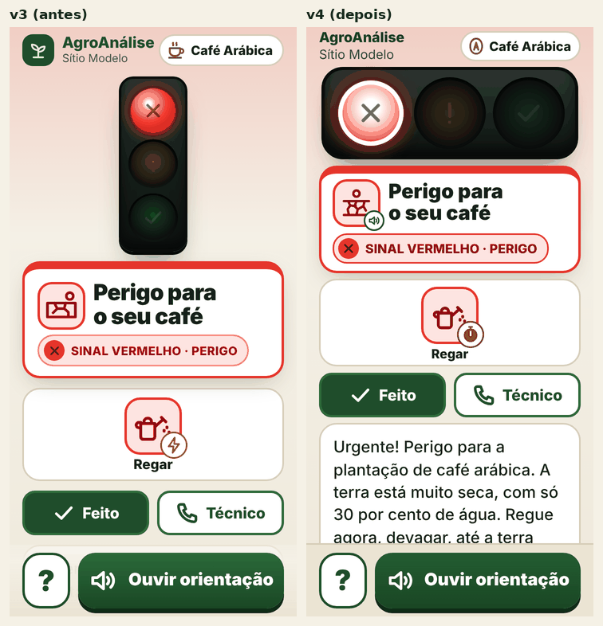
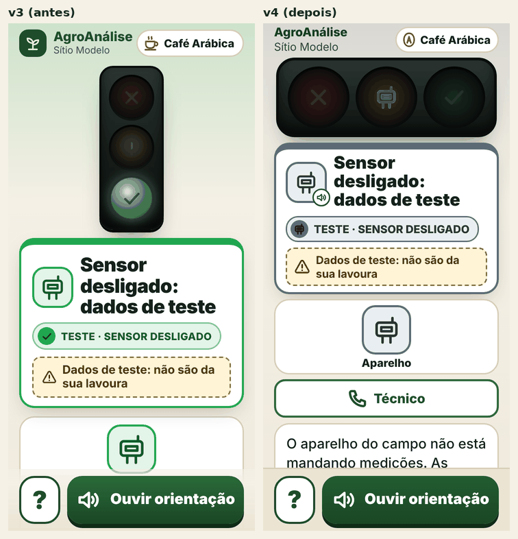

# AgroAnálise — Companheiro Virtual do Agricultor

Sistema IoT com Inteligência Artificial que acompanha o **microclima** (temperatura e umidade do ar) e a **umidade do solo** da lavoura e devolve a informação ao agricultor familiar **só como um semáforo** (Verde, Amarelo, Vermelho), uma **orientação falada** em português simples e até **3 pictogramas do que fazer** — sem gráficos, sem números obrigatórios, sem jargão. Na versão 2 ele também **antecipa** o estresse hídrico e térmico: avisa em Amarelo, com o motivo e o prazo falados ("a terra deve ficar seca amanhã de manhã"), antes de a lavoura entrar no Vermelho. Na versão 3 a faixa de temperatura do cliente passa a valer sobre a **média de 24 h** (o Vermelho térmico fica para a **geada** e o **calor que aborta flores**), a IA é medida em **dado climático real**, e a tela mostra a **causa**, aceita um "**Feito**" de um toque e chama o **técnico** pelo WhatsApp. Na versão 4 a tela passa a **dizer a verdade em todo estado** (dado de teste e demonstração deixam o semáforo apagado; notícia antiga é marcada pela forma), a voz diz **primeiro o que fazer** em até 15 palavras, e uma suíte permanente de validação de UX trava regressões ([avaliação de UX](docs/AVALIACAO_UX.md)).

O MVP vem calibrado para a cafeicultura (**Café Arábica** e **Café Conilon**), mas o banco, o pipeline de dados, o simulador e o coletor recebem **qualquer cultura nova sem mudar código** (veja [Como cadastrar uma nova cultura](#como-cadastrar-uma-nova-cultura)).

| Status | Cor | Significado |
|---|---|---|
| 0 | Verde (Ideal) | Tudo bem, nada a fazer agora |
| 1 | Amarelo (Atenção) | Condição saindo do ideal, ou risco previsto para as próximas 12 h: agir hoje |
| 2 | Vermelho (Risco Crítico) | Perigo para a safra: agir já (com "Urgente!" se passar do limite de dano severo) |

---

## Sumário

1. [Novidades da v4](#novidades-da-v4), [da v3](#novidades-da-v3) e [da v2](#novidades-da-v2) · [Avaliação de UX da v4](docs/AVALIACAO_UX.md) · [Protocolo de teste com agricultores](docs/PROTOCOLO_TESTE_USUARIOS.md) · [Pesquisa e referências](docs/PESQUISA_REFERENCIAS.md)
2. [Arquitetura em camadas](#arquitetura-em-camadas)
3. [Estrutura de pastas](#estrutura-de-pastas)
4. [Montagem do hardware e firmware](#montagem-do-hardware-e-firmware)
5. [Instalação](#instalação)
6. [Ordem de execução](#ordem-de-execução)
7. [Operação 24/7 (serviço)](#operação-247-serviço)
8. [Modos operantes](#modos-operantes)
9. [O que o agricultor vê e ouve](#o-que-o-agricultor-vê-e-ouve)
10. [API do servidor](#api-do-servidor)
11. [Como cadastrar uma nova cultura](#como-cadastrar-uma-nova-cultura)
12. [Como rodar os testes](#como-rodar-os-testes)
13. [Resultados de referência](#resultados-de-referência)
14. [Documentação de arquitetura](#documentação-de-arquitetura)
15. [Limitações conhecidas](#limitações-conhecidas)
16. [Solução de problemas](#solução-de-problemas)

---

## Novidades da v4

Versão de **UX de campo** para quem lê pouco ou nada. Método, achados, números antes × depois e capturas em
**[docs/AVALIACAO_UX.md](docs/AVALIACAO_UX.md)**; como testar com agricultores reais em
**[docs/PROTOCOLO_TESTE_USUARIOS.md](docs/PROTOCOLO_TESTE_USUARIOS.md)**; fontes na
[seção 11 da pesquisa](docs/PESQUISA_REFERENCIAS.md#11-ux-de-campo-da-v4-referências-novas); testes alterados em
[CHANGELOG.md](CHANGELOG.md#400--2026-11-15). Regras agronômicas, limiares e números do cliente **não mudaram**
(status de toda a grade idêntico ao da v3); a saída continua só semáforo + voz + pictogramas e a página do agricultor
continua 100 % offline.

- **A tela diz a verdade em todo estado:** dado de teste (simulação) e demonstração vista fora da banca deixam o
  semáforo **apagado** ("Dados de teste: não são da sua lavoura"), sem vibração, sem repetição falada e sem alarme na
  estação; notícia antiga ou sem ligação é marcada pela **forma** (borda tracejada + relógio), não só pela cor; erro do
  programa (5xx) diz "Programa com problema", nunca "Sem ligação".
- **Semáforo grande e estável:** sempre deitado no celular em pé, lâmpada ≥ 72 px, legível em cores forçadas, no
  escurecimento automático do Chrome (`color-scheme: only light`) e com ofuscamento de sol (razão acesa ÷ apagada ≥ 4,7).
- **Nada escondido:** "Feito", "Técnico" e as ações ficam acima da barra de voz em 5 tamanhos de celular, com fonte do
  sistema ampliada (texto em `rem`, `meta text-scale`) e foco pelo teclado nunca coberto; todo alvo ≥ 48 px.
- **Voz que diz primeiro o que fazer:** o 1º toque fala a `fala_curta` (≤ 15 palavras, sem números, ação na 2ª frase:
  "Sinal vermelho. Regue agora. A terra está seca."); o 2º toque fala a mensagem completa; a repetição sai mais
  devagar e a preferência é lembrada. "1 grau", "menos 2 graus", "tenha geada" e uma ordem de rega por fala.
- **Retorno sempre falado e seguro:** avisos e diálogos falados; "Feito" vira **Desfazer** por 15 s (servidor aceita
  até 120 s) e não duplica; diálogo modal nativo; PIN errado com mensagem própria e contagem.
- **Página do técnico no mesmo padrão** e com o **Calendário do café** (seca programada e florada, com a consequência
  dita e confirmação), que saiu da banca.
- **Peso:** CSS crítico inline + `/static/agro.<hash>.css` com cache imutável: `GET /` ≤ 15.000 B gzip no pior caso.
- **Suíte permanente de validação UX:** `scripts/validar_ux.sh` mede 70 metas (axe-core, Lighthouse, contraste próprio,
  oclusão, pixels das lâmpadas com daltonismo/sol/cores forçadas, regiões vivas, bytes, coerência
  cor × chip × voz × pictograma × causa, legibilidade) contra `tests/e2e/validacao/metas_v4.json`. A v4 atende 70/70;
  a v3, medida pelo mesmo método, 19/70.
- **O que ainda depende de pessoas:** a compreensão dos pictogramas (teste ISO 9186-1 com N ≥ 50 por símbolo), o
  momento da rega na geada (extensionista) e TalkBack, sol real e celular de entrada em aparelho.

| Vermelho de seca (v3 à esquerda, v4 à direita) | Sensor desligado, dados de teste (v3 à esquerda, v4 à direita) |
|---|---|
|  |  |

Na v3 a lâmpada verde de teste ficava acesa com o sensor desligado; na v4 o semáforo fica apagado.

### Como rodar a suíte de UX

Pré-requisitos: Node.js 22.19 ou mais novo (exigência do Lighthouse 13; testado com 22.23) e o Chromium do Playwright. Na raiz:

```bash
npm install                                  # playwright, axe-core e lighthouse nas versões fixas do package.json
npx playwright install chromium              # se o Chromium ainda não estiver instalado
python src/database.py && python src/gerador_dataset.py && python src/treinamento_ia.py
scripts/rodar_testes_ux.sh                   # unitários da interface + e2e (v3 e v4) + suíte de metas
AGRO_UX_ESTRITO=1 scripts/validar_ux.sh      # só as 70 metas; ferramenta ausente vira falha
```

| Variável | Para que serve |
|---|---|
| `AGRO_UX_PORTA` | porta do servidor de estados da suíte (padrão 5210; a 5000, do sítio, é recusada) |
| `AGRO_AXE`, `AGRO_LIGHTHOUSE`, `CHROME_PATH` | caminhos do `axe.min.js`, do executável do Lighthouse e do Chromium, quando não vêm do `npm install` |
| `AGRO_UX_ESTRITO=1` | axe-core ou Lighthouse ausente vira falha (sem isso, a suíte avisa "PULADO" e segue) |

Opções úteis de `scripts/validar_ux.sh`: `--grupos grade,foco` (só alguns grupos), `--projeto <pasta> --linha-de-base`
(mede outra cópia, por exemplo a v3) e `--saida <pasta>`. O relatório fica em `reports/ux4/<data>/resultado.json`, com
as capturas das metas que falharam. A suíte usa um banco temporário: não toca em `data/agroanalise.db`.

## Novidades da v3

Por que cada mudança foi feita, com as fontes (52 referências com URL, o que cada uma diz e o que mudou por causa dela), a decisão sobre as regras agronômicas, as ideias descartadas e os próximos passos de pesquisa: **[docs/PESQUISA_REFERENCIAS.md](docs/PESQUISA_REFERENCIAS.md)**. Detalhes técnicos e números em [CHANGELOG.md](CHANGELOG.md#300--2026-11-15) e em [docs/DICIONARIO_DADOS.md](docs/DICIONARIO_DADOS.md#20-mudanças-da-v3).

- **Regra térmica fisiológica** (`src/regras_agronomicas.py`, chave `regra_temperatura`): os números do cliente continuam cadastrados como a faixa ideal, mas 18–22 °C (Arábica) e 22–26 °C (Conilon) são critérios de **temperatura média** do zoneamento; por isso a faixa vale sobre a média de 24 h e dá no máximo **Amarelo** ("O dia está frio para o café. Não precisa fazer nada agora."). **Vermelho** térmico só com **geada** (abrigo ≤ 2 °C + incerteza do sensor: ≤ 4 °C no DHT11) ou **calor ≥ 34 °C** na florada / em 2 dias seguidos. Em dado real (ERA5-Land, Varginha 2018–2021) o Vermelho do Arábica cai de 27,6 % para 0,1 % das horas e as trocas de cor de 1.842 para 119 por ano. A chave ausente mantém a regra da v2; o coletor liga a nova ao iniciar.
- **Banda morta + off-delay** no status gravado (fim do pisca-pisca na borda), **janela de florada** ("O café floriu hoje" na banca; na v4, no Calendário do café de `/tecnico`) e **seca programada** opcional.
- **Sensor de ar com perfil** (DHT11/DHT22 informados pelo firmware), **sonda alimentada só na medida** (contra a corrosão) e **calibração da sonda no host** (dois pontos ou aferição de 1 ponto no campo, na página do técnico).
- **IA validada em dado real:** seção 7 do relatório com ERA5-Land offline, prognóstico retreinado com o rótulo fisiológico, aviso de geada com coeficientes por região (erro da mínima 3,30 → 1,02 °C) e **portão local** que suspende a antecipação pelo modelo se ela não vencer a climatologia no próprio sítio. Certeza falada em dois níveis ("É quase certo que…" / "Pode ser que…").
- **Interface:** desenho da **causa** ao lado do título, pictogramas que falam ao toque, botão "?", **"Feito"** de um toque (pausa a repetição do Vermelho), **alarme sonoro na estação base** (`agroanalise-alarme`), **página do técnico** (`/tecnico`) e "Chamar o técnico" por WhatsApp — o servidor continua 100 % offline.
- **Instalação do sensor:** o DHT fica **em abrigo ventilado a 1,5 m do chão** (o limiar de geada é de temperatura do abrigo).
- **O que não mudou:** a faixa do cliente cadastrada (nenhuma linha de `parametros_cultura`), a saída só por semáforo + voz + pictogramas, os 6 módulos nos mesmos caminhos, o funcionamento 100 % offline e os 179 testes antigos (3 ajustados com justificativa no CHANGELOG). Agora são 331 testes.

## Novidades da v2

Detalhes, motivação e números em [CHANGELOG.md](CHANGELOG.md).

**Antecipação de estresse (o requisito que a v1 não cumpria)**
- **IA de prognóstico de 12 h** (`src/prognostico.py`, `models/modelo_prognostico.pkl`): RandomForest calibrado sobre 36 features de tendência (últimas 24 h de campo) que estima a chance de a lavoura entrar no Vermelho nas próximas 12 h. Só leva de **Verde para Amarelo** — nunca cria um Vermelho, nunca rebaixa uma cor.
- **Quando a terra seca:** estimativa da hora em que o solo chega à borda de atenção, falada sem números ("hoje à tarde", "amanhã de manhã").
- **Geada ainda à tarde:** entre 17 h e 19 h, a mínima da madrugada é prevista pelo ponto de orvalho; a voz diz "Esta noite pode gear. Antes de escurecer, cubra as mudas novas e chegue terra no pé das plantas."
- **Simulador climático realista** (ano de 8.760 h no hemisfério sul: estações, chuva por mês, veranico, geada radiativa, escaldadura) e **avaliação honesta** em 6 seções com rótulo de escopo (fidelidade à regra × generalização temporal × ruído × antecipação × calibração × geada).

**Confiabilidade do campo 24/7**
- **Sensor solto não vira "Urgente, regue":** mediana móvel de 12 leituras antes da regra (perigo crítico passa direto) e diagnóstico de sensor solto, travado ou impossível; sensor suspeito dá no máximo Amarelo e a voz pede para conferir o espeto.
- **Protocolo serial v2** com checksum (`$2,21.0,65.0,72.4*XX`), linha com `nan` quando o DHT11 falha (o solo continua medido), watchdog de 8 s no Arduino, descarte da 1ª linha cortada.
- **Nada se perde:** fila de 720 leituras se o banco travar, batimento do coletor, relógio à prova de saltos (`instante_utc`, ordem por `id_leitura`), vigia de disco.
- **Histórico controlado:** retenção com médias por hora depois de 30 dias, backup seguro com o coletor gravando, compactação.
- **Serviço:** servidor `waitress`, logs rotativos, units systemd com reinício automático, instalador e inicializador para Windows.

**Interface do agricultor**
- **Pictogramas de ação** (regar agora, regar no fim da tarde, não regar, abrir valetas, fazer sombra, cobrir mudas, chegar terra...) na primeira tela, sem rolar, a 360×640.
- **Proteção contra toques acidentais:** painel da banca recolhido, PIN opcional, troca de cultura com confirmação Sim/Não e aviso a todos os aparelhos.
- **Voz que não falha calada:** sem voz em português, bipes por cor (1, 2 ou 3) e aviso visual; o Vermelho se repete a cada 10 min.
- **Rede fraca:** gzip, estado embutido na página, consulta econômica e "Última notícia de hoje às HH:MM — sem ligação agora" quando a rede cai.
- **Status e saúde honestos:** "Relógio do aparelho errado", "O programa do computador parou", "Confira o aparelho"; `/api/saude` por componente com 503.

O que **não** mudou: as faixas agronômicas (Arábica 18–22 °C / solo 60–80 %; Conilon 22–26 °C / solo 55–75 %), o motor de regras, a IA do instante (mesmo pacote `.pkl`), os 6 módulos e seus caminhos, e os 57 testes da v1 (arquivo intacto).

## Arquitetura em camadas

```
(1) Hardware IoT          Arduino + DHT11 (D2) + higrômetro (A0, média móvel N=10), watchdog 8 s
        │  USB/serial 9600 bps — "$2,21.0,65.0,72.4*XX" a cada 2 s (v1 "21.0,65.0,72.4" aceito); diagnósticos com '#'
        ▼
(2) Ingestão / Dados      coletor_serial.py: checksum → SaneadorTempoReal (NaN, faixa física, salto, queda física)
                          → qualidade_sensores.py (mediana de 12, diagnóstico OK/SUSPEITO/DEFEITO)
                          → features deficit_hidrico_solo e desvio_termico
        ▼
(3) IA / Persistência     motor de regras + IA do instante (modelo_agroanalise.pkl): status = max(regra, IA)
                          + prognostico.py (modelo_prognostico.pkl, ETA de secagem, geada): Verde → Amarelo
                          → SQLite3 WAL (historico_leituras + analise_antecipacao + agregado por hora)
        ▼
(4) Frontend Flask        app.py (+ acoes_orientacao.py, seguranca_banca.py) + index.html:
                          semáforo, pictogramas, voz pt-BR ou bipes, banca protegida; servidor.py (waitress)
```

Pipeline de treinamento (offline): `gerador_dataset.py` simula um ano (8.760 h) por cultura, injeta 3 % de ruído, detecta e interpola as anomalias e calcula features e rótulo; `treinamento_ia.py` treina a **IA do instante** (RandomForest × Regressão Logística, como na v1) e a **IA de prognóstico** (RandomForest calibrado com divisão temporal), escreve o relatório em 6 seções e salva os dois `.pkl`.

## Estrutura de pastas

```
agroanalise/
├── arduino/coleta_sensores.ino     firmware (DHT11 + higrômetro, protocolo v2 com checksum, watchdog)
├── src/
│   ├── database.py                 esquema SQLite, migração, gravação em lote, retenção, backup (CLI)
│   ├── gerador_dataset.py          regras, simulador climático realista, ruído, saneamento, cenários
│   ├── treinamento_ia.py           IA do instante + IA de prognóstico, avaliação honesta, .pkl
│   ├── prognostico.py              antecipação de 12 h, ETA de secagem, geada, frases (novo)
│   ├── qualidade_sensores.py       mediana móvel e diagnóstico de sensores (novo)
│   ├── coletor_serial.py           motor de coleta 24/7 (serial v2, fila, batimento, vigias)
│   ├── acoes_orientacao.py         códigos de ação → pictogramas; causa visível (v3)
│   ├── regras_agronomicas.py       regra térmica fisiológica, banda morta, florada, perfis de sensor (v3)
│   ├── referencia_climatica.py     leitura do ERA5-Land offline, climatologia (v3)
│   ├── desempenho_local.py         portão local do prognóstico: Brier, Page-Hinkley, Platt (v3)
│   ├── retorno_agricultor.py       "Feito", eventos da tela, pedidos de ajuda, resumo do técnico (v3)
│   ├── alarme_local.py             alarme sonoro na estação base (v3)
│   ├── calibracao_sonda.py         calibração da sonda de solo no host (v3)
│   ├── seguranca_banca.py          PIN da banca (PBKDF2) e limitador de tentativas (novo)
│   ├── app.py                      servidor Flask (API JSON + página)
│   ├── servidor.py                 servidor de produção waitress (novo)
│   ├── registro.py                 logs rotativos (novo)
│   └── templates/                  index.html (Companheiro Virtual, sem CDN) e tecnico.html (v3)
├── deploy/                         units systemd, instalar.sh, iniciar_windows.bat (novo)
├── scripts/                        rodar_testes_ux.sh, medir_impacto_regra.py e baixar_referencia_era5land.py (v3)
├── referencia_climatica/           ERA5-Land 2018–2021 de 2 regiões (CC BY 4.0, offline) (v3)
├── data/      agroanalise.db, dataset_bruto.csv, dataset_limpo.csv                 (gerados)
├── models/    modelo_agroanalise.pkl, modelo_prognostico.pkl, complemento_prognostico.json (gerados)
├── reports/   relatorio_treinamento.txt, matriz_confusao.png,
│              curva_confiabilidade.png, realismo_simulador.txt, ux/*.png           (gerados)
├── logs/      coletor.log, web.log (rotativos)                                      (gerados)
├── docs/      WORKFLOW.md, DICIONARIO_DADOS.md, MAPEAMENTO_FUNCOES.md, PESQUISA_REFERENCIAS.md (v3), diagramas/ (.mmd + .svg)
├── tests/     test_agroanalise.py (v1), test_antecipacao_ia.py, test_confiabilidade_campo.py,
│              test_interface_campo.py, test_regras_fisiologicas.py, test_ia_dado_real.py,
│              test_interface_retorno.py, test_integracao_v3.py, e2e/ux_campo.spec.js, stubs_arduino/
├── CHANGELOG.md
├── requirements.txt
├── requirements-referencia.txt    opcional: só para baixar de novo a referência climática (v3)
└── README.md
```

## Montagem do hardware e firmware

Material: Arduino Uno ou Nano (5 V), sensor **DHT11**, **higrômetro de solo** resistivo (sonda em garfo + módulo com saída A0), resistor de **10 kΩ** (se o DHT11 não vier em plaquinha), jumpers e cabo USB.

| Componente | Pino do componente | Ligar no Arduino |
|---|---|---|
| DHT11 | VCC | 5V |
| DHT11 | DATA | **D2** (com resistor de pull-up de 10 kΩ entre DATA e VCC) |
| DHT11 | GND | GND |
| Higrômetro (módulo) | VCC | 5V (ou um pino digital — veja a melhoria abaixo) |
| Higrômetro (módulo) | GND | GND |
| Higrômetro (módulo) | **A0** | **A0** |
| Higrômetro (módulo) | D0 | não ligar |

- Módulos DHT11 de 3 pinos em plaquinha normalmente **já trazem** o pull-up de 10 kΩ.
- Proteja o DHT11 do sol direto e da chuva: **abrigo ventilado a 1,5 m do chão** (v3 — o limiar de geada de 2 °C é de temperatura do abrigo, como na estação meteorológica). Enterre a sonda do solo na zona das raízes.
- **v3:** `#define AGRO_SENSOR_AR AGRO_AR_DHT22` troca o DHT11 pelo DHT22 (mesmo pino D2; mede abaixo de 0 °C, ±0,5 °C); `#define AGRO_PINO_ALIMENTACAO_SOLO 7` alimenta a sonda pelo pino 7 só durante a medida. O firmware informa o perfil numa linha `#AGROANALISE_PERFIL;...` logo depois do banner, e o coletor ajusta o limiar de geada e os limites físicos.
- **Melhoria recomendada (eletrólise):** alimentar o higrômetro por um pino digital ligado só durante a leitura reduz a corrosão; um sensor **capacitivo** praticamente elimina o problema.
- **Calibração da sonda (v3, sem regravar o Arduino):** na página do técnico (`/tecnico`, com PIN), use o assistente de **dois pontos** (sonda seca e sonda na terra encharcada) ou a **aferição de 1 ponto no campo** (terra no ponto, 24–48 h depois de uma rega forte). O host converte a leitura e guarda o valor do firmware em `umidade_solo_firmware`. As constantes `ADC_SOLO_SECO` (~1023) e `ADC_SOLO_ENCHARCADO` (~300) do `.ino` continuam como padrão de fábrica. Calibração feita só no laboratório erra muito no campo ([P2](docs/PESQUISA_REFERENCIAS.md#p2)).

Gravação do firmware: Arduino IDE → *Gerenciar Bibliotecas* → instale **"DHT sensor library" (Adafruit)** e **"Adafruit Unified Sensor"** → abra `arduino/coleta_sensores.ino` → escolha a placa e a porta → *Carregar*. No Monitor Serial (9600 bps) deve aparecer `#AGROANALISE_PRONTO;PROTOCOLO=2` e, a cada 2 s, uma linha como `$2,21.0,65.0,72.4*XX` (o `XX` é o checksum). Se o DHT11 falhar, a linha sai como `$2,nan,nan,72.4*XX`. O LED pisca a cada envio; o **watchdog** reinicia a placa sozinho se o programa travar por 8 s (desligue com `#define AGRO_USAR_WATCHDOG 0` se a sua placa tiver bootloader antigo que não suporta watchdog).

Mensagens de diagnóstico do firmware: `#ERRO:DHT11_LEITURA_INVALIDA`, `#AVISO:DHT11_REINICIADO`, `#AVISO:HIGROMETRO_CURTO_CIRCUITO`, `#AVISO:HIGROMETRO_DESCONECTADO` (vira sensor da terra em `DEFEITO` por 2 min), `#AVISO:HIGROMETRO_FORA_DA_FAIXA`.

Sem placa, a sintaxe é conferida com `g++ -fsyntax-only -x c++ -I tests/stubs_arduino arduino/coleta_sensores.ino` (com e sem `-D__AVR__`). Uma placa com firmware da v1 continua funcionando (o coletor aceita o protocolo 1), a menos que a configuração `exigir_protocolo_v2` seja ligada.

## Instalação

Requisitos: Python 3.13 (testado), pip. Para os testes de interface no navegador: Node.js com o pacote `playwright` (opcional).

```bash
cd agroanalise
python -m venv .venv
source .venv/bin/activate          # Windows: .venv\Scripts\activate
pip install -r requirements.txt    # pandas, numpy, scikit-learn, matplotlib, joblib, flask, pyserial, waitress
```

No Linux, dê ao usuário acesso à porta USB do Arduino: `sudo usermod -aG dialout $USER` (saia e entre de novo na sessão). Para a instalação como serviço, veja [Operação 24/7](#operação-247-serviço).

## Ordem de execução

Todos os comandos são rodados **a partir da raiz do projeto**:

```bash
python src/database.py            # 1. cria/migra data/agroanalise.db (culturas, faixas, configurações da v1–v3)
python src/gerador_dataset.py     # 2. data/dataset_*.csv (17.520 linhas) + reports/realismo_simulador.txt
python src/treinamento_ia.py      # 3. as duas IAs: models/*.pkl + reports/ (≈ 25 s)
python src/coletor_serial.py      # 4. motor de coleta 24/7 (deixe rodando; Ctrl+C encerra limpo)
python src/servidor.py            # 5. em outro terminal: http://<ip-do-computador>:5000 no celular
python src/alarme_local.py        # 6. (v3, opcional) alarme sonoro na estação base
python src/desempenho_local.py    # 7. (v3) portão local do prognóstico; o serviço roda de hora em hora
```

`python src/app.py` continua funcionando (servidor de desenvolvimento do Flask); `src/servidor.py` usa o `waitress`, próprio para ficar meses ligado. Os dois aceitam `AGRO_HOST`, `AGRO_PORTA` e `AGRO_BANCO` (o `servidor.py` também `--host`, `--porta`, `--banco`).

Os passos 1 a 3 só precisam ser repetidos quando as faixas mudarem ou uma cultura nova for cadastrada. Sem os `.pkl`, o sistema funciona só com o motor de regras (`versao_modelo = "REGRAS"`) e a antecipação continua com a estimativa de secagem e o aviso de geada; os modelos passam a ser usados automaticamente quando os arquivos aparecem.

Opções do coletor:

| Opção | Efeito |
|---|---|
| `--porta /dev/ttyUSB0` | porta do Arduino (padrão: configuração `porta_serial`; `AUTO` = autodetecção) |
| `--simular` | força o Modo Simulação (não abre a serial) |
| `--intervalo 5` | segundos entre leituras gravadas (padrão: `intervalo_coleta_segundos`) |
| `--max-iteracoes N` | para depois de N ciclos (útil para testes) |
| `--cultura cafe_conilon` | define a cultura monitorada antes de iniciar |
| `--banco caminho.db` | usa outro arquivo de banco |
| `--verboso` | uma linha de log por leitura (sem ele, um resumo a cada 5 min) |

Exemplo rápido sem hardware: `python src/coletor_serial.py --simular --max-iteracoes 5 --intervalo 0.2`.

Manutenção do banco:

```bash
python src/database.py --backup /caminho/backup.db   # cópia consistente, mesmo com o coletor gravando
python src/database.py --reter 30                    # agrega por hora e apaga as leituras brutas com mais de 30 dias
python src/database.py --compactar                   # VACUUM manual (devolve o espaço ao disco)
python src/seguranca_banca.py --definir-pin 1234     # exige PIN para a banca e a troca de cultura
python src/seguranca_banca.py --remover-pin          # volta ao painel livre
```

## Operação 24/7 (serviço)

**Linux (systemd):**

```bash
sudo bash deploy/instalar.sh
```

O instalador é idempotente: copia o projeto para `/opt/agroanalise` (troque com `AGRO_DESTINO`), cria o ambiente virtual e o usuário de serviço `agroanalise` (no grupo `dialout`), instala as dependências, gera banco, dataset e modelos se ainda não existirem, instala todas as unidades `deploy/agroanalise-*.service` e `*.timer` — `agroanalise-coletor`, `agroanalise-web` e, na v3, `agroanalise-alarme` (`Restart=always`, reinício em 5 s, sem limite de tentativas) e o par `agroanalise-desempenho.service`/`.timer` (portão local de hora em hora, `Persistent=true`; o serviço com timer de mesmo nome só é disparado pelo timer) —, faz `systemctl enable --now` e liga o NTP (`timedatectl set-ntp true`). Acompanhe com:

```bash
systemctl status agroanalise-coletor agroanalise-web agroanalise-alarme agroanalise-desempenho.timer
journalctl -u agroanalise-coletor -f
curl -s http://localhost:5000/api/saude
```

Logs também em `logs/coletor.log` e `logs/web.log` (5 arquivos de 5 MB no máximo, cada). O coletor aplica a retenção de hora em hora (30 dias de leituras brutas; `retencao_dias_brutos`) e uma retenção de emergência de 7 dias se o disco ficar abaixo de 200 MB (`espaco_minimo_mb`). Recomenda-se um backup diário com `--backup` (ex.: via `cron`).

**Windows:** `deploy\iniciar_windows.bat` cria o ambiente na 1ª vez e abre duas janelas (coletor e servidor) que se reiniciam sozinhas em 5 s se caírem. Para iniciar com o Windows, ponha um atalho dele em `shell:startup`.

## Modos operantes

```
CAMPO_USB ──(porta falhou / 3 ciclos sem linha de dados aproveitável)──► SIMULACAO
SIMULACAO ──(a cada intervalo_reconexao_segundos tenta abrir a porta; conseguiu)──► CAMPO_USB
qualquer  ──(app grava modo_operacao=DEMONSTRACAO com expiração futura)──► DEMONSTRACAO
DEMONSTRACAO ──(expirou ou "Voltar ao normal")──► CAMPO_USB se o Arduino estiver conectado, senão SIMULACAO
```

- **Campo USB:** leituras reais do Arduino. Cada leitura passa pelo checksum, pelo saneador (NaN, faixa física, salto; no campo, também a queda física máxima do solo), pela mediana de 12 leituras e pelo diagnóstico dos sensores. Só aqui a **antecipação** é aplicada (com pelo menos 18 das últimas 24 h de dados de campo). Ao (re)conectar, a 1ª linha é descartada e o saneador parte da última leitura de campo com menos de 10 min.
- **Simulação (fallback automático):** se o cabo sair ou a placa parar de mandar dados (inclusive se ela só mandar `#ERRO`), o coletor grava leituras sintéticas e segue tentando reconectar. A tela e a voz **não** transformam essas leituras em orientação: na v4 o semáforo fica apagado com "Dados de teste: não são da sua lavoura", pictograma "Aparelho", sem vibração, sem repetição falada e sem o alarme da estação base.
- **Demonstração (banca):** na Área da banca (`?banca=1` ou toque longo de 2 s no rótulo "Área da banca"), os botões "Simular Seca Extrema", "Onda de Calor", "Geada", "Encharcamento", "Atenção Moderada" e "Condição Ideal" injetam na hora uma leitura calculada pelas faixas da cultura. Dura 120 s; "Voltar ao normal" encerra antes. Com PIN definido, a página pede a senha.

Troca de cultura e troca de `.pkl` são percebidas pelo coletor **sem reiniciar**.

## O que o agricultor vê e ouve

- **Primeira tela, sem rolar:** semáforo → título ("Atenção com o seu café") → 1 a 3 pictogramas grandes com legenda de uma palavra (ex.: regador com sol poente = "Tardinha"). Detalhes numéricos ficam recolhidos.
- **Voz:** botão grande de voz; depois do primeiro toque, anuncia sozinha quando a situação muda. Sem voz em português no celular: aviso grande e bipes (1 longo grave = verde, 2 = amarelo, 3 agudos = vermelho). No Vermelho, repete a cada 10 min (`intervalo_repeticao_alerta_segundos`) com vibração.
- **Antecipação:** "Ainda está tudo bem, mas a terra está secando e deve ficar seca amanhã de manhã. Regue hoje no fim da tarde." · "Esta noite pode gear. Antes de escurecer, cubra as mudas novas e chegue terra no pé das plantas."
- **Avisos honestos (sempre Amarelo):** "Sem medições novas", "Relógio do aparelho errado", "O programa do computador parou. Desligue e ligue o computador. A última cor pode não valer mais.", "Confira o aparelho" (sensor solto/travado: "O sensor da terra parece solto ou quebrado. Confira o espeto na terra. Não regue só por causa deste aviso: olhe a terra com a mão.").
- **Rede caiu:** a última cor fica esmaecida com "Última notícia de hoje às HH:MM — sem ligação agora"; nunca é mostrada como atual.
- **v3 — causa e retorno:** ao lado do título aparece o desenho da **causa** (terra seca, encharcado, frio, calor, aparelho), que fala uma dica ao toque ("Aperte a terra na mão: se esfarelar, está seca."); cada pictograma fala o que pede; o botão **?** explica a tela; **Feito** registra o que o agricultor fez ("Anotado: você regou às 17 horas.") e pausa a repetição do Vermelho daquela causa por 60 min; **Chamar o técnico** abre o WhatsApp do celular com o resumo. Na estação base, o **alarme local** bipa na passagem para Vermelho e no aviso de geada da tarde.
- **v3 — frio e calor:** um dia frio sem geada é Amarelo ("O dia está frio para o café. Não precisa fazer nada agora."); Vermelho de temperatura só com **geada** ("Está gelando agora. Cubra as mudas…") ou **calor forte na florada** ("Regue no fim da tarde e faça sombra nas mudas.").
- **Troca de cultura:** diálogo "O aparelho vai cuidar do Café Conilon. Confirmar?" com Sim/Não; os outros celulares veem "A plantação foi trocada para … às HH:MM".

## API do servidor

| Método e rota | Descrição |
|---|---|
| `GET /` | página do Companheiro Virtual, já com o estado atual embutido (`<script id="estado-inicial">`) |
| `GET /api/status` | estado exibido: 53 campos (`status_alerta`, `cor`, `titulo`, `mensagem_voz`, `fala_curta` (v4), `acoes`, `motivo_principal`, `prazo_horas`, `antecipacao`, `estado_sensor`, `relogio_inconsistente`, `coletor_vivo`...) |
| `GET /api/historico?limite=24` | últimas leituras em ordem de gravação (limite 1 a 500; filtro opcional `cultura=`) |
| `GET /api/culturas` | culturas ativas e a cultura monitorada |
| `POST /api/cultura` | `{"codigo": "cafe_conilon"}` troca a cultura (grava também `cultura_anterior` e `cultura_alterada_em`) |
| `GET /api/cenarios` | cenários do Modo Demonstração |
| `POST /api/demonstracao` | `{"cenario": "SECA_EXTREMA"}` ativa a demonstração e grava a leitura na hora |
| `POST /api/demonstracao/encerrar` | volta ao modo normal |
| `GET /api/saude` | chaves da v1 + `componentes` (banco, coletor, disco, relógio, prognóstico, serial); **503** com banco fora, coletor parado ou disco abaixo do mínimo |
| `POST /api/acao_feita` | v3, sem PIN: `{"codigo_acao": "REGAR_AGORA", "causa": "TERRA_SECA"}` → 201 com a frase "Anotado: você regou às 14 horas." (10/min por IP; corpo ≤ 1 KB) |
| `POST /api/acao_feita/desfazer` | v4, sem PIN: `{"id_acao": 12}` → 200 `{"desfeito": true}` até 120 s depois do toque; 404 registro inexistente; 409 "Passou o tempo de desfazer." O "Feito" repetido (mesma causa, ação e leitura em 60 s) responde 200 com `repetido: true` e não grava de novo |
| `GET /static/agro.<hash>.css` | v4: CSS não crítico da página do agricultor, `Cache-Control: public, max-age=31536000, immutable` (outro hash → 404) |
| `POST /api/pedido_ajuda` | v3, sem PIN: grava o pedido e devolve o link `https://wa.me/<número>?text=…` (vazio sem número cadastrado; 3 a cada 10 min) |
| `POST /api/evento` | v3, sem PIN: evento da tela para o técnico (`ouviu`, `tocou_pictograma`, `ajuda`, `sem_voz`, `rede_caida`) |
| `GET /tecnico` · `GET /api/tecnico/resumo?dias=7` · `POST /api/tecnico/configuracao` | v3, com PIN: página e resumo do técnico (horas por cor e causa, avisos confirmados, ações, sensor, prognóstico, texto do WhatsApp) e cadastro do número |
| `POST /api/banca/florada` · `POST /api/banca/seca_programada` | v3, com PIN: "O café floriu hoje" (grava `data_florada_principal`) e liga/desliga a seca programada; na v4 chamadas pelo Calendário do café de `/tecnico` (mesmo contrato) |
| `GET /api/calibracao` · `POST /api/calibracao/{ponto,concluir,aferir,fabrica}` | v3, com PIN: calibração da sonda (dois pontos ou aferição de 1 ponto) |

Com PIN definido, os três `POST` exigem o cabeçalho `X-PIN-Banca` (403 "Peça a senha ao técnico."; 5 erros do mesmo IP → 429 por 1 min). Corpo acima de 4 KB → 413. Respostas acima de 1 KB vão em gzip quando o navegador aceita. Erros sempre em JSON simples. Contrato completo no [Dicionário de Dados](docs/DICIONARIO_DADOS.md#16-contrato-json-de-get-apistatus).

## Como cadastrar uma nova cultura

Uma cultura nova é **1 linha** em `culturas` + **N linhas** em `parametros_cultura` (formato longo: aceita até variáveis novas, como pH, sem `ALTER TABLE`). Use a função tipada `cadastrar_cultura`, que valida a ordem das faixas e grava tudo numa transação:

```python
# executar a partir da raiz do projeto: python cadastrar_tomate.py
import sys
sys.path.insert(0, "src")

from database import FaixaParametro, cadastrar_cultura

id_cultura = cadastrar_cultura(
    codigo="tomate",
    nome_comum="Tomate",
    nome_cientifico="Solanum lycopersicum",
    categoria="hortalica",          # cafe, fruta, grao, hortalica, leguminosa ou outra
    descricao="Tomate de mesa em campo aberto.",
    faixas=[
        #             variável          unid. ideal_min ideal_max atenção_min atenção_max crítico_min crítico_max
        FaixaParametro("temperatura_ar", "°C", 20.0, 26.0, 16.0, 30.0, 10.0, 35.0),
        FaixaParametro("umidade_ar",     "%",  60.0, 80.0, 50.0, 90.0, 40.0, 95.0),
        FaixaParametro("umidade_solo",   "%",  60.0, 80.0, 50.0, 88.0, 35.0, 95.0),
        FaixaParametro("ph_solo",        "pH",  6.0,  6.8,  5.5,  7.2,  5.0,  7.8),   # variável extra opcional
    ],
)
print("Cultura cadastrada com id", id_cultura)
```

Depois disso, **sem mudar nenhuma linha de código**: o botão da cultura aparece na tela; os cenários, as mensagens e os pictogramas usam as faixas dela; o simulador realista gera o ano dela; a estimativa de secagem e o aviso de geada já valem. **Até um novo treino**, a IA do instante não é aplicada a ela (`REGRAS`, porque três das cinco features são valores absolutos). A IA de prognóstico usa só features relativas às faixas e é aplicada também à cultura nova — por desenho, mas sem validação para culturas fora do treino. Para treinar as duas IAs com a cultura nova: `python src/gerador_dataset.py` e `python src/treinamento_ia.py`. `GET /api/saude` mostra em `culturas_modelo` quais culturas a IA do instante cobre.

## Como rodar os testes

```bash
python -m unittest discover -s tests -v    # 426 testes (≈ 130 s)
scripts/rodar_testes_ux.sh                 # interface + navegador (Node + Playwright) + suíte UX da v4
scripts/validar_ux.sh                      # só a suíte UX da v4 (70 metas; ≈ 10 min; código 0 = todas atendidas)
```

| Arquivo | Testes | O que cobre |
|---|---|---|
| `tests/test_agroanalise.py` | 57 | os testes da v1, **sem alteração**: regras, features, mensagens, cenários, saneamento, banco, pipeline em miniatura, coletor (Simulação, Demonstração, Arduino emulado em pty), rotas Flask, histerese |
| `tests/test_antecipacao_ia.py` | 48 | realismo do simulador, ponto de orvalho, ETA de secagem, `falar_prazo`, antecipação (nunca cria Vermelho), geada, persistência com CASCADE, divisão temporal, robustez, calibração |
| `tests/test_confiabilidade_campo.py` | 43 | mediana e diagnóstico de sensores, protocolo v2 e checksum, pty com fragmento e `nan`, firmware com `g++`, fila com banco travado, salto de relógio, batimento, disco, retenção e backup, logs rotativos, waitress, systemd |
| `tests/test_interface_campo.py` | 31 | pictogramas e propriedade "toda ação tem a palavra-chave na voz" (5.000 linhas), PIN, 413, troca de cultura, gzip, estado embutido, `/api/saude` por componente, relógio e coletor parado |
| `tests/test_regras_fisiologicas.py` | 55 | v3: regra fisiológica (geada ≤ 4 °C, média de 24 h, calor na florada e seguido), série de inverno, concordância vetorizado × tempo real, banda morta com 20 sementes, florada e seca programada, migração, firmware nas 3 combinações, banner DHT22 em pty, calibração no host |
| `tests/test_ia_dado_real.py` | 45 | v3: ERA5-Land (35.064 h por região), climatologia, rotulador fisiológico, complemento JSON, geada por região e cobertura conformal, portão local (Page-Hinkley, Brier, Platt, coeficientes locais), certeza falada |
| `tests/test_interface_retorno.py` | 45 | v3: causa coerente com a voz (5.000 leituras), página ≤ 16.000 B gzip, "Feito" (201/429/413/400), alarme local, página do técnico, WhatsApp, calibração da sonda e rotas com PIN |
| `tests/test_integracao_v3.py` | 8 | v3: costuras entre as frentes — figuras e causa seguem a voz nas duas regras, troca de cultura sem calibrar duas vezes, chaves do portão local, instalador sem rsync |
| `tests/test_conteudo_voz_v4.py` | 26 | v4: `fala_curta` em todo o espaço da auditoria (≤ 15 palavras, sem dígitos, ação até a 2ª frase, Flesch-PT ≥ 80), graus falados, "tenha geada", uma ordem de rega, voz → figura (o subjuntivo "que faça" não é ordem), status idêntico ao da v3 |
| `tests/test_retorno_v4.py` | 19 | v4: desfazer (120 s), "Feito" sem duplicata (60 s), demonstração fora do resumo do técnico, migração idempotente, PIN com código e contagem |
| `tests/test_pagina_v4.py` | 28 | v4: orçamento (`GET /` ≤ 15.000 B gzip, CSS imutável ≤ 6.144 B), meta tags, sem `font-size` em px, `fala_curta`, desfazer/PIN pela API, ícones por cultura, gabarito ISO 9186-1 |
| `tests/test_tecnico_v4.py` | 21 | v4: `/tecnico` com meta tags, tokens de cor iguais aos do agricultor, `rem` e variantes de texto ≥ 4,5:1 |
| `tests/e2e/agricultor_v4.spec.js` | ≈ 400 verificações | v4: oclusão em 5 celulares × 13 estados, confiança (neutro/antiga/503), robustez (cores forçadas, escurecimento, sol), texto a 130/150 %, voz, "Feito"/diálogo, pictogramas, rede lenta, axe-core |
| `tests/e2e/tecnico_v4.spec.js` | 34 verificações | v4: alvos ≥ 48 px, retorno junto do botão no assistente, Calendário do café com confirmação e PIN |
| `tests/e2e/ux_campo.spec.js` | 223 verificações | Chromium a 360×740 e 360×640: primeira tela sem rolar nos 6 cenários, botões ≥ 48 px, banca recolhida, confirmação de troca, voz/bipes, repetição do Vermelho, 2G, página oculta, offline |

Os testes usam bancos temporários (não tocam em `data/agroanalise.db`). Testes que dependem de `g++`, `systemd-analyze`, `bash` ou pty são pulados automaticamente quando a ferramenta não existe.

## Resultados de referência

Execução do zero com a semente 42 (14/11/2026). **Todas as métricas de prognóstico e de geada vêm do simulador climático, não do campo.**

**v3 (15/11/2026):** com o rótulo fisiológico, o prognóstico no simulador fica com AUC 0,872, Brier 0,034 e 2,2 h/semana de Amarelo antecipado falso (alvo de 7,2 % das horas, antes 31,4 %). Em **dado real** (ERA5-Land 2021, seção 7 do relatório) o falso Amarelo é 0,0 h/semana, mas a IA não vence a climatologia — o portão local decide no sítio. Aviso de geada em Varginha 2021: erro médio da mínima 1,02 °C (viés −0,01 °C). As linhas abaixo são da v2 (regra instantânea) e ficam como referência histórica.

- **Dataset:** 17.520 linhas (2 culturas × 8.760 h); ruído em 3,00 % das células de cada sensor; detector com recall 1,0000 e precisão 0,9993; classes Verde 26,4 % · Amarelo 42,2 % · Vermelho 31,4 %. Realismo (Arábica): 113 h abaixo do crítico, todas em mai.–ago. entre 0 h e 7 h; veranico de 16,7 dias em janeiro; chuva da seca = 15 % da chuva das águas.
- **IA do instante — fidelidade à regra (não é desempenho de campo):** RandomForest com accuracy, precision, recall e F1 = 1,0000 e FP = FN = 0 no teste aleatório e na validação cruzada. Significa que a IA **copia a regra do mesmo instante**; por isso existe a IA de prognóstico.
- **IA de prognóstico — teste temporal** (treino nov.–jul., teste jul.–out., intervalo de 12 h): AUC 0,919; Brier 0,094 (persistência 0,343); F1 macro 0,848 (persistência 0,595); **86,7 %** dos 90 inícios de Vermelho tiveram ≥ 3 h de aviso contínuo antes, com mediana de 10,5 h de antecedência e 7,8 h/semana de Amarelo antecipado falso (a regra pura "Amarelo vira Vermelho" daria 38,6 h/semana).
- **Geada:** 18 noites com mínima abaixo do crítico no teste, 100 % avisadas até as 19 h, 0 % de avisos sem frio, erro médio da mínima prevista 0,33 °C.
- **Robustez a ruído:** com σ = 0,5 °C / 1 p.p., a cor errada cai de 8,8 % (sem filtro) para 3,3 % (mediana de 12).

## Documentação de arquitetura

A governança do projeto fica em [`docs/`](docs/):

- [`docs/WORKFLOW.md`](docs/WORKFLOW.md) — fluxo passo a passo do dado (E1 a E15), MLOps das duas IAs, operação 24/7, governança, gates e riscos, com os diagramas embutidos;
- [`docs/PESQUISA_REFERENCIAS.md`](docs/PESQUISA_REFERENCIAS.md) — **novo na v3:** revisão de literatura por tema (agronomia, IoT, IA, UX/ICT4D), decisão sobre as regras agronômicas, análises em dado real, rastreabilidade mudança → fonte, ideias descartadas e próximos passos de pesquisa;
- [`docs/DICIONARIO_DADOS.md`](docs/DICIONARIO_DADOS.md) — esquema real do SQLite (10 tabelas da aplicação, conferidas por `PRAGMA`), configurações, CSVs, os dois `.pkl` e o complemento JSON, protocolo serial v2 com a linha de perfil e contratos JSON;
- [`docs/MAPEAMENTO_FUNCOES.md`](docs/MAPEAMENTO_FUNCOES.md) — 344 itens públicos em 17 módulos com as assinaturas copiadas do código por `ast`, grafo de dependências e conformidade com o contrato v1 e com as interfaces da v2, da v3 e da v4;
- [`docs/AVALIACAO_UX.md`](docs/AVALIACAO_UX.md) — **novo na v4:** método (ferramentas, personas, tarefas, heurísticas, normas), resultados antes × depois, 40 achados com status, matriz componente × estado, inventário de componentes, metas e capturas em [`docs/ux/`](docs/ux/);
- [`docs/PROTOCOLO_TESTE_USUARIOS.md`](docs/PROTOCOLO_TESTE_USUARIOS.md) — **novo na v4:** protocolo de teste com agricultores (recrutamento pela ATER, TCLE lido em voz alta, tarefas, métricas, compreensão de pictogramas pela ISO 9186-1, escala com rostos, roteiro do moderador);
- diagramas Mermaid em [`docs/diagramas/`](docs/diagramas/) (`.mmd` e `.svg`): [arquitetura](docs/diagramas/arquitetura_camadas.mmd), [DER](docs/diagramas/der.mmd), [sequência](docs/diagramas/sequencia.mmd) e [máquina de estados](docs/diagramas/maquina_estados.mmd);
- [`CHANGELOG.md`](CHANGELOG.md) — versões 1.0.0, 2.0.0, 3.0.0 e 4.0.0.

## Limitações conhecidas

- As IAs foram treinadas no simulador e, na v3, **avaliadas também em reanálise climática real** (ERA5-Land); ainda falta dado de campo do próprio sítio (o portão local cuida disso em operação) e rótulos de agrônomo.
- As regras fisiológicas da v3 vêm de literatura conferida, mas ainda precisam de validação com agrônomo da região e de piloto de campo ([próximos passos](docs/PESQUISA_REFERENCIAS.md#10-próximos-passos-de-pesquisa)).
- Não houve teste com Arduino físico, toolchain AVR nem instalação systemd real (só `g++ -fsyntax-only` com stubs, emulador em pty e `systemd-analyze verify`).
- v3: o inverno do Arábica deixou de ser Vermelho (regra fisiológica), mas ficou mais **Amarelo informativo** (jul.: 70 % das horas no ERA5-Land), que é a verdade agronômica sem pedir ação de emergência.
- v3: com o rótulo fisiológico a IA de prognóstico **não vence a climatologia em dado real** (Vermelho térmico real é raríssimo); o portão local a suspende no sítio até ela se provar. A antecipação útil vem da secagem do solo e da geada.
- v4: a UX foi validada só por ferramentas e emulação; a compreensão dos pictogramas e as tarefas com agricultores reais seguem o [protocolo](docs/PROTOCOLO_TESTE_USUARIOS.md). Recarregar a página sem rede continua deixando a tela em branco (sem Service Worker em `http://` da rede local). A página do agricultor está a ~20 B do orçamento de 15.000 B gzip.
- Lista completa e números em [CHANGELOG.md](CHANGELOG.md#limitações-conhecidas-da-400), [da 3.0.0](CHANGELOG.md#limitações-conhecidas-da-300) e [da 2.0.0](CHANGELOG.md#limitações-conhecidas-da-200).

## Solução de problemas

| Sintoma | O que fazer |
|---|---|
| Tela "Sensor desligado: dados de teste" com o Arduino ligado | Confira o cabo e a porta (`--porta`); no Linux, o grupo `dialout`; feche o Monitor Serial da IDE (ele ocupa a porta). Veja `componentes.serial` em `/api/saude`. |
| Tela "Confira o aparelho" / voz fala do "sensor da terra" | O espeto do higrômetro está solto, travado ou cravado em 0 %/100 %: confira na lavoura; olhe a terra com a mão antes de regar. |
| Voz fala do "sensor do ar" | DHT11 sem resposta há mais de 30 leituras: confira o pull-up de 10 kΩ e o fio no D2. |
| `serial_checksum_invalido` subindo em `/api/saude` | Ruído no cabo USB: use um cabo mais curto/blindado. |
| Tela "O programa parou" / `/api/saude` 503 com `coletor.vivo = false` | O coletor parou: `systemctl status agroanalise-coletor` (ou rode `python src/coletor_serial.py`). |
| Tela "Relógio do aparelho errado" | Acerte a data/hora do computador (`timedatectl set-ntp true`). |
| `/api/saude` 503 com `disco.ok = false` | Disco quase cheio: faça backup e rode `python src/database.py --reter 7` e `--compactar`. |
| Página pede senha na banca | Há PIN definido: peça ao técnico, ou `python src/seguranca_banca.py --remover-pin`. |
| Celular sem voz, só bipes | O aparelho não tem voz em português: instale a voz pt-BR nas configurações de texto para fala do Android. |
| `versao_modelo = REGRAS` | O `.pkl` ainda não existe (rode `python src/treinamento_ia.py`) ou a cultura foi cadastrada depois do treino. |
| `/api/status` com `antecipacao = null` no campo | Ainda não há 18 das últimas 24 h com leituras de campo (o prognóstico precisa de histórico), ou o sensor não está `OK`. |
