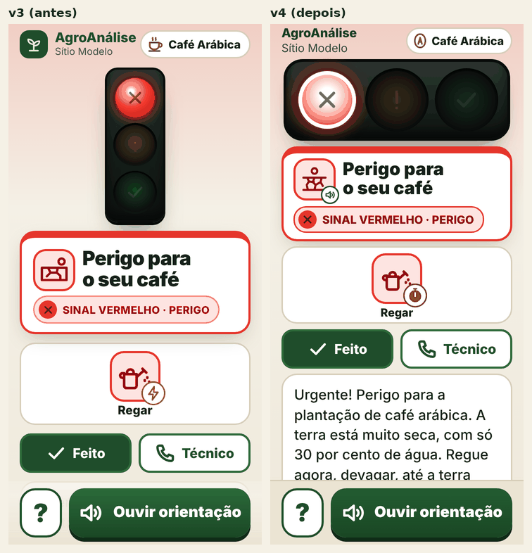
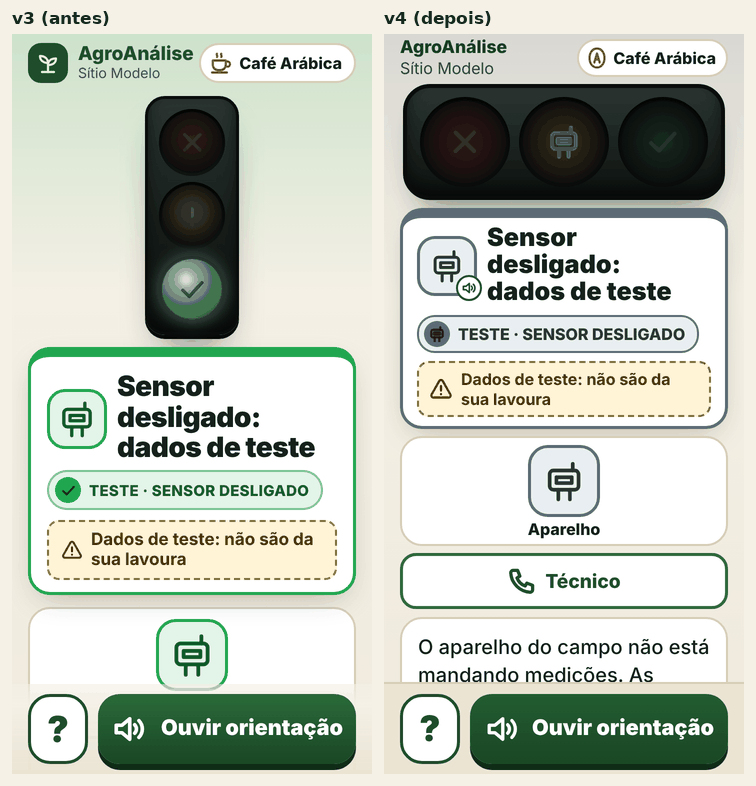
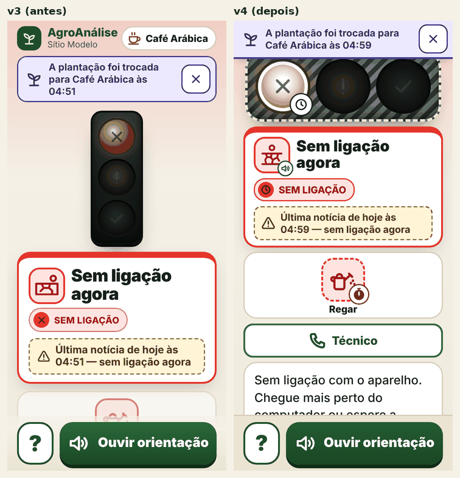
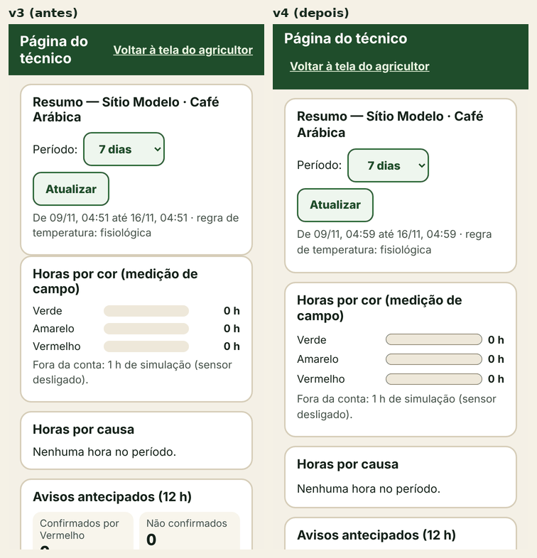
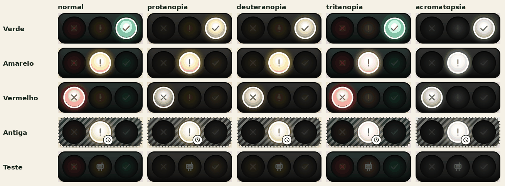
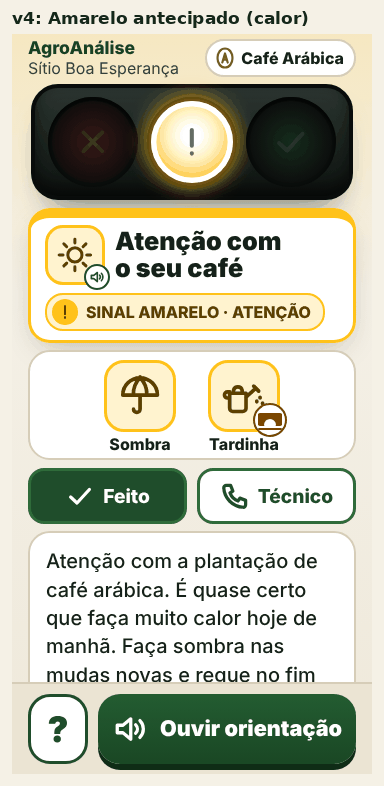
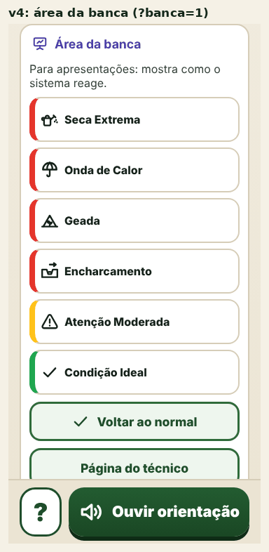
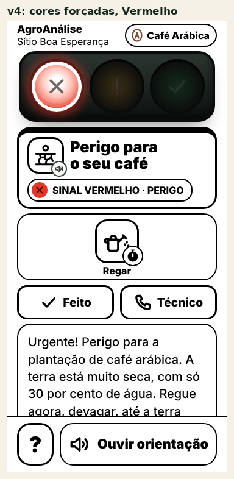

# Avaliação de UX — AgroAnálise v4

> Avaliação de usabilidade e acessibilidade de campo da página do agricultor (`/`), da área da banca (`/?banca=1`) e da
> página do técnico (`/tecnico`), feita para a versão 4.0.0. Compara a **v3** (commit `5c66abe`) com a **v4** pelo
> mesmo método e registra o que foi resolvido, o que ficou pendente e por quê.
>
> Documentos irmãos: [Protocolo de teste com agricultores](PROTOCOLO_TESTE_USUARIOS.md) ·
> [Pesquisa e referências, seção 11 (UX v4)](PESQUISA_REFERENCIAS.md#11-ux-de-campo-da-v4-referências-novas) ·
> [CHANGELOG 4.0.0](../CHANGELOG.md#400--2026-11-15) · [README](../README.md#novidades-da-v4) ·
> [Workflow, seção 12](WORKFLOW.md#12-ux-de-campo-da-v4-página-que-diz-a-verdade-e-suíte-permanente).

**Aviso.** Tudo aqui foi medido por **ferramentas e emulação** (Chromium headless, modelos de pixel, auditoria de
texto). Nenhum agricultor participou. A validação automatizada não substitui pessoas: a próxima etapa é o
[protocolo de teste com agricultores](PROTOCOLO_TESTE_USUARIOS.md).

## Sumário

1. [Resumo](#1-resumo)
2. [Método](#2-método)
3. [Resultados antes × depois](#3-resultados-antes--depois)
4. [Achados por severidade e status](#4-achados-por-severidade-e-status)
5. [Matriz componente × estado (v4)](#5-matriz-componente--estado-v4)
6. [Inventário de componentes](#6-inventário-de-componentes)
7. [Metas da v4: atingidas ou não](#7-metas-da-v4-atingidas-ou-não)
8. [Capturas](#8-capturas)
9. [Pendências e limites da avaliação](#9-pendências-e-limites-da-avaliação)
10. [Como reproduzir](#10-como-reproduzir)

---

## 1. Resumo

A v3 já passava limpa nas ferramentas automáticas comuns: **axe-core 0 violações** e **Lighthouse 100/100/100** no
celular. Os problemas para quem lê pouco ou nada estavam onde essas ferramentas não olham:

- **a cor podia mentir:** com o sensor desligado (modo Simulação, o estado de quem acabou de instalar), a lâmpada verde
  ou vermelha de teste ficava acesa; a demonstração da banca aparecia nos outros celulares como Vermelho real; um erro
  do servidor aparecia como "Sem ligação" com um ✓ verde;
- **botões de ajuda escondidos:** "Feito" e "Técnico" ficavam atrás da barra de voz em 8 estados (118 casos na matriz),
  justamente quando a medição estava antiga ou o aparelho com problema;
- **voz com a ação tarde:** em 99,8 % dos 841 alertas o "o que fazer" vinha na 3ª frase ou depois, com mediana de 31
  palavras, números e erros ("1 graus", "geie");
- **retorno só em texto:** 6 de 9 avisos e os 2 diálogos ficavam calados na 1ª visita.

A v4 atende as **70 metas** da suíte permanente (`scripts/validar_ux.sh`); a v3, medida pela mesma suíte, atende 19.
As regras agronômicas, os limiares e os números do cliente não mudaram (status de toda a grade idêntico ao da v3).

Fica pendente o que só pessoas podem dizer: a **compreensão dos pictogramas** em campo (ISO 9186-1), o **momento da
rega na geada** (validação de extensionista) e o teste com **TalkBack, sol real e aparelho de entrada**.

## 2. Método

### 2.1 Três lentes de auditoria e um comitê

Três auditores independentes trabalharam sobre cópias da v3, cada um com servidor próprio (portas 5101, 5102 e 5103;
nunca a 5000 do sítio) e sem tocar no repositório:

| Lente | Foco | Artefatos principais |
|---|---|---|
| **acessibilidade-campo** | contraste com gradiente e opacidade, alvos, oclusão e foco, cores forçadas, escurecimento automático, fonte ampliada, reflow, pixels das lâmpadas com ofuscamento e daltonismo, regiões vivas, rede lenta | `auditoria.js`, `medidas_pagina.js`, `analisar_lampadas.py`, `extras.js` |
| **usabilidade-letramento** | avaliação heurística, percurso cognitivo com 4 personas e 7 tarefas, auditoria de conteúdo da voz (873 mensagens), pictogramas | `auditoria_conteudo.py`, `walkthrough.js`, `par.js` |
| **componentes-estados** | inventário de componentes, matriz de 17 estados forçados pelo banco × 2 telas, coerência cor × chip × título × voz × pictograma × causa, polling, diálogo, bytes | `servidor_ux.py`, `grade.js`, `coerencia.py`, `dinamicos.js`, `polling.js` |

Um comitê consolidou os 40 achados num plano de três frentes (A: interface do agricultor; B: conteúdo, voz e domínio
do retorno; C: técnico e suíte de validação), com critério de aceite verificável para cada melhoria. Seis propostas
foram descartadas com motivo (seção 4.4). Depois da mescla, a integração tentou **refutar** cada critério (zoom de
200 %, ids enormes na API, alarme da estação, cores forçadas) e corrigiu o que achou. Na entrega, a verificação final
achou mais uma incoerência (seção 4.3).

### 2.2 Ferramentas e ambiente

| Ferramenta | Versão | Uso |
|---|---|---|
| Chromium (Playwright) | 153.0.8010.12 / Playwright 1.63 | todas as medições de página; viewports 360×640, 360×740, 360×800, 393×873, 412×915 e 1280×800; DPR 2 nas capturas |
| axe-core | 4.14 | tags `wcag2a`, `wcag2aa`, `wcag21a`, `wcag21aa`, `wcag22aa`, `best-practice` |
| Lighthouse | 13.6 | mobile, CPU 4× (e 6×), mediana de 3 rodadas |
| CDP | — | `Emulation.setCPUThrottlingRate` (CPU 6×) e `Network.emulateNetworkConditions` (Slow 3G: 2.000 ms, 50 kB/s) |
| Emulações | — | `forcedColors: 'active'`; `--enable-features=WebContentsForceDark --blink-settings=forceDarkModeEnabled=true`; `html { font-size: 130 % / 150 % / 200 % }`; voz `speechSynthesis` falsa que grava texto e taxa; voz só `en-US` (sem pt-BR); `context.setOffline(true)`; 503 provocado |
| Medição própria de contraste | — | texto e ícone com a **opacidade dos ancestrais** e a **pior parada do gradiente** de fundo (cobre os "incompletos" do axe) |
| Pixels das lâmpadas | — | luminância média no disco interno (raio < 0,42); razão acesa ÷ maior apagada; ofuscamento modelado somando 0,10 às duas luminâncias; filtros de protanopia, deuteranopia, tritanopia e acromatopsia |
| Auditoria de conteúdo | — | palavras, frases, posição da 1ª ação (regex de verbos no imperativo), dígitos, Flesch-PT de Martins et al. (1996), coerência com `acoes_orientacao` |

### 2.3 Personas e tarefas

| Persona | Perfil | O que pesa |
|---|---|---|
| **Seu José**, 63 anos | lê com dificuldade; presbiopia; possível perda auditiva; celular próprio | tamanho do semáforo e do texto, fala lenta, cor confiável |
| **Dona Maria** | não lê; usa o celular da família | tudo precisa ser falado ou desenhado; diálogos e avisos sem voz são barreira |
| **Ana** | jovem, alfabetizada, usa WhatsApp; segura o celular da família | caminho alternativo por texto, troca de cultura, chamar o técnico |
| **Técnico de ATER** | lê bem; visita o sítio | `/tecnico`, calibração, dados confiáveis (sem demonstração misturada) |

| Tarefa | Descrição |
|---|---|
| T1 | "Preciso regar hoje?" (Vermelho de seca) |
| T2 | "Ouvir de novo" (inclusive durante a fala) |
| T3 | Avisar que já fez ("Feito") |
| T4 | Trocar a cultura para Café Conilon |
| T5 | "Por que está amarelo?" |
| T6 | Chamar o técnico |
| T7 | Sensor desligado (dados de teste) |

### 2.4 Heurísticas e normas

- **Nielsen, 10 heurísticas**, com severidade de 0 a 4 por tela (agricultor, banca, técnico);
- **WCAG 2.2** níveis A e AA (e AAA 1.4.6 como meta de campo para o sol): 1.1.1, 1.3.3, 1.4.1, 1.4.3, 1.4.4, 1.4.6,
  1.4.10, 1.4.11, 2.2.1, 2.4.3, 2.4.11, 2.5.5, 2.5.8, 3.3.1, 4.1.2 e 4.1.3;
- **WAI-ARIA APG**, padrão *Dialog (Modal)*;
- **ISO 24495-1:2023** (linguagem simples), **ISO 9186-1:2014** (teste de compreensão de símbolos), critérios de
  aceitação de 67 % (ISO 3864) e 85 % (ANSI Z535.3);
- **ICT4D:** Medhi et al. (2007, 2011), celular compartilhado (Ahmed et al. 2019), efeito "lobo" dos alarmes falsos
  (LeClerc e Joslyn 2015), Wolters et al. (2007, idosos e voz sintética).

Fontes, URLs e o que foi lido na íntegra: [PESQUISA_REFERENCIAS.md, seção 11](PESQUISA_REFERENCIAS.md#11-ux-de-campo-da-v4-referências-novas).

## 3. Resultados antes × depois

Antes = v3 (`5c66abe`); depois = v4. Mesmo método: suíte `scripts/validar_ux.sh`, percurso cognitivo, `reflow.js` e
Lighthouse 13.6 (3 rodadas). Os números da suíte vêm de `reports/ux4/<data>/resultado.json`: a v3 da rodada de linha de base da integração e a v4 da regressão final da entrega (16/11/2026, do zero, `AGRO_UX_ESTRITO=1`, 70/70). Bytes e tempos variam alguns bytes e milissegundos entre rodadas (ex.: `GET /` 14.982–14.983 B).

### 3.1 Ferramentas automáticas

| Métrica | v3 | v4 |
|---|---|---|
| axe 4.14, violações (26 estados × 2 viewports + `/tecnico` com e sem assistente) | 0 | 0 |
| "Incompletos" de contraste do axe cobertos pela medição própria | 100 % | 100 % |
| Lighthouse `/` (Perf / A11y / BP / SEO) | 100 / 100 / 100 / 90 | 100 / 100 / 100 / 90 |
| Lighthouse `/`: LCP, TBT, CLS | 804 ms, 0, 0 | 788–796 ms, 0, 0,001 |
| Lighthouse `/tecnico` (Perf / A11y / BP / SEO) | 100 / 100 / 100 / 90 | 100 / 100 / 100 / 100 |
| Erros de console em `/` e `/tecnico` | 0 | 0 |

O SEO 90 de `/` vem só da falta de `meta description`, que é irrelevante para uma página de rede local.

### 3.2 Visão: contraste, tamanho, oclusão e semáforo

| Métrica | v3 | v4 |
|---|---|---|
| Textos abaixo de AA (todos os estados, inclusive antigo, sem ligação e teste) | 5 | **0** |
| Ícones de controle abaixo de 3:1 | 6 | **0** |
| Menor contraste de texto na 1ª tela (estados vivos) | 5,57:1 | **7,34:1** |
| Menor fonte na 1ª tela | 14 px | **16 px** |
| Interativos de `/tecnico` abaixo de 48 px | 2 (link de 20 px) | **0** |
| Oclusão pela barra de voz (`#acoes`, `#feito`, `#tecnico`) | 118 casos (até 56 px) | **0** |
| Foco escondido depois de 25 Tabs | 7 | **0** |
| Lâmpada mínima | 55,6 px | **72,8 px** |
| Lâmpada no vermelho − no verde | −17,7 px | 0 |
| Orientações do semáforo entre celulares em pé | 2 | **1** (sempre deitado) |
| Acesa ÷ apagada: viva / esmaecida | 3,92 / 3,06 | **9,98 / 10,02** |
| Acesa ÷ apagada com ofuscamento de sol (+0,10) | 1,91 | **4,78** |
| Acesa ÷ apagada em cores forçadas | 1,11 | **9,98** |
| Amarelo aceso ÷ apagado no escurecimento automático | 3,43 | **14,05** |
| Mínimo nos 4 filtros de daltonismo | 2,96 | **9,91** |

### 3.3 Estados distinguíveis sem cor

| Métrica | v3 | v4 |
|---|---|---|
| Teste/demonstração com lâmpada acesa | 3 estados | **0** (semáforo apagado, `data-estado="neutro"`) |
| Estados esmaecidos sem borda tracejada no semáforo | 5 | **0** |
| Diferença de pixels vivo × esmaecido em acromatopsia | 0,0167 | **0,0914** (5,5×) |
| `aria-label` do semáforo errado ("luz vermelho acesa", sem marca de antiga/teste) | 24 | **0** |
| Incoerências cor × chip × título × voz × pictograma × causa | 9 estados | **0** |
| 503 mostrado como "Sem ligação" ou com ✓ | 6 | **0** |

### 3.4 Texto e reflow

| Métrica | v3 | v4 |
|---|---|---|
| `font-size` em px no CSS das duas páginas | 52 | **0** (tudo em `rem`) |
| `meta text-scale` | ausente | presente nas 2 páginas |
| Rolagem lateral com texto a 130 % e 150 % (320 e 360 px) | 26 casos (até 101 px) | **0** |
| Colisões no topo com texto ampliado | 42 | **0** |
| Zoom de 200 % (180 px de CSS): `scrollWidth` | 300 | **180** |
| Zoom de 150 % (240 px de CSS): `scrollWidth` | 300 | **240** |

### 3.5 Voz e conteúdo

Auditoria sobre o espaço combinatório completo (cerca de 830 alertas). Na v3 a fala é a mensagem longa ouvida; na v4,
a `fala_curta` do 1º toque (a longa continua no 2º toque e na tela).

| Métrica | v3 | v4 |
|---|---|---|
| Ação até a 2ª frase | 0,2 % | **100 %** (a 1ª frase é sempre "Sinal &lt;cor&gt;.") |
| Palavras: mediana / máximo | 31 / 56 | **11 / 15** |
| Falas com dígitos | 412 | **0** |
| Flesch-PT mediano | 82,7 | **91,3** |
| "1 graus", "-2 graus" / "geie" | 32 / 84 | **0 / 0** |
| Duas ordens de rega / "Regue agora" com "gelando agora" | 12 / 6 | **0 / 0** |
| Coerência da voz (causa × voz, ação × voz, voz × ação) | 55,3 % | **100 %** |

Exemplo, Vermelho de seca. **v3:** "Sinal vermelho. Urgente! Perigo para a plantação de café arábica. A terra está
muito seca, com só 30 por cento de água. Regue agora, devagar, até a terra ficar úmida." (21 palavras antes de "Regue
agora"). **v4, 1º toque:** "Sinal vermelho. Regue agora. A terra está seca."

### 3.6 Retorno e regiões vivas

| Métrica | v3 | v4 |
|---|---|---|
| Avisos falados / diálogos falados na 1ª visita | 33,3 % / 0 % | **100 % / 100 %** |
| Taxa da fala na repetição | 0,95 | **0,8** (0,85 lembrada na visita seguinte) |
| Mutações nas regiões vivas em 10 min com estado parado | 720 | **0** |
| Lotes de mutação na faixa da demonstração em 30 s | 36 | **0** |
| Registros com 3 toques seguidos em "Feito" | 3 | **1** |
| Desfazer o "Feito" | não existia | 15 s na tela; servidor aceita até 120 s |
| Alarmes ou vibrações em 30 min de teste/demonstração | 12 | **0** (inclusive o alarme da estação base) |
| Eventos da demonstração no resumo do técnico | 3 | **0** |

### 3.7 Percurso cognitivo (4 personas, 360×740)

| Tarefa | v3 | v4 |
|---|---|---|
| T1 "Preciso regar?" | 1 toque; 21 palavras antes de "Regue agora" | 1 toque; 2 palavras antes |
| T2 "Ouvir de novo" durante a fala | 2 toques (o 1º só para) | 1 toque |
| T3 "Feito" | 1 toque, sem desfazer | 1 toque + "Desfazer" por 15 s |
| T4 "Trocar para Conilon" | rolar ≈ 505 px + 2 toques; diálogo calado; ícone igual ao do Arábica — **Dona Maria falha** | rolar ≈ 300 px + 2 toques; diálogo falado; ícone próprio |
| T5 "Por que está amarelo?" | 1 toque no desenho (sem pista de que fala) | 1 toque; selo de som no desenho; a ajuda "?" ensina |
| T6 "Chamar o técnico" | 2 toques; diálogo calado na 1ª visita | 2 toques; diálogo falado |
| T7 "Sensor desligado" | lâmpada verde acesa — **Seu José falha** | semáforo apagado + "Dados de teste: não são da sua lavoura"; 0 toques para entender |

Efeito colateral a decidir: as palavras visíveis acima da dobra subiram de 17 para 42–49, porque a mensagem longa
agora cabe acima da barra (seção 9).

### 3.8 Peso e rede

| Métrica | v3 | v4 |
|---|---|---|
| `GET /` com gzip, pior caso | 15.907 B | **14.983 B** (meta 15.000 B) |
| CSS estático (`/static/agro.<hash>.css`) | não existia | 3.551 B gzip, `immutable`, 1 ano |
| HTML + CSS | 15.907 B | 18.534 B |
| 2ª visita | 16.678 B | **15.240 B** |
| Slow 3G + CPU 6× até a 1ª lâmpada acesa | 2.144 ms | 2.117–2.144 ms (meta 2.500 ms) |
| Recursos de outro host | 0 | 0 |
| Recarregar sem rede | página em branco | página em branco (limitação mantida; seção 9) |

## 4. Achados por severidade e status

Severidade dos auditores (crítica, alta, média, baixa). Status: **resolvido** (critério de aceite verificado por teste
ou meta da suíte), **parcial** (o código resolveu a parte técnica; falta validação humana ou parte foi descartada),
**pendente** (fica para depois, com motivo). A coluna "Melhoria" aponta o item do plano (frentes A, B e C) descrito no
[CHANGELOG](../CHANGELOG.md#400--2026-11-15).

### 4.1 Crítica e alta

| # | Sev. | Achado | Lente | Melhoria | Status |
|---|---|---|---|---|---|
| 1 | crítica | Sensor desligado / dado de teste: lâmpada acesa na cor simulada e pictograma "Aparelho" atrás da barra | letramento | A3 | resolvido: semáforo apagado (`neutro`), chip `#i-aparelho`, aviso de teste |
| 2 | alta | "Feito" e "Técnico" atrás da barra de voz com medição antiga ou sem ligação; foco escondido | acessibilidade | A2 | resolvido: 0 oclusão, 0 foco escondido |
| 3 | alta | Barra de voz cobre Feito, Técnico e legendas em 8 estados | componentes | A2 | resolvido (aviso de voz no fluxo, `scroll-padding-bottom`) |
| 4 | alta | Semáforo encolhe no alerta e muda de orientação conforme a altura | acessibilidade | A2 | resolvido: sempre deitado, lâmpada ≥ 72 px |
| 5 | alta | Cores forçadas: nenhuma luz acesa; barra de voz transparente | acessibilidade | A4 | resolvido: 1,11 → 9,98 |
| 6 | alta | Voz com a ação tarde (99,8 % na 3ª frase ou depois) | letramento | B1, A6 | resolvido: `fala_curta`, ação na 2ª frase em 100 % |
| 7 | alta | "Feito" sem confirmação nem desfazer silencia o Vermelho por 60 min | letramento | A7, B5 | resolvido (desfazer); redução da pausa para 30 min descartada (4.4) |
| 8 | alta | Pictogramas ambíguos (raio = "agora", mão de PARE = "Nada", manhã × tardinha 26 %, valeta, mesmo ícone nas cultivares) | letramento | A8 | **parcial:** redesenho, diferença mínima 43,4 %, mapas injetivos e gabarito ISO 9186-1; compreensão em campo pendente |
| 9 | alta | Retorno só em texto: 6 de 9 avisos e os 2 diálogos calados | letramento | A6 | resolvido: 100 % falados |
| 10 | alta | Demonstração da banca aparece nos outros celulares como geada real | componentes | A3 | resolvido: neutro "Demonstração da banca: não é a sua lavoura" |
| 11 | alta | Simulação alarma como Vermelho (chip, borda, vibração, fala repetida) | componentes | A3 + integração | resolvido, inclusive o alarme da estação base (só `CAMPO_USB` toca) |
| 12 | alta | Erro 5xx aparece como "Sem ligação" com ✓ no chip | componentes | A3 | resolvido: "Programa com problema", chip `#i-relogio` |

### 4.2 Média e baixa

| # | Sev. | Achado | Lente | Melhoria | Status |
|---|---|---|---|---|---|
| 13 | média | Texto não acompanha a fonte do celular; a 130 % rola de lado | acessibilidade | A5, C2 | resolvido: `rem` + `meta text-scale` |
| 14 | média | Escurecimento automático do Chrome inverte o semáforo | acessibilidade | A4, C2 | resolvido: `color-scheme: only light` |
| 15 | média | Ao sol, a luz vermelha é o sinal mais fraco (2,47 com ofuscamento) | acessibilidade | A4 | resolvido no modelo (4,78); sol real não testado |
| 16 | média | Pictogramas esmaecidos (opacidade .55) abaixo de AA, mas tocáveis | acessibilidade | A3 | resolvido: tracejado sem opacidade |
| 17 | média | A ação certa ("Aparelho") esmaecida na leitura antiga | componentes | A3 | resolvido: só a ação da cópia local é marcada `data-antiga` |
| 18 | média | "Não siga esta cor" só como perda de saturação, invisível no daltonismo | acessibilidade | A3 | resolvido: borda tracejada + selo de relógio |
| 19 | média | Leitor de tela ouve "luz vermelho acesa" mesmo com medição antiga | acessibilidade | A3 | resolvido |
| 20 | média | Regiões vivas mudam o DOM sem mudar o conteúdo | acessibilidade | A6 | resolvido: `#anunciador` único, `definirTexto` |
| 21 | média | `aria-live` atômico reescrito a cada 5 s | componentes | A6 | resolvido: 720 → 0 mutações |
| 22 | média | Recarregar sem rede apaga a tela (inclusive "puxar para atualizar") | acessibilidade | A4 | **parcial:** `overscroll-behavior-y: contain`; recarregar sem rede continua impossível sem HTTPS |
| 23 | média | Números falados errados na geada ("1 graus", "-2 graus") | letramento | B2 | resolvido: `falar_graus` |
| 24 | média | "É quase certo que geie" | letramento | B2 | resolvido: "que tenha geada" |
| 25 | média | Ordens repetidas ou contraditórias (duas regas; "Regue agora" na geada) | letramento | B3 | resolvido; o momento da rega na geada pede validação de extensionista |
| 26 | média | Voz numa só velocidade; tocar durante a fala só para | letramento | A6 | resolvido: 0,8 na repetição, 0,85 lembrada |
| 27 | média | Seca programada e florada na "área de apresentações", 1 toque, sem PIN | letramento | A8, C3 | resolvido: Calendário do café em `/tecnico` com confirmação |
| 28 | média | Antecipação de calor: voz pede sombra, sem pictograma | componentes | B4 | resolvido (e ver 4.3) |
| 29 | média | Diálogo sem foco preso, Esc só com foco dentro, sem devolver o foco | componentes | A7 | resolvido: `<dialog>` nativo com `showModal()` |
| 30 | média | "Feito" duplica (3 toques = 3 registros) e a confirmação some | componentes | A7, B5 | resolvido: 1 registro, "Feito às HH:MM" persistente |
| 31 | média | Orçamento de 16 KB gzip esgotado; sem cache dos estáticos | componentes | A1 | resolvido: CSS imutável; `GET /` 14.983 B |
| 32 | baixa | Resultado da calibração aparece no pé da tela | acessibilidade | C2 | resolvido: retorno junto do botão |
| 33 | baixa | Textos de apoio com 14–15 px e abaixo de 7:1 | acessibilidade | A5 | resolvido: ≥ 16 px e ≥ 7,34:1 |
| 34 | baixa | Link "Voltar" do técnico com 20 px de altura | acessibilidade | C2 | resolvido: ≥ 48 px |
| 35 | baixa | A ajuda "?" não fala do Feito, do Técnico nem de como repetir | letramento | A6 | resolvido: ajuda montada a partir do que está visível |
| 36 | baixa | `/tecnico` conta pedidos e eventos da demonstração | letramento | B5 | resolvido: coluna `demonstracao` |
| 37 | baixa | PIN errado com a mesma mensagem de PIN ausente; botões "Sim/Não" | componentes | A7, B5 | resolvido: `codigo`, "Entrar/Cancelar", contagem |
| 38 | baixa | `aria-label` com concordância errada | componentes | A3 | resolvido |
| 39 | baixa | Polling sempre a 5 s, sem ETag/304 | componentes | — | **pendente (v5):** ETag entrou só em `/api/culturas` |
| 40 | baixa | Sem tokens únicos (49 cores soltas, Amarelo/Vermelho diferentes entre páginas) | componentes | C2, A7 | **parcial:** cores de estado iguais nas duas páginas, `--neutro-acao`, escala em `rem`; lint completo e `_tokens.css` ficaram para depois |

### 4.3 Achados na verificação final da entrega

| Sev. | Achado | Correção | Teste |
|---|---|---|---|
| média | **Subjuntivo lido como ordem.** No Amarelo antecipado de calor ("É quase certo que faça muito calor amanhã de manhã. Faça sombra nas mudas novas e regue no fim da tarde…"), o padrão de ordem aceitava "que **faça**" e o prazo "de manhã" virava o pictograma **"Manhã"** e a fala curta "Regue de manhã", contra "regue no fim da tarde" da voz completa. 24 dos 1.248 itens do espaço da auditoria; a checagem de coerência não pegava porque "de manhã" está na frase. | `acoes_orientacao._PADRAO_ORDEM` ignora o verbo depois de "que " (lookbehind). Agora: figuras "Sombra" + "Tardinha" e fala "Sinal amarelo. Faça sombra e regue no fim da tarde. Faz calor." | `tests/test_conteudo_voz_v4.py::TesteVozViraFigura::test_subjuntivo_depois_de_que_nao_e_ordem` (falha sem a correção; confere em todo o espaço que a rega da figura é a mesma da ordem falada) |

Antes dela, a integração já tinha corrigido: o alarme da estação base tocando com dados de teste; ids acima de 2⁶³
dando 500; rolagem lateral com zoom de 150–200 %; o botão "Ouvir orientação" sem contorno em cores forçadas; e as
costuras listadas no CHANGELOG.

### 4.4 Descartados de propósito

| Proposta | Motivo |
|---|---|
| ETag/304 e intervalo adaptativo no polling | tráfego é na rede local do sítio; sem vazamento medido; tocaria os dois arquivos mais carregados da frente A. Fica para a v5 |
| Lint de 0 literais de cor e `_tokens.css` compartilhado | obrigaria duas frentes a editar o mesmo arquivo; benefício indireto. Entrou só a parte essencial (cores de estado iguais, `--neutro-acao`, `rem`) |
| Pausa do Vermelho de 60 → 30 min depois do "Feito" | mudança de comportamento de alarme com impacto agronômico; pede validação. O risco do toque acidental foi coberto pelo desfazer |
| Estado neutro também para notícia antiga, sem ligação e relógio errado | a última cor foi real e continua útil (uma seca de 2 h atrás continua sendo seca); a v4 marca pela forma |
| Service Worker para recarregar sem rede | exige contexto seguro; `http://` por IP da rede local não é seguro |
| Teste de compreensão ISO 9186-1 com agricultores | não é entregável de código; virou o [protocolo](PROTOCOLO_TESTE_USUARIOS.md) |

## 5. Matriz componente × estado (v4)

Resumo do que a página do agricultor mostra em cada estado (360×740). "Barra" = todos acima da barra de voz
(medido: 0 px de oclusão). Fonte: `cetico.json` da integração e a suíte.

| Componente | Vivo (Verde / Amarelo / Vermelho) | Antecipado (Amarelo) | Notícia antiga / relógio errado | Sem ligação (rede) | Erro do programa (5xx) | Dado de teste (Simulação) | Demonstração vista fora da banca | Sem leitura |
|---|---|---|---|---|---|---|---|---|
| Semáforo | 1 lâmpada acesa com brilho e anel branco; borda contínua | igual ao vivo | última cor, dessaturada; **borda tracejada + relógio** | última cor, dessaturada; borda tracejada + relógio | última notícia marcada como antiga | **apagado**; símbolo do aparelho cinza no meio | **apagado** | amarela acesa ("Esperando o sensor") |
| `aria-label` | "Semáforo: luz verde/amarela/vermelha acesa" | igual | "… Notícia antiga, não siga esta cor" | "… Sem ligação" | "… Notícia antiga…" | "Semáforo apagado: dados de teste" | "Semáforo apagado: demonstração" | "Semáforo: luz amarela acesa" (sem marca própria; seção 9) |
| Chip | ✓ / ! / ✗ + "Sinal &lt;cor&gt; · …" | "Sinal amarelo · Atenção" | relógio + "Sem medição recente" | relógio + "Sem ligação" | relógio | aparelho + "Teste · sensor desligado" | aparelho + "Demonstração" | ! + "Sem dados do sensor" |
| Aviso tracejado | — | — | "Medição antiga: não siga esta cor" / "Relógio errado…" | "Última notícia de HH:MM — sem ligação agora" | "O programa do computador está com problema. Última notícia de HH:MM" | "Dados de teste: não são da sua lavoura" | "Demonstração da banca: não é a sua lavoura" | — |
| Pictogramas | ações do servidor (até 3) | ações da voz (ex.: Sombra + Tardinha) | "Aparelho" (normal) | ação antiga com `data-antiga` (tracejada, sem perder contraste) | "Aparelho" | "Aparelho" | — | "Aparelho" |
| "Feito" | no Amarelo/Vermelho; "Desfazer" 15 s; "Feito às HH:MM" | sim | oculto | oculto | oculto | oculto | oculto | oculto |
| "Técnico" | sim | sim | sim | sim | sim | sim | sim | sim |
| Voz, 1º toque | `fala_curta` ("Sinal vermelho. Regue agora. A terra está seca.") | `fala_curta` | "Atenção. Medição antiga. Confira o aparelho." | "Atenção. Sem ligação: a cor é a última notícia." | "Atenção. Programa com problema: chame o técnico." | "Atenção. Dados de teste. Não siga esta cor. Confira o aparelho." | "Atenção. Demonstração da banca. Não é a sua lavoura." | "Atenção. Sem medição. Confira o aparelho." |
| Voz, 2º e 3º toques (até 120 s depois do fim da fala) | 2º: mensagem completa ("para saber mais"); 3º: `fala_curta` mais devagar (0,8); repetir 2 vezes lembra a fala lenta (0,85) | idem | idem | idem | idem | idem | idem | idem |
| Repetição automática do Vermelho e vibração | a cada 10 min (sem "Feito") | — | não | não | não | **não** | **não** | — |
| Alarme da estação base | só leitura `CAMPO_USB` | — | — | — | — | **não toca** | não toca | — |

Na área da banca (`/?banca=1`) a demonstração aparece com as cores do cenário, porque ali ela é esperada.

## 6. Inventário de componentes

**Página do agricultor** (`src/templates/index.html` + `src/templates/agricultor.css`); entre parênteses, o que cada
componente lê de `GET /api/status`.

| Componente | Seletor estável | Dados |
|---|---|---|
| Topo: marca, propriedade, chip da cultura (ícone por cultivar) | `.topo`, `.marca`, `.cultura-atual` | `nome_propriedade`, `nome_cultura`, `codigo_cultura` |
| Faixa de troca de cultura (rola com a página abaixo de 320 px) | `#faixa-troca` | `cultura_alterada_em`, `segundos_desde_troca_cultura` |
| Semáforo (imagem com rótulo) | `#semaforo[role=img][aria-label]`, `.lampada--{vermelho,amarelo,verde}` | `status_alerta`, `dados_simulados`, `leitura_desatualizada`, `relogio_inconsistente` |
| Estado global da página | `body[data-estado]` ∈ {verde, amarelo, vermelho, neutro}; `body[data-confianca]` ∈ {viva, antiga, sem-ligacao, erro-servidor, teste, demonstracao, sem-leitura} | idem + `segundos_restantes_demonstracao` |
| Cartão: causa (toca e fala; selo de som), título, chip, aviso tracejado | `.cartao-estado`, `#causa`, `#titulo`, `#chip-texto`, `#chip-icone`, `#aviso-teste` | `causa`, `legenda_causa`, `causa_descricao`, `titulo` |
| Pictogramas de ação (tocam e falam) | `#acoes > li[data-acao][data-antiga]` | `acoes_detalhe` |
| "Feito" / "Desfazer" | `#feito[data-estado-feito ∈ {pronto, desfazer, feito}]` | `causa`, `id_leitura`, `causa_silenciada` |
| "Técnico" (WhatsApp) | `#tecnico` | `POST /api/pedido_ajuda` |
| Mensagem completa e hora | `.mensagem`, `#info-hora` | `mensagem_voz`, `data_hora` |
| Anunciador (única região viva do cartão) | `#anunciador[role=status]` | muda só quando a chave do anúncio muda |
| Barra de voz: "?" (ajuda contextual) e "Ouvir orientação" | `#barra-voz`, `#ajuda`, `#botao-voz` | `fala_curta`, `mensagem_voz` |
| Aviso de sem voz pt-BR (no fluxo, fora da barra) | `#aviso-voz` | `speechSynthesis.getVoices()` |
| Detalhes numéricos (recolhidos) | `.detalhes` | `temperatura_ar`, `umidade_ar`, `umidade_solo` |
| Seletor de cultura | `.botao-cultura[data-codigo]` | `GET /api/culturas` (ETag) |
| Diálogo modal (troca, técnico, PIN) | `dialog#dialogo`, `#dialogo-sim`, `#dialogo-nao`, `#dialogo-pin`, `#dialogo-erro[role=alert]` | — |
| Toast (sempre falado, salvo avisos internos da banca) | `#toast` | — |
| Área da banca (toque longo de 2 s ou `?banca=1`) | `details#area-banca`, cenários, faixa da demonstração | `GET /api/cenarios`, `POST /api/demonstracao` |

**Página do técnico** (`src/templates/tecnico.html`): PIN; resumo de 1 a 90 dias (sem a demonstração); horas por cor e
por causa; avisos antecipados confirmados × não confirmados; retorno do agricultor; saúde; **Calendário do café**
(`#t-seca`, `#t-florada`, confirmação em linha); assistente de calibração da sonda com `.retorno-passo`/`.erro-passo`
junto dos botões; texto de WhatsApp.

**Fora do navegador:** alarme sonoro da estação base (`src/alarme_local.py`), que só toca leitura de campo.

## 7. Metas da v4: atingidas ou não

Limiar e valores de `tests/e2e/validacao/metas_v4.json`, medidos pela suíte (v3 = linha de base pelo mesmo método).

| Grupo | Metas | v3 atende | v4 atende | Valores v4 |
|---|---|---|---|---|
| 1. Acessibilidade automática (axe, Lighthouse) | 11 | 11 | 11 | 0 violações em 26 estados; Lighthouse 100/100/100; CLS 0,001; LCP 796 ms |
| 2. Contraste | 5 | 1 | 5 | 0 textos < AA; 0 ícones < 3:1; 1ª tela 7,34:1 e 16 px |
| 3. Oclusão e foco | 2 | 0 | 2 | 0 / 0 |
| 4. Semáforo | 8 | 0 | 8 | 72,8 px; razões 9,98 / 10,02 / 4,78 / 9,98; amarelo no escuro 14,05 |
| 5. Estados distinguíveis sem cor | 6 | 0 | 6 | 0 neutros acesos; 0 sem tracejado; 5,5×; 0 rótulos errados; 0 incoerências; 0 erros 503 |
| 6. Alvos de toque | 2 | 1 | 2 | 0 abaixo de 48 px |
| 7. Texto e reflow | 4 | 0 | 4 | 0 px; text-scale; 0 rolagens; 0 colisões |
| 8. Voz e conteúdo | 8 | 1 | 8 | 100 % ação até a 2ª frase; ≤ 15 palavras; Flesch 91,3; 0 erros |
| 9. Retorno falado | 4 | 0 | 4 | 100 % / 100 % / 0,8 / 0,85 |
| 10. Regiões vivas | 2 | 0 | 2 | 0 / 0 |
| 11. "Feito" e alarmes | 6 | 0 | 6 | 1 registro; desfazer 15 s / 120 s; 0 alarmes; 0 da demonstração |
| 12. Peso e rede | 7 | 3 | 7 | 14.983 B; CSS 3.551 B; soma 18.534 B; 2ª visita 15.240 B; 2.144 ms; 0 outro host |
| 13. Pictogramas | 3 | 0 | 3 | 43,4 %; mapas injetivos; gabarito ISO |
| 14. Console | 2 | 2 | 2 | 0 / 0 |
| **Total** | **70** | **19** | **70** | — |

Metas que o código **não** pode atingir sozinho:

- **Compreensão dos pictogramas em campo** (≥ 85 % de acerto, ≤ 5 % de leitura oposta, N ≥ 50 por símbolo): não
  atingida; gabarito pronto em `tests/dados/pictogramas_iso9186.csv`, sem resultados.
- **Sucesso das 7 tarefas com agricultores reais:** não medido; ver o [protocolo](PROTOCOLO_TESTE_USUARIOS.md).

## 8. Capturas

PNG com paleta, ≤ 150 KB cada, a 360×740 (DPR 1). As capturas "antes" são da v3 (`5c66abe`) e as "depois" da v4, com
voz pt-BR falsa (para não mostrar o aviso de "sem voz").

| Captura | O que mostra |
|---|---|
|  | **Vermelho de seca.** v3: semáforo em pé, lâmpada pequena, mensagem longa abaixo da dobra. v4: semáforo deitado com lâmpada maior e anel branco, causa com selo de som, "Feito/Técnico" e o começo da mensagem acima da barra. |
|  | **Sensor desligado (dados de teste).** v3: lâmpada **verde acesa**, borda e chip verdes com ✓. v4: semáforo **apagado** com o aparelho no meio, chip cinza "Teste · sensor desligado", aviso "não são da sua lavoura", pictograma "Aparelho" visível. |
|  | **Rede caiu depois da 1ª carga.** v4 marca a última notícia pela forma: borda tracejada e relógio no semáforo, ação antiga tracejada sem perder contraste. |
|  | **`/tecnico`.** Link "Voltar" com ≥ 48 px, cores de estado iguais às do agricultor, texto em `rem`. |
|  | **Simulação de daltonismo** (Machado et al. 2009, severidade 1; acromatopsia por luminância) do semáforo v4 em Verde, Amarelo, Vermelho, notícia antiga e dado de teste. Posição + ícone ✓/!/✗ + anel branco distinguem as cores em todos os filtros; a notícia antiga se distingue pela borda tracejada e pelo relógio; o teste, pelo semáforo apagado. |
|  | **Amarelo antecipado de calor** (depois da correção 4.3): pictogramas "Sombra" + "Tardinha", na ordem da voz. |
|  | **Área da banca** (`?banca=1`): só cenários de demonstração, "Voltar ao normal" e o link para `/tecnico`; seca programada e florada saíram daqui. |
|  | **Cores forçadas** (tema de alto contraste) no Vermelho: o semáforo mantém as cores (`forced-color-adjust: none`), a barra tem fundo `Canvas` e o botão de voz tem contorno. |

## 9. Pendências e limites da avaliação

1. **Compreensão dos pictogramas** não testada com pessoas (ISO 9186-1). O desenho da causa "terra seca" ainda parece
   pouco legível nas capturas. Ver o [protocolo](PROTOCOLO_TESTE_USUARIOS.md#5-compreensão-dos-pictogramas-iso-9186-1).
2. **Momento da rega na geada** ("Regue de dia, quando o sol sair.") precisa de validação de extensionista
   (Emater/Incaper).
3. **Densidade de texto:** as palavras visíveis acima da dobra subiram de 17 para 42–49. Nenhuma meta trata disso;
   para quem lê pouco, avaliar no co-design recolher a mensagem longa (ela continua no 2º toque da voz).
4. **Sem leitura:** a lâmpada amarela fica acesa ("Esperando o sensor") e o `aria-label` não tem marca própria. É
   coerente com a ação "Aparelho", mas não foi especificado; decidir com usuários se deve ser neutro.
5. **Orçamento no limite:** `GET /` com 14.983 B de 15.000 B. Qualquer acréscimo em `index.html` precisa ir para
   `agricultor.css`.
6. **Recarregar sem rede** continua deixando a tela em branco (sem Service Worker em `http://` da rede local).
7. **Depois de um erro 5xx** a tela pode levar até 60 s (espera crescente da consulta) para voltar a "viva"; herdado da
   v3, mantido de propósito.
8. **Sem hardware:** TalkBack, sol real, escurecimento automático de fabricante (Samsung, Xiaomi) e celular Android de
   entrada não foram testados em aparelho. Regiões vivas foram medidas por mutação do DOM, não pelo que o leitor de tela
   anuncia; o sol, por modelo de pixels.
9. **Fontes:** muitos sites estavam bloqueados na rede da sessão; o que foi lido na íntegra e o que foi lido só pelo
   resumo está marcado em [PESQUISA_REFERENCIAS.md](PESQUISA_REFERENCIAS.md#11-ux-de-campo-da-v4-referências-novas).

## 10. Como reproduzir

```bash
python src/database.py && python src/gerador_dataset.py && python src/treinamento_ia.py
python -m unittest discover -s tests                 # 426 testes
npm install                                          # playwright, axe-core e lighthouse nas versões fixas
scripts/rodar_testes_ux.sh                           # interface + navegador + suíte UX
AGRO_UX_ESTRITO=1 scripts/validar_ux.sh              # só a suíte (70 metas); ferramenta ausente vira falha
scripts/validar_ux.sh --projeto <cópia da v3> --linha-de-base   # mede a v3 pelo mesmo método
```

Sem `npm install`, aponte as ferramentas por variável: `AGRO_AXE=<axe.min.js>`, `AGRO_LIGHTHOUSE=<executável>` e
`CHROME_PATH=<Chromium>`. A suíte sobe o próprio servidor de estados (`tests/e2e/validacao/servidor_estados.py`) num
banco temporário e numa porta própria (`AGRO_UX_PORTA`, padrão 5210; a 5000 é recusada) e grava
`reports/ux4/<data>/resultado.json` com as capturas das metas que falharam.
