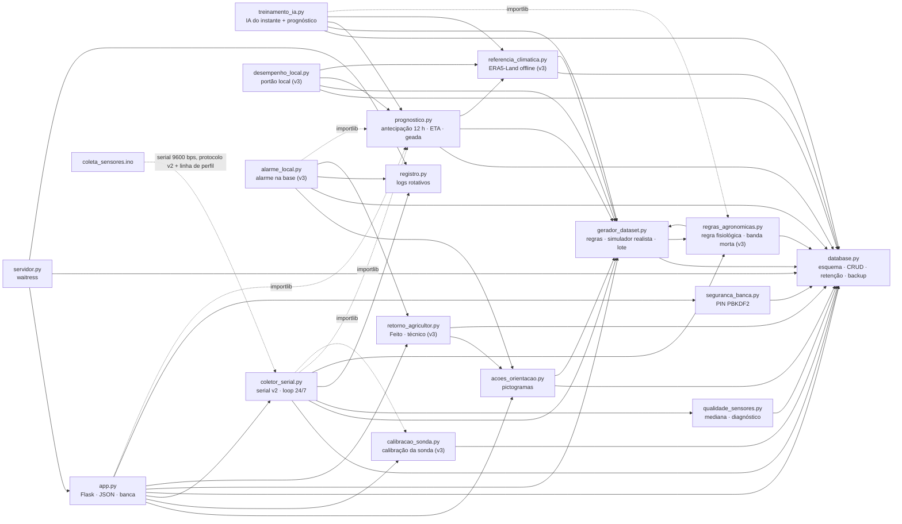

# Mapeamento de Funções e Type Hints — AgroAnálise v4

> Documento **gerado** a partir do código final (`ast` do Python 3.13 sobre os 17 arquivos de `src/` e
> regex sobre `arduino/coleta_sensores.ino`). Nenhuma assinatura foi escrita à mão: cada bloco `python`
> é o cabeçalho `def`/`class` **copiado do fonte** (quebras de linha juntadas). "O que faz" é o 1º
> parágrafo da docstring real; Entrada/Saída/Exceções vêm das seções `Args`/`Returns`/`Raises` da
> docstring ou, na falta delas, das anotações de tipo e dos `raise` do corpo. "Chama"/"Chamado por"
> vêm da análise estática das chamadas entre os módulos do projeto (não incluem bibliotecas nem testes;
> chamadas via `importlib` aos módulos `prognostico`, `calibracao_sonda` e `regras_agronomicas` são resolvidas pelo
> nome da função). Regenerado do zero por análise `ast` na entrega da v4 (16/11/2026).

Totais: **344 itens públicos** (funções, classes e métodos) e **302 internos** (prefixo `_`) em 17 módulos Python, mais as funções do firmware.

## Sumário

- [Módulo 2 — Banco de dados, esquema, retenção e backup (`src/database.py`)](#database)
- [Módulo 3 — Regras, simulador realista e saneamento em lote (`src/gerador_dataset.py`)](#gerador-dataset)
- [Módulo 4 — Treinamento e avaliação honesta das duas IAs (`src/treinamento_ia.py`)](#treinamento-ia)
- [Módulo 4b — Prognóstico de 12 h e antecipação (`src/prognostico.py`) — novo na v2](#prognostico)
- [Módulo 5a — Mediana móvel e diagnóstico de sensores (`src/qualidade_sensores.py`) — novo na v2](#qualidade-sensores)
- [Módulo 5 — Motor de coleta 24/7 (`src/coletor_serial.py`)](#coletor-serial)
- [Módulo 6a — Pictogramas de ação (`src/acoes_orientacao.py`) — novo na v2](#acoes-orientacao)
- [Módulo 6b — PIN da banca (`src/seguranca_banca.py`) — novo na v2](#seguranca-banca)
- [Módulo 6 — Companheiro Virtual Flask (`src/app.py`)](#app)
- [Operação 24/7 — Logs rotativos (`src/registro.py`) — novo na v2](#registro)
- [Operação 24/7 — Servidor waitress (`src/servidor.py`) — novo na v2](#servidor)
- [Módulo 3b — Regra térmica fisiológica, banda morta e florada (`src/regras_agronomicas.py`) — novo na v3](#regras-agronomicas)
- [Módulo 4c — Referência climática ERA5-Land offline (`src/referencia_climatica.py`) — novo na v3](#referencia-climatica)
- [Módulo 4d — Portão local do prognóstico (`src/desempenho_local.py`) — novo na v3](#desempenho-local)
- [Módulo 5b — Calibração da sonda de solo no host (`src/calibracao_sonda.py`) — novo na v3](#calibracao-sonda)
- [Módulo 6c — Feito, eventos, pedido de ajuda e resumo do técnico (`src/retorno_agricultor.py`) — novo na v3](#retorno-agricultor)
- [Operação 24/7 — Alarme sonoro na estação base (`src/alarme_local.py`) — novo na v3](#alarme-local)
- [Módulo 1 — Firmware (`arduino/coleta_sensores.ino`)](#firmware)
- [Grafo de dependências entre módulos](#grafo)
- [Conformidade com o contrato técnico v1 e com as interfaces da v2, da v3 e da v4](#conformidade)
- [Mudanças da v4 em relação à v3 (commit `5c66abe`)](#mudancas-v4)

## Convenções

- Tipos de `typing`: `Dict`, `List`, `Optional`, `Tuple`, `Any`, `Sequence`, `Iterator`, `Set`; `ModuleType` de `types`.
- Todos os módulos usam `from __future__ import annotations`.
- Status: `0 = Verde (Ideal)`, `1 = Amarelo (Atenção)`, `2 = Vermelho (Risco Crítico)`.
- Parâmetro `caminho_banco: Path = CAMINHO_BANCO` nas funções de banco permite testes com banco temporário.
- Exceções listadas são as levantadas deliberadamente; erros de biblioteca (sqlite3, scikit-learn) podem propagar.
- `prognostico` é opcional para `coletor_serial` e `app`: os dois o carregam por `importlib` e seguem sem ele.
- v3: `calibracao_sonda` é opcional para o coletor (`carregar_modulo_calibracao`, identidade em qualquer falha) e
  `regras_agronomicas` é opcional para o treino (`carregar_rotulador`, volta à regra instantânea).
- v4: a página do agricultor (`src/templates/index.html` + `agricultor.css`) e a do técnico não são Python e não
  entram nesta lista; seletores e atributos estáveis delas estão em `docs/AVALIACAO_UX.md`, seção 6.

<a id="database"></a>

## Módulo 2 — Banco de dados, esquema, retenção e backup (`src/database.py`)

*Módulo 2 — Banco de Dados e Regras Agronômicas do AgroAnálise.*

1867 linhas · 33 itens públicos · 19 internos · importa do projeto: —.

### `FaixaParametro`  <sub>linha 135</sub>

```python
@dataclass(frozen=True)
class FaixaParametro
    variavel: str
    unidade: str
    ideal_min: float
    ideal_max: float
    atencao_min: float
    atencao_max: float
    critico_min: float
    critico_max: float
```

- **O que faz:** Faixas agronômicas de UMA variável para UMA cultura.
- **Chamado por:** `database.buscar_parametros_cultura`

### `ParametrosCultura`  <sub>linha 153</sub>

```python
@dataclass(frozen=True)
class ParametrosCultura
    id_cultura: int
    codigo: str
    nome_comum: str
    nome_cientifico: str
    categoria: str
    faixas: Dict[str, FaixaParametro]
```

- **O que faz:** Conjunto de faixas de uma cultura cadastrada, indexadas pelo nome da variável.
- **Chamado por:** `database.buscar_parametros_cultura`

### `ParametrosCultura.faixa`  <sub>linha 163</sub>

```python
def faixa(self, variavel: str) -> FaixaParametro
```

- **O que faz:** Retorna a faixa da variável pedida.
- **Entrada:** `variavel: str`
- **Saída:** `FaixaParametro`
- **Exceções:** KeyError: se a cultura não tiver a variável cadastrada
- **Chama:** —
- **Chamado por:** `acoes_orientacao._acoes_da_leitura`, `acoes_orientacao._acoes_do_motivo_regra`, `acoes_orientacao._causa_da_leitura`, `acoes_orientacao._derivar_causa_da_leitura`, `coletor_serial.SaneadorTempoReal.__init__`, `coletor_serial._decidir_com_sensor_suspeito`, `coletor_serial._ponto_medio_ideal`, `gerador_dataset.SimuladorTempoReal.__init__`, `gerador_dataset.calcular_features`, `gerador_dataset.calcular_features_dataframe`, `gerador_dataset.calcular_status_regra`, `gerador_dataset.gerar_leitura_cenario`, `gerador_dataset.gerar_mensagem_fisiologica`, `gerador_dataset.gerar_mensagem_orientacao`, `gerador_dataset.gerar_relatorio_realismo`, `gerador_dataset.simular_serie_temporal`, `prognostico._acao_complementar_da_regra`, `prognostico._features_neutras`, `prognostico._lado_solo`, `prognostico._lado_temperatura`, `prognostico._motivo_do_vermelho`, `prognostico.aplicar_antecipacao`, `prognostico.calcular_features_temporais`, `prognostico.explicar_alerta`, `qualidade_sensores.FiltroMedianaMovel._alem_do_critico`, `regras_agronomicas._componentes_instantaneos`, `regras_agronomicas.avaliar_status_campo`, `regras_agronomicas.rotular_status_horario`, `treinamento_ia._alertas_de_geada`, `treinamento_ia._climatologia_combinada`, `treinamento_ia._entrada_referencia`, `treinamento_ia._tabela_noites`, `treinamento_ia.avaliar_robustez_ruido`, `treinamento_ia.rotular_instantaneo`

### `RegistroLeitura`  <sub>linha 179</sub>

```python
@dataclass
class RegistroLeitura
    data_hora: str
    codigo_cultura: str
    origem: str
    temperatura_ar_bruta: Optional[float]
    umidade_ar_bruta: Optional[float]
    umidade_solo_bruta: Optional[float]
    temperatura_ar: float
    umidade_ar: float
    umidade_solo: float
    deficit_hidrico_solo: float
    desvio_termico: float
    status_regra: int
    status_predito: int
    status_alerta: int
    probabilidade_predicao: float
    flag_anomalia: int
    descricao_anomalia: str
    mensagem_voz: str
    versao_modelo: str
    estado_sensor: str = ESTADO_SENSOR_OK
    diagnostico_sensor: str = ''
    instante_utc: Optional[str] = None
    motivo_regra: str = ''
    base_temperatura: str = ''
    temperatura_media_24h: Optional[float] = None
    umidade_solo_firmware: Optional[float] = None
```

- **O que faz:** Uma leitura completa, pronta para ser gravada em `historico_leituras`.
- **Chamado por:** `coletor_serial.montar_registro_leitura`

### `obter_conexao`  <sub>linha 470</sub>

```python
def obter_conexao(caminho_banco: Path = CAMINHO_BANCO) -> sqlite3.Connection
```

- **O que faz:** Abre uma conexão SQLite configurada para uso concorrente (coletor + Flask).
- **Entrada:** `caminho_banco: Path`
- **Saída:** `sqlite3.Connection`
- **Exceções:** nenhuma levantada deliberadamente
- **Chama:** —
- **Chamado por:** `app.rota_saude`, `calibracao_sonda._valores_da_janela`, `calibracao_sonda.garantir_tabela`, `calibracao_sonda.obter_calibracao_ativa`, `calibracao_sonda.registrar_calibracao`, `database._sessao`, `database.aplicar_retencao`, `database.compactar_banco`, `database.fazer_backup`, `database.inicializar_banco`, `desempenho_local._coef_em_uso_sem_local`, `desempenho_local._serie_horaria_ar`, `desempenho_local.previsoes_resolvidas`, `prognostico._consultar_serie`, `prognostico.gravar_analise_antecipacao`, `prognostico.ler_configuracao_prognostico`, `prognostico.obter_analise_antecipacao`, `referencia_climatica.regiao_da_cultura`, `regras_agronomicas.buscar_resumo_termico`, `retorno_agricultor.causa_silenciada`, `retorno_agricultor.desfazer_acao`, `retorno_agricultor.garantir_tabelas`, `retorno_agricultor.limpar_eventos_antigos`, `retorno_agricultor.montar_resumo_tecnico`, `retorno_agricultor.registrar_acao`, `retorno_agricultor.registrar_acao_sem_repetir`, `retorno_agricultor.registrar_evento`, `retorno_agricultor.registrar_pedido_ajuda`, `treinamento_ia._regra_padrao_treino`

### `migrar_esquema`  <sub>linha 493</sub>

```python
def migrar_esquema(conexao: sqlite3.Connection) -> None
```

- **O que faz:** Leva um banco de qualquer versão anterior ao esquema atual (idempotente).
- **Entrada:** `conexao: sqlite3.Connection`
- **Saída:** `None`
- **Exceções:** `RuntimeError`
- **Chama:** `database.migrar_colunas_demonstracao`
- **Chamado por:** `database.criar_tabelas`

### `migrar_colunas_demonstracao`  <sub>linha 533</sub>

```python
def migrar_colunas_demonstracao(conexao: sqlite3.Connection) -> List[str]
```

- **O que faz:** Acrescenta `demonstracao INTEGER NOT NULL DEFAULT 0` às tabelas do retorno que existirem (idempotente).
- **Entrada:** conexao: conexão aberta (é feito `commit` ao final)
- **Saída:** Nomes das tabelas que ganharam a coluna nesta chamada
- **Exceções:** sqlite3.Error: falha do banco que não seja a coluna duplicada
- **Chama:** —
- **Chamado por:** `database.migrar_esquema`, `retorno_agricultor.garantir_tabelas`

### `criar_tabelas`  <sub>linha 568</sub>

```python
def criar_tabelas(conexao: sqlite3.Connection) -> None
```

- **O que faz:** Cria (se ainda não existirem) todas as tabelas e índices e migra o esquema.
- **Entrada:** `conexao: sqlite3.Connection`
- **Saída:** `None`
- **Exceções:** nenhuma levantada deliberadamente
- **Chama:** `database.migrar_esquema`
- **Chamado por:** `database.inicializar_banco`

### `popular_parametros_iniciais`  <sub>linha 575</sub>

```python
def popular_parametros_iniciais(conexao: sqlite3.Connection) -> None
```

- **O que faz:** Semeia Café Arábica e Café Conilon com suas faixas agronômicas.
- **Entrada:** `conexao: sqlite3.Connection`
- **Saída:** `None`
- **Exceções:** `RuntimeError`
- **Chama:** —
- **Chamado por:** `database.inicializar_banco`

### `popular_configuracao_inicial`  <sub>linha 612</sub>

```python
def popular_configuracao_inicial(conexao: sqlite3.Connection) -> None
```

- **O que faz:** Semeia as chaves de configuração do sistema.
- **Entrada:** `conexao: sqlite3.Connection`
- **Saída:** `None`
- **Exceções:** nenhuma levantada deliberadamente
- **Chama:** —
- **Chamado por:** `database.inicializar_banco`

### `semear_configuracoes_confiabilidade`  <sub>linha 626</sub>

```python
def semear_configuracoes_confiabilidade(caminho_banco: Path = CAMINHO_BANCO) -> None
```

- **O que faz:** Semeia as chaves da confiabilidade de campo (`INSERT OR IGNORE`, idempotente).
- **Entrada:** `caminho_banco: Path`
- **Saída:** `None`
- **Exceções:** nenhuma levantada deliberadamente
- **Chama:** `database._sessao`
- **Chamado por:** `coletor_serial.ColetorAgroAnalise._preparar`, `database.main`

### `semear_configuracoes_v3`  <sub>linha 639</sub>

```python
def semear_configuracoes_v3(caminho_banco: Path = CAMINHO_BANCO) -> None
```

- **O que faz:** Semeia as chaves da v3 (`INSERT OR IGNORE`, idempotente; nunca sobrescreve valor ajustado).
- **Entrada:** `caminho_banco: Path`
- **Saída:** `None`
- **Exceções:** nenhuma levantada deliberadamente
- **Chama:** `database._sessao`
- **Chamado por:** `coletor_serial.ColetorAgroAnalise._preparar`, `database.main`

### `inicializar_banco`  <sub>linha 659</sub>

```python
def inicializar_banco(caminho_banco: Path = CAMINHO_BANCO) -> None
```

- **O que faz:** Cria o diretório, as tabelas e os dados iniciais do banco (idempotente).
- **Entrada:** `caminho_banco: Path`
- **Saída:** `None`
- **Exceções:** nenhuma levantada deliberadamente
- **Chama:** `database._chave_caminho`, `database.criar_tabelas`, `database.obter_conexao`, `database.popular_configuracao_inicial`, `database.popular_parametros_iniciais`
- **Chamado por:** `alarme_local.executar`, `coletor_serial.ColetorAgroAnalise._preparar`, `coletor_serial.main`, `database._garantir_banco`, `database.main`, `seguranca_banca.aplicar_comando`, `servidor.main`

### `validar_faixa`  <sub>linha 721</sub>

```python
def validar_faixa(faixa: FaixaParametro) -> None
```

- **O que faz:** Valida uma faixa agronômica antes de gravá-la.
- **Entrada:** `faixa: FaixaParametro`
- **Saída:** `None`
- **Exceções:** ValueError: com mensagem explicando a regra violada
- **Chama:** `database._numero_finito`
- **Chamado por:** `database.cadastrar_cultura`

### `cadastrar_cultura`  <sub>linha 769</sub>

```python
def cadastrar_cultura(codigo: str, nome_comum: str, nome_cientifico: str, categoria: str, descricao: str, faixas: List[FaixaParametro], caminho_banco: Path = CAMINHO_BANCO) -> int
```

- **O que faz:** Cadastra (ou atualiza) uma cultura e suas faixas — sem mudar código.
- **Entrada:** codigo: slug em minúsculas (ex.: `"tomate"`, `"milho_safrinha"`) · nome_comum: nome falado ao agricultor (ex.: `"Tomate"`) · nome_cientifico: nome botânico · categoria: uma de `CATEGORIAS_CULTURA` · descricao: texto livre · faixas: faixas por variável; precisam incluir `VARIAVEIS_OBRIGATORIAS` · caminho_banco: banco de destino
- **Saída:** O `id_cultura` da cultura cadastrada/atualizada
- **Exceções:** ValueError: dados ou faixas inválidos
- **Chama:** `database._sessao`, `database.validar_faixa`
- **Chamado por:** — (ponto de entrada, rota HTTP, uso externo ou testes)

### `listar_culturas`  <sub>linha 874</sub>

```python
def listar_culturas(apenas_ativas: bool = True, caminho_banco: Path = CAMINHO_BANCO) -> List[Dict[str, Any]]
```

- **O que faz:** Lista as culturas do catálogo, ordenadas por `id_cultura`.
- **Entrada:** `apenas_ativas: bool`, `caminho_banco: Path`
- **Saída:** `List[Dict[str, Any]]`
- **Exceções:** nenhuma levantada deliberadamente
- **Chama:** `database._sessao`
- **Chamado por:** `app._culturas_ativas`, `app.rota_historico`, `database._imprimir_resumo`, `gerador_dataset.gerar_dataset_completo`

### `buscar_parametros_cultura`  <sub>linha 893</sub>

```python
def buscar_parametros_cultura(codigo_cultura: str, caminho_banco: Path = CAMINHO_BANCO) -> ParametrosCultura
```

- **O que faz:** Carrega a cultura e todas as suas faixas.
- **Entrada:** `codigo_cultura: str`, `caminho_banco: Path`
- **Saída:** `ParametrosCultura`
- **Exceções:** ValueError: se a cultura não existir ou não tiver nenhuma faixa
- **Chama:** `database.FaixaParametro`, `database.ParametrosCultura`, `database._sessao`
- **Chamado por:** `alarme_local.ler_situacao`, `app._acoes_e_causa_seguras`, `app.injetar_leitura_cenario`, `app.reclassificar_medicao_de_campo`, `app.rota_iniciar_demonstracao`, `coletor_serial.ColetorAgroAnalise._carregar_cultura`, `coletor_serial.main`, `coletor_serial.montar_registro_leitura`, `database._imprimir_resumo`, `gerador_dataset._resolver_parametros`, `gerador_dataset.gerar_dataset_completo`, `gerador_dataset.gravar_relatorio_realismo`, `retorno_agricultor._horas_por_cor_e_causa`, `treinamento_ia._parametros_das_culturas`

### `inserir_leitura`  <sub>linha 1145</sub>

```python
def inserir_leitura(registro: RegistroLeitura, caminho_banco: Path = CAMINHO_BANCO, configuracoes_extras: Optional[Dict[str, Any]] = None) -> int
```

- **O que faz:** Grava uma leitura sanitizada no histórico.
- **Entrada:** registro: leitura a gravar · caminho_banco: banco de destino · configuracoes_extras: configurações (`{chave: valor}`) gravadas na · MESMA transação da leitura (ex.: batimento do coletor). Ou tudo é gravado, ou nada
- **Saída:** `id_leitura` gerado
- **Exceções:** ValueError: registro inválido ou cultura inexistente · sqlite3.OperationalError: banco travado por mais de `TEMPO_ESPERA_TRAVA_MS`
- **Chama:** `database.inserir_leituras_em_lote`
- **Chamado por:** `coletor_serial.ColetorAgroAnalise._despejar_fila`, `coletor_serial.gravar_registro_leitura`

### `inserir_leituras_em_lote`  <sub>linha 1175</sub>

```python
def inserir_leituras_em_lote(registros: Sequence[RegistroLeitura], caminho_banco: Path = CAMINHO_BANCO, configuracoes_extras: Optional[Dict[str, Any]] = None) -> List[int]
```

- **O que faz:** Grava várias leituras numa ÚNICA transação (todas ou nenhuma).
- **Entrada:** `registros: Sequence[RegistroLeitura]`, `caminho_banco: Path`, `configuracoes_extras: Optional[Dict[str, Any]]`
- **Saída:** Os `id_leitura` gerados, na ordem dos registros
- **Exceções:** ValueError: algum registro inválido (nada é gravado) · sqlite3.OperationalError: banco travado
- **Chama:** `database._id_cultura`, `database._sessao`, `database._upsert_configuracoes`, `database._validar_registro`
- **Chamado por:** `coletor_serial.ColetorAgroAnalise._despejar_fila`, `database.inserir_leitura`

### `buscar_ultima_leitura`  <sub>linha 1214</sub>

```python
def buscar_ultima_leitura(codigo_cultura: Optional[str] = None, caminho_banco: Path = CAMINHO_BANCO) -> Optional[Dict[str, Any]]
```

- **O que faz:** Retorna a leitura mais recente (opcionalmente de uma cultura) ou `None`.
- **Entrada:** `codigo_cultura: Optional[str]`, `caminho_banco: Path`
- **Saída:** `Optional[Dict[str, Any]]`
- **Exceções:** nenhuma levantada deliberadamente
- **Chama:** `database.buscar_historico`
- **Chamado por:** — (ponto de entrada, rota HTTP, uso externo ou testes)

### `buscar_historico`  <sub>linha 1226</sub>

```python
def buscar_historico(limite: int = 24, codigo_cultura: Optional[str] = None, caminho_banco: Path = CAMINHO_BANCO) -> List[Dict[str, Any]]
```

- **O que faz:** Retorna as últimas `limite` leituras, da mais recente para a mais antiga.
- **Entrada:** `limite: int`, `codigo_cultura: Optional[str]`, `caminho_banco: Path`
- **Saída:** `List[Dict[str, Any]]`
- **Exceções:** ValueError: se `limite` não for um inteiro positivo
- **Chama:** `database._sessao`
- **Chamado por:** `alarme_local.ler_situacao`, `app._coletor_ativo_em_outra_cultura`, `app._leituras_recentes_exibiveis`, `app._ultima_leitura_real`, `app.reclassificar_medicao_de_campo`, `app.rota_historico`, `database.buscar_ultima_leitura`

### `buscar_ultima_leitura_origem`  <sub>linha 1269</sub>

```python
def buscar_ultima_leitura_origem(codigo_cultura: str, origem: str, idade_maxima_segundos: float, caminho_banco: Path = CAMINHO_BANCO) -> Optional[Dict[str, Any]]
```

- **O que faz:** Última leitura gravada (ordem de gravação) de uma cultura e origem, se for recente.
- **Entrada:** `codigo_cultura: str`, `origem: str`, `idade_maxima_segundos: float`, `caminho_banco: Path`
- **Saída:** O dicionário da leitura (mesmas chaves de `buscar_historico`) ou `None` se não houver leitura, se ela for mais antiga que `idade_maxima_segundos` ou se estiver mais de 60 s "no futuro" (relógio inconsistente)
- **Exceções:** nenhuma levantada deliberadamente
- **Chama:** `database._idade_leitura_segundos`, `database._sessao`
- **Chamado por:** `coletor_serial.ColetorAgroAnalise._semear_saneador_campo`, `coletor_serial.MotorRegrasCampo._semear_estado`

### `obter_configuracao`  <sub>linha 1366</sub>

```python
def obter_configuracao(chave: str, padrao: Optional[str] = None, caminho_banco: Path = CAMINHO_BANCO) -> Optional[str]
```

- **O que faz:** Lê o valor textual de uma configuração; `padrao` se a chave não existir.
- **Entrada:** `chave: str`, `padrao: Optional[str]`, `caminho_banco: Path`
- **Saída:** `Optional[str]`
- **Exceções:** nenhuma levantada deliberadamente
- **Chama:** `database._sessao`
- **Chamado por:** `app._modo_normal`, `app._resolver_cultura_ativa`, `app._verificar_pin_banca`, `app.obter_configuracao_inteira`, `calibracao_sonda._ler_pendentes`, `retorno_agricultor._cultura_ativa`

### `obter_configuracao_tipada`  <sub>linha 1373</sub>

```python
def obter_configuracao_tipada(chave: str, padrao: Any = None, caminho_banco: Path = CAMINHO_BANCO) -> Any
```

- **O que faz:** Lê uma configuração já convertida segundo a coluna `tipo`.
- **Entrada:** `chave: str`, `padrao: Any`, `caminho_banco: Path`
- **Saída:** `Any`
- **Exceções:** nenhuma levantada deliberadamente
- **Chama:** `database._converter_valor_configuracao`, `database._sessao`
- **Chamado por:** `app.intervalo_repeticao_alerta`, `coletor_serial._regra_temperatura_do_banco`, `regras_agronomicas.carregar_configuracao_termica`

### `definir_configuracao`  <sub>linha 1393</sub>

```python
def definir_configuracao(chave: str, valor: Any, caminho_banco: Path = CAMINHO_BANCO) -> None
```

- **O que faz:** Grava (upsert) uma configuração.
- **Entrada:** `chave: str`, `valor: Any`, `caminho_banco: Path`
- **Saída:** `None`
- **Exceções:** ValueError: chave vazia ou valor incompatível com o tipo da chave
- **Chama:** `database._inferir_tipo`, `database._serializar_valor_configuracao`, `database._sessao`
- **Chamado por:** `app.encerrar_demonstracao`, `app.rota_configuracao_tecnico`, `app.rota_florada`, `app.rota_iniciar_demonstracao`, `app.rota_seca_programada`, `app.rota_trocar_cultura`, `calibracao_sonda._gravar_pendentes`, `coletor_serial.ColetorAgroAnalise._definir_configuracao_segura`, `coletor_serial.main`, `seguranca_banca.aplicar_comando`, `treinamento_ia.main`

### `definir_configuracoes`  <sub>linha 1427</sub>

```python
def definir_configuracoes(valores: Dict[str, Any], caminho_banco: Path = CAMINHO_BANCO) -> None
```

- **O que faz:** Grava várias configurações numa única transação (mesmas regras de `configuracoes_extras`).
- **Entrada:** `valores: Dict[str, Any]`, `caminho_banco: Path`
- **Saída:** `None`
- **Exceções:** nenhuma levantada deliberadamente
- **Chama:** `database._sessao`, `database._upsert_configuracoes`
- **Chamado por:** `coletor_serial.ColetorAgroAnalise._gravar_batimento_avulso`, `desempenho_local.ajustar_coef_tmin_local`, `desempenho_local.avaliar_e_decidir`

### `obter_todas_configuracoes`  <sub>linha 1437</sub>

```python
def obter_todas_configuracoes(caminho_banco: Path = CAMINHO_BANCO) -> Dict[str, Any]
```

- **O que faz:** Retorna todas as configurações como `{chave: valor_tipado}`.
- **Entrada:** `caminho_banco: Path`
- **Saída:** `Dict[str, Any]`
- **Exceções:** nenhuma levantada deliberadamente
- **Chama:** `database._converter_valor_configuracao`, `database._sessao`
- **Chamado por:** `alarme_local.ler_situacao`, `app._configuracoes_tipadas`, `app._encerrar_demonstracao_vencida`, `app._estado_banca`, `app.montar_status`, `app.reclassificar_medicao_de_campo`, `app.rota_cenarios`, `app.rota_pedido_ajuda`, `app.rota_saude`, `app.rota_seca_programada`, `app.rota_trocar_cultura`, `coletor_serial.ColetorAgroAnalise._atualizar_configuracoes`, `database._imprimir_resumo`

### `encerrar_demonstracao_se_inalterada`  <sub>linha 1458</sub>

```python
def encerrar_demonstracao_se_inalterada(cenario_avaliado: str, expira_em_avaliada: str, modo_destino: str, caminho_banco: Path = CAMINHO_BANCO) -> bool
```

- **O que faz:** Encerra o Modo Demonstração de forma ATÔMICA, só se ela ainda for a mesma que foi avaliada.
- **Entrada:** cenario_avaliado: valor de `cenario_demonstracao` lido por quem decidiu encerrar · expira_em_avaliada: valor de `demonstracao_expira_em` lido por quem decidiu encerrar · modo_destino: `CAMPO_USB` ou `SIMULACAO` · caminho_banco: banco de destino
- **Saída:** `True` se encerrou (cenário e expiração limpos e `modo_operacao` gravado); `False` se outra demonstração foi iniciada nesse meio-tempo (nada é alterado)
- **Exceções:** ValueError: `modo_destino` inválido
- **Chama:** `database._sessao`
- **Chamado por:** `app._encerrar_demonstracao_vencida`, `coletor_serial.ColetorAgroAnalise._encerrar_demonstracao`

### `definir_configuracao_condicional`  <sub>linha 1505</sub>

```python
def definir_configuracao_condicional(chave: str, valor: Any, exigir_valor_atual: Optional[str] = None, proibir_valor_atual: Optional[str] = None, caminho_banco: Path = CAMINHO_BANCO) -> bool
```

- **O que faz:** Grava uma configuração JÁ EXISTENTE só se o valor atual atender à condição, de forma ATÔMICA.
- **Entrada:** chave: configuração existente (ex.: `modo_operacao`) · valor: novo valor (validado contra o tipo da chave) · exigir_valor_atual: se informado, só grava quando o valor atual for exatamente este · proibir_valor_atual: se informado, só grava quando o valor atual for diferente deste · caminho_banco: banco de destino
- **Saída:** `True` se gravou; `False` se a condição não foi atendida ou a chave não existe
- **Exceções:** ValueError: chave vazia ou valor incompatível com o tipo da chave
- **Chama:** `database._serializar_valor_configuracao`, `database._sessao`
- **Chamado por:** `coletor_serial.ColetorAgroAnalise._gravar_modo`, `coletor_serial.ColetorAgroAnalise.encerrar`

### `aplicar_retencao`  <sub>linha 1646</sub>

```python
def aplicar_retencao(dias_brutos: int = 30, caminho_banco: Path = CAMINHO_BANCO, agora: Optional[datetime] = None, tamanho_lote: int = TAMANHO_LOTE_RETENCAO) -> Dict[str, int]
```

- **O que faz:** Mantém o banco com tamanho limitado sem perder o histórico de longo prazo.
- **Entrada:** dias_brutos: dias de leituras brutas a manter (>= 1) · caminho_banco: banco alvo · agora: instante de referência (horário local; padrão: agora) · tamanho_lote: linhas por transação
- **Saída:** ``{'agregadas': linhas brutas agregadas e apagadas, · 'apagadas': total de linhas apagadas, 'demonstracao_apagadas': ...}``
- **Exceções:** ValueError: `dias_brutos` ou `tamanho_lote` inválidos
- **Chama:** `database._garantir_banco`, `database._processar_lotes`, `database._texto_data_hora`, `database.obter_conexao`
- **Chamado por:** `coletor_serial.ColetorAgroAnalise._verificar_disco`, `coletor_serial.ColetorAgroAnalise._verificar_retencao_periodica`, `database.main`

### `fazer_backup`  <sub>linha 1716</sub>

```python
def fazer_backup(destino: Path, caminho_banco: Path = CAMINHO_BANCO) -> Path
```

- **O que faz:** Cópia consistente do banco, segura com WAL e com o coletor gravando.
- **Entrada:** destino: arquivo de destino (ou pasta: o nome vira `agroanalise_AAAAMMDD_HHMMSS.db`) · caminho_banco: banco de origem
- **Saída:** O caminho do backup gerado
- **Exceções:** `sqlite3.DatabaseError`
- **Chama:** `database._garantir_banco`, `database.obter_conexao`
- **Chamado por:** `database.main`

### `compactar_banco`  <sub>linha 1758</sub>

```python
def compactar_banco(caminho_banco: Path = CAMINHO_BANCO) -> Dict[str, int]
```

- **O que faz:** Compactação manual: checkpoint do WAL + `VACUUM` (reescreve o arquivo inteiro).
- **Entrada:** `caminho_banco: Path`
- **Saída:** `{'bytes_antes': ..., 'bytes_depois': ...}` (tamanho do arquivo principal)
- **Exceções:** nenhuma levantada deliberadamente
- **Chama:** `database._garantir_banco`, `database.obter_conexao`
- **Chamado por:** `database.main`

### `main`  <sub>linha 1827</sub>

```python
def main(argv: Optional[List[str]] = None) -> int
```

- **O que faz:** Ponto de entrada da linha de comando.
- **Entrada:** `argv: Optional[List[str]]`
- **Saída:** 0 em sucesso, 2 para argumentos inválidos, 1 para falha de banco
- **Exceções:** nenhuma levantada deliberadamente
- **Chama:** `database._criar_parser`, `database._imprimir_resumo`, `database.aplicar_retencao`, `database.compactar_banco`, `database.fazer_backup`, `database.inicializar_banco`, `database.semear_configuracoes_confiabilidade`, `database.semear_configuracoes_v3`
- **Chamado por:** — (ponto de entrada, rota HTTP, uso externo ou testes)

#### Funções internas de `database` (prefixo `_`)

| Assinatura exata | Docstring (1ª linha) | Chamado por |
|---|---|---|
| `def _chave_caminho(caminho_banco: Path) -> str` | Normaliza o caminho do banco para uso como chave de memoização. | _garantir_banco, inicializar_banco |
| `def _garantir_banco(caminho_banco: Path) -> None` | Inicializa o banco na primeira utilização do caminho neste processo. | _sessao, aplicar_retencao, compactar_banco, fazer_backup |
| `def _sessao(caminho_banco: Path) -> Iterator[sqlite3.Connection]` | Abre uma conexão com o banco garantido, confirma ao final e sempre fecha. | _imprimir_resumo, buscar_historico, buscar_parametros_cultura, buscar_ultima_leitura_origem, cadastrar_cultura, definir_configuracao, definir_configuracao_condicional, definir_configuracoes, encerrar_demonstracao_se_inalterada, inserir_leituras_em_lote, listar_culturas, obter_configuracao, obter_configuracao_tipada, obter_todas_configuracoes, semear_configuracoes_confiabilidade, semear_configuracoes_v3 |
| `def _numero_finito(valor: Any, descricao: str) -> float` | Converte para float e garante que seja finito (sem NaN/infinito). | _validar_registro, validar_faixa |
| `def _valor_bruto(valor: Optional[float]) -> Optional[float]` | Converte o valor bruto do sensor para gravação: NaN/None/inválido → NULL. | _validar_registro |
| `def _validar_status(valor: Any, nome: str) -> int` | Garante que um status seja inteiro 0, 1 ou 2. | _validar_registro |
| `def _instante_utc_de_data_hora(data_hora: str) -> Optional[str]` | Converte a data/hora LOCAL (`YYYY-MM-DD HH:MM:SS` ou ISO) para ISO UTC com `+00:00`. | _idade_leitura_segundos, _normalizar_instante_utc |
| `def _normalizar_instante_utc(valor: Optional[str], data_hora: str) -> Optional[str]` | `instante_utc` informado (normalizado para UTC) ou calculado a partir de `data_hora`. | _validar_registro |
| `def _validar_registro(registro: RegistroLeitura) -> Dict[str, Any]` | Valida um `RegistroLeitura` e devolve os valores prontos para o INSERT (sem `id_cultura`). | inserir_leituras_em_lote |
| `def _id_cultura(conexao: sqlite3.Connection, codigo_cultura: str, cache: Dict[str, int]) -> int` | `id_cultura` do código (com cache por transação). | inserir_leituras_em_lote |
| `def _upsert_configuracoes(conexao: sqlite3.Connection, configuracoes: Optional[Dict[str, Any]]) -> None` | Grava várias configurações na transação aberta em `conexao`. | definir_configuracoes, inserir_leituras_em_lote |
| `def _idade_leitura_segundos(leitura: Dict[str, Any], agora_utc: Optional[datetime] = None) -> Optional[float]` | Idade da leitura em segundos, pelo `instante_utc` (ou pela `data_hora` local, se faltar). | buscar_ultima_leitura_origem |
| `def _converter_valor_configuracao(valor: str, tipo: str) -> Any` | Converte o texto armazenado para o tipo Python declarado na coluna `tipo`. | _serializar_valor_configuracao, obter_configuracao_tipada, obter_todas_configuracoes |
| `def _serializar_valor_configuracao(valor: Any, tipo: str) -> str` | Converte um valor Python para o texto gravado, validando contra o tipo. | _upsert_configuracoes, definir_configuracao, definir_configuracao_condicional |
| `def _inferir_tipo(valor: Any) -> str` | Deduz o tipo de uma chave nova a partir do valor Python. | _upsert_configuracoes, definir_configuracao |
| `def _texto_data_hora(instante: datetime) -> str` | Formata no padrão de `historico_leituras.data_hora` (horário local, sem fuso). | aplicar_retencao |
| `def _processar_lotes(conexao: sqlite3.Connection, filtro_sql: str, parametros: Tuple[Any, ...], tamanho_lote: int, agregar: bool) -> int` | Agrega (opcionalmente) e apaga, em lotes de `tamanho_lote` por transação, as linhas do filtro. | aplicar_retencao |
| `def _imprimir_resumo(caminho_banco: Path = CAMINHO_BANCO) -> None` | Imprime no terminal o conteúdo essencial do banco. | main |
| `def _criar_parser() -> argparse.ArgumentParser` | Monta o parser da linha de comando do módulo de banco. | main |

<a id="gerador-dataset"></a>

## Módulo 3 — Regras, simulador realista e saneamento em lote (`src/gerador_dataset.py`)

*Módulo 3 — Geração e Saneamento de Dados do AgroAnálise.*

1627 linhas · 22 itens públicos · 20 internos · importa do projeto: `database`, `regras_agronomicas`.

### `classificar_variavel`  <sub>linha 120</sub>

```python
def classificar_variavel(valor: float, faixa: FaixaParametro) -> int
```

- **O que faz:** Classifica UMA variável: 0 Verde (ideal), 1 Amarelo (atenção), 2 Vermelho.
- **Entrada:** `valor: float`, `faixa: FaixaParametro`
- **Saída:** `int`
- **Exceções:** ValueError: se o valor não for um número finito
- **Chama:** —
- **Chamado por:** `acoes_orientacao._acoes_da_leitura`, `acoes_orientacao._acoes_do_motivo_regra`, `acoes_orientacao._causa_da_leitura`, `acoes_orientacao._derivar_causa_da_leitura`, `coletor_serial._decidir_com_sensor_suspeito`, `gerador_dataset._ponto_atencao`, `gerador_dataset.calcular_status_regra`, `gerador_dataset.gerar_mensagem_orientacao`, `prognostico._motivo_do_vermelho`, `prognostico.aplicar_antecipacao`, `regras_agronomicas._classificar`, `regras_agronomicas.classificar_com_banda_morta`

### `calcular_desvio_faixa`  <sub>linha 140</sub>

```python
def calcular_desvio_faixa(valor: float, minimo: float, maximo: float) -> float
```

- **O que faz:** Distância do valor até a faixa `[minimo, maximo]`.
- **Entrada:** `valor: float`, `minimo: float`, `maximo: float`
- **Saída:** `float`
- **Exceções:** nenhuma levantada deliberadamente
- **Chama:** —
- **Chamado por:** `gerador_dataset.calcular_features`

### `calcular_features`  <sub>linha 160</sub>

```python
def calcular_features(temperatura_ar: float, umidade_solo: float, cultura: Union[str, ParametrosCultura]) -> Tuple[float, float]
```

- **O que faz:** Calcula as features derivadas usadas pela IA.
- **Entrada:** `temperatura_ar: float`, `umidade_solo: float`, `cultura: Union[str, ParametrosCultura]`
- **Saída:** `(deficit_hidrico_solo, desvio_termico)` arredondados a 2 casas
- **Exceções:** nenhuma levantada deliberadamente
- **Chama:** `database.ParametrosCultura.faixa`, `gerador_dataset._resolver_parametros`, `gerador_dataset.calcular_desvio_faixa`
- **Chamado por:** `acoes_orientacao._acoes_da_leitura`, `acoes_orientacao._causa_da_leitura`, `coletor_serial._decidir_com_sensor_suspeito`, `coletor_serial._decidir_fisiologico_com_sensor_suspeito`, `coletor_serial.montar_registro_leitura`

### `calcular_status_regra`  <sub>linha 182</sub>

```python
def calcular_status_regra(temperatura_ar: float, umidade_solo: float, parametros: ParametrosCultura) -> int
```

- **O que faz:** Status do motor de regras (rótulo-verdade): pior classe entre temperatura e solo.
- **Entrada:** `temperatura_ar: float`, `umidade_solo: float`, `parametros: ParametrosCultura`
- **Saída:** `int`
- **Exceções:** nenhuma levantada deliberadamente
- **Chama:** `database.ParametrosCultura.faixa`, `gerador_dataset.classificar_variavel`
- **Chamado por:** `coletor_serial._decidir_com_sensor_suspeito`, `coletor_serial.montar_registro_leitura`, `gerador_dataset.gerar_leitura_cenario`, `gerador_dataset.gerar_relatorio_realismo`

### `falar_graus`  <sub>linha 195</sub>

```python
def falar_graus(valor: float) -> str
```

- **O que faz:** Temperatura falada com a concordância certa (v4): "zero grau", "1 grau", "menos 2 graus".
- **Entrada:** valor: temperatura em °C
- **Saída:** `'zero grau'` para 0; `'1 grau'` para 1; `'menos 1 grau'` para -1; `'menos N graus'` para N < -1; `'N graus'` para os demais
- **Exceções:** nenhuma levantada deliberadamente
- **Chama:** —
- **Chamado por:** `gerador_dataset._frase_borda_proxima`, `gerador_dataset.gerar_mensagem_fisiologica`, `gerador_dataset.gerar_mensagem_orientacao`

### `gerar_mensagem_orientacao`  <sub>linha 327</sub>

```python
def gerar_mensagem_orientacao(status: int, deficit_hidrico_solo: float, desvio_termico: float, parametros: ParametrosCultura, temperatura_ar: float, umidade_solo: float) -> str
```

- **O que faz:** Monta a orientação falada ao agricultor (frases curtas, sem jargão nem símbolos).
- **Entrada:** `status: int`, `deficit_hidrico_solo: float`, `desvio_termico: float`, `parametros: ParametrosCultura`, `temperatura_ar: float`, `umidade_solo: float`
- **Saída:** `str`
- **Exceções:** nenhuma levantada deliberadamente
- **Chama:** `database.ParametrosCultura.faixa`, `gerador_dataset._frase_borda_proxima`, `gerador_dataset._juntar_acoes`, `gerador_dataset._numero_falado`, `gerador_dataset.classificar_variavel`, `gerador_dataset.falar_graus`
- **Chamado por:** `coletor_serial._decidir_com_sensor_suspeito`, `coletor_serial.montar_registro_leitura`

### `gerar_mensagem_fisiologica`  <sub>linha 451</sub>

```python
def gerar_mensagem_fisiologica(avaliacao: "AvaliacaoRegra", deficit_hidrico_solo: float, parametros: ParametrosCultura, temperatura_ar: float, umidade_solo: float) -> str
```

- **O que faz:** Orientação falada da regra fisiológica (v3): ESTADO + CAUSA + AÇÃO.
- **Entrada:** avaliacao: resultado de `regras_agronomicas.avaliar_status_campo` (`status` pode vir elevado pela IA; sem motivo, a voz aponta a borda do solo mais próxima) · deficit_hidrico_solo: feature do solo (positivo = falta de água). A causa vem de `motivo_solo`; o déficit só escolhe o sentido da frase de borda quando a IA elevou o status sem motivo na regra · parametros: faixas da cultura · temperatura_ar, umidade_solo: leitura saneada (números falados)
- **Saída:** `str`
- **Exceções:** nenhuma levantada deliberadamente
- **Chama:** `database.ParametrosCultura.faixa`, `gerador_dataset._frase_borda_proxima`, `gerador_dataset._juntar_acoes`, `gerador_dataset._numero_falado`, `gerador_dataset.falar_graus`
- **Chamado por:** `coletor_serial._decidir_fisiologico_com_sensor_suspeito`, `coletor_serial.montar_registro_leitura`

### `SimuladorTempoReal`  <sub>linha 597</sub>

```python
class SimuladorTempoReal
    FATOR_ACELERACAO_SOLO: float = 60.0
    PASSO_MAXIMO_HORAS: float = 1.0
    TAXA_IRRIGACAO_POR_HORA: float = 8.0
    HORAS_MEMORIA_DERIVA: float = 6.0
```

- **O que faz:** Gera leituras sintéticas plausíveis em tempo real quando o Arduino falha.
- **Chamado por:** `coletor_serial.ColetorAgroAnalise._carregar_cultura`

### `SimuladorTempoReal.__init__`  <sub>linha 614</sub>

```python
def __init__(self, parametros: ParametrosCultura, semente: Optional[int] = None) -> None
```

- **O que faz:** Prepara o estado inicial a partir das faixas da cultura.
- **Entrada:** `parametros: ParametrosCultura`, `semente: Optional[int]`
- **Saída:** `None`
- **Exceções:** nenhuma levantada deliberadamente
- **Chama:** `database.ParametrosCultura.faixa`
- **Chamado por:** — (ponto de entrada, rota HTTP, uso externo ou testes)

### `SimuladorTempoReal.proxima_leitura`  <sub>linha 631</sub>

```python
def proxima_leitura(self, instante: Optional[datetime] = None) -> Dict[str, float]
```

- **O que faz:** Retorna `{"temperatura_ar", "umidade_ar", "umidade_solo"}` para o instante dado (padrão: agora).
- **Entrada:** `instante: Optional[datetime]`
- **Saída:** `Dict[str, float]`
- **Exceções:** nenhuma levantada deliberadamente
- **Chama:** —
- **Chamado por:** `coletor_serial.ColetorAgroAnalise._ciclo_simulacao`

### `gerar_leitura_cenario`  <sub>linha 777</sub>

```python
def gerar_leitura_cenario(cenario: str, parametros: ParametrosCultura) -> Dict[str, float]
```

- **O que faz:** Gera uma leitura extrema para o Modo Demonstração.
- **Entrada:** `cenario: str`, `parametros: ParametrosCultura`
- **Saída:** `Dict[str, float]`
- **Exceções:** ValueError: cenário desconhecido ou cultura cujas faixas não permitem o cenário
- **Chama:** `database.ParametrosCultura.faixa`, `gerador_dataset._ponto_atencao`, `gerador_dataset._ponto_ideal`, `gerador_dataset._umidade_ar_relativa`, `gerador_dataset._valor_abaixo`, `gerador_dataset._valor_acima`, `gerador_dataset.calcular_status_regra`
- **Chamado por:** `app.injetar_leitura_cenario`, `app.rota_iniciar_demonstracao`, `coletor_serial.ColetorAgroAnalise._ciclo_demonstracao`

### `ponto_orvalho_magnus`  <sub>linha 852</sub>

```python
def ponto_orvalho_magnus(temperatura_c: Union[float, np.ndarray], umidade_relativa: Union[float, np.ndarray]) -> Union[float, np.ndarray]
```

- **O que faz:** Ponto de orvalho (°C) pela fórmula de Magnus (coeficientes de Sonntag, 17,62 e 243,12 °C).
- **Entrada:** `temperatura_c: Union[float, np.ndarray]`, `umidade_relativa: Union[float, np.ndarray]`
- **Saída:** `Union[float, np.ndarray]`
- **Exceções:** nenhuma levantada deliberadamente
- **Chama:** —
- **Chamado por:** `desempenho_local._noites_locais`, `gerador_dataset.simular_serie_temporal`, `prognostico._features_neutras`, `prognostico.calcular_features_temporais`, `prognostico.prever_temperatura_minima_noite`, `treinamento_ia._tabela_noites`

### `umidade_relativa_magnus`  <sub>linha 873</sub>

```python
def umidade_relativa_magnus(temperatura_c: Union[float, np.ndarray], ponto_orvalho_c: Union[float, np.ndarray]) -> Union[float, np.ndarray]
```

- **O que faz:** Inversa de `ponto_orvalho_magnus`: umidade relativa (%) do ar com temperatura e ponto de orvalho dados.
- **Entrada:** `temperatura_c: Union[float, np.ndarray]`, `ponto_orvalho_c: Union[float, np.ndarray]`
- **Saída:** `Union[float, np.ndarray]`
- **Exceções:** nenhuma levantada deliberadamente
- **Chama:** —
- **Chamado por:** `gerador_dataset.simular_serie_temporal`, `referencia_climatica._ler_csv_referencia`

### `simular_serie_temporal`  <sub>linha 956</sub>

```python
def simular_serie_temporal(parametros: ParametrosCultura, horas: int = HORAS_SIMULACAO, semente: int = SEMENTE_ALEATORIA, data_inicial: str = "2026-01-01 00:00:00") -> pd.DataFrame
```

- **O que faz:** Simula `horas` leituras horárias do talhão de uma cultura, com o clima de um ano no hemisfério sul.
- **Entrada:** `parametros: ParametrosCultura`, `horas: int`, `semente: int`, `data_inicial: str`
- **Saída:** DataFrame com `data_hora, cultura, temperatura_ar, umidade_ar, umidade_solo`
- **Exceções:** `ValueError`
- **Chama:** `database.ParametrosCultura.faixa`, `gerador_dataset._envelope_evento`, `gerador_dataset._sortear_chuvas`, `gerador_dataset._sortear_eventos`, `gerador_dataset._sortear_veranicos`, `gerador_dataset.ponto_orvalho_magnus`, `gerador_dataset.umidade_relativa_magnus`
- **Chamado por:** `gerador_dataset.gerar_dataset_completo`

### `gerar_relatorio_realismo`  <sub>linha 1220</sub>

```python
def gerar_relatorio_realismo(df: pd.DataFrame, parametros: ParametrosCultura) -> str
```

- **O que faz:** Relatório de realismo do simulador para UMA cultura (texto pt-BR).
- **Entrada:** `df: pd.DataFrame`, `parametros: ParametrosCultura`
- **Saída:** `str`
- **Exceções:** nenhuma levantada deliberadamente
- **Chama:** `database.ParametrosCultura.faixa`, `gerador_dataset._maior_estiagem_dias`, `gerador_dataset._subidas_de_solo`, `gerador_dataset.calcular_status_regra`
- **Chamado por:** `gerador_dataset.gravar_relatorio_realismo`

### `injetar_ruidos`  <sub>linha 1284</sub>

```python
def injetar_ruidos(df: pd.DataFrame, taxa_ruido: float = TAXA_RUIDO, semente: int = SEMENTE_ALEATORIA) -> pd.DataFrame
```

- **O que faz:** Corrompe `taxa_ruido` das células de CADA coluna de sensor.
- **Entrada:** `df: pd.DataFrame`, `taxa_ruido: float`, `semente: int`
- **Saída:** `pd.DataFrame`
- **Exceções:** `ValueError`
- **Chama:** —
- **Chamado por:** `gerador_dataset.gerar_dataset_completo`

### `detectar_anomalias`  <sub>linha 1327</sub>

```python
def detectar_anomalias(df: pd.DataFrame) -> pd.DataFrame
```

- **O que faz:** Detecta leituras impossíveis SEM olhar o gabarito `tipo_ruido_injetado`.
- **Entrada:** `df: pd.DataFrame`
- **Saída:** `pd.DataFrame`
- **Exceções:** nenhuma levantada deliberadamente
- **Chama:** —
- **Chamado por:** `gerador_dataset.sanear_dataset`

### `sanear_dataset`  <sub>linha 1370</sub>

```python
def sanear_dataset(df_bruto: pd.DataFrame) -> pd.DataFrame
```

- **O que faz:** Detecta anomalias, interpola linearmente por cultura e arredonda a 1 casa.
- **Entrada:** `df_bruto: pd.DataFrame`
- **Saída:** `pd.DataFrame`
- **Exceções:** ValueError: se alguma cultura ficar sem nenhum valor válido em um sensor
- **Chama:** `gerador_dataset.detectar_anomalias`
- **Chamado por:** `gerador_dataset.gerar_dataset_completo`

### `calcular_features_dataframe`  <sub>linha 1392</sub>

```python
def calcular_features_dataframe(df: pd.DataFrame, parametros_por_cultura: Dict[str, ParametrosCultura]) -> pd.DataFrame
```

- **O que faz:** Versão vetorizada (numpy.where) de `calcular_features` e `calcular_status_regra`.
- **Entrada:** `df: pd.DataFrame`, `parametros_por_cultura: Dict[str, ParametrosCultura]`
- **Saída:** `pd.DataFrame`
- **Exceções:** ValueError: se houver cultura sem parâmetros informados
- **Chama:** `database.ParametrosCultura.faixa`
- **Chamado por:** `gerador_dataset.gerar_dataset_completo`

### `avaliar_detector`  <sub>linha 1443</sub>

```python
def avaliar_detector(df_bruto: pd.DataFrame, df_limpo: pd.DataFrame) -> Dict[str, float]
```

- **O que faz:** Compara o detector com o gabarito de ruídos injetados.
- **Entrada:** `df_bruto: pd.DataFrame`, `df_limpo: pd.DataFrame`
- **Saída:** Dicionário de métricas (todas como `float`)
- **Exceções:** nenhuma levantada deliberadamente
- **Chama:** `gerador_dataset._celulas_por_linha`
- **Chamado por:** `gerador_dataset.gerar_dataset_completo`

### `gerar_dataset_completo`  <sub>linha 1507</sub>

```python
def gerar_dataset_completo(horas: int = HORAS_SIMULACAO, semente: int = SEMENTE_ALEATORIA, caminho_bruto: Path = CAMINHO_DATASET_BRUTO, caminho_limpo: Path = CAMINHO_DATASET_LIMPO, caminho_banco: Path = CAMINHO_BANCO, data_inicial: str = "2026-01-01 00:00:00") -> Tuple[pd.DataFrame, pd.DataFrame]
```

- **O que faz:** Gera, suja, saneia e rotula o dataset de todas as culturas ativas do banco.
- **Entrada:** `horas: int`, `semente: int`, `caminho_bruto: Path`, `caminho_limpo: Path`, `caminho_banco: Path`, `data_inicial: str`
- **Saída:** `(df_bruto, df_limpo)` com as colunas exatas dos CSVs do contrato
- **Exceções:** RuntimeError: se não houver cultura ativa cadastrada
- **Chama:** `database.buscar_parametros_cultura`, `database.listar_culturas`, `gerador_dataset._imprimir_relatorio`, `gerador_dataset.avaliar_detector`, `gerador_dataset.calcular_features_dataframe`, `gerador_dataset.injetar_ruidos`, `gerador_dataset.sanear_dataset`, `gerador_dataset.simular_serie_temporal`
- **Chamado por:** `treinamento_ia.carregar_dataset`

### `gravar_relatorio_realismo`  <sub>linha 1608</sub>

```python
def gravar_relatorio_realismo(df_limpo: pd.DataFrame, caminho: Path = CAMINHO_RELATORIO_REALISMO, caminho_banco: Path = CAMINHO_BANCO) -> Path
```

- **O que faz:** Grava `gerar_relatorio_realismo` de cada cultura do dataset (saneado) em `caminho`.
- **Entrada:** `df_limpo: pd.DataFrame`, `caminho: Path`, `caminho_banco: Path`
- **Saída:** `Path`
- **Exceções:** nenhuma levantada deliberadamente
- **Chama:** `database.buscar_parametros_cultura`, `gerador_dataset.gerar_relatorio_realismo`
- **Chamado por:** — (ponto de entrada, rota HTTP, uso externo ou testes)

#### Funções internas de `gerador_dataset` (prefixo `_`)

| Assinatura exata | Docstring (1ª linha) | Chamado por |
|---|---|---|
| `def _resolver_parametros(cultura: Union[str, ParametrosCultura]) -> ParametrosCultura` | Aceita o código da cultura ou o objeto já carregado. | calcular_features |
| `def _numero_falado(valor: float) -> str` | Número inteiro (arredondamento comercial: 0,5 sobe), para ser lido em voz alta. | _frase_borda_proxima, gerar_mensagem_fisiologica, gerar_mensagem_orientacao |
| `def _dividir_sentencas(texto: str) -> List[str]` | Separa um texto nas frases terminadas por ponto, exclamação ou interrogação. | _juntar_acoes |
| `def _tirar_rega_da_frase(frase: str) -> str` | Tira a ordem de rega de uma frase com outra ordem; `""` se a frase for só a rega. | _juntar_acoes |
| `def _juntar_acoes(frases: List[str]) -> List[str]` | Passo final das mensagens faladas: uma ordem por ação, sem ordens contraditórias. | gerar_mensagem_fisiologica, gerar_mensagem_orientacao, _mensagem_antecipada |
| `def _frase_borda_proxima(temperatura_ar: float, umidade_solo: float, faixa_temperatura: FaixaParametro, faixa_solo: FaixaParametro) -> str` | Orientação concreta quando tudo está na faixa ideal, mas perto de uma borda. | gerar_mensagem_fisiologica, gerar_mensagem_orientacao |
| `def _valor_abaixo(faixa: FaixaParametro, limite_fisico: Tuple[float, float], margem_critica: float) -> float` | Valor Vermelho abaixo de `atencao_min`, preferindo passar do crítico, dentro da faixa física. | gerar_leitura_cenario |
| `def _valor_acima(faixa: FaixaParametro, limite_fisico: Tuple[float, float], margem_critica: float) -> float` | Valor Vermelho acima de `atencao_max`, preferindo passar do crítico, dentro da faixa física. | gerar_leitura_cenario |
| `def _ponto_ideal(faixa: FaixaParametro, fracao: float) -> float` | Ponto dentro da faixa ideal: `fracao` 0 = ideal_min, 1 = ideal_max (arredondado e garantido). | gerar_leitura_cenario |
| `def _ponto_atencao(faixa: FaixaParametro, lado: str) -> Optional[float]` | Ponto no meio da faixa amarela do lado pedido (`"acima"`/`"abaixo"`); `None` se ela não existir. | gerar_leitura_cenario |
| `def _umidade_ar_relativa(faixa: FaixaParametro, posicao: str) -> float` | Umidade do ar coerente com o cenário: `"seca"`, `"ideal"` ou `"umida"`. | gerar_leitura_cenario |
| `def _envelope_evento(duracao: int) -> np.ndarray` | Envelope suave (seno) para ondas de calor/frentes frias, sem degraus bruscos. | simular_serie_temporal |
| `def _sortear_eventos(gerador: np.random.Generator, horas: int, intervalo_medio: float, duracao_min: int, duracao_max: int) -> List[Tuple[int, int]]` | Sorteia eventos (início, duração) com intervalos exponenciais, sem sobreposição. | simular_serie_temporal |
| `def _sortear_veranicos(gerador: np.random.Generator, instantes: pd.DatetimeIndex) -> np.ndarray` | Marca as horas de veranico: em cada ano, com probabilidade `PROB_VERANICO_ANO`, | simular_serie_temporal |
| `def _sortear_chuvas(gerador: np.random.Generator, instantes: pd.DatetimeIndex, veranico: np.ndarray, largura_solo: float) -> np.ndarray` | Lâmina de chuva (pontos percentuais de umidade do solo por hora). | simular_serie_temporal |
| `def _subidas_de_solo(serie_solo: pd.Series, limiar: float = LIMIAR_SUBIDA_CHUVA_PP) -> pd.Series` | Subidas horárias da umidade do solo acima de `limiar` pp/h (aproximação da chuva; o gotejamento é mais lento). | gerar_relatorio_realismo |
| `def _maior_estiagem_dias(instantes: pd.Series, subidas: pd.Series, meses: Sequence[int]) -> Tuple[float, Optional[pd.Timestamp]]` | Maior sequência (em dias) sem subida de solo de chuva, contada só nos meses pedidos, e seu início. | gerar_relatorio_realismo |
| `def _celulas_por_linha(textos: pd.Series) -> List[Set[str]]` | Converte textos `"coluna:tipo;..."` em conjuntos de colunas afetadas por linha. | avaliar_detector |
| `def _distribuicao_classes(serie: pd.Series) -> Dict[int, float]` | Proporção de cada classe 0/1/2 (classes ausentes = 0). | _imprimir_relatorio |
| `def _imprimir_relatorio(df_bruto: pd.DataFrame, df_limpo: pd.DataFrame, metricas: Dict[str, float], caminho_bruto: Path, caminho_limpo: Path) -> None` | Imprime o relatório do pipeline de dados no terminal. | gerar_dataset_completo |

<a id="treinamento-ia"></a>

## Módulo 4 — Treinamento e avaliação honesta das duas IAs (`src/treinamento_ia.py`)

*Módulo 4 — Treinamento e Validação da IA do AgroAnálise.*

2324 linhas · 38 itens públicos · 27 internos · importa do projeto: `database`, `gerador_dataset`, `prognostico`, `referencia_climatica`.

### `carregar_dataset`  <sub>linha 194</sub>

```python
def carregar_dataset(caminho: Path = CAMINHO_DATASET_LIMPO) -> pd.DataFrame
```

- **O que faz:** Carrega o dataset limpo e rotulado usado no treinamento.
- **Entrada:** `caminho: Path`
- **Saída:** `pd.DataFrame`
- **Exceções:** ValueError: se faltarem colunas obrigatórias, se o dataset ficar vazio ou se aparecer um rótulo fora de 0/1/2
- **Chama:** `gerador_dataset.gerar_dataset_completo`
- **Chamado por:** `treinamento_ia.main`

### `separar_treino_teste`  <sub>linha 239</sub>

```python
def separar_treino_teste(df: pd.DataFrame, proporcao_teste: float = 0.2, semente: int = SEMENTE_ALEATORIA) -> Tuple[pd.DataFrame, pd.DataFrame, pd.Series, pd.Series]
```

- **O que faz:** Divide o dataset em treino e teste, estratificando pelo rótulo.
- **Entrada:** `df: pd.DataFrame`, `proporcao_teste: float`, `semente: int`
- **Saída:** `(X_treino, X_teste, y_treino, y_teste)`
- **Exceções:** ValueError: se a proporção de teste não estiver entre 0 e 1
- **Chama:** —
- **Chamado por:** `treinamento_ia.main`

### `treinar_random_forest`  <sub>linha 291</sub>

```python
def treinar_random_forest(X_treino: pd.DataFrame, y_treino: pd.Series, semente: int = SEMENTE_ALEATORIA) -> RandomForestClassifier
```

- **O que faz:** Treina um `RandomForestClassifier` (300 árvores, classes balanceadas).
- **Entrada:** `X_treino: pd.DataFrame`, `y_treino: pd.Series`, `semente: int`
- **Saída:** `RandomForestClassifier`
- **Exceções:** nenhuma levantada deliberadamente
- **Chama:** `treinamento_ia._novo_random_forest`
- **Chamado por:** `treinamento_ia.main`

### `treinar_regressao_logistica`  <sub>linha 305</sub>

```python
def treinar_regressao_logistica(X_treino: pd.DataFrame, y_treino: pd.Series, semente: int = SEMENTE_ALEATORIA) -> Pipeline
```

- **O que faz:** Treina o `Pipeline` StandardScaler + LogisticRegression (multinomial).
- **Entrada:** `X_treino: pd.DataFrame`, `y_treino: pd.Series`, `semente: int`
- **Saída:** `Pipeline`
- **Exceções:** nenhuma levantada deliberadamente
- **Chama:** `treinamento_ia._nova_regressao_logistica`
- **Chamado por:** `treinamento_ia.main`

### `calcular_falsos_operacionais`  <sub>linha 318</sub>

```python
def calcular_falsos_operacionais(y_real: pd.Series, y_pred: np.ndarray) -> Dict[str, int]
```

- **O que faz:** Conta os erros que importam no campo.
- **Entrada:** `y_real: pd.Series`, `y_pred: np.ndarray`
- **Saída:** `Dict[str, int]`
- **Exceções:** ValueError: se os vetores tiverem tamanhos diferentes
- **Chama:** —
- **Chamado por:** `treinamento_ia._falsos_por_cultura`, `treinamento_ia.avaliar_modelo`, `treinamento_ia.validacao_cruzada`

### `avaliar_modelo`  <sub>linha 347</sub>

```python
def avaliar_modelo(nome: str, modelo: Any, X_teste: pd.DataFrame, y_teste: pd.Series) -> Dict[str, Any]
```

- **O que faz:** Avalia um modelo treinado no conjunto de teste.
- **Entrada:** `nome: str`, `modelo: Any`, `X_teste: pd.DataFrame`, `y_teste: pd.Series`
- **Saída:** Dicionário com `nome`, `modelo`, `accuracy`, `precision_macro`, `recall_macro`, `f1_macro`, `precision_ponderada`, `recall_ponderado`, `f1_ponderado`, `por_classe` (precision, recall, f1 e suporte de cada classe), `matriz_confusao` (lista de listas, linhas = real, colunas = predito, ordem 0/1/2), `falsos` (`calcular_falsos_operacionais`), `n_teste`, `distribuicao_teste`, `y_pred` (lista) e, quando o estimador oferece, `importancia_features`
- **Exceções:** nenhuma levantada deliberadamente
- **Chama:** `treinamento_ia.calcular_falsos_operacionais`
- **Chamado por:** `treinamento_ia.main`

### `validacao_cruzada`  <sub>linha 403</sub>

```python
def validacao_cruzada(modelo: Any, X: pd.DataFrame, y: pd.Series, dobras: int = DOBRAS_VALIDACAO) -> Dict[str, float]
```

- **O que faz:** Validação cruzada estratificada (`StratifiedKFold`, embaralhada, semente fixa).
- **Entrada:** `modelo: Any`, `X: pd.DataFrame`, `y: pd.Series`, `dobras: int`
- **Saída:** `{"dobras", "accuracy_media", "accuracy_desvio", "precision_macro_media", ..., "falsos_positivos_fora_dobra", "falsos_negativos_fora_dobra", "subestimacoes_criticas_fora_dobra", "amostras"}` (todos `float`)
- **Exceções:** ValueError: se `dobras` < 2
- **Chama:** `treinamento_ia.calcular_falsos_operacionais`
- **Chamado por:** `treinamento_ia.main`

### `selecionar_campeao`  <sub>linha 457</sub>

```python
def selecionar_campeao(resultados: Dict[str, Dict[str, Any]]) -> str
```

- **O que faz:** Escolhe o modelo campeão.
- **Entrada:** `resultados: Dict[str, Dict[str, Any]]`
- **Saída:** `str`
- **Exceções:** ValueError: se `resultados` estiver vazio
- **Chama:** —
- **Chamado por:** `treinamento_ia.main`

### `gerar_matriz_confusao`  <sub>linha 482</sub>

```python
def gerar_matriz_confusao(resultados: Dict[str, Dict[str, Any]], campeao: str, caminho: Path = CAMINHO_MATRIZ_CONFUSAO) -> Path
```

- **O que faz:** Desenha as matrizes de confusão dos modelos lado a lado e salva em PNG.
- **Entrada:** `resultados: Dict[str, Dict[str, Any]]`, `campeao: str`, `caminho: Path`
- **Saída:** Caminho do arquivo salvo
- **Exceções:** nenhuma levantada deliberadamente
- **Chama:** `treinamento_ia._decimal`
- **Chamado por:** `treinamento_ia.main`

### `montar_relatorio`  <sub>linha 576</sub>

```python
def montar_relatorio(resultados: Dict[str, Dict[str, Any]], campeao: str) -> str
```

- **O que faz:** Monta o relatório técnico completo (texto) do treinamento.
- **Entrada:** `resultados: Dict[str, Dict[str, Any]]`, `campeao: str`
- **Saída:** `str`
- **Exceções:** nenhuma levantada deliberadamente
- **Chama:** `treinamento_ia._decimal`, `treinamento_ia._matriz_textual`, `treinamento_ia._percentual`
- **Chamado por:** `treinamento_ia.main`

### `salvar_modelo`  <sub>linha 744</sub>

```python
def salvar_modelo(modelo: Any, nome_modelo: str, metricas: Dict[str, Any], caminho: Path = CAMINHO_MODELO, culturas: Optional[List[str]] = None) -> Path
```

- **O que faz:** Salva o pacote do modelo campeão com `joblib.dump`.
- **Entrada:** modelo: estimador treinado · nome_modelo: nome do algoritmo (prefixo da versão) · metricas: resultado de `avaliar_modelo` (o estimador e as predições brutas são removidos antes de gravar) · caminho: arquivo `.pkl` de destino · culturas: códigos das culturas do treino; `None` usa as chaves de `metricas["falsos_por_cultura"]` (se houver)
- **Saída:** Caminho do arquivo `.pkl` gravado
- **Exceções:** nenhuma levantada deliberadamente
- **Chama:** `treinamento_ia._culturas_do_treino`, `treinamento_ia._metricas_serializaveis`
- **Chamado por:** `treinamento_ia.main`

### `rotular_instantaneo`  <sub>linha 822</sub>

```python
def rotular_instantaneo(df_horario: pd.DataFrame, parametros: ParametrosCultura) -> pd.Series
```

- **O que faz:** Rótulo da regra INSTANTÂNEA (v2): `max(status da temperatura, status do solo)` de cada leitura.
- **Entrada:** `df_horario: pd.DataFrame`, `parametros: ParametrosCultura`
- **Saída:** Série inteira 0/1/2 com o mesmo índice de `df_horario`
- **Exceções:** nenhuma levantada deliberadamente
- **Chama:** `database.ParametrosCultura.faixa`, `prognostico.status_vetorizado`
- **Chamado por:** — (ponto de entrada, rota HTTP, uso externo ou testes)

### `carregar_rotulador`  <sub>linha 857</sub>

```python
def carregar_rotulador(modo: str) -> Rotulador
```

- **O que faz:** Função de rótulo do prognóstico para a regra de temperatura `modo`.
- **Entrada:** `modo: str`
- **Saída:** `Rotulador`
- **Exceções:** ValueError: `modo` fora de `REGRAS_TEMPERATURA`
- **Chama:** `treinamento_ia._rotulador_com_modo`
- **Chamado por:** `treinamento_ia.main`

### `modo_do_rotulador`  <sub>linha 890</sub>

```python
def modo_do_rotulador(rotulador: Optional[Rotulador]) -> str
```

- **O que faz:** Regra efetiva de um rotulador (`None` = rótulo do dataset, que é o instantâneo da v2).
- **Entrada:** `rotulador: Optional[Rotulador]`
- **Saída:** `str`
- **Exceções:** nenhuma levantada deliberadamente
- **Chama:** —
- **Chamado por:** `treinamento_ia.avaliar_em_referencia`, `treinamento_ia.main`, `treinamento_ia.montar_complemento_prognostico`

### `preparar_dataset_prognostico`  <sub>linha 944</sub>

```python
def preparar_dataset_prognostico(df_limpo: pd.DataFrame, parametros_por_cultura: Optional[Dict[str, ParametrosCultura]] = None, rotulador: Optional[Rotulador] = None) -> pd.DataFrame
```

- **O que faz:** Dataset do prognóstico: por cultura, em ordem de `data_hora`, features temporais + alvo.
- **Entrada:** `df_limpo: pd.DataFrame`, `parametros_por_cultura: Optional[Dict[str, ParametrosCultura]]`, `rotulador: Optional[Rotulador]`
- **Saída:** `pd.DataFrame`
- **Exceções:** nenhuma levantada deliberadamente
- **Chama:** `treinamento_ia._serie_prognostico_completa`
- **Chamado por:** — (ponto de entrada, rota HTTP, uso externo ou testes)

### `dividir_temporal`  <sub>linha 966</sub>

```python
def dividir_temporal(df: pd.DataFrame, fracao_teste: float = 0.3, intervalo_horas: int = HORIZONTE_PROGNOSTICO_HORAS) -> Tuple[pd.Index, pd.Index]
```

- **O que faz:** Divisão temporal por cultura: as últimas `fracao_teste` horas viram teste.
- **Entrada:** `df: pd.DataFrame`, `fracao_teste: float`, `intervalo_horas: int`
- **Saída:** `(indices_treino, indices_teste)` do `df` (sem sobreposição)
- **Exceções:** `ValueError`
- **Chama:** —
- **Chamado por:** `treinamento_ia.avaliar_prognostico_completo`

### `divisoes_temporais`  <sub>linha 997</sub>

```python
def divisoes_temporais(momentos: pd.Series, dobras: int = 4, intervalo_horas: int = HORIZONTE_PROGNOSTICO_HORAS, fracao_validacao: Optional[float] = None) -> List[Tuple[np.ndarray, np.ndarray]]
```

- **O que faz:** Dobras `TimeSeriesSplit(gap=intervalo_horas)` sobre as HORAS únicas (vale para várias culturas juntas).
- **Entrada:** `momentos: pd.Series`, `dobras: int`, `intervalo_horas: int`, `fracao_validacao: Optional[float]`
- **Saída:** Lista de `(posicoes_treino, posicoes_validacao)` (posições 0..n−1 da série `momentos`); o treino sempre termina mais de `intervalo_horas` antes da validação
- **Exceções:** nenhuma levantada deliberadamente
- **Chama:** —
- **Chamado por:** `treinamento_ia.treinar_modelo_prognostico`, `treinamento_ia.validacao_temporal`

### `escolher_limiar_por_orcamento`  <sub>linha 1032</sub>

```python
def escolher_limiar_por_orcamento(probabilidades: np.ndarray, alvo: np.ndarray, horas_por_semana_max: float = ORCAMENTO_AMARELO_ANTECIPADO_HORAS_SEMANA) -> float
```

- **O que faz:** Menor limiar (= maior recall de antecipação) cujo Amarelo antecipado FALSO cabe no orçamento.
- **Entrada:** `probabilidades: np.ndarray`, `alvo: np.ndarray`, `horas_por_semana_max: float`
- **Saída:** O limiar escolhido (entre 0 e 1); `1.0` se nenhum limiar couber
- **Exceções:** `ValueError`
- **Chama:** —
- **Chamado por:** `treinamento_ia.treinar_modelo_prognostico`, `treinamento_ia.validacao_temporal`

### `ajustar_coef_tmin`  <sub>linha 1097</sub>

```python
def ajustar_coef_tmin(df_horario: pd.DataFrame, parametros_por_cultura: Dict[str, ParametrosCultura]) -> Tuple[Tuple[float, float, float], float, int]
```

- **O que faz:** Ajusta `Tmin = a + b·T_tarde + c·Td_tarde` por mínimos quadrados nas noites da série.
- **Entrada:** `df_horario: pd.DataFrame`, `parametros_por_cultura: Dict[str, ParametrosCultura]`
- **Saída:** `((a, b, c), erro_padrao_residual, numero_de_noites)`; com menos de 10 noites devolve `COEF_TMIN_PADRAO`
- **Exceções:** nenhuma levantada deliberadamente
- **Chama:** `treinamento_ia._tabela_noites`
- **Chamado por:** `treinamento_ia.treinar_modelo_prognostico`

### `treinar_modelo_prognostico`  <sub>linha 1117</sub>

```python
def treinar_modelo_prognostico(df_prog: pd.DataFrame, semente: int = SEMENTE_ALEATORIA, df_horario: Optional[pd.DataFrame] = None, parametros_por_cultura: Optional[Dict[str, ParametrosCultura]] = None) -> Dict[str, Any]
```

- **O que faz:** Treina a IA de prognóstico de 12 h e devolve o pacote pronto para `salvar_modelo_prognostico`.
- **Entrada:** `df_prog: pd.DataFrame`, `semente: int`, `df_horario: Optional[pd.DataFrame]`, `parametros_por_cultura: Optional[Dict[str, ParametrosCultura]]`
- **Saída:** `{'modelo','features','limiar','horizonte_horas','culturas','coef_tmin','metricas','versao','treinado_em'}`
- **Exceções:** `ValueError`
- **Chama:** `treinamento_ia._novo_random_forest_prognostico`, `treinamento_ia._parametros_das_culturas`, `treinamento_ia.ajustar_coef_tmin`, `treinamento_ia.divisoes_temporais`, `treinamento_ia.escolher_limiar_por_orcamento`
- **Chamado por:** `treinamento_ia.avaliar_prognostico_completo`

### `salvar_modelo_prognostico`  <sub>linha 1202</sub>

```python
def salvar_modelo_prognostico(pacote: Dict[str, Any], caminho: Path = CAMINHO_MODELO_PROGNOSTICO) -> Path
```

- **O que faz:** Grava o pacote do prognóstico com `joblib.dump`.
- **Entrada:** `pacote: Dict[str, Any]`, `caminho: Path`
- **Saída:** `Path`
- **Exceções:** ValueError: se o pacote não tiver exatamente as chaves de `CHAVES_PACOTE_PROGNOSTICO`
- **Chama:** —
- **Chamado por:** `treinamento_ia.main`

### `validacao_temporal`  <sub>linha 1244</sub>

```python
def validacao_temporal(df_prog: pd.DataFrame, dobras: int = 4, semente: int = SEMENTE_ALEATORIA) -> Dict[str, Any]
```

- **O que faz:** Validação temporal (`TimeSeriesSplit(gap=12)` sobre as horas): prognóstico × persistência × regra pura.
- **Entrada:** `df_prog: pd.DataFrame`, `dobras: int`, `semente: int`
- **Saída:** `{"dobras": [...], "media": {...}, "divisoes": [(treino, validacao), ...]}` com F1 macro, AUC e recall de "vira Vermelho" de cada abordagem
- **Exceções:** nenhuma levantada deliberadamente
- **Chama:** `treinamento_ia._metricas_binarias`, `treinamento_ia._novo_random_forest_prognostico`, `treinamento_ia.divisoes_temporais`, `treinamento_ia.escolher_limiar_por_orcamento`
- **Chamado por:** `treinamento_ia.avaliar_prognostico_completo`

### `avaliar_antecipacao`  <sub>linha 1291</sub>

```python
def avaliar_antecipacao(alertas: pd.Series, status: pd.Series, horas_sem_vermelho_antes: int = 6, horizonte: int = HORIZONTE_PROGNOSTICO_HORAS) -> Dict[str, float]
```

- **O que faz:** Mede a antecipação de UMA série horária (uma cultura, horas consecutivas).
- **Entrada:** `alertas: pd.Series`, `status: pd.Series`, `horas_sem_vermelho_antes: int`, `horizonte: int`
- **Saída:** `{"inicios_vermelho", "mediana_horas_aviso", "pct_inicios_com_3h", "horas_alarme_falso_semana", "horas_avaliadas"}`
- **Exceções:** `ValueError`
- **Chama:** `prognostico.calcular_alvo_risco_futuro`
- **Chamado por:** `treinamento_ia._avaliar_antecipacao_por_cultura`

### `avaliar_robustez_ruido`  <sub>linha 1372</sub>

```python
def avaliar_robustez_ruido(df_limpo: pd.DataFrame, parametros_por_cultura: Dict[str, ParametrosCultura], sigmas: Sequence[Tuple[float, float]] = ((0.0, 0.0), (0.5, 1.0), (1.0, 2.0), (2.0, 3.0)), semente: int = SEMENTE_ALEATORIA) -> List[Dict[str, float]]
```

- **O que faz:** Quanto o semáforo do motor de regras erra com ruído de sensor (σ de temperatura em °C, σ de solo em pp).
- **Entrada:** `df_limpo: pd.DataFrame`, `parametros_por_cultura: Dict[str, ParametrosCultura]`, `sigmas: Sequence[Tuple[float, float]]`, `semente: int`
- **Saída:** Uma linha por par de σ com `sigma_temperatura`, `sigma_solo` e as três taxas `_sem_filtro` e `_mediana12`
- **Exceções:** nenhuma levantada deliberadamente
- **Chama:** `database.ParametrosCultura.faixa`, `prognostico.status_vetorizado`, `treinamento_ia._mediana_subhoraria`
- **Chamado por:** `treinamento_ia.avaliar_prognostico_completo`

### `curva_confiabilidade`  <sub>linha 1426</sub>

```python
def curva_confiabilidade(alvo: np.ndarray, probabilidades: np.ndarray, bins: int = 5) -> List[Dict[str, float]]
```

- **O que faz:** Curva de confiabilidade em `bins` faixas iguais de probabilidade: média prevista × frequência observada.
- **Entrada:** `alvo: np.ndarray`, `probabilidades: np.ndarray`, `bins: int`
- **Saída:** `List[Dict[str, float]]`
- **Exceções:** nenhuma levantada deliberadamente
- **Chama:** —
- **Chamado por:** `treinamento_ia.avaliar_prognostico_completo`

### `gerar_grafico_confiabilidade`  <sub>linha 1443</sub>

```python
def gerar_grafico_confiabilidade(curvas: Dict[str, List[Dict[str, float]]], caminho: Path = CAMINHO_CURVA_CONFIABILIDADE) -> Path
```

- **O que faz:** Desenha as curvas de confiabilidade (calibrado × não calibrado) e salva em PNG (backend Agg).
- **Entrada:** `curvas: Dict[str, List[Dict[str, float]]]`, `caminho: Path`
- **Saída:** `Path`
- **Exceções:** nenhuma levantada deliberadamente
- **Chama:** —
- **Chamado por:** `treinamento_ia.main`

### `avaliar_geada`  <sub>linha 1474</sub>

```python
def avaliar_geada(df_horario: pd.DataFrame, parametros_por_cultura: Dict[str, ParametrosCultura], coef_tmin: Tuple[float, float, float]) -> Dict[str, float]
```

- **O que faz:** Aviso de geada às 19 h nas noites de `df_horario`: acerto, alarmes falsos e erro da mínima prevista.
- **Entrada:** `df_horario: pd.DataFrame`, `parametros_por_cultura: Dict[str, ParametrosCultura]`, `coef_tmin: Tuple[float, float, float]`
- **Saída:** `Dict[str, float]`
- **Exceções:** nenhuma levantada deliberadamente
- **Chama:** `treinamento_ia._tabela_noites`
- **Chamado por:** `treinamento_ia.avaliar_prognostico_completo`

### `avaliar_prognostico_completo`  <sub>linha 1517</sub>

```python
def avaliar_prognostico_completo(df_limpo: pd.DataFrame, parametros_por_cultura: Optional[Dict[str, ParametrosCultura]] = None, semente: int = SEMENTE_ALEATORIA, *, rotulador: Optional[Rotulador] = None) -> Tuple[Dict[str, Any], Dict[str, Any]]
```

- **O que faz:** Treina o prognóstico no período inicial e faz toda a avaliação honesta no teste temporal.
- **Entrada:** `df_limpo: pd.DataFrame`, `parametros_por_cultura: Optional[Dict[str, ParametrosCultura]]`, `semente: int`, `rotulador: Optional[Rotulador]`
- **Saída:** `(pacote, avaliacao)`: o pacote treinado nos 70 % iniciais (o mesmo avaliado) e um dicionário com as métricas das seções 2 a 5 e da geada
- **Exceções:** nenhuma levantada deliberadamente
- **Chama:** `treinamento_ia._alertas_de_geada`, `treinamento_ia._avaliar_antecipacao_por_cultura`, `treinamento_ia._metricas_binarias`, `treinamento_ia._novo_random_forest_prognostico`, `treinamento_ia._parametros_das_culturas`, `treinamento_ia._serie_prognostico_completa`, `treinamento_ia.avaliar_geada`, `treinamento_ia.avaliar_robustez_ruido`, `treinamento_ia.curva_confiabilidade`, `treinamento_ia.dividir_temporal`, `treinamento_ia.treinar_modelo_prognostico`, `treinamento_ia.validacao_temporal`
- **Chamado por:** `treinamento_ia.main`

### `montar_relatorio_prognostico`  <sub>linha 1613</sub>

```python
def montar_relatorio_prognostico(avaliacao: Dict[str, Any], caminho_grafico: Path) -> str
```

- **O que faz:** Seções 2 a 5 (e a seção de geada) do relatório, cada uma com o rótulo de escopo.
- **Entrada:** `avaliacao: Dict[str, Any]`, `caminho_grafico: Path`
- **Saída:** `str`
- **Exceções:** nenhuma levantada deliberadamente
- **Chama:** `treinamento_ia._decimal`, `treinamento_ia._numero`, `treinamento_ia._percentual`
- **Chamado por:** `treinamento_ia.main`

### `ajustar_coef_tmin_referencia`  <sub>linha 1719</sub>

```python
def ajustar_coef_tmin_referencia(noites: pd.DataFrame, ano_teste: int = ANO_TESTE_REFERENCIA) -> Tuple[float, float, float]
```

- **O que faz:** Coeficientes `tmin_noite = a + b·t_tarde + c·td_tarde` ajustados nas noites ANTERIORES a `ano_teste`.
- **Entrada:** `noites: pd.DataFrame`, `ano_teste: int`
- **Saída:** `Tuple[float, float, float]`
- **Exceções:** ValueError: menos de 3 noites antes de `ano_teste`
- **Chama:** `referencia_climatica.minimos_quadrados_tmin`
- **Chamado por:** `treinamento_ia.ajustar_geada_regiao`

### `quantis_conformal_tmin`  <sub>linha 1738</sub>

```python
def quantis_conformal_tmin(residuos: pd.Series, meses: pd.Series, q: float = QUANTIL_CONFORMAL_TMIN) -> Dict[str, float]
```

- **O que faz:** Margem conformal da mínima por estação: quantil `q` de `|resíduo|` com correção de amostra finita.
- **Entrada:** `residuos: pd.Series`, `meses: pd.Series`, `q: float`
- **Saída:** `{'seca': q_seca, 'aguas': q_aguas}` (°C)
- **Exceções:** nenhuma levantada deliberadamente
- **Chama:** `referencia_climatica.estacao_do_mes`, `referencia_climatica.quantil_conformal`
- **Chamado por:** `treinamento_ia.ajustar_geada_regiao`

### `ajustar_geada_regiao`  <sub>linha 1775</sub>

```python
def ajustar_geada_regiao(regiao: str, ano_teste: int = ANO_TESTE_REFERENCIA, diretorio: Path = DIRETORIO_REFERENCIA) -> Dict[str, Any]
```

- **O que faz:** Coeficientes da mínima e margens conformais de UMA região, ajustados antes de `ano_teste`.
- **Entrada:** `regiao: str`, `ano_teste: int`, `diretorio: Path`
- **Saída:** `{"coef": (a, b, c), "quantis": {"seca": q, "aguas": q}, "noites": DataFrame}`
- **Exceções:** nenhuma levantada deliberadamente
- **Chama:** `referencia_climatica.carregar_referencia`, `referencia_climatica.tabela_noites`, `treinamento_ia._residuos_por_ano`, `treinamento_ia.ajustar_coef_tmin_referencia`, `treinamento_ia.quantis_conformal_tmin`
- **Chamado por:** `treinamento_ia.avaliar_geada_referencia`

### `avaliar_geada_referencia`  <sub>linha 1801</sub>

```python
def avaliar_geada_referencia(coef_simulador: Optional[Tuple[float, float, float]] = None, ano_teste: int = ANO_TESTE_REFERENCIA, diretorio: Path = DIRETORIO_REFERENCIA, limiar_alarme_c: float = LIMIAR_GEADA_ABRIGO_PADRAO_C + INCERTEZA_SENSOR_AR_PADRAO_C, regioes: Optional[Sequence[str]] = None) -> Dict[str, Any]
```

- **O que faz:** Aviso de geada em DADO REAL: erro da mínima e alarmes no ano de teste, por região e por método.
- **Entrada:** `coef_simulador: Optional[Tuple[float, float, float]]`, `ano_teste: int`, `diretorio: Path`, `limiar_alarme_c: float`, `regioes: Optional[Sequence[str]]`
- **Saída:** ``{regiao: {"coef", "quantis", "cobertura_q90": {estacao: fração}, · "noites_teste", "eventos", "metodos": {metodo: {"mae", "vies", "alarmes", "alarmes_falsos", "eventos_avisados"}}}}``
- **Exceções:** nenhuma levantada deliberadamente
- **Chama:** `referencia_climatica.estacao_do_mes`, `referencia_climatica.prever_tmin`, `referencia_climatica.referencia_disponivel`, `treinamento_ia._margens_por_noite`, `treinamento_ia.ajustar_geada_regiao`
- **Chamado por:** `treinamento_ia.main`, `treinamento_ia.montar_complemento_prognostico`

### `avaliar_em_referencia`  <sub>linha 1908</sub>

```python
def avaliar_em_referencia(pacote: Dict[str, Any], parametros_por_cultura: Dict[str, ParametrosCultura], rotulador: Callable[[pd.DataFrame, ParametrosCultura], pd.Series], ano_teste: int = ANO_TESTE_REFERENCIA, diretorio: Path = DIRETORIO_REFERENCIA) -> Dict[str, Any]
```

- **O que faz:** Aplica o pacote de prognóstico (treinado no simulador) à reanálise ERA5-Land real.
- **Entrada:** `pacote: Dict[str, Any]`, `parametros_por_cultura: Dict[str, ParametrosCultura]`, `rotulador: Callable[[pd.DataFrame, ParametrosCultura], pd.Series]`, `ano_teste: int`, `diretorio: Path`
- **Saída:** Métricas agregadas das culturas (chaves `auc`, `brier`, `recall`, `precisao`, `falso_amarelo_h_semana`, `brier_persistencia`, `auc_persistencia`, `brier_climatologia`, `auc_climatologia`, `horas`, `positivos`, `taxa_alvo`), `limiar`, `ano_teste`, `regra` e `por_cultura` `{cultura: {... , "regiao", "media_anual_c", "vermelho_pct_ano"}}`
- **Exceções:** nenhuma levantada deliberadamente
- **Chama:** `prognostico.calcular_alvo_risco_futuro`, `prognostico.calcular_features_temporais`, `referencia_climatica.aplicar_climatologia`, `referencia_climatica.climatologia_mes_hora`, `referencia_climatica.referencia_disponivel`, `referencia_climatica.resolver_regiao`, `treinamento_ia._entrada_referencia`, `treinamento_ia._metricas_referencia`, `treinamento_ia.modo_do_rotulador`
- **Chamado por:** `treinamento_ia.main`

### `montar_complemento_prognostico`  <sub>linha 2029</sub>

```python
def montar_complemento_prognostico(df_limpo: pd.DataFrame, parametros_por_cultura: Dict[str, ParametrosCultura], rotulador: Rotulador, versao: str, ano_teste: int = ANO_TESTE_REFERENCIA, diretorio: Path = DIRETORIO_REFERENCIA, geada_referencia: Optional[Dict[str, Any]] = None) -> Dict[str, Any]
```

- **O que faz:** Monta o complemento do prognóstico (`models/complemento_prognostico.json`).
- **Entrada:** `df_limpo: pd.DataFrame`, `parametros_por_cultura: Dict[str, ParametrosCultura]`, `rotulador: Rotulador`, `versao: str`, `ano_teste: int`, `diretorio: Path`, `geada_referencia: Optional[Dict[str, Any]]`
- **Saída:** `Dict[str, Any]`
- **Exceções:** nenhuma levantada deliberadamente
- **Chama:** `referencia_climatica.referencia_disponivel`, `treinamento_ia._climatologia_combinada`, `treinamento_ia.avaliar_geada_referencia`, `treinamento_ia.modo_do_rotulador`
- **Chamado por:** `treinamento_ia.main`

### `salvar_complemento_prognostico`  <sub>linha 2078</sub>

```python
def salvar_complemento_prognostico(complemento: Dict[str, Any], caminho: Path = CAMINHO_COMPLEMENTO_PROGNOSTICO) -> Path
```

- **O que faz:** Grava o complemento em JSON (UTF-8, escrita atômica por arquivo temporário + `replace`).
- **Entrada:** `complemento: Dict[str, Any]`, `caminho: Path`
- **Saída:** `Path`
- **Exceções:** ValueError: faltam chaves de `CHAVES_COMPLEMENTO`
- **Chama:** —
- **Chamado por:** `treinamento_ia.main`

### `montar_relatorio_referencia`  <sub>linha 2098</sub>

```python
def montar_relatorio_referencia(avaliacao: Dict[str, Any], geada: Dict[str, Any]) -> str
```

- **O que faz:** Texto da SEÇÃO 7 — Dado real (reanálise ERA5-Land), com rótulo de escopo e leitura honesta.
- **Entrada:** `avaliacao: Dict[str, Any]`, `geada: Dict[str, Any]`
- **Saída:** `str`
- **Exceções:** nenhuma levantada deliberadamente
- **Chama:** `treinamento_ia._decimal`, `treinamento_ia._numero`
- **Chamado por:** `treinamento_ia.main`

### `main`  <sub>linha 2220</sub>

```python
def main(argv: Optional[List[str]] = None) -> int
```

- **O que faz:** Executa o treinamento completo e retorna o código de saída (0 = sucesso).
- **Entrada:** argv: argumentos da linha de comando (`None` = `sys.argv[1:]`)
- **Saída:** `int`
- **Exceções:** nenhuma levantada deliberadamente
- **Chama:** `database.definir_configuracao`, `referencia_climatica.referencia_disponivel`, `treinamento_ia._criar_parser`, `treinamento_ia._falsos_por_cultura`, `treinamento_ia._parametros_das_culturas`, `treinamento_ia._regra_padrao_treino`, `treinamento_ia.avaliar_em_referencia`, `treinamento_ia.avaliar_geada_referencia`, `treinamento_ia.avaliar_modelo`, `treinamento_ia.avaliar_prognostico_completo`, `treinamento_ia.carregar_dataset`, `treinamento_ia.carregar_rotulador`, `treinamento_ia.gerar_grafico_confiabilidade`, `treinamento_ia.gerar_matriz_confusao`, `treinamento_ia.modo_do_rotulador`, `treinamento_ia.montar_complemento_prognostico`, `treinamento_ia.montar_relatorio`, `treinamento_ia.montar_relatorio_prognostico`, `treinamento_ia.montar_relatorio_referencia`, `treinamento_ia.salvar_complemento_prognostico`, `treinamento_ia.salvar_modelo`, `treinamento_ia.salvar_modelo_prognostico`, `treinamento_ia.selecionar_campeao`, `treinamento_ia.separar_treino_teste`, `treinamento_ia.treinar_random_forest`, `treinamento_ia.treinar_regressao_logistica`, `treinamento_ia.validacao_cruzada`
- **Chamado por:** — (ponto de entrada, rota HTTP, uso externo ou testes)

#### Funções internas de `treinamento_ia` (prefixo `_`)

| Assinatura exata | Docstring (1ª linha) | Chamado por |
|---|---|---|
| `def _novo_random_forest(semente: int) -> RandomForestClassifier` | Instancia (sem treinar) o Random Forest com os hiperparâmetros do projeto. | treinar_random_forest |
| `def _nova_regressao_logistica(semente: int) -> Pipeline` | Instancia (sem treinar) o Pipeline StandardScaler + LogisticRegression. | treinar_regressao_logistica |
| `def _decimal(valor: float, casas: int = 4) -> str` | Formata número com vírgula decimal (padrão brasileiro). | _numero, _percentual, gerar_matriz_confusao, montar_relatorio, montar_relatorio_prognostico, montar_relatorio_referencia |
| `def _percentual(parte: float, total: float) -> str` | Percentual com vírgula decimal; '0,00%' quando o total é zero. | montar_relatorio, montar_relatorio_prognostico |
| `def _matriz_textual(matriz: List[List[int]]) -> List[str]` | Matriz de confusão em texto alinhado (linhas = real, colunas = predito). | montar_relatorio |
| `def _metricas_serializaveis(metricas: Dict[str, Any]) -> Dict[str, Any]` | Remove o estimador e as predições brutas e converte chaves numéricas para texto. | salvar_modelo |
| `def _culturas_do_treino(culturas: Optional[List[str]], metricas: Dict[str, Any]) -> List[str]` | Lista ordenada e sem repetição das culturas do treino (parâmetro explícito ou métricas por cultura). | salvar_modelo |
| `def _parametros_das_culturas(df: pd.DataFrame, parametros_por_cultura: Optional[Dict[str, ParametrosCultura]] = None, caminho_banco: Path = CAMINHO_BANCO) -> Dict[str, ParametrosCultura]` | Faixas de cada cultura presente no dataset (as informadas ou as do banco). | _serie_prognostico_completa, avaliar_prognostico_completo, main, treinar_modelo_prognostico |
| `def _rotulador_com_modo(funcao: Callable[..., Any], modo: str) -> Rotulador` | Embrulha uma função de rótulo: confere a saída (0/1/2, mesmo índice) e marca o modo efetivo. | carregar_rotulador |
| `def _entrada_rotulador(dados: pd.DataFrame) -> pd.DataFrame` | Colunas do contrato do rotulador (`data_hora`, `temperatura_ar`, `umidade_solo` e `umidade_ar`). | _climatologia_combinada, _serie_prognostico_completa |
| `def _serie_prognostico_completa(df_limpo: pd.DataFrame, parametros_por_cultura: Optional[Dict[str, ParametrosCultura]] = None, rotulador: Optional[Rotulador] = None) -> pd.DataFrame` | Todas as horas de cada cultura com features temporais, status atual, alvo e persistência. | avaliar_prognostico_completo, preparar_dataset_prognostico |
| `def _novo_random_forest_prognostico(semente: int) -> RandomForestClassifier` | Random Forest do prognóstico (folhas maiores = probabilidades mais suaves). | avaliar_prognostico_completo, treinar_modelo_prognostico, validacao_temporal |
| `def _tabela_noites(df_horario: pd.DataFrame, parametros_por_cultura: Dict[str, ParametrosCultura], coef_tmin: Optional[Tuple[float, float, float]] = None, hora_previsao: int = 19) -> pd.DataFrame` | Uma linha por noite e cultura: tarde (17 h–19 h), ponto de orvalho, mínima real (20 h–8 h) e previsão às 19 h. | ajustar_coef_tmin, avaliar_geada |
| `def _auc_seguro(alvo: np.ndarray, pontuacao: np.ndarray) -> float` | AUC ROC; `nan` se só houver uma classe. | _metricas_binarias, _metricas_referencia |
| `def _metricas_binarias(alvo: np.ndarray, pontuacao: np.ndarray, previsto: np.ndarray) -> Dict[str, float]` | F1 macro, AUC, Brier e recall da classe 'vira Vermelho' de uma previsão binária. | avaliar_prognostico_completo, validacao_temporal |
| `def _avaliar_antecipacao_por_cultura(serie: pd.DataFrame, coluna_alerta: str, horas_sem_vermelho_antes: int = 6) -> Dict[str, float]` | `avaliar_antecipacao` em cada cultura e agregado (inícios somados, mediana e % sobre todos os inícios). | avaliar_prognostico_completo |
| `def _mediana_subhoraria(valores: np.ndarray, sigma: float, gerador: np.random.Generator, amostras: int = 12) -> np.ndarray` | Mediana de `amostras` leituras sub-horárias com ruído gaussiano (filtro implementado localmente). | avaliar_robustez_ruido |
| `def _alertas_de_geada(serie: pd.DataFrame, parametros_por_cultura: Dict[str, ParametrosCultura], coef_tmin: Tuple[float, float, float]) -> pd.Series` | Horas com aviso de geada ativo (previsão das 18 h/19 h abaixo de critico_min + margem, até as 6 h). | avaliar_prognostico_completo |
| `def _numero(valor: float, casas: int = 3) -> str` | Número com vírgula decimal; 'n/d' para NaN. | montar_relatorio_prognostico, montar_relatorio_referencia |
| `def _residuos_por_ano(noites: pd.DataFrame) -> pd.Series` | Resíduos fora da amostra por ano (ajusta nos outros anos, prevê o ano deixado de fora). | ajustar_geada_regiao |
| `def _margens_por_noite(noites: pd.DataFrame, quantis: Dict[str, float], padrao: float) -> np.ndarray` | Margem (°C) de cada noite pela estação do mês; `padrao` se a estação não tiver quantil. | avaliar_geada_referencia |
| `def _entrada_referencia(regiao: str, parametros: ParametrosCultura, diretorio: Path) -> pd.DataFrame` | Série da reanálise pronta para features e rótulo: solo FIXO no meio da faixa ideal (rótulo só térmico). | _climatologia_combinada, avaliar_em_referencia |
| `def _metricas_referencia(alvo: np.ndarray, probabilidade: np.ndarray, persistencia: np.ndarray, climatologia: np.ndarray, limiar: float) -> Dict[str, float]` | Métricas do prognóstico em dado real contra persistência e climatologia (mesmas horas). | avaliar_em_referencia |
| `def _climatologia_combinada(df_limpo: pd.DataFrame, codigo: str, parametros: ParametrosCultura, rotulador: Rotulador, diretorio: Path) -> Dict[str, float]` | Climatologia mês × hora do alvo "Vermelho em 12 h" de UMA cultura, para o portão de segurança local. | montar_complemento_prognostico |
| `def _regra_padrao_treino(caminho_banco: Path = CAMINHO_BANCO) -> str` | Regra do rótulo quando `--regra-temperatura` não é informado. | main |
| `def _criar_parser() -> argparse.ArgumentParser` | Argumentos da linha de comando do treinamento. | main |
| `def _falsos_por_cultura(df: pd.DataFrame, y_teste: pd.Series, y_pred: List[int]) -> Dict[str, Dict[str, int]]` | Erros operacionais do teste separados por cultura (usa o índice original do df). | main |

<a id="prognostico"></a>

## Módulo 4b — Prognóstico de 12 h e antecipação (`src/prognostico.py`) — novo na v2

*Prognóstico de 12 h do AgroAnálise: antecipação de estresse hídrico e térmico.*

1653 linhas · 24 itens públicos · 30 internos · importa do projeto: `database`, `gerador_dataset`, `referencia_climatica`.

### `ResultadoAntecipacao`  <sub>linha 181</sub>

```python
@dataclass
class ResultadoAntecipacao
    status_antecipado: int
    probabilidade_risco_futuro: Optional[float]
    horas_ate_secar: Optional[float]
    temperatura_minima_prevista: Optional[float]
    motivo_principal: str
    prazo_horas: Optional[float]
    horas_em_estresse: Optional[float]
    versao_prognostico: str
```

- **O que faz:** Resultado do prognóstico de UMA leitura (gravado em `analise_antecipacao`).
- **Chamado por:** `prognostico.aplicar_antecipacao`

### `estimar_horas_ate_secar`  <sub>linha 258</sub>

```python
def estimar_horas_ate_secar(serie_horaria_solo: pd.Series, faixa_solo: FaixaParametro, borda: str = "atencao_min") -> Optional[float]
```

- **O que faz:** Estima em quantas horas a umidade do solo chega à `borda` da faixa (padrão: `atencao_min`).
- **Entrada:** `serie_horaria_solo: pd.Series`, `faixa_solo: FaixaParametro`, `borda: str`
- **Saída:** `0.0` se a terra já está na borda ou abaixo dela; `None` se houve subida maior que 1 pp/h na janela (choveu ou regou), se a taxa de secagem for ≤ 0,02 pp/h, se houver menos de 6 horas válidas ou se o prazo passar de 72 h; senão, as horas estimadas
- **Exceções:** nenhuma levantada deliberadamente
- **Chama:** `prognostico._eta_a_partir_da_taxa`, `prognostico._taxa_secagem_janela`
- **Chamado por:** `prognostico.aplicar_antecipacao`

### `status_vetorizado`  <sub>linha 286</sub>

```python
def status_vetorizado(valores: np.ndarray, faixa: FaixaParametro) -> np.ndarray
```

- **O que faz:** Classificação vetorizada idêntica a `classificar_variavel` (NaN → NaN).
- **Entrada:** `valores: np.ndarray`, `faixa: FaixaParametro`
- **Saída:** `np.ndarray`
- **Exceções:** nenhuma levantada deliberadamente
- **Chama:** —
- **Chamado por:** `prognostico.calcular_features_temporais`, `treinamento_ia.avaliar_robustez_ruido`, `treinamento_ia.rotular_instantaneo`

### `calcular_features_temporais`  <sub>linha 295</sub>

```python
def calcular_features_temporais(df_horario: pd.DataFrame, parametros: ParametrosCultura) -> pd.DataFrame
```

- **O que faz:** Calcula `COLUNAS_FEATURES_PROGNOSTICO` para cada linha de uma série horária de UMA cultura.
- **Entrada:** `df_horario: pd.DataFrame`, `parametros: ParametrosCultura`
- **Saída:** DataFrame com o mesmo índice e a mesma ordem da entrada; linhas sem histórico suficiente (primeiras 24 h) ficam com NaN
- **Exceções:** nenhuma levantada deliberadamente
- **Chama:** `database.ParametrosCultura.faixa`, `gerador_dataset.ponto_orvalho_magnus`, `prognostico._eta_a_partir_da_taxa`, `prognostico._largura`, `prognostico._pressao_saturacao_kpa`, `prognostico.status_vetorizado`
- **Chamado por:** `prognostico.aplicar_antecipacao`, `treinamento_ia._serie_prognostico_completa`, `treinamento_ia.avaliar_em_referencia`

### `calcular_alvo_risco_futuro`  <sub>linha 386</sub>

```python
def calcular_alvo_risco_futuro(status_horario: pd.Series, horizonte: int = HORIZONTE_PROGNOSTICO_HORAS) -> pd.Series
```

- **O que faz:** Alvo do prognóstico: 1 se `max(status[t+1 .. t+horizonte]) == 2`, senão 0.
- **Entrada:** `status_horario: pd.Series`, `horizonte: int`
- **Saída:** `pd.Series`
- **Exceções:** `ValueError`
- **Chama:** —
- **Chamado por:** `treinamento_ia._climatologia_combinada`, `treinamento_ia._serie_prognostico_completa`, `treinamento_ia.avaliar_antecipacao`, `treinamento_ia.avaliar_em_referencia`

### `limpar_cache_serie_horaria`  <sub>linha 456</sub>

```python
def limpar_cache_serie_horaria() -> None
```

- **O que faz:** Esvazia o cache em memória de `buscar_serie_horaria` (útil em testes e após retenção).
- **Entrada:** —
- **Saída:** `None`
- **Exceções:** nenhuma levantada deliberadamente
- **Chama:** —
- **Chamado por:** — (ponto de entrada, rota HTTP, uso externo ou testes)

### `buscar_serie_horaria`  <sub>linha 462</sub>

```python
def buscar_serie_horaria(codigo_cultura: str, caminho_banco: Path = CAMINHO_BANCO, horas: int = JANELA_HISTORICO_HORAS, agora: Optional[datetime] = None, origem: str = MODO_CAMPO_USB) -> pd.DataFrame
```

- **O que faz:** Série horária (médias por hora) das leituras de UMA origem, sem anomalias, das últimas `horas` horas.
- **Entrada:** `codigo_cultura: str`, `caminho_banco: Path`, `horas: int`, `agora: Optional[datetime]`, `origem: str`
- **Saída:** DataFrame `data_hora` (início da hora), `temperatura_ar`, `umidade_ar`, `umidade_solo`, `n_leituras`, `primeira_leitura` e `ultima_leitura`; vazio se o banco não existir
- **Exceções:** nenhuma levantada deliberadamente
- **Chama:** `prognostico._consultar_serie`, `prognostico._serie_vazia`
- **Chamado por:** `prognostico.aplicar_antecipacao`

### `falar_prazo`  <sub>linha 566</sub>

```python
def falar_prazo(horas: float, agora: datetime) -> str
```

- **O que faz:** Traduz "daqui a N horas" para uma expressão que o agricultor entende.
- **Entrada:** `horas: float`, `agora: datetime`
- **Saída:** `str`
- **Exceções:** nenhuma levantada deliberadamente
- **Chama:** —
- **Chamado por:** `prognostico._frase_antecipacao_v2`, `prognostico.aplicar_antecipacao`, `prognostico.gerar_frase_antecipacao`

### `carregar_modelo_prognostico`  <sub>linha 618</sub>

```python
def carregar_modelo_prognostico(caminho: Path = CAMINHO_MODELO_PROGNOSTICO) -> Optional[Dict[str, Any]]
```

- **O que faz:** Carrega o pacote `modelo_prognostico.pkl` (cache pela data de modificação do arquivo).
- **Entrada:** `caminho: Path`
- **Saída:** O pacote, ou `None` se o arquivo não existir, estiver corrompido ou não tiver o formato esperado (o sistema segue com secagem e geada, que não dependem do modelo)
- **Exceções:** nenhuma levantada deliberadamente
- **Chama:** `prognostico._pacote_valido`
- **Chamado por:** `prognostico.aplicar_antecipacao`

### `predizer_risco_futuro`  <sub>linha 652</sub>

```python
def predizer_risco_futuro(linha_features: pd.DataFrame, pacote: Dict[str, Any]) -> float
```

- **O que faz:** Probabilidade (0–1) de Vermelho nas próximas 12 h para a ÚLTIMA linha de `linha_features`.
- **Entrada:** `linha_features: pd.DataFrame`, `pacote: Dict[str, Any]`
- **Saída:** `float`
- **Exceções:** KeyError: se faltar alguma feature do pacote
- **Chama:** —
- **Chamado por:** `prognostico.aplicar_antecipacao`, `prognostico.explicar_alerta`

### `carregar_complemento_prognostico`  <sub>linha 673</sub>

```python
def carregar_complemento_prognostico(caminho: Path = CAMINHO_COMPLEMENTO_PROGNOSTICO) -> Optional[Dict[str, Any]]
```

- **O que faz:** Carrega `models/complemento_prognostico.json` (cache pela data de modificação).
- **Entrada:** `caminho: Path`
- **Saída:** O dicionário, ou `None` se o arquivo não existir, estiver corrompido ou não for um objeto JSON (nunca lança exceção)
- **Exceções:** nenhuma levantada deliberadamente
- **Chama:** —
- **Chamado por:** `desempenho_local._coef_em_uso_sem_local`, `desempenho_local.avaliar_e_decidir`, `prognostico.aplicar_antecipacao`

### `ConfiguracaoPrognostico`  <sub>linha 710</sub>

```python
@dataclass(frozen=True)
class ConfiguracaoPrognostico
    regra_temperatura: str = REGRA_TEMPERATURA_INSTANTANEA
    limiar_geada_abrigo_c: float = LIMIAR_GEADA_ABRIGO_PADRAO_C
    incerteza_sensor_ar_c: float = INCERTEZA_SENSOR_AR_PADRAO_C
    regiao_referencia: str = ''
    prognostico_suspenso: bool = False
    platt_local: Optional[Tuple[float, float]] = None
    coef_tmin_local: Optional[Tuple[float, float, float]] = None
    quantis_tmin_local: Dict[str, float] = dataclasses.field(default_factory=dict)
```

- **O que faz:** Chaves de `configuracao_sistema` que mudam o prognóstico (padrões = comportamento da v2).
- **Chamado por:** `prognostico.ler_configuracao_prognostico`

### `ConfiguracaoPrognostico.fisiologica`  <sub>linha 734</sub>

```python
@property
def fisiologica(self) -> bool
```

- **O que faz:** `True` quando a regra de temperatura é a fisiológica.
- **Entrada:** —
- **Saída:** `bool`
- **Exceções:** nenhuma levantada deliberadamente
- **Chama:** —
- **Chamado por:** — (ponto de entrada, rota HTTP, uso externo ou testes)

### `ler_configuracao_prognostico`  <sub>linha 798</sub>

```python
def ler_configuracao_prognostico(caminho_banco: Path = CAMINHO_BANCO) -> ConfiguracaoPrognostico
```

- **O que faz:** Lê, numa só consulta, as chaves de `configuracao_sistema` que afetam o prognóstico.
- **Entrada:** `caminho_banco: Path`
- **Saída:** `ConfiguracaoPrognostico`
- **Exceções:** nenhuma levantada deliberadamente
- **Chama:** `database.obter_conexao`, `prognostico.ConfiguracaoPrognostico`, `prognostico._texto_para_bool`, `prognostico._texto_para_float`, `prognostico._texto_para_quantis`, `prognostico._texto_para_tupla`
- **Chamado por:** `desempenho_local._coef_em_uso_sem_local`, `desempenho_local.avaliar_e_decidir`, `prognostico.aplicar_antecipacao`

### `calibrar_platt`  <sub>linha 838</sub>

```python
def calibrar_platt(probabilidade: float, platt: Optional[Tuple[float, float]]) -> float
```

- **O que faz:** Recalibração de Platt: `σ(a·logit(p) + b)`; sem `platt` devolve `p`.
- **Entrada:** `probabilidade: float`, `platt: Optional[Tuple[float, float]]`
- **Saída:** `float`
- **Exceções:** nenhuma levantada deliberadamente
- **Chama:** —
- **Chamado por:** `desempenho_local.avaliar_e_decidir`, `prognostico.aplicar_antecipacao`

### `escolher_coef_tmin`  <sub>linha 867</sub>

```python
def escolher_coef_tmin(configuracao: ConfiguracaoPrognostico, complemento: Optional[Dict[str, Any]], regiao: Optional[str], pacote: Optional[Dict[str, Any]]) -> Tuple[Tuple[float, float, float], str]
```

- **O que faz:** Coeficientes da mínima na regra fisiológica: local > região do complemento > pacote > padrão.
- **Entrada:** `configuracao: ConfiguracaoPrognostico`, `complemento: Optional[Dict[str, Any]]`, `regiao: Optional[str]`, `pacote: Optional[Dict[str, Any]]`
- **Saída:** `((a, b, c), origem)` com origem `'local'`, `'regiao'`, `'pacote'` ou `'padrao'`
- **Exceções:** nenhuma levantada deliberadamente
- **Chama:** `prognostico._numeros_validos`
- **Chamado por:** `desempenho_local._coef_em_uso_sem_local`, `prognostico.aplicar_antecipacao`

### `margem_geada`  <sub>linha 890</sub>

```python
def margem_geada(configuracao: ConfiguracaoPrognostico, complemento: Optional[Dict[str, Any]], regiao: Optional[str], mes: int) -> float
```

- **O que faz:** Margem (°C) da mínima prevista: quantil conformal q90 da estação do `mes`.
- **Entrada:** `configuracao: ConfiguracaoPrognostico`, `complemento: Optional[Dict[str, Any]]`, `regiao: Optional[str]`, `mes: int`
- **Saída:** `float`
- **Exceções:** nenhuma levantada deliberadamente
- **Chama:** `referencia_climatica.estacao_do_mes`
- **Chamado por:** `prognostico.aplicar_antecipacao`

### `prever_temperatura_minima_noite`  <sub>linha 917</sub>

```python
def prever_temperatura_minima_noite(serie_horaria_ar: pd.DataFrame, instante: datetime, coef_tmin: Optional[Tuple[float, float, float]] = None) -> Optional[float]
```

- **O que faz:** Prevê a mínima da madrugada pelo ponto de orvalho do fim da tarde.
- **Entrada:** `serie_horaria_ar: pd.DataFrame`, `instante: datetime`, `coef_tmin: Optional[Tuple[float, float, float]]`
- **Saída:** A mínima prevista (°C) ou `None` fora da janela 17 h–6 h, sem dados suficientes ou com valores inválidos
- **Exceções:** nenhuma levantada deliberadamente
- **Chama:** `gerador_dataset.ponto_orvalho_magnus`
- **Chamado por:** `prognostico.aplicar_antecipacao`, `treinamento_ia._alertas_de_geada`, `treinamento_ia._tabela_noites`

### `explicar_alerta`  <sub>linha 1071</sub>

```python
def explicar_alerta(contexto: Dict[str, Any]) -> Dict[str, Any]
```

- **O que faz:** Escolhe o motivo principal, o prazo e as horas em estresse de um alerta antecipado.
- **Entrada:** `contexto: Dict[str, Any]`
- **Saída:** `{"motivo_principal", "prazo_horas", "horas_em_estresse", "grupo"}`
- **Exceções:** nenhuma levantada deliberadamente
- **Chama:** `database.ParametrosCultura.faixa`, `prognostico._features_neutras`, `prognostico._horas_ate_hora_do_dia`, `prognostico._horas_seguidas_fora`, `prognostico._lado_solo`, `prognostico._lado_temperatura`, `prognostico._largura`, `prognostico.predizer_risco_futuro`
- **Chamado por:** `prognostico.aplicar_antecipacao`

### `nivel_certeza`  <sub>linha 1181</sub>

```python
def nivel_certeza(probabilidade: float) -> str
```

- **O que faz:** `'quase_certo'` (p ≥ `PROBABILIDADE_QUASE_CERTO`) ou `'pode_ser'`.
- **Entrada:** `probabilidade: float`
- **Saída:** `str`
- **Exceções:** nenhuma levantada deliberadamente
- **Chama:** —
- **Chamado por:** `prognostico.gerar_frase_antecipacao`

### `gerar_frase_antecipacao`  <sub>linha 1200</sub>

```python
def gerar_frase_antecipacao(motivo: str, prazo_horas: Optional[float], horas_em_estresse: Optional[float], agora: datetime, parametros: ParametrosCultura, *, probabilidade: Optional[float] = None) -> str
```

- **O que faz:** Frases curtas (sem a abertura) que dizem o motivo, o prazo e a ação.
- **Entrada:** `motivo: str`, `prazo_horas: Optional[float]`, `horas_em_estresse: Optional[float]`, `agora: datetime`, `parametros: ParametrosCultura`, `probabilidade: Optional[float]`
- **Saída:** `str`
- **Exceções:** ValueError: motivo fora de `MOTIVOS`
- **Chama:** `prognostico._dividir_frases`, `prognostico._frase_antecipacao_v2`, `prognostico._memoria_de_estresse`, `prognostico.falar_prazo`, `prognostico.nivel_certeza`
- **Chamado por:** `prognostico._mensagem_antecipada`

### `aplicar_antecipacao`  <sub>linha 1405</sub>

```python
def aplicar_antecipacao(registro: RegistroLeitura, parametros: ParametrosCultura, caminho_banco: Path = CAMINHO_BANCO, agora: Optional[datetime] = None, pacote_prognostico: Optional[Dict[str, Any]] = None) -> Tuple[RegistroLeitura, Optional[ResultadoAntecipacao]]
```

- **O que faz:** Aplica o prognóstico de 12 h a UMA leitura antes de ela ser gravada.
- **Entrada:** registro: leitura já classificada pelo coletor (ainda não gravada) · parametros: faixas da cultura do registro · caminho_banco: banco com o histórico de campo · agora: instante da leitura (padrão: `registro.data_hora`) · pacote_prognostico: pacote já carregado; `None` carrega `CAMINHO_MODELO_PROGNOSTICO`; `{}` força a operação sem modelo
- **Saída:** `(registro_final, resultado)`; `(registro, None)` se a origem não for `CAMPO_USB`, se houver menos de 18 das últimas 24 h com dados de campo ou em qualquer falha (nunca lança exceção)
- **Exceções:** nenhuma levantada deliberadamente
- **Chama:** `database.ParametrosCultura.faixa`, `gerador_dataset.classificar_variavel`, `prognostico.ResultadoAntecipacao`, `prognostico._horas_ate_hora_do_dia`, `prognostico._horas_com_dados`, `prognostico._horas_seguidas_fora`, `prognostico._incluir_leitura_atual`, `prognostico._instante_do_registro`, `prognostico._mensagem_antecipada`, `prognostico._motivo_do_vermelho`, `prognostico._pacote_valido`, `prognostico._regularizar_serie`, `prognostico.buscar_serie_horaria`, `prognostico.calcular_features_temporais`, `prognostico.calibrar_platt`, `prognostico.carregar_complemento_prognostico`, `prognostico.carregar_modelo_prognostico`, `prognostico.escolher_coef_tmin`, `prognostico.estimar_horas_ate_secar`, `prognostico.explicar_alerta`, `prognostico.falar_prazo`, `prognostico.ler_configuracao_prognostico`, `prognostico.margem_geada`, `prognostico.predizer_risco_futuro`, `prognostico.prever_temperatura_minima_noite`, `referencia_climatica.resolver_regiao`
- **Chamado por:** `coletor_serial._aplicar_antecipacao`

### `gravar_analise_antecipacao`  <sub>linha 1573</sub>

```python
def gravar_analise_antecipacao(id_leitura: int, resultado: ResultadoAntecipacao, caminho_banco: Path = CAMINHO_BANCO) -> None
```

- **O que faz:** Grava (`INSERT OR REPLACE`) a análise de antecipação de uma leitura.
- **Entrada:** `id_leitura: int`, `resultado: ResultadoAntecipacao`, `caminho_banco: Path`
- **Saída:** `None`
- **Exceções:** ValueError: motivo fora de `MOTIVOS` ou `status_antecipado` fora de 0/1 · sqlite3.Error: falha de gravação (ex.: `id_leitura` inexistente)
- **Chama:** `database.obter_conexao`, `prognostico._numero_ou_nulo`
- **Chamado por:** `coletor_serial.gravar_registro_leitura`

### `obter_analise_antecipacao`  <sub>linha 1614</sub>

```python
def obter_analise_antecipacao(id_leitura: int, caminho_banco: Path = CAMINHO_BANCO) -> Optional[Dict[str, Any]]
```

- **O que faz:** Lê a análise de antecipação de uma leitura.
- **Entrada:** `id_leitura: int`, `caminho_banco: Path`
- **Saída:** `{"probabilidade_risco_futuro", "horas_ate_secar", "temperatura_minima_prevista", "motivo_principal", "prazo_horas", "horas_em_estresse", "status_antecipado", "versao_prognostico"}` ou `None` se o banco, a tabela ou a linha não existirem
- **Exceções:** nenhuma levantada deliberadamente
- **Chama:** `database.obter_conexao`
- **Chamado por:** `alarme_local.ler_situacao`, `app.obter_antecipacao`

#### Funções internas de `prognostico` (prefixo `_`)

| Assinatura exata | Docstring (1ª linha) | Chamado por |
|---|---|---|
| `def _pressao_saturacao_kpa(temperatura: np.ndarray) -> np.ndarray` | Pressão de saturação do vapor (kPa), fórmula de Tetens. | _features_neutras, calcular_features_temporais |
| `def _largura(faixa: FaixaParametro) -> float` | Largura da faixa ideal (nunca zero). | _features_neutras, _lado_temperatura, calcular_features_temporais, explicar_alerta |
| `def _taxa_secagem_janela(valores: np.ndarray) -> float` | Perda líquida (pp/h, positiva = secando) pela inclinação de mínimos quadrados da janela. | estimar_horas_ate_secar |
| `def _eta_a_partir_da_taxa(solo_atual: float, taxa: float, borda: float) -> Optional[float]` | Horas até `borda` dada a taxa de secagem; `None` se não estiver secando ou passar do teto. | calcular_features_temporais, estimar_horas_ate_secar |
| `def _serie_vazia() -> pd.DataFrame` | Série horária vazia com as colunas e tipos esperados. | _consultar_serie, buscar_serie_horaria |
| `def _consultar_serie(caminho: Path, codigo: str, origem: str, inicio: datetime, fim: datetime) -> pd.DataFrame` | SELECT agregado por hora entre `inicio` e `fim` (inclusive), só leitura. | buscar_serie_horaria |
| `def _instante_do_registro(registro: RegistroLeitura) -> Optional[datetime]` | Converte `registro.data_hora` em `datetime` (`None` se inválido). | aplicar_antecipacao |
| `def _incluir_leitura_atual(serie: pd.DataFrame, registro: RegistroLeitura, agora: datetime) -> pd.DataFrame` | Soma a leitura que ainda vai ser gravada à média da hora corrente. | aplicar_antecipacao |
| `def _horas_com_dados(serie: pd.DataFrame, agora: datetime, janela: int = JANELA_HISTORICO_HORAS) -> int` | Quantas das últimas `janela` horas (incluindo a corrente) têm ao menos uma leitura. | aplicar_antecipacao |
| `def _regularizar_serie(serie: pd.DataFrame, agora: datetime, janela: int = JANELA_HISTORICO_HORAS) -> pd.DataFrame` | Grade horária completa de `agora − janela` até a hora corrente, com interpolação linear dos buracos. | aplicar_antecipacao |
| `def _pacote_valido(pacote: Any) -> bool` | Confere o formato mínimo do pacote de prognóstico. | aplicar_antecipacao, carregar_modelo_prognostico |
| `def _texto_para_bool(valor: Any) -> bool` | Converte 'true'/'1'/'sim' (e bool) em `True`; qualquer outra coisa em `False`. | ler_configuracao_prognostico |
| `def _texto_para_float(valor: Any, padrao: float) -> float` | Número finito do texto; `padrao` se vazio ou inválido. | ler_configuracao_prognostico |
| `def _texto_para_tupla(valor: Any, tamanho: int) -> Optional[Tuple[float, ...]]` | `'a,b[,c]'` → tupla de floats finitos com `tamanho` itens; `None` se vazio ou inválido. | ler_configuracao_prognostico |
| `def _texto_para_quantis(valor: Any) -> Dict[str, float]` | JSON `{'seca': q, 'aguas': q}` → dicionário só com estações conhecidas e valores finitos ≥ 0. | ler_configuracao_prognostico |
| `def _numeros_validos(valores: Any, tamanho: int) -> Optional[Tuple[float, ...]]` | Sequência de `tamanho` números finitos (de lista/tupla JSON ou do pacote); senão `None`. | escolher_coef_tmin |
| `def _horas_seguidas_fora(valores: Sequence[float], faixa: FaixaParametro) -> Optional[float]` | Horas seguidas fora da faixa ideal no fim da série (`None` se a série inteira estiver fora). | aplicar_antecipacao, explicar_alerta |
| `def _horas_ate_hora_do_dia(agora: datetime, hora_alvo: int) -> float` | Horas até a próxima ocorrência de `hora_alvo` (hoje ou amanhã). | aplicar_antecipacao, explicar_alerta |
| `def _features_neutras(linha: pd.DataFrame, grupo: str, parametros: ParametrosCultura) -> pd.DataFrame` | Cópia da linha com o grupo de features no "ponto neutro" (meio da faixa ideal, estável, sem estresse). | explicar_alerta |
| `def _lado_temperatura(contexto: Dict[str, Any]) -> str` | 'calor' ou 'frio': o lado da faixa de temperatura mais ameaçado nas últimas 24 h. | explicar_alerta |
| `def _lado_solo(contexto: Dict[str, Any]) -> str` | 'seca' ou 'encharcamento': o lado da faixa do solo mais próximo agora. | explicar_alerta |
| `def _acao_rega(prazo_horas: Optional[float], agora: datetime) -> str` | Quando regar, conforme o prazo e a hora do dia (mantém 'Regue agora', 'fim da tarde' e 'de manhã'). | _frase_antecipacao_v2 |
| `def _memoria_de_estresse(motivo: str, horas_em_estresse: Optional[float]) -> Optional[str]` | Frase "há quanto tempo" que acompanha a certeza (a mesma informação da frase da v2). | gerar_frase_antecipacao |
| `def _frase_antecipacao_v2(motivo: str, prazo_horas: Optional[float], horas_em_estresse: Optional[float], agora: datetime) -> str` | Frase da v2 (motivo + prazo + ação), sem nível de certeza. | gerar_frase_antecipacao |
| `def _dividir_frases(texto: str) -> List[str]` | Separa um texto em frases terminadas por ponto, exclamação ou interrogação. | _mensagem_antecipada, gerar_frase_antecipacao |
| `def _acao_complementar_da_regra(registro: RegistroLeitura, parametros: ParametrosCultura, motivo: str, fisiologica: bool = False) -> Optional[str]` | Ação do Amarelo da regra quando ele vem de outra variável que não a do motivo antecipado. | _mensagem_antecipada |
| `def _mensagem_antecipada(registro: RegistroLeitura, parametros: ParametrosCultura, explicacao: Dict[str, Any], agora: datetime, probabilidade: Optional[float] = None, fisiologica: bool = False) -> str` | Mensagem do Amarelo antecipado: abertura 'Atenção com a plantação de …' + motivo/prazo + ação (≤ 4 frases). | aplicar_antecipacao |
| `def _motivo_da_regra(motivo_regra: str) -> Optional[str]` | Traduz `registro.motivo_regra` para `MOTIVOS` (`None` se não houver tradução segura). | _motivo_do_vermelho |
| `def _motivo_do_vermelho(registro: RegistroLeitura, parametros: ParametrosCultura) -> str` | Motivo (para o registro de análise) de uma leitura que já está Vermelha pela regra. | aplicar_antecipacao |
| `def _numero_ou_nulo(valor: Optional[float]) -> Optional[float]` | Converte para float finito ou `None`. | gravar_analise_antecipacao |

<a id="qualidade-sensores"></a>

## Módulo 5a — Mediana móvel e diagnóstico de sensores (`src/qualidade_sensores.py`) — novo na v2

*Qualidade dos sensores de campo: mediana móvel e diagnóstico de sensor solto, travado ou impossível.*

414 linhas · 17 itens públicos · 6 internos · importa do projeto: `database`.

### `pior_estado`  <sub>linha 66</sub>

```python
def pior_estado(*estados: str) -> str
```

- **O que faz:** Devolve o pior estado entre os informados (ordem `OK < SUSPEITO < DEFEITO`).
- **Entrada:** `*estados`
- **Saída:** `str`
- **Exceções:** nenhuma levantada deliberadamente
- **Chama:** —
- **Chamado por:** `qualidade_sensores.DiagnosticoSensores.avaliar`, `qualidade_sensores.EstadoSensores.estado_geral`

### `FiltroMedianaMovel`  <sub>linha 79</sub>

```python
class FiltroMedianaMovel
```

- **O que faz:** Mediana móvel por variável, aplicada às leituras JÁ saneadas.
- **Chamado por:** `coletor_serial.ColetorAgroAnalise.__init__`, `coletor_serial.ColetorAgroAnalise._recriar_qualidade_campo`

### `FiltroMedianaMovel.__init__`  <sub>linha 92</sub>

```python
def __init__(self, janela: int = 12, idade_maxima_s: float = 90.0) -> None
```

- **O que faz:** Configura o filtro.
- **Entrada:** `janela: int`, `idade_maxima_s: float`
- **Saída:** `None`
- **Exceções:** ValueError: janela menor que 1 ou idade máxima não positiva
- **Chama:** —
- **Chamado por:** — (ponto de entrada, rota HTTP, uso externo ou testes)

### `FiltroMedianaMovel.contexto`  <sub>linha 109</sub>

```python
@property
def contexto(self) -> Optional[Tuple[str, str]]
```

- **O que faz:** Contexto `(cultura, origem)` das leituras no buffer (`None` = ainda nenhum).
- **Entrada:** —
- **Saída:** `Optional[Tuple[str, str]]`
- **Exceções:** nenhuma levantada deliberadamente
- **Chama:** —
- **Chamado por:** — (ponto de entrada, rota HTTP, uso externo ou testes)

### `FiltroMedianaMovel.tamanho_buffer`  <sub>linha 113</sub>

```python
def tamanho_buffer(self, variavel: str) -> int
```

- **O que faz:** Quantas leituras da variável estão no buffer.
- **Entrada:** `variavel: str`
- **Saída:** `int`
- **Exceções:** nenhuma levantada deliberadamente
- **Chama:** —
- **Chamado por:** — (ponto de entrada, rota HTTP, uso externo ou testes)

### `FiltroMedianaMovel.reiniciar`  <sub>linha 117</sub>

```python
def reiniciar(self) -> None
```

- **O que faz:** Esvazia todos os buffers e esquece o instante da última leitura (mantém o contexto).
- **Entrada:** —
- **Saída:** `None`
- **Exceções:** nenhuma levantada deliberadamente
- **Chama:** —
- **Chamado por:** `qualidade_sensores.FiltroMedianaMovel.filtrar`

### `FiltroMedianaMovel.preencher`  <sub>linha 122</sub>

```python
def preencher(self, valores: Dict[str, float]) -> None
```

- **O que faz:** Enche o buffer de cada variável informada com `janela` cópias do valor.
- **Entrada:** `valores: Dict[str, float]`
- **Saída:** `None`
- **Exceções:** nenhuma levantada deliberadamente
- **Chama:** —
- **Chamado por:** — (ponto de entrada, rota HTTP, uso externo ou testes)

### `FiltroMedianaMovel.filtrar`  <sub>linha 137</sub>

```python
def filtrar(self, valores: Dict[str, float], parametros: ParametrosCultura, contexto: Tuple[str, str], instante_monotonic: float) -> Dict[str, float]
```

- **O que faz:** Aplica a mediana móvel a uma leitura saneada.
- **Entrada:** valores: leitura saneada `{variavel: valor}` (valores finitos) · parametros: faixas da cultura (para a exceção crítica) · contexto: `(codigo_cultura, origem)` da leitura · instante_monotonic: `time.monotonic()` da leitura
- **Saída:** `{variavel: valor_filtrado}` com 1 casa decimal, mesmas chaves de `valores`
- **Exceções:** nenhuma levantada deliberadamente
- **Chama:** `qualidade_sensores.FiltroMedianaMovel._alem_do_critico`, `qualidade_sensores.FiltroMedianaMovel.reiniciar`
- **Chamado por:** `coletor_serial.montar_registro_leitura`

### `EstadoSensores`  <sub>linha 193</sub>

```python
@dataclass
class EstadoSensores
    estado_solo: str = ESTADO_SENSOR_OK
    estado_ar: str = ESTADO_SENSOR_OK
    descricao: str = ''
```

- **O que faz:** Situação dos sensores numa leitura.
- **Chamado por:** `qualidade_sensores.DiagnosticoSensores.__init__`, `qualidade_sensores.DiagnosticoSensores.avaliar`, `qualidade_sensores.DiagnosticoSensores.reiniciar`

### `EstadoSensores.estado_geral`  <sub>linha 208</sub>

```python
@property
def estado_geral(self) -> str
```

- **O que faz:** O pior entre o estado do solo e o do ar (`OK < SUSPEITO < DEFEITO`).
- **Entrada:** —
- **Saída:** `str`
- **Exceções:** nenhuma levantada deliberadamente
- **Chama:** `qualidade_sensores.pior_estado`
- **Chamado por:** — (ponto de entrada, rota HTTP, uso externo ou testes)

### `EstadoSensores.solo_confiavel`  <sub>linha 213</sub>

```python
@property
def solo_confiavel(self) -> bool
```

- **O que faz:** `True` quando o sensor da terra está `OK`.
- **Entrada:** —
- **Saída:** `bool`
- **Exceções:** nenhuma levantada deliberadamente
- **Chama:** —
- **Chamado por:** — (ponto de entrada, rota HTTP, uso externo ou testes)

### `EstadoSensores.ar_confiavel`  <sub>linha 218</sub>

```python
@property
def ar_confiavel(self) -> bool
```

- **O que faz:** `True` quando o sensor do ar está `OK`.
- **Entrada:** —
- **Saída:** `bool`
- **Exceções:** nenhuma levantada deliberadamente
- **Chama:** —
- **Chamado por:** — (ponto de entrada, rota HTTP, uso externo ou testes)

### `DiagnosticoSensores`  <sub>linha 269</sub>

```python
class DiagnosticoSensores
```

- **O que faz:** Classifica a saúde do higrômetro e do DHT11 a partir das leituras BRUTAS e dos avisos do firmware.
- **Chamado por:** `coletor_serial.ColetorAgroAnalise.__init__`, `coletor_serial.ColetorAgroAnalise._recriar_qualidade_campo`

### `DiagnosticoSensores.__init__`  <sub>linha 287</sub>

```python
def __init__(self, minutos_travamento_solo: float = 60, horas_travamento_ar: float = 3, leituras_saturacao: int = 3, limite_hold_last: int = 30) -> None
```

- **O que faz:** Configura os limites do diagnóstico.
- **Entrada:** `minutos_travamento_solo: float`, `horas_travamento_ar: float`, `leituras_saturacao: int`, `limite_hold_last: int`
- **Saída:** `None`
- **Exceções:** ValueError: algum limite não positivo
- **Chama:** `qualidade_sensores.EstadoSensores`, `qualidade_sensores._MonitorTravamento`
- **Chamado por:** — (ponto de entrada, rota HTTP, uso externo ou testes)

### `DiagnosticoSensores.reiniciar`  <sub>linha 320</sub>

```python
def reiniciar(self) -> None
```

- **O que faz:** Esquece o histórico (ex.: troca de cultura ou de sensor); mantém as contagens de diagnóstico.
- **Entrada:** —
- **Saída:** `None`
- **Exceções:** nenhuma levantada deliberadamente
- **Chama:** `qualidade_sensores.EstadoSensores`
- **Chamado por:** — (ponto de entrada, rota HTTP, uso externo ou testes)

### `DiagnosticoSensores.registrar_diagnostico`  <sub>linha 330</sub>

```python
def registrar_diagnostico(self, codigo: str, instante_monotonic: float) -> None
```

- **O que faz:** Registra uma linha de diagnóstico do firmware (com ou sem `#` inicial).
- **Entrada:** `codigo: str`, `instante_monotonic: float`
- **Saída:** `None`
- **Exceções:** nenhuma levantada deliberadamente
- **Chama:** —
- **Chamado por:** `coletor_serial.ColetorAgroAnalise._ao_receber_linha`

### `DiagnosticoSensores.avaliar`  <sub>linha 346</sub>

```python
def avaliar(self, brutos: Dict[str, Optional[float]], instante_monotonic: float, hold_last_excedido: Sequence[str] = ()) -> EstadoSensores
```

- **O que faz:** Avalia uma leitura BRUTA (antes do saneamento).
- **Entrada:** brutos: `{variavel: valor bruto ou None}` (chaves ausentes = `None`) · instante_monotonic: `time.monotonic()` da leitura · hold_last_excedido: variáveis que o saneador segura no último válido há mais leituras que o limite (`SaneadorTempoReal.variaveis_hold_last_excedido`)
- **Saída:** O `EstadoSensores` desta leitura (também guardado em `ultimo_estado`)
- **Exceções:** nenhuma levantada deliberadamente
- **Chama:** `qualidade_sensores.EstadoSensores`, `qualidade_sensores._MonitorTravamento.observar`, `qualidade_sensores._arredondar`, `qualidade_sensores.pior_estado`
- **Chamado por:** — (ponto de entrada, rota HTTP, uso externo ou testes)

#### Funções internas de `qualidade_sensores` (prefixo `_`)

| Assinatura exata | Docstring (1ª linha) | Chamado por |
|---|---|---|
| `def _alem_do_critico(variavel: str, valor: float, parametros: ParametrosCultura) -> bool` | Indica se o valor passou do limite crítico da cultura (sem faixa cadastrada → `False`). | FiltroMedianaMovel.filtrar |
| `def _arredondar(valor: Optional[float]) -> Optional[float]` | Valor bruto com 1 casa decimal; `None` para ausente, NaN ou não numérico. | DiagnosticoSensores.avaliar |
| `class _MonitorTravamento` | Acompanha há quanto tempo um valor (ou tupla de valores) se repete exatamente. | DiagnosticoSensores.__init__ |
| `def __init__(self) -> None` | Começa sem nenhum valor observado. | — |
| `def observar(self, valor: Tuple[float, ...], instante: float) -> float` | Registra a amostra e devolve, em segundos, há quanto tempo o valor está parado. | DiagnosticoSensores.avaliar |
| `def reiniciar(self) -> None` | Esquece o valor acompanhado. | — |

<a id="coletor-serial"></a>

## Módulo 5 — Motor de coleta 24/7 (`src/coletor_serial.py`)

*Módulo 5 — Motor de Coleta 24/7 do AgroAnálise.*

2632 linhas · 39 itens públicos · 66 internos · importa do projeto: `database`, `gerador_dataset`, `qualidade_sensores`, `registro`, `regras_agronomicas`.

### `localizar_porta_arduino`  <sub>linha 251</sub>

```python
def localizar_porta_arduino(porta_configurada: str = "AUTO") -> Optional[str]
```

- **O que faz:** Descobre em qual porta serial o Arduino está ligado.
- **Entrada:** porta_configurada: nome da porta (`/dev/ttyUSB0`, `COM3`...) ou `"AUTO"` para autodetecção via `serial.tools.list_ports`
- **Saída:** A porta configurada (se não for AUTO) ou a melhor candidata encontrada: primeiro as de fabricante conhecido (Arduino, CH340, FTDI, CP210x), depois as de nome típico (`ttyUSB`, `ttyACM`, `COM`...). `None` se nenhuma for encontrada
- **Exceções:** nenhuma levantada deliberadamente
- **Chama:** `coletor_serial._pontuar_porta`
- **Chamado por:** `coletor_serial.ColetorAgroAnalise._tentar_conectar`

### `abrir_conexao_serial`  <sub>linha 287</sub>

```python
def abrir_conexao_serial(porta: str, baud_rate: int = BAUD_RATE_PADRAO, timeout: float = 2.0) -> serial.Serial
```

- **O que faz:** Abre a porta serial e espera o Arduino reiniciar.
- **Entrada:** porta: dispositivo da porta · baud_rate: velocidade (igual ao firmware: 9600) · timeout: tempo máximo de cada `read` em segundos
- **Saída:** `serial.Serial`
- **Exceções:** serial.SerialException: porta inexistente, ocupada ou sem permissão · ValueError: parâmetros inválidos (baud rate, timeout)
- **Chama:** —
- **Chamado por:** `coletor_serial.ColetorAgroAnalise._tentar_conectar`

### `LinhaSerial`  <sub>linha 320</sub>

```python
@dataclass(frozen=True)
class LinhaSerial
    tipo: str
    valores: Optional[ValoresSensores] = None
    versao_protocolo: int = 0
    checksum_valido: Optional[bool] = None
    codigo_diagnostico: str = ''
```

- **O que faz:** Uma linha recebida do firmware, já interpretada.
- **Chamado por:** `coletor_serial.interpretar_linha_serial_detalhada`

### `ContadoresProtocolo`  <sub>linha 340</sub>

```python
@dataclass
class ContadoresProtocolo
    linhas_v1: int = 0
    linhas_v2: int = 0
    checksum_invalido: int = 0
    descartadas: int = 0
```

- **O que faz:** Contadores do protocolo serial (gravados no batimento do coletor).
- **Chamado por:** `coletor_serial.ColetorAgroAnalise.__init__`

### `ContadoresProtocolo.contabilizar`  <sub>linha 348</sub>

```python
def contabilizar(self, linha: LinhaSerial) -> None
```

- **O que faz:** Conta uma linha interpretada (dados v1/v2 ou checksum inválido).
- **Entrada:** `linha: LinhaSerial`
- **Saída:** `None`
- **Exceções:** nenhuma levantada deliberadamente
- **Chama:** —
- **Chamado por:** `coletor_serial.ColetorAgroAnalise._ao_receber_linha`, `coletor_serial.interpretar_linha_serial`

### `ContadoresProtocolo.como_configuracoes`  <sub>linha 358</sub>

```python
def como_configuracoes(self) -> Dict[str, int]
```

- **O que faz:** Chaves `serial_*` de `configuracao_sistema` com os valores atuais.
- **Entrada:** —
- **Saída:** `Dict[str, int]`
- **Exceções:** nenhuma levantada deliberadamente
- **Chama:** —
- **Chamado por:** `coletor_serial.ColetorAgroAnalise._configuracoes_batimento`

### `calcular_checksum_nmea`  <sub>linha 368</sub>

```python
def calcular_checksum_nmea(conteudo: str) -> str
```

- **O que faz:** XOR de todos os bytes de `conteudo` em hexadecimal maiúsculo com 2 dígitos (estilo NMEA).
- **Entrada:** `conteudo: str`
- **Saída:** `str`
- **Exceções:** nenhuma levantada deliberadamente
- **Chama:** —
- **Chamado por:** `coletor_serial.interpretar_linha_serial_detalhada`

### `interpretar_linha_serial_detalhada`  <sub>linha 412</sub>

```python
def interpretar_linha_serial_detalhada(linha: str) -> LinhaSerial
```

- **O que faz:** Interpreta uma linha do firmware em qualquer versão do protocolo.
- **Entrada:** `linha: str`
- **Saída:** `LinhaSerial`
- **Exceções:** nenhuma levantada deliberadamente
- **Chama:** `coletor_serial.LinhaSerial`, `coletor_serial._converter_valores`, `coletor_serial._registrar_diagnostico_no_log`, `coletor_serial.calcular_checksum_nmea`
- **Chamado por:** `coletor_serial.interpretar_linha_serial`, `coletor_serial.ler_linhas_serial`

### `interpretar_linha_serial`  <sub>linha 457</sub>

```python
def interpretar_linha_serial(linha: str, contadores: Optional[ContadoresProtocolo] = None) -> Optional[ValoresSensores]
```

- **O que faz:** Interpreta uma linha enviada pelo firmware (protocolos v1 e v2).
- **Entrada:** linha: texto recebido · contadores: se informado, a linha é contabilizada (v1, v2, checksum inválido)
- **Saída:** A tupla de 3 valores (cada um `float` ou `None`) ou `None` para diagnóstico/malformada/checksum inválido
- **Exceções:** nenhuma levantada deliberadamente
- **Chama:** `coletor_serial.ContadoresProtocolo.contabilizar`, `coletor_serial.interpretar_linha_serial_detalhada`
- **Chamado por:** — (ponto de entrada, rota HTTP, uso externo ou testes)

### `ler_linhas_serial`  <sub>linha 483</sub>

```python
def ler_linhas_serial(conexao: serial.Serial, timeout_total: float = TIMEOUT_LEITURA_SEGUNDOS, ao_receber: Optional[Callable[[LinhaSerial], bool]] = None) -> List[LinhaSerial]
```

- **O que faz:** Drena o buffer da serial e devolve TODAS as linhas recebidas, já interpretadas.
- **Entrada:** conexao: porta aberta · timeout_total: espera máxima por uma linha de dados aceita · ao_receber: chamada para cada linha não vazia, na ordem de chegada · devolve `True` se a linha é um dado aproveitável. Padrão: toda linha `DADOS` é aproveitável
- **Saída:** `List[LinhaSerial]`
- **Exceções:** serial.SerialException: porta fechada ou Arduino desconectado
- **Chama:** `coletor_serial.interpretar_linha_serial_detalhada`
- **Chamado por:** `coletor_serial.ColetorAgroAnalise._ciclo_campo`, `coletor_serial.ler_linha_mais_recente`

### `ler_linha_mais_recente`  <sub>linha 547</sub>

```python
def ler_linha_mais_recente(conexao: serial.Serial, timeout_total: float = TIMEOUT_LEITURA_SEGUNDOS) -> Optional[ValoresSensores]
```

- **O que faz:** Drena o buffer da serial e devolve a linha de DADOS mais recente.
- **Entrada:** `conexao: serial.Serial`, `timeout_total: float`
- **Saída:** A tupla mais recente ou `None` se nenhuma linha de dados chegou
- **Exceções:** serial.SerialException: porta fechada ou Arduino desconectado
- **Chama:** `coletor_serial.ler_linhas_serial`
- **Chamado por:** `coletor_serial.ColetorAgroAnalise._ciclo_demonstracao`

### `carregar_modelo`  <sub>linha 569</sub>

```python
def carregar_modelo(caminho: Path = CAMINHO_MODELO) -> Optional[Dict[str, Any]]
```

- **O que faz:** Carrega o pacote `.pkl` gerado pelo treinamento.
- **Entrada:** `caminho: Path`
- **Saída:** O pacote ou `None` se o arquivo não existir, estiver corrompido ou não tiver o formato esperado (com aviso no log). Sem modelo o sistema segue com o motor de regras
- **Exceções:** nenhuma levantada deliberadamente
- **Chama:** —
- **Chamado por:** `app.obter_pacote_modelo`, `coletor_serial.ColetorAgroAnalise._verificar_modelo`

### `modelo_cobre_cultura`  <sub>linha 616</sub>

```python
def modelo_cobre_cultura(pacote_modelo: Optional[Dict[str, Any]], codigo_cultura: Optional[str]) -> bool
```

- **O que faz:** Indica se o modelo `.pkl` foi treinado com dados da cultura informada.
- **Entrada:** `pacote_modelo: Optional[Dict[str, Any]]`, `codigo_cultura: Optional[str]`
- **Saída:** `False` sem modelo ou se a cultura não estiver na lista do pacote; `True` se estiver, se `codigo_cultura` for `None` (chamador não informou a cultura) ou se o pacote for antigo e não trouxer a lista
- **Exceções:** nenhuma levantada deliberadamente
- **Chama:** —
- **Chamado por:** `coletor_serial.predizer_status`

### `SaneadorTempoReal`  <sub>linha 654</sub>

```python
class SaneadorTempoReal
    LEITURAS_PARA_NOVO_PATAMAR: int = 3
```

- **O que faz:** Equivalente on-line do `detectar_anomalias` + interpolação do dataset.
- **Chamado por:** `app.injetar_leitura_cenario`, `app.reclassificar_medicao_de_campo`, `coletor_serial.ColetorAgroAnalise._carregar_cultura`, `coletor_serial.ColetorAgroAnalise._ciclo_demonstracao`, `coletor_serial.ColetorAgroAnalise._criar_saneador_campo`

### `SaneadorTempoReal.__init__`  <sub>linha 693</sub>

```python
def __init__(self, parametros: ParametrosCultura, plausibilidade_fisica: bool = False, taxa_maxima_queda_solo_pp_h: float = 8.0, limite_hold_last: Optional[int] = None, limites_fisicos: Optional[Dict[str, Tuple[float, float]]] = None) -> None
```

- **O que faz:** Define as referências iniciais no ponto médio da faixa ideal de cada sensor.
- **Entrada:** `parametros: ParametrosCultura`, `plausibilidade_fisica: bool`, `taxa_maxima_queda_solo_pp_h: float`, `limite_hold_last: Optional[int]`, `limites_fisicos: Optional[Dict[str, Tuple[float, float]]]`
- **Saída:** `None`
- **Exceções:** ValueError: taxa negativa/não finita, limite de hold-last menor que 1 ou limites físicos com mínimo maior ou igual ao máximo
- **Chama:** `database.ParametrosCultura.faixa`
- **Chamado por:** — (ponto de entrada, rota HTTP, uso externo ou testes)

### `SaneadorTempoReal.semear`  <sub>linha 734</sub>

```python
def semear(self, valores: Dict[str, float]) -> None
```

- **O que faz:** Usa uma leitura real conhecida (ex.: a última gravada) como referência de salto.
- **Entrada:** `valores: Dict[str, float]`
- **Saída:** `None`
- **Exceções:** nenhuma levantada deliberadamente
- **Chama:** `coletor_serial.SaneadorTempoReal._aceitar`, `coletor_serial._para_float_finito`
- **Chamado por:** `coletor_serial.ColetorAgroAnalise._semear_saneador_campo`

### `SaneadorTempoReal.variaveis_hold_last_excedido`  <sub>linha 752</sub>

```python
def variaveis_hold_last_excedido(self) -> List[str]
```

- **O que faz:** Variáveis presas no último válido há mais de `limite_hold_last` leituras (vazio sem limite).
- **Entrada:** —
- **Saída:** `List[str]`
- **Exceções:** nenhuma levantada deliberadamente
- **Chama:** —
- **Chamado por:** `coletor_serial.ColetorAgroAnalise._ciclo_campo`

### `SaneadorTempoReal.sanear`  <sub>linha 808</sub>

```python
def sanear(self, temperatura_ar: Optional[float], umidade_ar: Optional[float], umidade_solo: Optional[float], instante_monotonic: Optional[float] = None) -> Tuple[Dict[str, float], int, str]
```

- **O que faz:** Saneia uma leitura completa.
- **Entrada:** temperatura_ar, umidade_ar, umidade_solo: valores brutos (`None` = ausente) · instante_monotonic: `time.monotonic()` da leitura (padrão: agora); usado pela plausibilidade física da queda do solo
- **Saída:** `(valores_limpos, flag_anomalia, descricao)`; `valores_limpos` tem as chaves de `COLUNAS_SENSORES` (1 casa decimal), `flag_anomalia` é 0/1 e `descricao` segue o formato do detector do dataset · (ex.: `"umidade_solo:negativo;temperatura_ar:pico"`, vazio se limpa)
- **Exceções:** nenhuma levantada deliberadamente
- **Chama:** `coletor_serial.SaneadorTempoReal._sanear_variavel`
- **Chamado por:** `app._aclimatar_saneador`, `coletor_serial.montar_registro_leitura`

### `predizer_status`  <sub>linha 848</sub>

```python
def predizer_status(pacote_modelo: Optional[Dict[str, Any]], valores: Dict[str, float], deficit_hidrico_solo: float, desvio_termico: float, status_regra: int, codigo_cultura: Optional[str] = None) -> Tuple[int, float, str]
```

- **O que faz:** Aplica o modelo `.pkl` à leitura saneada.
- **Entrada:** pacote_modelo: pacote carregado por `carregar_modelo` ou `None` · valores: leituras saneadas (`temperatura_ar`, `umidade_ar`, `umidade_solo`) · deficit_hidrico_solo, desvio_termico: features derivadas · status_regra: status do motor de regras (usado no fallback) · codigo_cultura: cultura da leitura. Se informada e o modelo não tiver sido treinado com ela (`modelo_cobre_cultura`), o motor de regras é usado no lugar da IA
- **Saída:** `(status_predito, probabilidade_da_classe_predita, versao_modelo)` · Sem modelo, ou cultura fora do treino: `(status_regra, 1.0, "REGRAS")` · Erro de predição: o mesmo fallback, com aviso no log
- **Exceções:** `ValueError`
- **Chama:** `coletor_serial.modelo_cobre_cultura`
- **Chamado por:** `coletor_serial._decidir_com_sensor_suspeito`, `coletor_serial._decidir_fisiologico_com_sensor_suspeito`, `coletor_serial.montar_registro_leitura`

### `carregar_modulo_antecipacao`  <sub>linha 909</sub>

```python
def carregar_modulo_antecipacao(nome: str = NOME_MODULO_ANTECIPACAO) -> Optional[ModuleType]
```

- **O que faz:** Carrega, sem dependência rígida, o módulo de antecipação de estresse (`prognostico`).
- **Entrada:** `nome: str`
- **Saída:** O módulo carregado ou `None`
- **Exceções:** nenhuma levantada deliberadamente
- **Chama:** —
- **Chamado por:** `coletor_serial.ColetorAgroAnalise.__init__`

### `carregar_modulo_calibracao`  <sub>linha 942</sub>

```python
def carregar_modulo_calibracao(nome: str = NOME_MODULO_CALIBRACAO) -> Optional[ModuleType]
```

- **O que faz:** Carrega, sem dependência rígida, o módulo de calibração da sonda de solo (`calibracao_sonda`).
- **Entrada:** `nome: str`
- **Saída:** O módulo carregado ou `None` (o coletor usa a identidade)
- **Exceções:** nenhuma levantada deliberadamente
- **Chama:** —
- **Chamado por:** `coletor_serial.calibrar_umidade_solo`

### `calibrar_umidade_solo`  <sub>linha 993</sub>

```python
def calibrar_umidade_solo(valor_firmware: Optional[float], caminho_banco: Path = CAMINHO_BANCO) -> Optional[float]
```

- **O que faz:** Aplica a calibração da sonda (`calibracao_sonda.converter_umidade_solo`) ao valor do firmware.
- **Entrada:** `valor_firmware: Optional[float]`, `caminho_banco: Path`
- **Saída:** `Optional[float]`
- **Exceções:** nenhuma levantada deliberadamente
- **Chama:** `calibracao_sonda.converter_umidade_solo`, `coletor_serial._avisar_calibracao`, `coletor_serial._para_float_finito`, `coletor_serial.carregar_modulo_calibracao`
- **Chamado por:** `coletor_serial.montar_registro_leitura`

### `interpretar_perfil_firmware`  <sub>linha 1020</sub>

```python
def interpretar_perfil_firmware(codigo_diagnostico: str) -> Dict[str, str]
```

- **O que faz:** Lê os campos `CHAVE=VALOR` do banner do firmware.
- **Entrada:** `codigo_diagnostico: str`
- **Saída:** `{CHAVE: VALOR}` com chaves e valores em maiúsculas, sem o nome do banner
- **Exceções:** nenhuma levantada deliberadamente
- **Chama:** —
- **Chamado por:** `coletor_serial.ColetorAgroAnalise._aplicar_perfil_firmware`

### `MotorRegrasCampo`  <sub>linha 1053</sub>

```python
@dataclass
class MotorRegrasCampo
    configuracao: ConfiguracaoTermica = field(default_factory=ConfiguracaoTermica)
    estados_anteriores: Dict[Tuple[str, str], Tuple[int, int]] = field(default_factory=dict)
    melhoras_pendentes: Dict[Tuple[str, str, str], datetime] = field(default_factory=dict)
    _cultura_atual: Optional[str] = field(default=None, repr=False)
```

- **O que faz:** Regra agronômica do coletor com memória: modo fisiológico/instantâneo e banda morta.
- **Chamado por:** `coletor_serial.ColetorAgroAnalise.__init__`

### `MotorRegrasCampo.do_banco`  <sub>linha 1082</sub>

```python
@classmethod
def do_banco(cls, caminho_banco: Path = CAMINHO_BANCO) -> "MotorRegrasCampo"
```

- **O que faz:** Motor sem memória com a configuração térmica lida do banco.
- **Entrada:** `caminho_banco: Path`
- **Saída:** `'MotorRegrasCampo'`
- **Exceções:** nenhuma levantada deliberadamente
- **Chama:** `regras_agronomicas.carregar_configuracao_termica`
- **Chamado por:** `coletor_serial.montar_registro_leitura`

### `MotorRegrasCampo.atualizar_configuracao`  <sub>linha 1086</sub>

```python
def atualizar_configuracao(self, configuracao: ConfiguracaoTermica) -> None
```

- **O que faz:** Troca a configuração; a memória da banda é zerada se o modo ou a banda mudarem.
- **Entrada:** `configuracao: ConfiguracaoTermica`
- **Saída:** `None`
- **Exceções:** nenhuma levantada deliberadamente
- **Chama:** `coletor_serial.MotorRegrasCampo._zerar_memoria`
- **Chamado por:** `coletor_serial.ColetorAgroAnalise._recarregar_motor_regras`

### `MotorRegrasCampo.configuracao_da_origem`  <sub>linha 1094</sub>

```python
def configuracao_da_origem(self, origem: str) -> ConfiguracaoTermica
```

- **O que faz:** Configuração efetiva: demonstração e dataset ficam na regra instantânea sem banda.
- **Entrada:** `origem: str`
- **Saída:** `ConfiguracaoTermica`
- **Exceções:** nenhuma levantada deliberadamente
- **Chama:** —
- **Chamado por:** `coletor_serial.MotorRegrasCampo.avaliar`, `coletor_serial.MotorRegrasCampo.fisiologico`

### `MotorRegrasCampo.fisiologico`  <sub>linha 1101</sub>

```python
def fisiologico(self, origem: str) -> bool
```

- **O que faz:** Indica se a leitura desta origem usa a regra fisiológica.
- **Entrada:** `origem: str`
- **Saída:** `bool`
- **Exceções:** nenhuma levantada deliberadamente
- **Chama:** `coletor_serial.MotorRegrasCampo.configuracao_da_origem`
- **Chamado por:** `coletor_serial.montar_registro_leitura`

### `MotorRegrasCampo.avaliar`  <sub>linha 1128</sub>

```python
def avaliar(self, temperatura: float, solo: float, parametros: ParametrosCultura, origem: str, caminho_banco: Path, agora: datetime) -> AvaliacaoRegra
```

- **O que faz:** Avalia uma leitura saneada (e filtrada) e atualiza a memória da banda morta.
- **Entrada:** temperatura, solo: valores da leitura · parametros: faixas da cultura · origem: origem da leitura (define a regra efetiva) · caminho_banco: banco do histórico térmico (média de 24 h e máximas) · agora: instante da leitura
- **Saída:** `AvaliacaoRegra`
- **Exceções:** nenhuma levantada deliberadamente
- **Chama:** `coletor_serial.MotorRegrasCampo._pisos_do_atraso`, `coletor_serial.MotorRegrasCampo._semear_estado`, `coletor_serial.MotorRegrasCampo._zerar_memoria`, `coletor_serial.MotorRegrasCampo.configuracao_da_origem`, `regras_agronomicas.avaliar_status_campo`, `regras_agronomicas.buscar_resumo_termico`
- **Chamado por:** — (ponto de entrada, rota HTTP, uso externo ou testes)

### `montar_registro_leitura`  <sub>linha 1333</sub>

```python
def montar_registro_leitura(temperatura_ar: Optional[float], umidade_ar: Optional[float], umidade_solo: Optional[float], origem: str, codigo_cultura: str, saneador: SaneadorTempoReal, pacote_modelo: Optional[Dict[str, Any]], caminho_banco: Path = CAMINHO_BANCO, *, filtro: Optional[FiltroMedianaMovel] = None, estado_sensores: Optional[EstadoSensores] = None, modulo_antecipacao: Optional[ModuleType] = None, instante_monotonic: Optional[float] = None, motor_regras: Optional[MotorRegrasCampo] = None, agora: Optional[datetime] = None) -> Tuple[RegistroLeitura, Optional[Any]]
```

- **O que faz:** Monta o `RegistroLeitura` de UMA leitura, sem gravar.
- **Entrada:** motor_regras: motor com memória (o `ColetorAgroAnalise` mantém um) · agora: instante da leitura (padrão: agora); define `data_hora` e o dia civil da regra (florada, seca programada, máximas)
- **Saída:** `(registro, resultado_antecipacao)`; o resultado é `None` sem antecipação
- **Exceções:** ValueError: origem inválida ou cultura inexistente
- **Chama:** `coletor_serial.MotorRegrasCampo.do_banco`, `coletor_serial.MotorRegrasCampo.fisiologico`, `coletor_serial.SaneadorTempoReal.sanear`, `coletor_serial._aplicar_antecipacao`, `coletor_serial._decidir_com_sensor_suspeito`, `coletor_serial._decidir_fisiologico_com_sensor_suspeito`, `coletor_serial._para_float_finito`, `coletor_serial._ponto_medio_ideal`, `coletor_serial._regra_temperatura_do_banco`, `coletor_serial.calibrar_umidade_solo`, `coletor_serial.predizer_status`, `database.RegistroLeitura`, `database.buscar_parametros_cultura`, `gerador_dataset.calcular_features`, `gerador_dataset.calcular_status_regra`, `gerador_dataset.gerar_mensagem_fisiologica`, `gerador_dataset.gerar_mensagem_orientacao`, `qualidade_sensores.FiltroMedianaMovel.filtrar`, `regras_agronomicas.ConfiguracaoTermica`, `regras_agronomicas.avaliar_status_campo`, `regras_agronomicas.restringir_avaliacao`
- **Chamado por:** `coletor_serial.ColetorAgroAnalise._processar`, `coletor_serial.processar_leitura`

### `gravar_registro_leitura`  <sub>linha 1482</sub>

```python
def gravar_registro_leitura(registro: RegistroLeitura, caminho_banco: Path = CAMINHO_BANCO, *, resultado_antecipacao: Optional[Any] = None, modulo_antecipacao: Optional[ModuleType] = None, configuracoes_extras: Optional[Dict[str, Any]] = None) -> int
```

- **O que faz:** Grava o registro (e as configurações extras na mesma transação) e, depois, a análise de antecipação.
- **Entrada:** `registro: RegistroLeitura`, `caminho_banco: Path`, `resultado_antecipacao: Optional[Any]`, `modulo_antecipacao: Optional[ModuleType]`, `configuracoes_extras: Optional[Dict[str, Any]]`
- **Saída:** `id_leitura` gerado
- **Exceções:** ValueError: registro inválido · sqlite3.Error: falha de gravação da leitura
- **Chama:** `database.inserir_leitura`, `prognostico.gravar_analise_antecipacao`
- **Chamado por:** `coletor_serial.ColetorAgroAnalise._processar`, `coletor_serial.processar_leitura`

### `processar_leitura`  <sub>linha 1510</sub>

```python
def processar_leitura(temperatura_ar: Optional[float], umidade_ar: Optional[float], umidade_solo: Optional[float], origem: str, codigo_cultura: str, saneador: SaneadorTempoReal, pacote_modelo: Optional[Dict[str, Any]], caminho_banco: Path = CAMINHO_BANCO, *, filtro: Optional[FiltroMedianaMovel] = None, estado_sensores: Optional[EstadoSensores] = None, modulo_antecipacao: Optional[ModuleType] = None, configuracoes_extras: Optional[Dict[str, Any]] = None, motor_regras: Optional[MotorRegrasCampo] = None, agora: Optional[datetime] = None) -> Tuple[int, RegistroLeitura]
```

- **O que faz:** Pipeline completo de UMA leitura até o banco.
- **Entrada:** temperatura_ar, umidade_ar, umidade_solo: valores brutos (`None` = NaN) · origem: `CAMPO_USB`, `SIMULACAO`, `DEMONSTRACAO` ou `DATASET` · codigo_cultura: cultura da leitura; se diferente da cultura do saneador, os parâmetros são buscados no banco · saneador: estado do saneamento em tempo real (mantém o último válido) · pacote_modelo: pacote `.pkl` carregado ou `None` · caminho_banco: banco de destino · filtro: mediana móvel aplicada depois do saneamento (só por palavra-chave) · estado_sensores: diagnóstico dos sensores desta leitura · modulo_antecipacao: módulo `prognostico` (ver `carregar_modulo_antecipacao`) · configuracoes_extras: configurações gravadas na mesma transação da leitura · motor_regras: regra com memória (fisiológica/instantânea e banda morta); `None` segue `montar_registro_leitura` (motor sem memória só com `regra_temperatura='fisiologica'` no banco; sem banda morta) · agora: instante da leitura (padrão: agora)
- **Saída:** `(id_leitura, registro_gravado)`
- **Exceções:** ValueError: origem inválida ou cultura inexistente · sqlite3.Error: falha de gravação
- **Chama:** `coletor_serial.gravar_registro_leitura`, `coletor_serial.montar_registro_leitura`
- **Chamado por:** `app.injetar_leitura_cenario`, `app.reclassificar_medicao_de_campo`

### `ColetorAgroAnalise`  <sub>linha 1596</sub>

```python
class ColetorAgroAnalise
```

- **O que faz:** Motor de coleta 24/7: Arduino → saneamento → IA → banco, com fallback automático.
- **Chamado por:** `coletor_serial.main`

### `ColetorAgroAnalise.__init__`  <sub>linha 1612</sub>

```python
def __init__(self, caminho_banco: Path = CAMINHO_BANCO, forcar_simulacao: bool = False, porta: Optional[str] = None, intervalo_segundos: Optional[float] = None, max_iteracoes: Optional[int] = None) -> None
```

- **O que faz:** Configura o coletor (nada é aberto até `executar`).
- **Entrada:** caminho_banco: banco SQLite usado para configurações e histórico · forcar_simulacao: nunca abrir a serial (Modo Simulação fixo) · porta: porta serial; `None` usa `porta_serial` da configuração (`AUTO` = autodetecção) · intervalo_segundos: intervalo entre ciclos; `None` usa `intervalo_coleta_segundos` da configuração (lido a cada ciclo) · max_iteracoes: número de ciclos antes de parar; `None` = infinito
- **Saída:** `None`
- **Exceções:** ValueError: intervalo ou número de iterações inválidos
- **Chama:** `coletor_serial.ContadoresProtocolo`, `coletor_serial.MotorRegrasCampo`, `coletor_serial.carregar_modulo_antecipacao`, `qualidade_sensores.DiagnosticoSensores`, `qualidade_sensores.FiltroMedianaMovel`
- **Chamado por:** — (ponto de entrada, rota HTTP, uso externo ou testes)

### `ColetorAgroAnalise.conectado`  <sub>linha 1944</sub>

```python
@property
def conectado(self) -> bool
```

- **O que faz:** Indica se há uma conexão serial aberta com o Arduino.
- **Entrada:** —
- **Saída:** `bool`
- **Exceções:** nenhuma levantada deliberadamente
- **Chama:** —
- **Chamado por:** — (ponto de entrada, rota HTTP, uso externo ou testes)

### `ColetorAgroAnalise.parar`  <sub>linha 2473</sub>

```python
def parar(self) -> None
```

- **O que faz:** Pede ao loop que termine ao fim do ciclo atual (seguro entre threads).
- **Entrada:** —
- **Saída:** `None`
- **Exceções:** nenhuma levantada deliberadamente
- **Chama:** —
- **Chamado por:** `coletor_serial.ColetorAgroAnalise._tratar_sinal_termino`

### `ColetorAgroAnalise.encerrar`  <sub>linha 2482</sub>

```python
def encerrar(self) -> None
```

- **O que faz:** Grava a fila pendente, fecha a serial e grava o estado final (hardware desconectado).
- **Entrada:** —
- **Saída:** `None`
- **Exceções:** nenhuma levantada deliberadamente
- **Chama:** `coletor_serial.ColetorAgroAnalise._definir_configuracao_segura`, `coletor_serial.ColetorAgroAnalise._despejar_fila`, `coletor_serial.ColetorAgroAnalise._fechar_serial`, `coletor_serial.ColetorAgroAnalise._registrar_resumo_periodico`, `database.definir_configuracao_condicional`
- **Chamado por:** `coletor_serial.ColetorAgroAnalise.executar`

### `ColetorAgroAnalise.executar`  <sub>linha 2506</sub>

```python
def executar(self) -> None
```

- **O que faz:** Loop 24/7 (`while True`) até `max_iteracoes`, Ctrl+C ou `parar()`.
- **Entrada:** —
- **Saída:** `None`
- **Exceções:** nenhuma levantada deliberadamente
- **Chama:** `coletor_serial.ColetorAgroAnalise._aguardar`, `coletor_serial.ColetorAgroAnalise._executar_ciclo`, `coletor_serial.ColetorAgroAnalise._gravar_batimento_avulso`, `coletor_serial.ColetorAgroAnalise._intervalo_coleta`, `coletor_serial.ColetorAgroAnalise._preparar`, `coletor_serial.ColetorAgroAnalise._registrar_falha_ciclo`, `coletor_serial.ColetorAgroAnalise._registrar_resumo_periodico`, `coletor_serial.ColetorAgroAnalise._vigias_do_ciclo`, `coletor_serial.ColetorAgroAnalise.encerrar`
- **Chamado por:** `coletor_serial.main`

### `main`  <sub>linha 2591</sub>

```python
def main(argv: Optional[List[str]] = None) -> int
```

- **O que faz:** Ponto de entrada da linha de comando.
- **Entrada:** `argv: Optional[List[str]]`
- **Saída:** 0 em execução normal (incluindo Ctrl+C), 2 para argumentos inválidos
- **Exceções:** nenhuma levantada deliberadamente
- **Chama:** `coletor_serial.ColetorAgroAnalise`, `coletor_serial.ColetorAgroAnalise.executar`, `coletor_serial._criar_parser`, `database.buscar_parametros_cultura`, `database.definir_configuracao`, `database.inicializar_banco`, `registro.configurar_logs`
- **Chamado por:** — (ponto de entrada, rota HTTP, uso externo ou testes)

#### Funções internas de `coletor_serial` (prefixo `_`)

| Assinatura exata | Docstring (1ª linha) | Chamado por |
|---|---|---|
| `def _pontuar_porta(porta: Any) -> int` | Dá uma nota à porta listada: 2 = fabricante conhecido, 1 = nome típico, 0 = descartar. | localizar_porta_arduino |
| `def _converter_campo(texto: str) -> Optional[float]` | Converte um campo da linha CSV: `nan`/vazio/infinito → `None`. | _converter_valores |
| `def _converter_valores(partes: List[str]) -> Optional[ValoresSensores]` | Converte os 3 campos de sensor; `None` se algum não for número nem `nan`. | interpretar_linha_serial_detalhada |
| `def _registrar_diagnostico_no_log(mensagem: str) -> None` | Leva a linha de diagnóstico do firmware ao log com o nível adequado. | interpretar_linha_serial_detalhada |
| `def _para_float_finito(valor: Optional[float]) -> Optional[float]` | Converte para `float` finito; `None` para ausente, NaN, infinito ou não numérico. | MotorRegrasCampo._semear_estado, SaneadorTempoReal._sanear_variavel, SaneadorTempoReal.semear, calibrar_umidade_solo, montar_registro_leitura |
| `def _aceitar(self, variavel: str, valor: float, instante: Optional[float] = None) -> float` | Registra `valor` como último válido da variável e zera candidatos a novo patamar. | SaneadorTempoReal._sanear_variavel, SaneadorTempoReal.semear |
| `def _queda_plausivel(self, variavel: str, queda: float, instante: float) -> bool` | Indica se a queda do solo cabe na evaporação máxima desde o último valor aceito. | SaneadorTempoReal._sanear_variavel |
| `def _sanear_variavel(self, variavel: str, valor_bruto: Optional[float], instante: float) -> Tuple[float, str]` | Saneia uma variável. Retorna `(valor_limpo, rotulo)`; rótulo vazio = leitura aceita. | SaneadorTempoReal.sanear |
| `def _avisar_calibracao(chave: str, mensagem: str, *argumentos: Any) -> None` | Aviso da calibração no log, uma vez por tipo de problema. | calibrar_umidade_solo |
| `def _regra_temperatura_do_banco(caminho_banco: Path) -> str` | `regra_temperatura` gravada (ausente, inválida ou banco indisponível → `instantanea`). | montar_registro_leitura |
| `def _zerar_memoria(self) -> None` | Esquece estados anteriores e melhoras pendentes. | MotorRegrasCampo.atualizar_configuracao, MotorRegrasCampo.avaliar |
| `def _semear_estado(self, parametros: ParametrosCultura, origem: str, caminho_banco: Path, cfg: ConfiguracaoTermica, agora: datetime) -> Optional[Tuple[int, int]]` | Estado anterior a partir da última leitura gravada da origem (até 1 h); `None` sem ela. | MotorRegrasCampo.avaliar |
| `def _pisos_do_atraso(self, chave: Tuple[str, str], anterior: Tuple[int, int], avaliacao: AvaliacaoRegra, cfg: ConfiguracaoTermica, agora: datetime) -> Tuple[int, int]` | Off-delay da melhora: a cor anterior é mantida até a melhora durar `banda_morta_atraso_s`. | MotorRegrasCampo.avaliar |
| `def _ponto_medio_ideal(parametros: ParametrosCultura, variavel: str) -> float` | Ponto médio da faixa ideal da variável (ou da faixa física, se a cultura não a tiver). | _decidir_com_sensor_suspeito, _decidir_fisiologico_com_sensor_suspeito, montar_registro_leitura |
| `def _decidir_com_sensor_suspeito(valores: Dict[str, float], parametros: ParametrosCultura, estado: EstadoSensores, pacote_modelo: Optional[Dict[str, Any]]) -> Tuple[int, int, float, str, int, str]` | Decide cor e voz quando um sensor está `SUSPEITO` ou com `DEFEITO`. | montar_registro_leitura |
| `def _decidir_fisiologico_com_sensor_suspeito(valores: Dict[str, float], parametros: ParametrosCultura, estado: EstadoSensores, pacote_modelo: Optional[Dict[str, Any]], avaliacao: AvaliacaoRegra) -> Tuple[int, int, float, str, int, str, AvaliacaoRegra]` | Versão fisiológica de `_decidir_com_sensor_suspeito` (mesmas garantias). | montar_registro_leitura |
| `def _aplicar_antecipacao(modulo: ModuleType, registro: RegistroLeitura, parametros: ParametrosCultura, caminho_banco: Path) -> Tuple[RegistroLeitura, Optional[Any]]` | Chama `modulo.aplicar_antecipacao` com defesa total. | montar_registro_leitura |
| `def _interpretar_data_hora(texto: str) -> Optional[datetime]` | Converte o texto ISO de `demonstracao_expira_em`; `None` se vazio ou inválido. | ColetorAgroAnalise._motivo_fim_demonstracao |
| `def _agora_comparavel(referencia: datetime) -> datetime` | Retorna o instante atual com (ou sem) fuso, conforme `referencia`, para comparação. | ColetorAgroAnalise._motivo_fim_demonstracao |
| `def _atualizar_configuracoes(self) -> None` | Relê `configuracao_sistema`; se o banco falhar, mantém as últimas lidas. | ColetorAgroAnalise._demonstracao_ativa, ColetorAgroAnalise._executar_ciclo, ColetorAgroAnalise._preparar |
| `def _recarregar_motor_regras(self) -> None` | Atualiza o `motor_regras` quando alguma chave térmica mudou (avisos de valor inválido saem uma vez). | ColetorAgroAnalise._aplicar_perfil_firmware, ColetorAgroAnalise._atualizar_configuracoes |
| `def _config_texto(self, chave: str, padrao: str = "") -> str` | Valor textual de uma configuração lida no ciclo. | ColetorAgroAnalise._aplicar_perfil_firmware, ColetorAgroAnalise._ciclo_demonstracao, ColetorAgroAnalise._criar_saneador_campo, ColetorAgroAnalise._demonstracao_ativa, ColetorAgroAnalise._encerrar_demonstracao, ColetorAgroAnalise._motivo_fim_demonstracao, ColetorAgroAnalise._sincronizar_estado_gravado, ColetorAgroAnalise._tentar_conectar, ColetorAgroAnalise._verificar_troca_cultura |
| `def _config_numero(self, chave: str, padrao: float) -> float` | Valor numérico positivo de uma configuração (ou `padrao`). | ColetorAgroAnalise._config_inteiro, ColetorAgroAnalise._criar_saneador_campo, ColetorAgroAnalise._intervalo_coleta, ColetorAgroAnalise._intervalo_reconexao, ColetorAgroAnalise._recriar_qualidade_campo, ColetorAgroAnalise._tentar_conectar, ColetorAgroAnalise._verificar_disco |
| `def _definir_configuracao_segura(self, chave: str, valor: Any) -> bool` | Grava uma configuração sem deixar uma falha do banco derrubar o ciclo. | ColetorAgroAnalise._aplicar_perfil_firmware, ColetorAgroAnalise._desconectar, ColetorAgroAnalise._gravar_modo, ColetorAgroAnalise._preparar, ColetorAgroAnalise._sincronizar_estado_gravado, ColetorAgroAnalise._tentar_conectar, ColetorAgroAnalise.encerrar |
| `def _gravar_modo(self, modo: str) -> None` | Grava `modo_operacao` sem atropelar uma demonstração recém-ativada pelo aplicativo. | ColetorAgroAnalise._desconectar, ColetorAgroAnalise._preparar, ColetorAgroAnalise._sincronizar_estado_gravado, ColetorAgroAnalise._tentar_conectar |
| `def _config_inteiro(self, chave: str, padrao: int) -> int` | Valor inteiro positivo de uma configuração (ou `padrao`). | ColetorAgroAnalise._recriar_qualidade_campo, ColetorAgroAnalise._verificar_retencao_periodica |
| `def _criar_saneador_campo(self, parametros: ParametrosCultura) -> SaneadorTempoReal` | Saneador do Modo Campo USB: plausibilidade física da queda do solo, limite de hold-last e | ColetorAgroAnalise._aplicar_perfil_firmware, ColetorAgroAnalise._carregar_cultura, ColetorAgroAnalise._tentar_conectar |
| `def _aplicar_perfil_firmware(self, codigo_diagnostico: str) -> None` | Grava o sensor de ar anunciado no banner (`AR=`) e ajusta o saneador e a regra de geada. | ColetorAgroAnalise._ao_receber_linha |
| `def _recriar_qualidade_campo(self) -> None` | Recria a mediana móvel e o diagnóstico dos sensores com os valores da configuração. | ColetorAgroAnalise._carregar_cultura |
| `def _semear_saneador_campo(self) -> None` | Parte o saneador do campo da última leitura CAMPO_USB com menos de 10 minutos, se houver. | ColetorAgroAnalise._aplicar_perfil_firmware, ColetorAgroAnalise._carregar_cultura, ColetorAgroAnalise._tentar_conectar |
| `def _intervalo_coleta(self) -> float` | Intervalo entre ciclos: o da linha de comando ou o da configuração. | ColetorAgroAnalise.executar |
| `def _intervalo_reconexao(self) -> float` | Intervalo entre tentativas de reconectar o Arduino. | ColetorAgroAnalise._agendar_reconexao, ColetorAgroAnalise._desconectar, ColetorAgroAnalise._tentar_conectar |
| `def _carregar_cultura(self, codigo: str) -> bool` | Carrega os parâmetros da cultura e recria saneadores e simulador. | ColetorAgroAnalise._verificar_troca_cultura |
| `def _verificar_troca_cultura(self) -> None` | Recarrega os parâmetros quando `cultura_ativa` muda na configuração. | ColetorAgroAnalise._executar_ciclo, ColetorAgroAnalise._preparar |
| `def _verificar_modelo(self) -> None` | Carrega/recarrega o `.pkl` quando ele aparece, muda (mtime) ou some. | ColetorAgroAnalise._executar_ciclo, ColetorAgroAnalise._preparar |
| `def _modo_base(self) -> str` | Modo fora da demonstração: Campo USB com Arduino, senão Simulação. | ColetorAgroAnalise._encerrar_demonstracao |
| `def _reconexao_devida(self) -> bool` | Indica se já é hora de tentar abrir a porta serial. | ColetorAgroAnalise._ciclo_demonstracao, ColetorAgroAnalise._executar_ciclo |
| `def _agendar_reconexao(self) -> None` | Agenda a próxima tentativa de conexão. | ColetorAgroAnalise._desconectar, ColetorAgroAnalise._tentar_conectar |
| `def _tentar_conectar(self) -> bool` | Localiza e abre a porta do Arduino; em caso de sucesso passa para Campo USB. | ColetorAgroAnalise._ciclo_demonstracao, ColetorAgroAnalise._executar_ciclo |
| `def _fechar_serial(self) -> None` | Fecha a porta serial ignorando erros (o dispositivo pode já ter sumido). | ColetorAgroAnalise._desconectar, ColetorAgroAnalise.encerrar |
| `def _desconectar(self, motivo: str) -> None` | Fecha a serial, grava DESCONECTADO e cai para o Modo Simulação. | ColetorAgroAnalise._ciclo_campo, ColetorAgroAnalise._ciclo_demonstracao |
| `def _encerrar_demonstracao(self, motivo: str, limpar_configuracao: bool) -> bool` | Sai do Modo Demonstração para Campo USB (se conectado) ou Simulação. | ColetorAgroAnalise._demonstracao_ativa |
| `def _motivo_fim_demonstracao(self) -> Optional[str]` | Motivo para encerrar a demonstração configurada (`None` se ela segue válida). | ColetorAgroAnalise._demonstracao_ativa |
| `def _demonstracao_ativa(self) -> bool` | Decide, pela configuração, se este ciclo é de demonstração (encerrando-a se expirou). | ColetorAgroAnalise._executar_ciclo |
| `def _ciclo_demonstracao(self) -> None` | Grava uma leitura do cenário extremo, mantendo a serial drenada. | ColetorAgroAnalise._executar_ciclo |
| `def _configuracoes_batimento(self) -> Dict[str, Any]` | Telemetria do coletor gravada a cada ciclo (lida por /api/saude e /api/status). | ColetorAgroAnalise._gravar_batimento_avulso, ColetorAgroAnalise._processar |
| `def _despejar_fila(self) -> bool` | Grava, numa transação só, as leituras que esperavam o banco destravar. | ColetorAgroAnalise._processar, ColetorAgroAnalise.encerrar |
| `def _anotar_erro(self, erro: BaseException) -> None` | Guarda o último erro (com o instante UTC) para o batimento `coletor_ultimo_erro`. | ColetorAgroAnalise._despejar_fila, ColetorAgroAnalise._enfileirar, ColetorAgroAnalise._registrar_falha_ciclo, ColetorAgroAnalise._verificar_disco, ColetorAgroAnalise._verificar_retencao_periodica |
| `def _enfileirar(self, registro: RegistroLeitura, erro: Optional[BaseException] = None) -> None` | Guarda a leitura em memória quando o banco está travado (a mais antiga sai se a fila lotar). | ColetorAgroAnalise._processar |
| `def _processar(self, temperatura_ar: Optional[float], umidade_ar: Optional[float], umidade_solo: Optional[float], origem: str, saneador: SaneadorTempoReal, filtro: Optional[FiltroMedianaMovel] = None, estado_sensores: Optional[EstadoSensores] = None) -> None` | Monta a leitura, despeja a fila pendente, grava (com o batimento) e registra no log. | ColetorAgroAnalise._ciclo_campo, ColetorAgroAnalise._ciclo_demonstracao, ColetorAgroAnalise._ciclo_simulacao |
| `def _ciclo_simulacao(self) -> None` | Gera e grava uma leitura sintética (Modo Simulação). | ColetorAgroAnalise._executar_ciclo |
| `def _ao_receber_linha(self, linha: LinhaSerial) -> bool` | Trata cada linha recebida da serial; devolve `True` se ela é um dado aproveitável. | — |
| `def _ciclo_campo(self) -> bool` | Lê o Arduino e grava. Retorna `False` se o Arduino caiu neste ciclo. | ColetorAgroAnalise._executar_ciclo |
| `def _sincronizar_estado_gravado(self) -> None` | Corrige `modo_operacao`/`estado_hardware` se alguém gravou valores que não refletem a realidade. | ColetorAgroAnalise._executar_ciclo |
| `def _executar_ciclo(self) -> None` | Um ciclo completo: configurações, cultura, modelo, modo e leitura. | ColetorAgroAnalise.executar |
| `def _preparar(self) -> None` | Inicializa banco (com as chaves da v3, `INSERT OR IGNORE`), cultura, modelo e estado do hardware. | ColetorAgroAnalise.executar |
| `def _registrar_falha_ciclo(self, erro: Exception) -> None` | Registra a falha de um ciclo: traceback completo só na 1ª ocorrência de cada erro. | ColetorAgroAnalise.executar |
| `def _verificar_relogio(self) -> None` | Detecta saltos do relógio de parede comparando-o com o relógio monotônico. | — |
| `def _verificar_disco(self) -> None` | Mede o espaço livre do disco do banco; abaixo do mínimo, aplica a retenção de emergência. | — |
| `def _verificar_retencao_periodica(self) -> None` | Aplica a retenção configurada (`retencao_dias_brutos`) uma vez por hora (relógio monotônico). | — |
| `def _gravar_batimento_avulso(self) -> None` | Grava o batimento quando o ciclo não gravou leitura (ex.: Arduino sem dados). | ColetorAgroAnalise.executar |
| `def _registrar_resumo_periodico(self, forcar: bool = False) -> None` | Resumo INFO a cada 5 minutos: leituras, cores, modo, fila e contadores da serial. | ColetorAgroAnalise.encerrar, ColetorAgroAnalise.executar |
| `def _vigias_do_ciclo(self) -> None` | Roda as verificações de serviço de um ciclo, cada uma isolada contra falhas. | ColetorAgroAnalise.executar |
| `def _aguardar(self, segundos: float) -> None` | Espera até o próximo ciclo, acordando cedo se a parada for pedida. | ColetorAgroAnalise.executar |
| `def _tratar_sinal_termino(self, numero_sinal: int, quadro: Optional[FrameType]) -> None` | Converte SIGTERM (ex.: `systemctl stop`) em parada limpa. | — |
| `def _criar_parser() -> argparse.ArgumentParser` | Monta o parser de argumentos da linha de comando. | main |

<a id="acoes-orientacao"></a>

## Módulo 6a — Pictogramas de ação (`src/acoes_orientacao.py`) — novo na v2

*Ações de orientação em pictogramas para o agricultor que não lê.*

816 linhas · 7 itens públicos · 10 internos · importa do projeto: `database`, `gerador_dataset`.

### `derivar_acoes`  <sub>linha 447</sub>

```python
def derivar_acoes(status_alerta: int, temperatura_ar: Optional[float], umidade_solo: Optional[float], parametros: ParametrosCultura, motivo_antecipacao: str = "NENHUM", estado_sensor: str = ESTADO_SENSOR_OK, mensagem_voz: str = "", motivo_regra: str = "") -> List[str]
```

- **O que faz:** Lista de 0 a 3 ações (códigos de `ACOES_VALIDAS`) para os pictogramas.
- **Entrada:** status_alerta: status final da leitura (0 Verde, 1 Amarelo, 2 Vermelho) · temperatura_ar: temperatura saneada (°C); `None` = sem leitura · umidade_solo: umidade do solo saneada (%); `None` = sem leitura · parametros: faixas da cultura da leitura · motivo_antecipacao: motivo principal do prognóstico (`prognostico.MOTIVOS`); `SECA_CHEGANDO` acrescenta a rega no fim da tarde e `GEADA_NOITE` acrescenta cobrir as mudas e chegar terra · estado_sensor: `OK` ou qualquer outro valor (defeito do sensor, `SEM_LEITURA`, `LEITURA_ANTIGA`, `SIMULACAO`), que vira `["VERIFICAR_APARELHO"]`: sem medição confiável não há ação de campo · mensagem_voz: frase falada da leitura (opcional). Quando informada, o pictograma de rega acrescentado pela antecipação segue o MOMENTO que a voz realmente pediu ("Regue agora", "de manhã" ou "fim da tarde"), para a figura nunca contradizer o que o agricultor ouve · motivo_regra: motivo gravado pela regra fisiológica (Frente 1). Vazio (padrão) = comportamento da v2, idêntico. Com um motivo de `ACOES_POR_MOTIVO_REGRA`, as ações saem do mapa; nos motivos informativos (dia frio/quente), uma ação de água que a voz também pede ("Regue...", "Não regue") é mantida no lugar de "nada a fazer"
- **Saída:** Até `MAXIMO_ACOES` ações, sem repetição. `NADA_A_FAZER` só aparece sozinho. Pode ser vazia no único caso em que a mensagem não pede ação · concreta (alerta da IA perto da borda de seca: "olhe a terra")
- **Exceções:** nenhuma levantada deliberadamente
- **Chama:** `acoes_orientacao._acoes_da_leitura`, `acoes_orientacao._acoes_do_motivo_regra`, `acoes_orientacao._normalizar_motivo`, `acoes_orientacao._numero_valido`, `acoes_orientacao._rega_conforme_mensagem`, `acoes_orientacao.acoes_coerentes_com_mensagem`, `acoes_orientacao.acoes_faladas`
- **Chamado por:** `app._acoes_e_causa_seguras`

### `acoes_coerentes_com_mensagem`  <sub>linha 545</sub>

```python
def acoes_coerentes_com_mensagem(acoes: List[str], mensagem: str) -> bool
```

- **O que faz:** `True` se cada ação tiver ao menos uma das suas palavras-chave na mensagem falada.
- **Entrada:** `acoes: List[str]`, `mensagem: str`
- **Saída:** `bool`
- **Exceções:** nenhuma levantada deliberadamente
- **Chama:** —
- **Chamado por:** `acoes_orientacao.derivar_acoes`

### `acoes_faladas`  <sub>linha 563</sub>

```python
def acoes_faladas(mensagem: str) -> List[str]
```

- **O que faz:** Ações que a mensagem falada PEDE, na ordem em que são ditas (no máximo `MAXIMO_ACOES`).
- **Entrada:** mensagem: frase falada ao agricultor
- **Saída:** Lista de códigos de `ACOES_VALIDAS`, sem repetição
- **Exceções:** nenhuma levantada deliberadamente
- **Chama:** —
- **Chamado por:** `acoes_orientacao.acoes_cobrem_mensagem`, `acoes_orientacao.derivar_acoes`

### `acoes_cobrem_mensagem`  <sub>linha 602</sub>

```python
def acoes_cobrem_mensagem(acoes: Sequence[str], mensagem: str) -> bool
```

- **O que faz:** `True` se toda ação que a voz pede tem pictograma (voz → figura).
- **Entrada:** acoes: códigos mostrados como pictogramas · mensagem: frase falada ao agricultor
- **Saída:** `bool`
- **Exceções:** nenhuma levantada deliberadamente
- **Chama:** `acoes_orientacao.acoes_faladas`
- **Chamado por:** — (ponto de entrada, rota HTTP, uso externo ou testes)

### `montar_fala_curta`  <sub>linha 637</sub>

```python
def montar_fala_curta(nivel: int, acoes: Sequence[str], causa: str, *, situacao: str = SITUACAO_NORMAL) -> str
```

- **O que faz:** Fala curta do semáforo: a cor, logo depois O QUE FAZER e, se couber, o motivo.
- **Entrada:** nivel: 0 verde, 1 amarelo ou 2 vermelho · acoes: códigos de `ACOES_VALIDAS` na ordem dos pictogramas (os desconhecidos e repetidos são ignorados; `NADA_A_FAZER` só vale sozinho) · causa: código de `CAUSAS_VALIDAS` · situacao: um de `SITUACOES_FALA` (padrão `SITUACAO_NORMAL`)
- **Saída:** A fala curta, terminada em ponto
- **Exceções:** ValueError: `nivel` fora de 0, 1 e 2 ou `situacao` fora de `SITUACOES_FALA`
- **Chama:** `acoes_orientacao._contar_palavras`, `acoes_orientacao._juntar_ordens`
- **Chamado por:** `app.montar_fala_curta`

### `derivar_causa`  <sub>linha 727</sub>

```python
def derivar_causa(status: int, leitura: Dict[str, Any], parametros: ParametrosCultura, motivo_antecipacao: str = "NENHUM", estado_sensor: str = ESTADO_SENSOR_OK, mensagem_voz: str = "") -> str
```

- **O que faz:** Código de `CAUSAS_VALIDAS` que explica a cor do semáforo (pictograma ao lado do título).
- **Entrada:** status: status final exibido (0, 1 ou 2) · leitura: dicionário da leitura (`temperatura_ar`, `umidade_solo` e, depois da Frente 1, `motivo_regra`); lido sempre com `.get` · parametros: faixas da cultura · motivo_antecipacao: motivo do prognóstico de 12 h (`NENHUM` se não houver) · estado_sensor: `OK` ou qualquer outro estado (defeito, sem leitura...) · mensagem_voz: frase falada da leitura (opcional). Só é usada em leituras · com `motivo_regra` gravado (v3): se a causa calculada pela leitura instantânea não aparecer na frase, vale a causa que a frase diz (na regra fisiológica a noite fria com média de 24 h ideal é Verde e a voz · diz "Tudo bem": a figura não pode dizer "Frio")
- **Saída:** Um código de `CAUSAS_VALIDAS`. Nunca lança exceção por dado ruim
- **Exceções:** nenhuma levantada deliberadamente
- **Chama:** `acoes_orientacao._derivar_causa_da_leitura`, `acoes_orientacao._normalizar_motivo`, `acoes_orientacao._numero_valido`, `acoes_orientacao.causa_coerente_com_mensagem`
- **Chamado por:** `alarme_local.ler_situacao`, `app._acoes_e_causa_seguras`, `retorno_agricultor._horas_por_cor_e_causa`

### `causa_coerente_com_mensagem`  <sub>linha 814</sub>

```python
def causa_coerente_com_mensagem(causa: str, mensagem: str) -> bool
```

- **O que faz:** `True` se a mensagem falada tiver ao menos uma palavra-chave da causa.
- **Entrada:** `causa: str`, `mensagem: str`
- **Saída:** `bool`
- **Exceções:** nenhuma levantada deliberadamente
- **Chama:** —
- **Chamado por:** `acoes_orientacao.derivar_causa`

#### Funções internas de `acoes_orientacao` (prefixo `_`)

| Assinatura exata | Docstring (1ª linha) | Chamado por |
|---|---|---|
| `def _numero_valido(valor: Optional[float]) -> bool` | `True` se o valor for um número finito. | derivar_acoes, derivar_causa |
| `def _borda_mais_proxima(temperatura_ar: float, umidade_solo: float, faixa_temperatura: FaixaParametro, faixa_solo: FaixaParametro) -> str` | Mesma escolha de `gerador_dataset._frase_borda_proxima` (calor, frio, seca ou excesso). | _acoes_da_leitura, _causa_da_leitura |
| `def _acoes_da_leitura(status_alerta: int, temperatura_ar: float, umidade_solo: float, parametros: ParametrosCultura, usar_borda: bool = True) -> List[str]` | Ações pela leitura atual, nas mesmas condições de `gerar_mensagem_orientacao`. | _acoes_do_motivo_regra, derivar_acoes |
| `def _rega_conforme_mensagem(acao: str, mensagem_voz: str) -> str` | Troca uma ação de rega pela ação de rega cujo momento aparece na mensagem falada. | _acoes_do_motivo_regra, derivar_acoes |
| `def _normalizar_motivo(motivo: Any) -> str` | Motivo em maiúsculas, sem espaços; `""` para ausente, `None` ou `NENHUM`. | _derivar_causa_da_leitura, derivar_acoes, derivar_causa |
| `def _acoes_do_motivo_regra(motivo: str, temperatura_ar: float, umidade_solo: float, parametros: ParametrosCultura, mensagem_voz: str) -> List[str]` | Ações pelo motivo da regra fisiológica (`ACOES_POR_MOTIVO_REGRA`). | derivar_acoes |
| `def _contar_palavras(texto: str) -> int` | Palavras separadas por espaço (o mesmo critério de `len(texto.split())`). | montar_fala_curta |
| `def _juntar_ordens(frases: Sequence[str]) -> str` | Junta até três ordens: "A", "A e b", "A, b e c" (só a 1ª com maiúscula). | montar_fala_curta |
| `def _causa_da_leitura(status_alerta: int, temperatura_ar: float, umidade_solo: float, parametros: ParametrosCultura) -> str` | Causa pela leitura, nas mesmas condições de `gerar_mensagem_orientacao` (`NENHUMA` se nada fora do ideal). | _derivar_causa_da_leitura |
| `def _derivar_causa_da_leitura(nivel: int, leitura: Dict[str, Any], parametros: ParametrosCultura, motivo_antecipacao: str) -> str` | Passos 3 a 6 de `derivar_causa` (leitura com números válidos; comportamento da v2). | derivar_causa |

<a id="seguranca-banca"></a>

## Módulo 6b — PIN da banca (`src/seguranca_banca.py`) — novo na v2

*Proteção do painel da banca contra toques acidentais e curiosos.*

250 linhas · 15 itens públicos · 1 internos · importa do projeto: `database`.

### `gerar_hash_pin`  <sub>linha 48</sub>

```python
def gerar_hash_pin(pin: str, iteracoes: int = ITERACOES_PADRAO) -> str
```

- **O que faz:** Gera o hash do PIN no formato `pbkdf2_sha256$<iter>$<salt_hex>$<hash_hex>`.
- **Entrada:** `pin: str`, `iteracoes: int`
- **Saída:** `str`
- **Exceções:** ValueError: PIN vazio ou número de iterações menor que 1
- **Chama:** —
- **Chamado por:** `seguranca_banca.aplicar_comando`

### `verificar_pin`  <sub>linha 64</sub>

```python
def verificar_pin(pin: str, hash_armazenado: str) -> bool
```

- **O que faz:** Confere o PIN contra o hash gravado (comparação em tempo constante).
- **Entrada:** `pin: str`, `hash_armazenado: str`
- **Saída:** `bool`
- **Exceções:** nenhuma levantada deliberadamente
- **Chama:** —
- **Chamado por:** `app._verificar_pin_banca`

### `LimitadorTentativas`  <sub>linha 85</sub>

```python
class LimitadorTentativas
```

- **O que faz:** Bloqueia por `bloqueio_s` segundos o IP que errar o PIN `max_erros` vezes seguidas.
- **Chamado por:** — (ponto de entrada, rota HTTP, uso externo ou testes)

### `LimitadorTentativas.__init__`  <sub>linha 91</sub>

```python
def __init__(self, max_erros: int = 5, bloqueio_s: float = 60.0, relogio: Callable[[], float] = time.monotonic) -> None
```

- **O que faz:** Configura o limite de erros, a duração do bloqueio e o relógio (injetável em testes).
- **Entrada:** `max_erros: int`, `bloqueio_s: float`, `relogio: Callable[[], float]`
- **Saída:** `None`
- **Exceções:** nenhuma levantada deliberadamente
- **Chama:** —
- **Chamado por:** — (ponto de entrada, rota HTTP, uso externo ou testes)

### `LimitadorTentativas.registrar_erro`  <sub>linha 101</sub>

```python
def registrar_erro(self, ip: str) -> None
```

- **O que faz:** Conta um erro do IP; ao chegar em `max_erros`, inicia o bloqueio.
- **Entrada:** `ip: str`
- **Saída:** `None`
- **Exceções:** nenhuma levantada deliberadamente
- **Chama:** —
- **Chamado por:** `app._verificar_pin_banca`

### `LimitadorTentativas.bloqueado`  <sub>linha 110</sub>

```python
def bloqueado(self, ip: str) -> bool
```

- **O que faz:** `True` enquanto o IP estiver bloqueado; ao vencer, zera a contagem.
- **Entrada:** `ip: str`
- **Saída:** `bool`
- **Exceções:** nenhuma levantada deliberadamente
- **Chama:** —
- **Chamado por:** `app._verificar_pin_banca`

### `LimitadorTentativas.segundos_restantes`  <sub>linha 123</sub>

```python
def segundos_restantes(self, ip: str) -> int
```

- **O que faz:** Segundos inteiros que faltam para o IP poder tentar de novo; 0 se não está bloqueado.
- **Entrada:** ip: endereço do cliente
- **Saída:** 0 sem bloqueio; um inteiro em `[1, ceil(bloqueio_s)]` durante o bloqueio
- **Exceções:** nenhuma levantada deliberadamente
- **Chama:** —
- **Chamado por:** `app.segundos_bloqueio_pin`

### `LimitadorTentativas.limpar`  <sub>linha 148</sub>

```python
def limpar(self, ip: str) -> None
```

- **O que faz:** Esquece os erros e o bloqueio do IP (ex.: depois de um PIN certo).
- **Entrada:** `ip: str`
- **Saída:** `None`
- **Exceções:** nenhuma levantada deliberadamente
- **Chama:** —
- **Chamado por:** — (ponto de entrada, rota HTTP, uso externo ou testes)

### `LimitadorJanela`  <sub>linha 156</sub>

```python
class LimitadorJanela
```

- **O que faz:** Aceita no máximo `max_eventos` pedidos por IP numa janela deslizante de `janela_s` segundos.
- **Chamado por:** — (ponto de entrada, rota HTTP, uso externo ou testes)

### `LimitadorJanela.__init__`  <sub>linha 164</sub>

```python
def __init__(self, max_eventos: int, janela_s: float, relogio: Callable[[], float] = time.monotonic) -> None
```

- **O que faz:** Configura o limite, a janela e o relógio (injetável em testes).
- **Entrada:** `max_eventos: int`, `janela_s: float`, `relogio: Callable[[], float]`
- **Saída:** `None`
- **Exceções:** nenhuma levantada deliberadamente
- **Chama:** —
- **Chamado por:** — (ponto de entrada, rota HTTP, uso externo ou testes)

### `LimitadorJanela.permitir`  <sub>linha 173</sub>

```python
def permitir(self, ip: str) -> bool
```

- **O que faz:** Conta o pedido e devolve `True` se ainda estiver dentro do limite; `False` = 429.
- **Entrada:** `ip: str`
- **Saída:** `bool`
- **Exceções:** nenhuma levantada deliberadamente
- **Chama:** —
- **Chamado por:** `app._limitar_pedidos`

### `LimitadorJanela.limpar`  <sub>linha 193</sub>

```python
def limpar(self, ip: Optional[str] = None) -> None
```

- **O que faz:** Esquece os pedidos de um IP (ou de todos, com `None`).
- **Entrada:** `ip: Optional[str]`
- **Saída:** `None`
- **Exceções:** nenhuma levantada deliberadamente
- **Chama:** —
- **Chamado por:** — (ponto de entrada, rota HTTP, uso externo ou testes)

### `validar_pin_digitado`  <sub>linha 202</sub>

```python
def validar_pin_digitado(pin: str) -> str
```

- **O que faz:** PIN da linha de comando: só dígitos, de 4 a 12.
- **Entrada:** `pin: str`
- **Saída:** `str`
- **Exceções:** ValueError: PIN fora do formato
- **Chama:** —
- **Chamado por:** `seguranca_banca.aplicar_comando`

### `aplicar_comando`  <sub>linha 226</sub>

```python
def aplicar_comando(definir_pin: Optional[str], remover_pin: bool, caminho_banco: Path) -> Tuple[bool, str]
```

- **O que faz:** Grava ou remove o hash do PIN; devolve `(sucesso, mensagem)`.
- **Entrada:** `definir_pin: Optional[str]`, `remover_pin: bool`, `caminho_banco: Path`
- **Saída:** `Tuple[bool, str]`
- **Exceções:** nenhuma levantada deliberadamente
- **Chama:** `database.definir_configuracao`, `database.inicializar_banco`, `seguranca_banca.gerar_hash_pin`, `seguranca_banca.validar_pin_digitado`
- **Chamado por:** `seguranca_banca.main`

### `main`  <sub>linha 240</sub>

```python
def main(argv: Optional[List[str]] = None) -> int
```

- **O que faz:** Ponto de entrada da linha de comando; devolve o código de saída (0 = sucesso).
- **Entrada:** `argv: Optional[List[str]]`
- **Saída:** `int`
- **Exceções:** nenhuma levantada deliberadamente
- **Chama:** `seguranca_banca._interpretar_argumentos`, `seguranca_banca.aplicar_comando`
- **Chamado por:** — (ponto de entrada, rota HTTP, uso externo ou testes)

#### Funções internas de `seguranca_banca` (prefixo `_`)

| Assinatura exata | Docstring (1ª linha) | Chamado por |
|---|---|---|
| `def _interpretar_argumentos(argv: Optional[List[str]]) -> argparse.Namespace` | Lê `--definir-pin`/`--remover-pin` e `--banco`. | main |

<a id="app"></a>

## Módulo 6 — Companheiro Virtual Flask (`src/app.py`)

*Módulo 6 — Companheiro Virtual do AgroAnálise (servidor Flask).*

2428 linhas · 58 itens públicos · 57 internos · importa do projeto: `acoes_orientacao`, `calibracao_sonda`, `coletor_serial`, `database`, `gerador_dataset`, `retorno_agricultor`, `seguranca_banca`.

### `ErroApi`  <sub>linha 322</sub>

```python
class ErroApi(Exception)
```

- **O que faz:** Erro previsto da API, convertido em `{"erro": mensagem, **extras}` com o código HTTP dado.
- **Chamado por:** `app._corpo_json`, `app._id_leitura_do_corpo`, `app._limitar_pedidos`, `app._numero_do_corpo`, `app._resolver_cultura_ativa`, `app._texto_obrigatorio`, `app._verificar_pin_banca`, `app.rota_acao_feita`, `app.rota_calibracao_aferir`, `app.rota_calibracao_concluir`, `app.rota_calibracao_ponto`, `app.rota_configuracao_tecnico`, `app.rota_desfazer_acao`, `app.rota_evento`, `app.rota_florada`, `app.rota_historico`, `app.rota_iniciar_demonstracao`, `app.rota_resumo_tecnico`, `app.rota_seca_programada`, `app.rota_trocar_cultura`

### `ErroApi.__init__`  <sub>linha 325</sub>

```python
def __init__(self, mensagem: str, codigo_http: int = 400, extras: Optional[Dict[str, Any]] = None) -> None
```

- **O que faz:** Guarda a mensagem simples (exibida ao usuário), o código HTTP e campos extras da resposta.
- **Entrada:** `mensagem: str`, `codigo_http: int`, `extras: Optional[Dict[str, Any]]`
- **Saída:** `None`
- **Exceções:** nenhuma levantada deliberadamente
- **Chama:** —
- **Chamado por:** — (ponto de entrada, rota HTTP, uso externo ou testes)

### `CarregadorMinificado`  <sub>linha 340</sub>

```python
class CarregadorMinificado(FileSystemLoader)
    _BLOCO: 're.Pattern[str]' = re.compile('(<style>.*?</style>|<script(?: [^>]*)?>.*?</script>)', re.S)
```

- **O que faz:** Carrega os templates `.html` sem comentários nem indentação (página menor em rede 2G).
- **Chamado por:** — (ponto de entrada, rota HTTP, uso externo ou testes)

### `CarregadorMinificado.get_source`  <sub>linha 353</sub>

```python
def get_source(self, environment: Environment, template: str) -> Tuple[str, Optional[str], Optional[Callable[[], bool]]]
```

- **O que faz:** Fonte do template já minificada quando for `.html`.
- **Entrada:** `environment: Environment`, `template: str`
- **Saída:** `Tuple[str, Optional[str], Optional[Callable[[], bool]]]`
- **Exceções:** nenhuma levantada deliberadamente
- **Chama:** `app.minificar_html`
- **Chamado por:** — (ponto de entrada, rota HTTP, uso externo ou testes)

### `minificar_html`  <sub>linha 586</sub>

```python
def minificar_html(fonte: str) -> str
```

- **O que faz:** Minificação conservadora do template (ver `CarregadorMinificado`).
- **Entrada:** `fonte: str`
- **Saída:** `str`
- **Exceções:** nenhuma levantada deliberadamente
- **Chama:** `app._compactar_caminho_svg`, `app._minificar_css`, `app._minificar_js`
- **Chamado por:** `app.CarregadorMinificado.get_source`

### `carregar_css_agricultor`  <sub>linha 635</sub>

```python
def carregar_css_agricultor(caminho: Path = CAMINHO_CSS_AGRICULTOR) -> Tuple[str, bytes]
```

- **O que faz:** Lê o CSS não crítico da página do agricultor, minifica e devolve `(hash, conteúdo)`.
- **Entrada:** `caminho: Path`
- **Saída:** `Tuple[str, bytes]`
- **Exceções:** nenhuma levantada deliberadamente
- **Chama:** `app._minificar_css`
- **Chamado por:** — (ponto de entrada, rota HTTP, uso externo ou testes)

### `obter_pacote_modelo`  <sub>linha 674</sub>

```python
def obter_pacote_modelo() -> Optional[Dict[str, Any]]
```

- **O que faz:** Carrega o modelo de forma preguiçosa e o mantém em memória.
- **Entrada:** —
- **Saída:** `Optional[Dict[str, Any]]`
- **Exceções:** nenhuma levantada deliberadamente
- **Chama:** `app._caminho_modelo`, `coletor_serial.carregar_modelo`
- **Chamado por:** `app.injetar_leitura_cenario`, `app.reclassificar_medicao_de_campo`, `app.rota_saude`

### `obter_antecipacao`  <sub>linha 742</sub>

```python
def obter_antecipacao(id_leitura: int, caminho: Path) -> Optional[Dict[str, Any]]
```

- **O que faz:** Análise de antecipação da leitura (`prognostico.obter_analise_antecipacao`), saneada.
- **Entrada:** `id_leitura: int`, `caminho: Path`
- **Saída:** `Optional[Dict[str, Any]]`
- **Exceções:** nenhuma levantada deliberadamente
- **Chama:** `app._modulo_antecipacao`, `app._numero_ou_none`, `prognostico.obter_analise_antecipacao`
- **Chamado por:** `app.montar_status`

### `montar_titulo`  <sub>linha 844</sub>

```python
def montar_titulo(status: int, nome_comum: str, categoria: str) -> str
```

- **O que faz:** Título grande do estado, em linguagem simples, para qualquer cultura.
- **Entrada:** `status: int`, `nome_comum: str`, `categoria: str`
- **Saída:** `str`
- **Exceções:** nenhuma levantada deliberadamente
- **Chama:** `app._alvo_cultura`
- **Chamado por:** `app.montar_status`

### `encerrar_demonstracao`  <sub>linha 887</sub>

```python
def encerrar_demonstracao(caminho: Path) -> str
```

- **O que faz:** Limpa o cenário e a expiração e devolve o modo normal; retorna o modo gravado.
- **Entrada:** `caminho: Path`
- **Saída:** `str`
- **Exceções:** nenhuma levantada deliberadamente
- **Chama:** `app._modo_normal`, `database.definir_configuracao`
- **Chamado por:** `app.rota_encerrar_demonstracao`, `app.rota_iniciar_demonstracao`, `app.rota_trocar_cultura`

### `aplicar_histerese`  <sub>linha 958</sub>

```python
def aplicar_histerese(leituras: List[Dict[str, Any]]) -> Tuple[Dict[str, Any], bool]
```

- **O que faz:** Escolhe a leitura que define a cor do semáforo, sem piscar perto das bordas.
- **Entrada:** leituras: leituras exibíveis, da mais recente para a mais antiga (não vazia)
- **Saída:** `(leitura_exibida, em_confirmacao)`; `em_confirmacao` é `True` quando a leitura mais recente já é melhor, mas a melhora ainda não foi confirmada
- **Exceções:** ValueError: lista vazia
- **Chama:** `app._instante_leitura`
- **Chamado por:** `app.montar_status`

### `descrever_duracao`  <sub>linha 1027</sub>

```python
def descrever_duracao(segundos: float) -> str
```

- **O que faz:** Duração em palavras simples para ser lida em voz alta (ex.: "3 minutos", "2 horas", "3 dias").
- **Entrada:** `segundos: float`
- **Saída:** `str`
- **Exceções:** nenhuma levantada deliberadamente
- **Chama:** —
- **Chamado por:** `app._mensagem_leitura_antiga`

### `estado_coletor`  <sub>linha 1084</sub>

```python
def estado_coletor(configuracoes: Dict[str, Any]) -> Dict[str, Any]
```

- **O que faz:** Saúde do coletor pelo batimento que ele grava em `coletor_batimento_em`.
- **Entrada:** `configuracoes: Dict[str, Any]`
- **Saída:** `Dict[str, Any]`
- **Exceções:** nenhuma levantada deliberadamente
- **Chama:** `app._inteiro_ou_none`, `app._intervalo_coleta`, `app._segundos_desde`
- **Chamado por:** `app._componentes_saude`, `app.montar_status`

### `estado_disco`  <sub>linha 1102</sub>

```python
def estado_disco(caminho: Path, configuracoes: Dict[str, Any]) -> Dict[str, Any]
```

- **O que faz:** Espaço livre na pasta do banco contra `espaco_minimo_mb` (padrão 200 MB).
- **Entrada:** `caminho: Path`, `configuracoes: Dict[str, Any]`
- **Saída:** `Dict[str, Any]`
- **Exceções:** nenhuma levantada deliberadamente
- **Chama:** `app._numero_ou_none`
- **Chamado por:** `app._componentes_saude`

### `informacao_troca_cultura`  <sub>linha 1132</sub>

```python
def informacao_troca_cultura(configuracoes: Dict[str, Any]) -> Dict[str, Any]
```

- **O que faz:** Última troca de cultura: anterior, instante (ISO UTC) e segundos desde ela (`None` se nunca houve).
- **Entrada:** `configuracoes: Dict[str, Any]`
- **Saída:** `Dict[str, Any]`
- **Exceções:** nenhuma levantada deliberadamente
- **Chama:** `app._segundos_desde`
- **Chamado por:** `app.montar_status`

### `intervalo_repeticao_alerta`  <sub>linha 1143</sub>

```python
def intervalo_repeticao_alerta(caminho: Path) -> int
```

- **O que faz:** Segundos entre as repetições do alerta Vermelho na página (configurável; padrão 600).
- **Entrada:** `caminho: Path`
- **Saída:** `int`
- **Exceções:** nenhuma levantada deliberadamente
- **Chama:** `database.obter_configuracao_tipada`
- **Chamado por:** `app.montar_status`

### `montar_fala_curta`  <sub>linha 1178</sub>

```python
def montar_fala_curta(nivel: int, acoes: Sequence[str], causa: str, situacao: str = SITUACAO_FALA_NORMAL) -> str
```

- **O que faz:** Primeira fala do botão de voz: o sinal e o que fazer, antes de qualquer explicação.
- **Entrada:** `nivel: int`, `acoes: Sequence[str]`, `causa: str`, `situacao: str`
- **Saída:** `str`
- **Exceções:** nenhuma levantada deliberadamente
- **Chama:** `acoes_orientacao.montar_fala_curta`
- **Chamado por:** `app.montar_status`

### `montar_status`  <sub>linha 1192</sub>

```python
def montar_status(caminho: Path) -> Dict[str, Any]
```

- **O que faz:** Monta a resposta de `/api/status` (estado exibido no semáforo).
- **Entrada:** `caminho: Path`
- **Saída:** `Dict[str, Any]`
- **Exceções:** nenhuma levantada deliberadamente
- **Chama:** `app._acoes_e_causa_seguras`, `app._agora_utc`, `app._coletor_ativo_em_outra_cultura`, `app._culturas_ativas`, `app._encerrar_demonstracao_vencida`, `app._idade_segundos`, `app._leituras_recentes_exibiveis`, `app._limite_idade_leitura`, `app._mensagem_leitura_antiga`, `app._numero`, `app._relogio_inconsistente`, `app._resolver_cultura_ativa`, `app._segundos_restantes_demonstracao`, `app.aplicar_histerese`, `app.estado_coletor`, `app.informacao_troca_cultura`, `app.intervalo_repeticao_alerta`, `app.montar_fala_curta`, `app.montar_titulo`, `app.obter_antecipacao`, `database.obter_todas_configuracoes`, `retorno_agricultor.causa_silenciada`
- **Chamado por:** `app._leitura_da_demonstracao`, `app.pagina_inicial`, `app.rota_encerrar_demonstracao`, `app.rota_pedido_ajuda`, `app.status_para_aparelho`

### `injetar_leitura_cenario`  <sub>linha 1392</sub>

```python
def injetar_leitura_cenario(cenario: str, codigo_cultura: str, caminho: Path) -> Tuple[int, RegistroLeitura]
```

- **O que faz:** Gera a leitura do cenário para a cultura e a grava IMEDIATAMENTE pelo pipeline completo.
- **Entrada:** `cenario: str`, `codigo_cultura: str`, `caminho: Path`
- **Saída:** `Tuple[int, RegistroLeitura]`
- **Exceções:** ValueError: cenário desconhecido ou impossível para as faixas da cultura
- **Chama:** `app._aclimatar_saneador`, `app.obter_pacote_modelo`, `coletor_serial.SaneadorTempoReal`, `coletor_serial.processar_leitura`, `database.buscar_parametros_cultura`, `gerador_dataset.gerar_leitura_cenario`
- **Chamado por:** `app.rota_iniciar_demonstracao`, `app.rota_trocar_cultura`

### `reclassificar_medicao_de_campo`  <sub>linha 1418</sub>

```python
def reclassificar_medicao_de_campo(codigo_cultura: str, caminho: Path) -> Optional[Tuple[int, RegistroLeitura]]
```

- **O que faz:** Reaproveita a medição de CAMPO mais recente para a cultura recém-escolhida.
- **Entrada:** `codigo_cultura: str`, `caminho: Path`
- **Saída:** `(id_leitura, registro)` da leitura gravada, ou `None` se nada foi feito
- **Exceções:** ValueError: cultura inexistente
- **Chama:** `app._idade_segundos`, `app._limite_idade_leitura`, `app.obter_pacote_modelo`, `coletor_serial.SaneadorTempoReal`, `coletor_serial.processar_leitura`, `database.buscar_historico`, `database.buscar_parametros_cultura`, `database.obter_todas_configuracoes`
- **Chamado por:** `app.rota_trocar_cultura`

### `segundos_bloqueio_pin`  <sub>linha 1546</sub>

```python
def segundos_bloqueio_pin(ip: str) -> int
```

- **O que faz:** Segundos inteiros que faltam para o IP poder tentar o PIN de novo (0 fora do bloqueio).
- **Entrada:** `ip: str`
- **Saída:** `int`
- **Exceções:** nenhuma levantada deliberadamente
- **Chama:** `seguranca_banca.LimitadorTentativas.segundos_restantes`
- **Chamado por:** `app._verificar_pin_banca`

### `recusar_corpo_grande`  <sub>linha 1565</sub>

```python
@app.before_request
def recusar_corpo_grande() -> None
```

- **O que faz:** Recusa (413) corpos maiores que `TAMANHO_MAXIMO_CORPO_BYTES` antes de qualquer outra verificação.
- **Entrada:** —
- **Saída:** `None`
- **Exceções:** nenhuma levantada deliberadamente
- **Chama:** —
- **Chamado por:** — (ponto de entrada, rota HTTP, uso externo ou testes)

### `registrar_aparelho_banca`  <sub>linha 1572</sub>

```python
def registrar_aparelho_banca(ip: str) -> None
```

- **O que faz:** Guarda o endereço do aparelho que ligou a demonstração (`""` esquece).
- **Entrada:** `ip: str`
- **Saída:** `None`
- **Exceções:** nenhuma levantada deliberadamente
- **Chama:** —
- **Chamado por:** `app.rota_encerrar_demonstracao`, `app.rota_iniciar_demonstracao`

### `aparelho_da_banca`  <sub>linha 1578</sub>

```python
def aparelho_da_banca(status: Dict[str, Any], ip: str) -> bool
```

- **O que faz:** `True` se a demonstração em andamento foi ligada por este aparelho (mesmo endereço na rede).
- **Entrada:** `status: Dict[str, Any]`, `ip: str`
- **Saída:** `bool`
- **Exceções:** nenhuma levantada deliberadamente
- **Chama:** —
- **Chamado por:** `app.pagina_inicial`, `app.status_para_aparelho`

### `status_para_aparelho`  <sub>linha 1592</sub>

```python
def status_para_aparelho(caminho: Path) -> Dict[str, Any]
```

- **O que faz:** `montar_status` mais `aparelho_da_banca` para o aparelho que fez o pedido.
- **Entrada:** `caminho: Path`
- **Saída:** `Dict[str, Any]`
- **Exceções:** nenhuma levantada deliberadamente
- **Chama:** `app._ip_cliente`, `app.aparelho_da_banca`, `app.montar_status`
- **Chamado por:** `app.rota_iniciar_demonstracao`, `app.rota_status`, `app.rota_trocar_cultura`

### `pagina_inicial`  <sub>linha 1600</sub>

```python
@app.get('/')
def pagina_inicial() -> Response
```

- **O que faz:** Página única do Companheiro Virtual (semáforo + voz), já com o estado atual embutido.
- **Entrada:** —
- **Saída:** `Response`
- **Exceções:** nenhuma levantada deliberadamente
- **Chama:** `app._caminho_banco`, `app._ip_cliente`, `app.aparelho_da_banca`, `app.montar_status`
- **Chamado por:** — (ponto de entrada, rota HTTP, uso externo ou testes)

### `rota_css_agricultor`  <sub>linha 1626</sub>

```python
@app.get('/static/agro.<codigo>.css')
def rota_css_agricultor(codigo: str) -> Response
```

- **O que faz:** CSS não crítico da página do agricultor, com cache imutável de um ano.
- **Entrada:** `codigo: str`
- **Saída:** `Response`
- **Exceções:** nenhuma levantada deliberadamente
- **Chama:** —
- **Chamado por:** — (ponto de entrada, rota HTTP, uso externo ou testes)

### `rota_favicon`  <sub>linha 1641</sub>

```python
@app.get('/favicon.svg')
def rota_favicon() -> Response
```

- **O que faz:** Ícone da aba (semáforo em pé), guardado pelo navegador: sai do HTML para a página caber no orçamento.
- **Entrada:** —
- **Saída:** `Response`
- **Exceções:** nenhuma levantada deliberadamente
- **Chama:** —
- **Chamado por:** — (ponto de entrada, rota HTTP, uso externo ou testes)

### `rota_status`  <sub>linha 1649</sub>

```python
@app.get('/api/status')
def rota_status() -> Response
```

- **O que faz:** Estado atual exibido no semáforo (com `aparelho_da_banca` para quem pediu).
- **Entrada:** —
- **Saída:** `Response`
- **Exceções:** nenhuma levantada deliberadamente
- **Chama:** `app._caminho_banco`, `app.status_para_aparelho`
- **Chamado por:** — (ponto de entrada, rota HTTP, uso externo ou testes)

### `rota_historico`  <sub>linha 1655</sub>

```python
@app.get('/api/historico')
def rota_historico() -> Response
```

- **O que faz:** Últimas leituras, da mais recente para a mais antiga (`limite` de 1 a 500; `cultura` opcional).
- **Entrada:** —
- **Saída:** `Response`
- **Exceções:** `ErroApi`
- **Chama:** `app.ErroApi`, `app._caminho_banco`, `app._localizar_cultura`, `database.buscar_historico`, `database.listar_culturas`
- **Chamado por:** — (ponto de entrada, rota HTTP, uso externo ou testes)

### `icone_cultura`  <sub>linha 1678</sub>

```python
def icone_cultura(codigo: str, categoria: str, culturas: List[Dict[str, Any]]) -> str
```

- **O que faz:** Símbolo SVG da cultura: pelo código; senão pela categoria, quando só ela usa a categoria.
- **Entrada:** `codigo: str`, `categoria: str`, `culturas: List[Dict[str, Any]]`
- **Saída:** `str`
- **Exceções:** nenhuma levantada deliberadamente
- **Chama:** —
- **Chamado por:** `app.rota_culturas`

### `rota_culturas`  <sub>linha 1694</sub>

```python
@app.get('/api/culturas')
def rota_culturas() -> Response
```

- **O que faz:** Culturas ativas (botões de troca) e a cultura monitorada.
- **Entrada:** —
- **Saída:** `Response`
- **Exceções:** nenhuma levantada deliberadamente
- **Chama:** `app._caminho_banco`, `app._culturas_ativas`, `app._resolver_cultura_ativa`, `app._rotulo_curto_cultura`, `app.icone_cultura`
- **Chamado por:** — (ponto de entrada, rota HTTP, uso externo ou testes)

### `rota_trocar_cultura`  <sub>linha 1723</sub>

```python
@app.post('/api/cultura')
@_exigir_pin_banca
def rota_trocar_cultura() -> Response
```

- **O que faz:** Troca a cultura monitorada (`{"codigo": "cafe_conilon"}`).
- **Entrada:** —
- **Saída:** `Response`
- **Exceções:** `ErroApi`
- **Chama:** `app.ErroApi`, `app._caminho_banco`, `app._corpo_json`, `app._culturas_ativas`, `app._ip_cliente`, `app._localizar_cultura`, `app._resolver_cultura_ativa`, `app._segundos_restantes_demonstracao`, `app._texto_obrigatorio`, `app.encerrar_demonstracao`, `app.injetar_leitura_cenario`, `app.reclassificar_medicao_de_campo`, `app.status_para_aparelho`, `database.definir_configuracao`, `database.obter_todas_configuracoes`
- **Chamado por:** — (ponto de entrada, rota HTTP, uso externo ou testes)

### `rota_cenarios`  <sub>linha 1768</sub>

```python
@app.get('/api/cenarios')
def rota_cenarios() -> Response
```

- **O que faz:** Cenários extremos disponíveis para a demonstração ao vivo.
- **Entrada:** —
- **Saída:** `Response`
- **Exceções:** nenhuma levantada deliberadamente
- **Chama:** `app._caminho_banco`, `app._encerrar_demonstracao_vencida`, `app._estado_banca`, `app._listar_cenarios`, `database.obter_todas_configuracoes`
- **Chamado por:** — (ponto de entrada, rota HTTP, uso externo ou testes)

### `rota_iniciar_demonstracao`  <sub>linha 1783</sub>

```python
@app.post('/api/demonstracao')
@_exigir_pin_banca
def rota_iniciar_demonstracao() -> Response
```

- **O que faz:** Ativa um cenário extremo (`{"cenario": "SECA_EXTREMA"}`) e grava a leitura na hora.
- **Entrada:** —
- **Saída:** `Response`
- **Exceções:** `ErroApi`
- **Chama:** `app.ErroApi`, `app._caminho_banco`, `app._corpo_json`, `app._ip_cliente`, `app._resolver_cultura_ativa`, `app._texto_obrigatorio`, `app.encerrar_demonstracao`, `app.injetar_leitura_cenario`, `app.obter_configuracao_inteira`, `app.registrar_aparelho_banca`, `app.status_para_aparelho`, `database.buscar_parametros_cultura`, `database.definir_configuracao`, `gerador_dataset.gerar_leitura_cenario`
- **Chamado por:** — (ponto de entrada, rota HTTP, uso externo ou testes)

### `rota_encerrar_demonstracao`  <sub>linha 1830</sub>

```python
@app.post('/api/demonstracao/encerrar')
@_exigir_pin_banca
def rota_encerrar_demonstracao() -> Response
```

- **O que faz:** Sai do Modo Demonstração e volta ao Campo USB (Arduino conectado) ou à Simulação.
- **Entrada:** —
- **Saída:** `Response`
- **Exceções:** nenhuma levantada deliberadamente
- **Chama:** `app._caminho_banco`, `app._ip_cliente`, `app.encerrar_demonstracao`, `app.montar_status`, `app.registrar_aparelho_banca`
- **Chamado por:** — (ponto de entrada, rota HTTP, uso externo ou testes)

### `registrar_acao_sem_repetir`  <sub>linha 1911</sub>

```python
def registrar_acao_sem_repetir(caminho: Path, codigo_acao: str, causa: str, id_leitura: Optional[int], origem: str, instante: datetime) -> Tuple[int, bool]
```

- **O que faz:** Grava o "Feito" sem duplicar toques repetidos: `(id_acao, repetido)`.
- **Entrada:** `caminho: Path`, `codigo_acao: str`, `causa: str`, `id_leitura: Optional[int]`, `origem: str`, `instante: datetime`
- **Saída:** `Tuple[int, bool]`
- **Exceções:** ValueError: ação ou causa fora do catálogo · sqlite3.Error: falha do banco
- **Chama:** `retorno_agricultor.registrar_acao`, `retorno_agricultor.registrar_acao_sem_repetir`
- **Chamado por:** `app.rota_acao_feita`

### `rota_acao_feita`  <sub>linha 1932</sub>

```python
@app.post('/api/acao_feita')
def rota_acao_feita() -> Tuple[Response, int]
```

- **O que faz:** O agricultor tocou em "Feito": grava a ação e a causa e devolve a confirmação falada.
- **Entrada:** —
- **Saída:** `Tuple[Response, int]`
- **Exceções:** `ErroApi`
- **Chama:** `app.ErroApi`, `app._agora_utc`, `app._caminho_banco`, `app._corpo_json`, `app._id_leitura_do_corpo`, `app._ip_cliente`, `app._leitura_da_demonstracao`, `app._limitar_corpo`, `app._limitar_pedidos`, `app._texto_obrigatorio`, `app.registrar_acao_sem_repetir`, `retorno_agricultor.frase_confirmacao_acao`
- **Chamado por:** — (ponto de entrada, rota HTTP, uso externo ou testes)

### `rota_desfazer_acao`  <sub>linha 1972</sub>

```python
@app.post('/api/acao_feita/desfazer')
def rota_desfazer_acao() -> Tuple[Response, int]
```

- **O que faz:** Desfaz um "Feito" tocado sem querer: `{"id_acao": 12}`, até 120 s depois do toque.
- **Entrada:** —
- **Saída:** `Tuple[Response, int]`
- **Exceções:** `ErroApi`
- **Chama:** `app.ErroApi`, `app._agora_utc`, `app._caminho_banco`, `app._corpo_json`, `app._ip_cliente`, `app._limitar_corpo`, `app._limitar_pedidos`, `retorno_agricultor.desfazer_acao`
- **Chamado por:** — (ponto de entrada, rota HTTP, uso externo ou testes)

### `rota_pedido_ajuda`  <sub>linha 1996</sub>

```python
@app.post('/api/pedido_ajuda')
def rota_pedido_ajuda() -> Tuple[Response, int]
```

- **O que faz:** O agricultor tocou em "Chamar o técnico": grava o pedido e devolve o link do WhatsApp.
- **Entrada:** —
- **Saída:** `Tuple[Response, int]`
- **Exceções:** nenhuma levantada deliberadamente
- **Chama:** `app._agora_utc`, `app._caminho_banco`, `app._corpo_json_opcional`, `app._ip_cliente`, `app._limitar_corpo`, `app._limitar_pedidos`, `app.montar_status`, `database.obter_todas_configuracoes`, `retorno_agricultor.montar_link_whatsapp`, `retorno_agricultor.montar_resumo_tecnico`, `retorno_agricultor.montar_texto_pedido`, `retorno_agricultor.registrar_pedido_ajuda`, `retorno_agricultor.resumo_curto_whatsapp`
- **Chamado por:** — (ponto de entrada, rota HTTP, uso externo ou testes)

### `rota_evento`  <sub>linha 2033</sub>

```python
@app.post('/api/evento')
def rota_evento() -> Tuple[Response, int]
```

- **O que faz:** Evento da tela (`ouviu`, `tocou_pictograma`, `ajuda`, `sem_voz`, `rede_caida`) para o técnico.
- **Entrada:** —
- **Saída:** `Tuple[Response, int]`
- **Exceções:** `ErroApi`
- **Chama:** `app.ErroApi`, `app._agora_utc`, `app._caminho_banco`, `app._corpo_json`, `app._limitar_corpo`, `app._limitar_pedidos`, `app._texto_obrigatorio`, `retorno_agricultor.registrar_evento`
- **Chamado por:** — (ponto de entrada, rota HTTP, uso externo ou testes)

### `pagina_tecnico`  <sub>linha 2072</sub>

```python
@app.get('/tecnico')
def pagina_tecnico() -> Response
```

- **O que faz:** Página do técnico de ATER: resumo da semana, WhatsApp e assistente de calibração (pede o PIN).
- **Entrada:** —
- **Saída:** `Response`
- **Exceções:** nenhuma levantada deliberadamente
- **Chama:** —
- **Chamado por:** — (ponto de entrada, rota HTTP, uso externo ou testes)

### `rota_resumo_tecnico`  <sub>linha 2081</sub>

```python
@app.get('/api/tecnico/resumo')
@_exigir_pin_banca
def rota_resumo_tecnico() -> Response
```

- **O que faz:** Resumo dos últimos `dias` (1 a 90, padrão 7) para o técnico; exige o PIN quando definido.
- **Entrada:** —
- **Saída:** `Response`
- **Exceções:** `ErroApi`
- **Chama:** `app.ErroApi`, `app._agora_utc`, `app._caminho_banco`, `app._configuracoes_tipadas`, `app._modulo_antecipacao`, `calibracao_sonda.estado_calibracao`, `retorno_agricultor.limpar_eventos_antigos`, `retorno_agricultor.montar_resumo_tecnico`
- **Chamado por:** — (ponto de entrada, rota HTTP, uso externo ou testes)

### `rota_configuracao_tecnico`  <sub>linha 2106</sub>

```python
@app.post('/api/tecnico/configuracao')
@_exigir_pin_banca
def rota_configuracao_tecnico() -> Response
```

- **O que faz:** Cadastra (ou apaga, com `""`) o número do WhatsApp do técnico: `{"numero_whatsapp_tecnico": "+55 35 9..."}`.
- **Entrada:** —
- **Saída:** `Response`
- **Exceções:** `ErroApi`
- **Chama:** `app.ErroApi`, `app._caminho_banco`, `app._corpo_json`, `app._ip_cliente`, `database.definir_configuracao`, `retorno_agricultor.normalizar_numero_whatsapp`
- **Chamado por:** — (ponto de entrada, rota HTTP, uso externo ou testes)

### `rota_florada`  <sub>linha 2136</sub>

```python
@app.post('/api/banca/florada')
@_exigir_pin_banca
def rota_florada() -> Response
```

- **O que faz:** "O café floriu hoje": grava `data_florada_principal` (AAAA-MM-DD) com a data LOCAL.
- **Entrada:** —
- **Saída:** `Response`
- **Exceções:** `ErroApi`
- **Chama:** `app.ErroApi`, `app._agora_utc`, `app._caminho_banco`, `app._corpo_json_opcional`, `app._estado_banca`, `app._ip_cliente`, `database.definir_configuracao`
- **Chamado por:** — (ponto de entrada, rota HTTP, uso externo ou testes)

### `rota_seca_programada`  <sub>linha 2165</sub>

```python
@app.post('/api/banca/seca_programada')
@_exigir_pin_banca
def rota_seca_programada() -> Response
```

- **O que faz:** Liga/desliga a seca programada (`{"ativa": true}`; sem corpo, inverte o estado atual).
- **Entrada:** —
- **Saída:** `Response`
- **Exceções:** `ErroApi`
- **Chama:** `app.ErroApi`, `app._caminho_banco`, `app._corpo_json_opcional`, `app._estado_banca`, `app._ip_cliente`, `database.definir_configuracao`, `database.obter_todas_configuracoes`
- **Chamado por:** — (ponto de entrada, rota HTTP, uso externo ou testes)

### `rota_calibracao`  <sub>linha 2207</sub>

```python
@app.get('/api/calibracao')
@_exigir_pin_banca
def rota_calibracao() -> Response
```

- **O que faz:** Calibração ativa da sonda, método, dias desde ela e pontos já capturados.
- **Entrada:** —
- **Saída:** `Response`
- **Exceções:** nenhuma levantada deliberadamente
- **Chama:** `app._agora_utc`, `app._caminho_banco`, `calibracao_sonda.estado_calibracao`
- **Chamado por:** — (ponto de entrada, rota HTTP, uso externo ou testes)

### `rota_calibracao_ponto`  <sub>linha 2214</sub>

```python
@app.post('/api/calibracao/ponto')
@_exigir_pin_banca
def rota_calibracao_ponto() -> Response
```

- **O que faz:** Captura o ponto `{"tipo": "SECO" | "UMIDO" | "CAMPO"}` com as leituras do último minuto (422 se instável).
- **Entrada:** —
- **Saída:** `Response`
- **Exceções:** `ErroApi`
- **Chama:** `app.ErroApi`, `app._agora_utc`, `app._caminho_banco`, `app._corpo_json`, `app._texto_obrigatorio`, `calibracao_sonda.capturar_ponto`
- **Chamado por:** — (ponto de entrada, rota HTTP, uso externo ou testes)

### `rota_calibracao_concluir`  <sub>linha 2227</sub>

```python
@app.post('/api/calibracao/concluir')
@_exigir_pin_banca
def rota_calibracao_concluir() -> Response
```

- **O que faz:** Fecha a calibração de dois pontos (`alvo_seco_pct` 0 e `alvo_umido_pct` 100 por padrão).
- **Entrada:** —
- **Saída:** `Response`
- **Exceções:** `ErroApi`
- **Chama:** `app.ErroApi`, `app._agora_utc`, `app._caminho_banco`, `app._corpo_json_opcional`, `app._ip_cliente`, `app._numero_do_corpo`, `calibracao_sonda.concluir_dois_pontos`
- **Chamado por:** — (ponto de entrada, rota HTTP, uso externo ou testes)

### `rota_calibracao_aferir`  <sub>linha 2242</sub>

```python
@app.post('/api/calibracao/aferir')
@_exigir_pin_banca
def rota_calibracao_aferir() -> Response
```

- **O que faz:** Aferição de um ponto no campo: `{"valor_referencia_pct": 70}`.
- **Entrada:** —
- **Saída:** `Response`
- **Exceções:** `ErroApi`
- **Chama:** `app.ErroApi`, `app._agora_utc`, `app._caminho_banco`, `app._corpo_json`, `app._ip_cliente`, `app._numero_do_corpo`, `calibracao_sonda.aferir_um_ponto`
- **Chamado por:** — (ponto de entrada, rota HTTP, uso externo ou testes)

### `rota_calibracao_fabrica`  <sub>linha 2256</sub>

```python
@app.post('/api/calibracao/fabrica')
@_exigir_pin_banca
def rota_calibracao_fabrica() -> Response
```

- **O que faz:** Volta à reta de fábrica do firmware (sem calibração no sítio).
- **Entrada:** —
- **Saída:** `Response`
- **Exceções:** nenhuma levantada deliberadamente
- **Chama:** `app._agora_utc`, `app._caminho_banco`, `calibracao_sonda.voltar_para_fabrica`
- **Chamado por:** — (ponto de entrada, rota HTTP, uso externo ou testes)

### `rota_saude`  <sub>linha 2296</sub>

```python
@app.get('/api/saude')
def rota_saude() -> Tuple[Response, int]
```

- **O que faz:** Verificação de funcionamento por componente.
- **Entrada:** —
- **Saída:** `Tuple[Response, int]`
- **Exceções:** nenhuma levantada deliberadamente
- **Chama:** `app._caminho_banco`, `app._componentes_saude`, `app.obter_pacote_modelo`, `calibracao_sonda.dias_desde_calibracao`, `calibracao_sonda.estado_calibracao`, `database.obter_conexao`, `database.obter_todas_configuracoes`
- **Chamado por:** — (ponto de entrada, rota HTTP, uso externo ou testes)

### `obter_configuracao_inteira`  <sub>linha 2345</sub>

```python
def obter_configuracao_inteira(chave: str, padrao: int, caminho: Path) -> int
```

- **O que faz:** Lê uma configuração inteira positiva, com `padrao` se ausente ou inválida.
- **Entrada:** `chave: str`, `padrao: int`, `caminho: Path`
- **Saída:** `int`
- **Exceções:** nenhuma levantada deliberadamente
- **Chama:** `database.obter_configuracao`
- **Chamado por:** `app.rota_iniciar_demonstracao`

### `tratar_erro_api`  <sub>linha 2368</sub>

```python
@app.errorhandler(ErroApi)
def tratar_erro_api(erro: ErroApi) -> Tuple[Response, int]
```

- **O que faz:** Erros previstos da API: `{"erro": mensagem simples}` mais os campos extras (`codigo`...).
- **Entrada:** `erro: ErroApi`
- **Saída:** `Tuple[Response, int]`
- **Exceções:** nenhuma levantada deliberadamente
- **Chama:** —
- **Chamado por:** — (ponto de entrada, rota HTTP, uso externo ou testes)

### `tratar_erro_http`  <sub>linha 2376</sub>

```python
@app.errorhandler(HTTPException)
def tratar_erro_http(erro: HTTPException) -> Tuple[Response, int]
```

- **O que faz:** Erros HTTP do Flask/Werkzeug (404, 405, 413...) convertidos para JSON em português.
- **Entrada:** `erro: HTTPException`
- **Saída:** `Tuple[Response, int]`
- **Exceções:** nenhuma levantada deliberadamente
- **Chama:** —
- **Chamado por:** — (ponto de entrada, rota HTTP, uso externo ou testes)

### `tratar_erro_inesperado`  <sub>linha 2383</sub>

```python
@app.errorhandler(Exception)
def tratar_erro_inesperado(erro: Exception) -> Tuple[Response, int]
```

- **O que faz:** Falhas inesperadas: registra no log e devolve mensagem simples (500).
- **Entrada:** `erro: Exception`
- **Saída:** `Tuple[Response, int]`
- **Exceções:** nenhuma levantada deliberadamente
- **Chama:** —
- **Chamado por:** — (ponto de entrada, rota HTTP, uso externo ou testes)

### `comprimir_resposta`  <sub>linha 2390</sub>

```python
@app.after_request
def comprimir_resposta(resposta: Response) -> Response
```

- **O que faz:** Comprime com gzip (nível 6) HTML, JSON e JS acima de 1 KB quando o navegador aceitar.
- **Entrada:** `resposta: Response`
- **Saída:** `Response`
- **Exceções:** nenhuma levantada deliberadamente
- **Chama:** —
- **Chamado por:** — (ponto de entrada, rota HTTP, uso externo ou testes)

### `desativar_cache_api`  <sub>linha 2412</sub>

```python
@app.after_request
def desativar_cache_api(resposta: Response) -> Response
```

- **O que faz:** Impede que o navegador guarde respostas da API (o semáforo precisa estar sempre atual).
- **Entrada:** `resposta: Response`
- **Saída:** `Response`
- **Exceções:** nenhuma levantada deliberadamente
- **Chama:** —
- **Chamado por:** — (ponto de entrada, rota HTTP, uso externo ou testes)

#### Funções internas de `app` (prefixo `_`)

| Assinatura exata | Docstring (1ª linha) | Chamado por |
|---|---|---|
| `def _minificar_css(css: str) -> str` | Remove comentários e espaços desnecessários de um bloco CSS. | carregar_css_agricultor, minificar_html |
| `def _tokenizar_js(js: str) -> List[Tuple[str, str, bool]]` | Tokens `(tipo, texto, havia_quebra_de_linha_antes)` do JS, sem espaços nem comentários. | _minificar_js |
| `def _nomes_declarados_js(tokens: List[Tuple[str, str, bool]]) -> Set[str]` | Nomes declarados no próprio script (`var`, `function`, parâmetros e `catch`). | _renomear_locais_js |
| `def _gerador_nomes_curtos(proibidos: Set[str]) -> Iterator[str]` | Nomes curtos (`a`, `b`, …, `aa`…) que não colidem com nenhum identificador do script. | _renomear_locais_js |
| `def _renomear_locais_js(tokens: List[Tuple[str, str, bool]]) -> List[Tuple[str, str, bool]]` | Troca os nomes DECLARADOS no script por nomes curtos (os mais usados ficam com os menores). | _minificar_js |
| `def _juntar_tokens_js(tokens: List[Tuple[str, str, bool]]) -> str` | Junta os tokens com o mínimo de separação; mantém a quebra de linha onde a inserção de `;` dependeria dela. | _minificar_js |
| `def _minificar_js_simples(js: str) -> str` | Minificação de reserva: tira indentação, linhas vazias, linhas só de comentário e blocos `/* */`. | _minificar_js |
| `def _minificar_js(js: str) -> str` | Minifica o JS da página: tokens sem espaços/comentários e nomes locais curtos. | minificar_html |
| `def _compactar_caminho_svg(caminho: str) -> str` | Tira os espaços dispensáveis do atributo `d` de um `<path>` (antes de `-` e em volta das letras de comando). | minificar_html |
| `def _agora_utc() -> datetime` | Instante atual em UTC (ponto único do relógio das rotas novas; substituído nos testes). | montar_status, rota_acao_feita, rota_calibracao, rota_calibracao_aferir, rota_calibracao_concluir, rota_calibracao_fabrica, rota_calibracao_ponto, rota_desfazer_acao, rota_evento, rota_florada, rota_pedido_ajuda, rota_resumo_tecnico |
| `def _caminho_banco() -> Path` | Caminho do banco em uso (`app.config['CAMINHO_BANCO']`; inicialmente `AGRO_BANCO` ou o padrão). | _verificar_pin_banca, pagina_inicial, rota_acao_feita, rota_calibracao, rota_calibracao_aferir, rota_calibracao_concluir, rota_calibracao_fabrica, rota_calibracao_ponto, rota_cenarios, rota_configuracao_tecnico, rota_culturas, rota_desfazer_acao, rota_encerrar_demonstracao, rota_evento, rota_florada, rota_historico, rota_iniciar_demonstracao, rota_pedido_ajuda, rota_resumo_tecnico, rota_saude, rota_seca_programada, rota_status, rota_trocar_cultura |
| `def _caminho_modelo() -> Path` | Caminho do pacote do modelo (configurável em `app.config['CAMINHO_MODELO']`). | obter_pacote_modelo |
| `def _modulo_antecipacao() -> Optional[ModuleType]` | Módulo `prognostico` (antecipação de 12 h), importado sob demanda; `None` se ausente. | _componentes_saude, obter_antecipacao, rota_resumo_tecnico |
| `def _numero_ou_none(valor: Any) -> Optional[float]` | Converte para `float` arredondado a 2 casas; `None` se ausente ou inválido. | _componentes_saude, estado_disco, obter_antecipacao |
| `def _interpretar_data_hora(texto: Optional[str]) -> Optional[datetime]` | Converte texto ISO em `datetime`; `None` se vazio ou inválido. | _instante_leitura, _segundos_desde, _segundos_restantes_demonstracao |
| `def _agora_comparavel(referencia: datetime) -> datetime` | Instante atual do MESMO tipo de `referencia` (com fuso → UTC aware; sem fuso → hora local). | _segundos_desde, _segundos_restantes_demonstracao |
| `def _para_utc(instante: datetime) -> datetime` | Converte para UTC *aware*; um `datetime` sem fuso é tratado como hora local. | _instante_leitura |
| `def _instante_leitura(leitura: Dict[str, Any]) -> Optional[datetime]` | Instante da leitura em UTC: `instante_utc` quando existir, senão `data_hora` (local). | _idade_segundos, aplicar_histerese |
| `def _segundos_desde(texto_iso: Optional[str]) -> Optional[float]` | Segundos desde um instante ISO (com ou sem fuso); `None` se vazio ou inválido. | estado_coletor, informacao_troca_cultura |
| `def _rotulo_curto_cultura(nome_comum: str, categoria: str) -> str` | Nome curto para o botão de troca de cultura (ex.: "Café Arábica" → "Arábica"). | rota_culturas |
| `def _alvo_cultura(nome_comum: str, categoria: str) -> str` | Como o título se refere à lavoura (ex.: "o seu café", "a sua plantação de tomate"). | montar_titulo |
| `def _culturas_ativas(caminho: Path) -> List[Dict[str, Any]]` | Culturas ativas do catálogo, na ordem de cadastro. | _resolver_cultura_ativa, montar_status, rota_culturas, rota_trocar_cultura |
| `def _localizar_cultura(codigo: str, culturas: List[Dict[str, Any]]) -> Optional[Dict[str, Any]]` | Procura uma cultura pelo código numa lista já carregada. | _resolver_cultura_ativa, rota_historico, rota_trocar_cultura |
| `def _resolver_cultura_ativa(caminho: Path, culturas: Optional[List[Dict[str, Any]]] = None) -> Dict[str, Any]` | Cultura monitorada: a da configuração, ou a padrão/primeira ativa se ela tiver sido desativada. | montar_status, rota_culturas, rota_iniciar_demonstracao, rota_trocar_cultura |
| `def _modo_normal(caminho: Path) -> str` | Modo para o qual voltar ao sair da demonstração: Campo USB se o Arduino estiver conectado. | _encerrar_demonstracao_vencida, encerrar_demonstracao |
| `def _segundos_restantes_demonstracao(configuracoes: Dict[str, Any]) -> int` | Segundos até o fim da demonstração (0 se inativa, vencida ou sem expiração válida). | _encerrar_demonstracao_vencida, montar_status, rota_trocar_cultura |
| `def _encerrar_demonstracao_vencida(caminho: Path, configuracoes: Dict[str, Any]) -> Dict[str, Any]` | Se a demonstração venceu (ou ficou sem expiração), volta ao modo normal; retorna as configurações atuais. | montar_status, rota_cenarios |
| `def _leituras_recentes_exibiveis(codigo_cultura: str, demonstracao_ativa: bool, caminho: Path, quantidade: int = 1) -> List[Dict[str, Any]]` | Até `quantidade` leituras exibíveis no modo atual, da mais recente para a mais antiga. | _selecionar_leitura_exibida, montar_status |
| `def _selecionar_leitura_exibida(codigo_cultura: str, demonstracao_ativa: bool, caminho: Path) -> Optional[Dict[str, Any]]` | Leitura mais recente exibível conforme o modo (ver docstring do módulo); `None` se não houver. | — |
| `def _limite_idade_leitura(configuracoes: Dict[str, Any]) -> float` | Idade máxima (s) para a leitura ainda valer como atual: `max(60, 6 × intervalo de coleta)`. | _coletor_ativo_em_outra_cultura, montar_status, reclassificar_medicao_de_campo |
| `def _idade_segundos(leitura: Dict[str, Any]) -> Optional[float]` | Idade da leitura em segundos (`None` se sem data válida; negativa se estiver no futuro). | _coletor_ativo_em_outra_cultura, _componentes_saude, montar_status, reclassificar_medicao_de_campo |
| `def _mensagem_leitura_antiga(idade_segundos: float, status_ultima: int) -> str` | Aviso falado quando a última leitura é antiga demais para orientar o agricultor. | montar_status |
| `def _coletor_ativo_em_outra_cultura(codigo_cultura: str, configuracoes: Dict[str, Any], caminho: Path) -> bool` | Indica se há leitura recente (fora da demonstração) de OUTRA cultura: o coletor está vivo. | montar_status |
| `def _numero(valor: Any) -> Optional[float]` | Converte para float arredondado a 2 casas; `None` se ausente. | montar_status |
| `def _inteiro_ou_none(valor: Any) -> Optional[int]` | Converte para `int`; `None` se ausente ou inválido. | _componentes_saude, estado_coletor |
| `def _intervalo_coleta(configuracoes: Dict[str, Any]) -> float` | Intervalo de coleta configurado (s), com o padrão se ausente ou inválido. | estado_coletor |
| `def _relogio_inconsistente(idade_segundos: Optional[float]) -> bool` | Leitura mais de `TOLERANCIA_FUTURO_SEGUNDOS` "no futuro": relógio errado. | _componentes_saude, montar_status |
| `def _ultima_leitura_real(caminho: Path) -> Optional[Dict[str, Any]]` | Leitura mais recente fora da demonstração (qualquer cultura); `None` se não houver. | _componentes_saude |
| `def _acoes_seguras(status: int, leitura: Dict[str, Any], codigo_cultura: str, caminho: Path, motivo: str, estado_sensor: str, mensagem_voz: str = "") -> List[str]` | `derivar_acoes` protegido: cultura sem faixa de temperatura/solo vira lista vazia. | — |
| `def _acoes_e_causa_seguras(status: int, leitura: Dict[str, Any], codigo_cultura: str, caminho: Path, motivo: str, estado_sensor: str, mensagem_voz: str = "") -> Tuple[List[str], str]` | Pictogramas de ação e causa da leitura; cultura sem faixa de temperatura/solo → `([], NENHUMA)`. | _acoes_seguras, montar_status |
| `def _aclimatar_saneador(saneador: SaneadorTempoReal, leitura: Dict[str, float]) -> None` | Apresenta o valor do cenário ao saneador até ele aceitá-lo como novo patamar. | injetar_leitura_cenario |
| `def _corpo_json() -> Dict[str, Any]` | Lê o corpo JSON da requisição como dicionário. | _corpo_json_opcional, rota_acao_feita, rota_calibracao_aferir, rota_calibracao_ponto, rota_configuracao_tecnico, rota_desfazer_acao, rota_evento, rota_iniciar_demonstracao, rota_trocar_cultura |
| `def _texto_obrigatorio(corpo: Dict[str, Any], campo: str, mensagem: str) -> str` | Extrai um campo de texto não vazio do corpo JSON. | rota_acao_feita, rota_calibracao_ponto, rota_evento, rota_iniciar_demonstracao, rota_trocar_cultura |
| `def _listar_cenarios() -> List[Dict[str, Any]]` | Cenários do Modo Demonstração prontos para a interface. | rota_cenarios |
| `def _ip_cliente() -> str` | Endereço do cliente (`request.remote_addr`), para o log e o limitador de tentativas. | _limitar_pedidos, _verificar_pin_banca, pagina_inicial, rota_acao_feita, rota_calibracao_aferir, rota_calibracao_concluir, rota_configuracao_tecnico, rota_desfazer_acao, rota_encerrar_demonstracao, rota_florada, rota_iniciar_demonstracao, rota_pedido_ajuda, rota_seca_programada, rota_trocar_cultura, status_para_aparelho |
| `def _verificar_pin_banca() -> None` | Exige o PIN da banca no cabeçalho `X-PIN-Banca` quando `pin_banca_hash` estiver definido. | _exigir_pin_banca |
| `def _exigir_pin_banca(funcao: _Funcao) -> _Funcao` | Decorator das rotas que mudam o que TODOS veem (banca e troca de cultura): exige o PIN se houver. | — |
| `def _limitar_corpo(limite_bytes: int) -> None` | Recusa (413) corpos maiores que `limite_bytes` nesta rota. | rota_acao_feita, rota_desfazer_acao, rota_evento, rota_pedido_ajuda |
| `def _limitar_pedidos(limitador: LimitadorJanela) -> None` | Aplica o limite de pedidos por IP da rota. | rota_acao_feita, rota_desfazer_acao, rota_evento, rota_pedido_ajuda |
| `def _corpo_json_opcional() -> Dict[str, Any]` | Corpo JSON como dicionário; corpo vazio vira `{}`. | rota_calibracao_concluir, rota_florada, rota_pedido_ajuda, rota_seca_programada |
| `def _id_leitura_do_corpo(corpo: Dict[str, Any]) -> Optional[int]` | `id_leitura` opcional do corpo (inteiro não negativo ou `null`). | rota_acao_feita |
| `def _leitura_da_demonstracao(caminho: Path) -> Optional[int]` | Leitura da banca exibida agora, se uma demonstração está em andamento (senão `None`). | rota_acao_feita |
| `def _configuracoes_tipadas(caminho: Path) -> Dict[str, Any]` | Configurações atuais, com as chaves da v3 nos padrões combinados quando ausentes. | rota_resumo_tecnico |
| `def _booleano_config(valor: Any) -> bool` | Interpreta um valor de configuração como booleano (`"true"`, `1`, `True`...). | _componentes_saude, _estado_banca |
| `def _estado_banca(caminho: Path) -> Dict[str, Any]` | Florada e seca programada atuais (chaves escritas pela banca e lidas pela regra fisiológica). | rota_cenarios, rota_florada, rota_seca_programada |
| `def _numero_do_corpo(corpo: Dict[str, Any], campo: str, padrao: Optional[float]) -> float` | Número do corpo (ou `padrao`). | rota_calibracao_aferir, rota_calibracao_concluir |
| `def _componentes_saude(caminho: Path, banco_ok: bool, configuracoes: Dict[str, Any]) -> Dict[str, Any]` | Detalhe por componente de `/api/saude` (chaves ausentes do coletor viram `None`/0). | rota_saude |

<a id="registro"></a>

## Operação 24/7 — Logs rotativos (`src/registro.py`) — novo na v2

*Registro (logs) do AgroAnálise para operação 24/7 sem intervenção.*

109 linhas · 2 itens públicos · 2 internos · importa do projeto: —.

### `configurar_logs`  <sub>linha 47</sub>

```python
def configurar_logs(nome: str, pasta: Path = PASTA_LOGS_PADRAO, nivel: int = logging.INFO, verboso: bool = False) -> logging.Logger
```

- **O que faz:** Configura o log do processo: arquivo rotativo `<pasta>/<nome>.log` + saída de erro (journald).
- **Entrada:** nome: nome do serviço (vira o nome do arquivo), ex.: `"coletor"` ou `"web"` · pasta: pasta dos arquivos de log (`AGRO_PASTA_LOGS` tem prioridade quando `pasta` é o padrão) · nivel: nível mínimo registrado (`logging.INFO`) · verboso: se verdadeiro, registra também DEBUG (ex.: uma linha por leitura)
- **Saída:** O logger `agroanalise.<nome>`
- **Exceções:** ValueError: nome vazio ou com separador de pasta
- **Chama:** `registro._handlers_agroanalise`, `registro._pasta_padrao`
- **Chamado por:** `alarme_local.main`, `coletor_serial.main`, `servidor.main`

### `desfazer_configuracao_logs`  <sub>linha 104</sub>

```python
def desfazer_configuracao_logs() -> None
```

- **O que faz:** Remove e fecha os handlers criados por `configurar_logs` (uso em testes e no encerramento).
- **Entrada:** —
- **Saída:** `None`
- **Exceções:** nenhuma levantada deliberadamente
- **Chama:** `registro._handlers_agroanalise`
- **Chamado por:** — (ponto de entrada, rota HTTP, uso externo ou testes)

#### Funções internas de `registro` (prefixo `_`)

| Assinatura exata | Docstring (1ª linha) | Chamado por |
|---|---|---|
| `def _pasta_padrao() -> Path` | Pasta de logs: `AGRO_PASTA_LOGS` (se definida) ou `<raiz do projeto>/logs`. | configurar_logs |
| `def _handlers_agroanalise(raiz: logging.Logger) -> List[logging.Handler]` | Handlers do logger raiz criados por `configurar_logs`. | configurar_logs, desfazer_configuracao_logs |

<a id="servidor"></a>

## Operação 24/7 — Servidor waitress (`src/servidor.py`) — novo na v2

*Servidor web de produção do AgroAnálise (waitress), para rodar 24/7 como serviço.*

107 linhas · 1 itens públicos · 2 internos · importa do projeto: `app`, `database`, `registro`.

### `main`  <sub>linha 70</sub>

```python
def main(argv: Optional[List[str]] = None) -> int
```

- **O que faz:** Sobe o aplicativo Flask no waitress e bloqueia até o encerramento.
- **Entrada:** `argv: Optional[List[str]]`
- **Saída:** 0 ao encerrar normalmente, 2 para configuração inválida
- **Exceções:** nenhuma levantada deliberadamente
- **Chama:** `database.inicializar_banco`, `registro.configurar_logs`, `servidor._criar_parser`, `servidor._porta_valida`
- **Chamado por:** — (ponto de entrada, rota HTTP, uso externo ou testes)

#### Funções internas de `servidor` (prefixo `_`)

| Assinatura exata | Docstring (1ª linha) | Chamado por |
|---|---|---|
| `def _porta_valida(texto: str) -> int` | Converte e valida a porta TCP (1–65535) para o argparse. | main |
| `def _criar_parser() -> argparse.ArgumentParser` | Monta o parser da linha de comando (padrões vindos das variáveis AGRO_*). | main |

<a id="regras-agronomicas"></a>

## Módulo 3b — Regra térmica fisiológica, banda morta e florada (`src/regras_agronomicas.py`) — novo na v3

*Regras agronômicas fisiológicas do AgroAnálise (v3): da leitura ao status gravado.*

946 linhas · 19 itens públicos · 16 internos · importa do projeto: `database`, `gerador_dataset`.

### `ConfiguracaoTermica`  <sub>linha 153</sub>

```python
@dataclass(frozen=True)
class ConfiguracaoTermica
    modo: str = MODO_INSTANTANEO
    limiar_geada_abrigo_c: float = LIMIAR_GEADA_ABRIGO_PADRAO_C
    incerteza_sensor_ar_c: float = 2.0
    limiar_calor_dano_c: float = LIMIAR_CALOR_DANO_PADRAO_C
    dias_janela_florada: int = DIAS_JANELA_FLORADA_PADRAO
    data_florada_principal: Optional[date] = None
    meses_florada_padrao: Tuple[int, ...] = MESES_FLORADA_PADRAO
    seca_programada_ativa: bool = False
    seca_programada_inicio: str = SECA_PROGRAMADA_INICIO_PADRAO
    seca_programada_fim: str = SECA_PROGRAMADA_FIM_PADRAO
    banda_morta_ativa: bool = False
    banda_morta_fracao: float = BANDA_MORTA_FRACAO_PADRAO
    banda_morta_atraso_s: float = BANDA_MORTA_ATRASO_MELHORA_PADRAO_S
```

- **O que faz:** Parâmetros da regra térmica lidos de `configuracao_sistema` (padrões = chave ausente).
- **Chamado por:** `coletor_serial.montar_registro_leitura`, `regras_agronomicas.carregar_configuracao_termica`, `regras_agronomicas.configuracao_termica_de_dicionario`, `regras_agronomicas.rotular_status_horario`

### `ResumoTermico`  <sub>linha 177</sub>

```python
@dataclass(frozen=True)
class ResumoTermico
    media_24h: Optional[float]
    horas_com_dado: int
    maxima_hoje: Optional[float]
    maxima_ontem: Optional[float]
```

- **O que faz:** Resumo do histórico de temperatura ANTERIOR ao instante avaliado.
- **Chamado por:** `coletor_serial.MotorRegrasCampo._semear_estado`, `regras_agronomicas._resumo_de_grupos`

### `AvaliacaoRegra`  <sub>linha 198</sub>

```python
@dataclass(frozen=True)
class AvaliacaoRegra
    status: int
    status_temperatura: int
    status_solo: int
    motivo: str
    base_temperatura: str
    temperatura_referencia: float
    status_conforto: int = STATUS_VERDE
    motivo_temperatura: str = MOTIVO_NENHUM
    motivo_solo: str = MOTIVO_NENHUM
```

- **O que faz:** Resultado da regra para UMA leitura.
- **Chamado por:** `regras_agronomicas._componentes_instantaneos`, `regras_agronomicas.avaliar_status_campo`

### `configuracao_termica_de_dicionario`  <sub>linha 322</sub>

```python
def configuracao_termica_de_dicionario(config: Mapping[str, Any]) -> ConfiguracaoTermica
```

- **O que faz:** Monta a `ConfiguracaoTermica` a partir de `{chave: valor}` (ex.: `obter_todas_configuracoes`).
- **Entrada:** `config: Mapping[str, Any]`
- **Saída:** `ConfiguracaoTermica`
- **Exceções:** nenhuma levantada deliberadamente
- **Chama:** `regras_agronomicas.ConfiguracaoTermica`, `regras_agronomicas._avisar_invalido`, `regras_agronomicas._ler_booleano`, `regras_agronomicas._ler_data`, `regras_agronomicas._ler_inteiro`, `regras_agronomicas._ler_mes_dia`, `regras_agronomicas._ler_real`
- **Chamado por:** `coletor_serial.ColetorAgroAnalise._recarregar_motor_regras`, `regras_agronomicas.carregar_configuracao_termica`

### `carregar_configuracao_termica`  <sub>linha 360</sub>

```python
def carregar_configuracao_termica(caminho_banco: Path = CAMINHO_BANCO) -> ConfiguracaoTermica
```

- **O que faz:** Lê as chaves da regra térmica do banco via `obter_configuracao_tipada`.
- **Entrada:** `caminho_banco: Path`
- **Saída:** `ConfiguracaoTermica`
- **Exceções:** nenhuma levantada deliberadamente
- **Chama:** `database.obter_configuracao_tipada`, `regras_agronomicas.ConfiguracaoTermica`, `regras_agronomicas.configuracao_termica_de_dicionario`
- **Chamado por:** `coletor_serial.MotorRegrasCampo.do_banco`

### `normalizar_modelo_sensor_ar`  <sub>linha 377</sub>

```python
def normalizar_modelo_sensor_ar(modelo: Optional[str]) -> str
```

- **O que faz:** Nome do perfil do sensor de ar (`DHT11`, `DHT22`, `SHT3X`); desconhecido → `DHT11`.
- **Entrada:** `modelo: Optional[str]`
- **Saída:** `str`
- **Exceções:** nenhuma levantada deliberadamente
- **Chama:** —
- **Chamado por:** `coletor_serial.ColetorAgroAnalise._aplicar_perfil_firmware`, `regras_agronomicas.limites_fisicos_sensor_ar`

### `limites_fisicos_sensor_ar`  <sub>linha 390</sub>

```python
def limites_fisicos_sensor_ar(modelo: Optional[str]) -> Dict[str, Tuple[float, float]]
```

- **O que faz:** `LIMITES_FISICOS_SENSORES` com a faixa de temperatura do perfil do sensor de ar.
- **Entrada:** `modelo: Optional[str]`
- **Saída:** `Dict[str, Tuple[float, float]]`
- **Exceções:** nenhuma levantada deliberadamente
- **Chama:** `regras_agronomicas.normalizar_modelo_sensor_ar`
- **Chamado por:** `coletor_serial.ColetorAgroAnalise._criar_saneador_campo`

### `em_janela_florada`  <sub>linha 409</sub>

```python
def em_janela_florada(dia: date, cfg: ConfiguracaoTermica) -> bool
```

- **O que faz:** Indica se `dia` está na janela de florada.
- **Entrada:** `dia: date`, `cfg: ConfiguracaoTermica`
- **Saída:** `bool`
- **Exceções:** nenhuma levantada deliberadamente
- **Chama:** `regras_agronomicas._data_no_ano`
- **Chamado por:** `regras_agronomicas.avaliar_status_campo`, `regras_agronomicas.fase_florada`, `regras_agronomicas.rotular_status_horario`

### `fase_florada`  <sub>linha 427</sub>

```python
def fase_florada(dia: date, cfg: ConfiguracaoTermica) -> str
```

- **O que faz:** `'FLORADA'` dentro da janela de florada, `'FORA_FLORADA'` fora dela.
- **Entrada:** `dia: date`, `cfg: ConfiguracaoTermica`
- **Saída:** `str`
- **Exceções:** nenhuma levantada deliberadamente
- **Chama:** `regras_agronomicas.em_janela_florada`
- **Chamado por:** — (ponto de entrada, rota HTTP, uso externo ou testes)

### `em_seca_programada`  <sub>linha 432</sub>

```python
def em_seca_programada(dia: date, cfg: ConfiguracaoTermica) -> bool
```

- **O que faz:** Indica se a seca programada vale em `dia` (chave ligada E dia na janela `MM-DD`).
- **Entrada:** `dia: date`, `cfg: ConfiguracaoTermica`
- **Saída:** `bool`
- **Exceções:** nenhuma levantada deliberadamente
- **Chama:** `regras_agronomicas._interpretar_mes_dia`
- **Chamado por:** `regras_agronomicas.avaliar_status_campo`, `regras_agronomicas.rotular_status_horario`

### `limiar_geada_vermelho`  <sub>linha 448</sub>

```python
def limiar_geada_vermelho(cfg: ConfiguracaoTermica) -> float
```

- **O que faz:** Leitura do abrigo que já dá Vermelho de geada: limiar fisiológico + incerteza do sensor.
- **Entrada:** `cfg: ConfiguracaoTermica`
- **Saída:** `float`
- **Exceções:** nenhuma levantada deliberadamente
- **Chama:** —
- **Chamado por:** `regras_agronomicas.avaliar_status_campo`, `regras_agronomicas.rotular_status_horario`

### `limiar_calor_vermelho`  <sub>linha 456</sub>

```python
def limiar_calor_vermelho(cfg: ConfiguracaoTermica, faixa_temperatura: FaixaParametro) -> float
```

- **O que faz:** Máxima do dia que pode dar Vermelho de calor: `max(limiar_calor_dano_c, critico_max)`.
- **Entrada:** `cfg: ConfiguracaoTermica`, `faixa_temperatura: FaixaParametro`
- **Saída:** `float`
- **Exceções:** nenhuma levantada deliberadamente
- **Chama:** —
- **Chamado por:** `regras_agronomicas.avaliar_status_campo`, `regras_agronomicas.rotular_status_horario`

### `banda_morta_padrao`  <sub>linha 464</sub>

```python
def banda_morta_padrao(faixa: FaixaParametro, fracao: float) -> float
```

- **O que faz:** Banda morta = `fracao × (critico_max − critico_min)` (≈ 0,72 °C no Arábica e 1,8 pp no solo).
- **Entrada:** `faixa: FaixaParametro`, `fracao: float`
- **Saída:** `float`
- **Exceções:** nenhuma levantada deliberadamente
- **Chama:** —
- **Chamado por:** `regras_agronomicas._classificar`

### `classificar_com_banda_morta`  <sub>linha 469</sub>

```python
def classificar_com_banda_morta(valor: float, faixa: FaixaParametro, status_anterior: Optional[int], banda: float) -> int
```

- **O que faz:** Classifica com histerese: piorar é imediato; MELHORAR exige folga `banda`.
- **Entrada:** `valor: float`, `faixa: FaixaParametro`, `status_anterior: Optional[int]`, `banda: float`
- **Saída:** `int`
- **Exceções:** ValueError: valor não finito
- **Chama:** `gerador_dataset.classificar_variavel`
- **Chamado por:** `regras_agronomicas._classificar`

### `resumir_serie_termica`  <sub>linha 554</sub>

```python
def resumir_serie_termica(serie: pd.DataFrame, agora: datetime) -> ResumoTermico
```

- **O que faz:** Resume a série ANTERIOR a `agora` (colunas `data_hora` e `temperatura_ar`).
- **Entrada:** `serie: pd.DataFrame`, `agora: datetime`
- **Saída:** `ResumoTermico`
- **Exceções:** nenhuma levantada deliberadamente
- **Chama:** `regras_agronomicas._resumo_de_grupos`, `regras_agronomicas._truncar_segundo`
- **Chamado por:** — (ponto de entrada, rota HTTP, uso externo ou testes)

### `buscar_resumo_termico`  <sub>linha 606</sub>

```python
def buscar_resumo_termico(codigo_cultura: str, caminho_banco: Path, agora: datetime, origem: str) -> ResumoTermico
```

- **O que faz:** Resumo térmico das últimas 48 h de `historico_leituras` (mesma cultura e origem).
- **Entrada:** `codigo_cultura: str`, `caminho_banco: Path`, `agora: datetime`, `origem: str`
- **Saída:** `ResumoTermico`
- **Exceções:** nenhuma levantada deliberadamente
- **Chama:** `database.obter_conexao`, `regras_agronomicas._resumo_de_grupos`, `regras_agronomicas._truncar_segundo`
- **Chamado por:** `coletor_serial.MotorRegrasCampo.avaliar`

### `avaliar_status_campo`  <sub>linha 742</sub>

```python
def avaliar_status_campo(temperatura_ar: float, umidade_solo: float, parametros: ParametrosCultura, resumo: ResumoTermico, cfg: ConfiguracaoTermica, agora: datetime, estado_anterior: Optional[Tuple[int, int]] = None, pisos: Optional[Tuple[int, int]] = None) -> AvaliacaoRegra
```

- **O que faz:** Aplica a regra térmica e a do solo a UMA leitura.
- **Entrada:** temperatura_ar, umidade_solo: leitura saneada · parametros: faixas da cultura · resumo: histórico térmico ANTERIOR à leitura (`buscar_resumo_termico`) · cfg: configuração térmica · agora: instante da leitura (dia civil, florada e seca programada) · estado_anterior: `(status_conforto, status_solo)` da leitura anterior, usado pela banda morta quando `cfg.banda_morta_ativa`. Geada e · calor fisiológicos nunca usam banda: o perigo não espera · pisos: `(conforto, solo)` mínimos — o `MotorRegrasCampo` segura a cor anterior enquanto o off-delay da melhora não venceu
- **Saída:** `AvaliacaoRegra`
- **Exceções:** ValueError: valores não finitos · KeyError: cultura sem faixa de temperatura ou de solo
- **Chama:** `database.ParametrosCultura.faixa`, `regras_agronomicas.AvaliacaoRegra`, `regras_agronomicas._avaliar_solo`, `regras_agronomicas._classificar`, `regras_agronomicas._componentes_instantaneos`, `regras_agronomicas._escolher_motivo`, `regras_agronomicas._lado`, `regras_agronomicas._validar_finito`, `regras_agronomicas.em_janela_florada`, `regras_agronomicas.em_seca_programada`, `regras_agronomicas.limiar_calor_vermelho`, `regras_agronomicas.limiar_geada_vermelho`
- **Chamado por:** `coletor_serial.MotorRegrasCampo._semear_estado`, `coletor_serial.MotorRegrasCampo.avaliar`, `coletor_serial.montar_registro_leitura`

### `restringir_avaliacao`  <sub>linha 841</sub>

```python
def restringir_avaliacao(avaliacao: AvaliacaoRegra, usar_temperatura: bool, usar_solo: bool) -> AvaliacaoRegra
```

- **O que faz:** Zera os componentes de sensores não confiáveis e recalcula status e motivo.
- **Entrada:** `avaliacao: AvaliacaoRegra`, `usar_temperatura: bool`, `usar_solo: bool`
- **Saída:** `AvaliacaoRegra`
- **Exceções:** nenhuma levantada deliberadamente
- **Chama:** `regras_agronomicas._escolher_motivo`
- **Chamado por:** `coletor_serial._decidir_fisiologico_com_sensor_suspeito`, `coletor_serial.montar_registro_leitura`

### `rotular_status_horario`  <sub>linha 860</sub>

```python
def rotular_status_horario(df_horario: pd.DataFrame, parametros: ParametrosCultura, configuracao: Optional[ConfiguracaoTermica] = None) -> pd.Series
```

- **O que faz:** Rotula uma série HORÁRIA com a mesma regra de `avaliar_status_campo` (sem banda morta).
- **Entrada:** `df_horario: pd.DataFrame`, `parametros: ParametrosCultura`, `configuracao: Optional[ConfiguracaoTermica]`
- **Saída:** `pd.Series`
- **Exceções:** ValueError: colunas ausentes, `data_hora` fora de ordem ou valores não finitos
- **Chama:** `database.ParametrosCultura.faixa`, `regras_agronomicas.ConfiguracaoTermica`, `regras_agronomicas.em_janela_florada`, `regras_agronomicas.em_seca_programada`, `regras_agronomicas.limiar_calor_vermelho`, `regras_agronomicas.limiar_geada_vermelho`
- **Chamado por:** — (ponto de entrada, rota HTTP, uso externo ou testes)

#### Funções internas de `regras_agronomicas` (prefixo `_`)

| Assinatura exata | Docstring (1ª linha) | Chamado por |
|---|---|---|
| `def _avisar_invalido(chave: str, valor: Any, padrao: Any, motivo: str) -> None` | Registra no log uma configuração inválida trocada pelo padrão. | _ler_booleano, _ler_data, _ler_inteiro, _ler_mes_dia, _ler_real, configuracao_termica_de_dicionario |
| `def _ler_real(config: Mapping[str, Any], chave: str, padrao: float, minimo: float, maximo: float) -> float` | Número real finito dentro de `[minimo, maximo]` ou o padrão (com aviso). | _ler_inteiro, configuracao_termica_de_dicionario |
| `def _ler_inteiro(config: Mapping[str, Any], chave: str, padrao: int, minimo: int, maximo: int) -> int` | Inteiro dentro de `[minimo, maximo]` ou o padrão (com aviso). | configuracao_termica_de_dicionario |
| `def _ler_booleano(config: Mapping[str, Any], chave: str, padrao: bool) -> bool` | Booleano (aceita `true`/`false`/`1`/`0`/`sim`/`não`) ou o padrão. | configuracao_termica_de_dicionario |
| `def _interpretar_mes_dia(texto: str) -> Optional[Tuple[int, int]]` | `'MM-DD'` → `(mes, dia)` válido num ano bissexto; `None` se inválido. | _ler_mes_dia, em_seca_programada |
| `def _ler_mes_dia(config: Mapping[str, Any], chave: str, padrao: str) -> str` | Texto `'MM-DD'` válido ou o padrão (com aviso). | configuracao_termica_de_dicionario |
| `def _ler_data(config: Mapping[str, Any], chave: str) -> Optional[date]` | Data ISO `AAAA-MM-DD` ou `None` (vazia ou inválida, com aviso). | configuracao_termica_de_dicionario |
| `def _data_no_ano(referencia: date, ano: int) -> date` | A mesma data (mês/dia) no ano pedido; 29/02 vira 28/02 em ano não bissexto. | em_janela_florada |
| `def _resumo_de_grupos(grupos: Iterable[Grupo], agora: datetime) -> ResumoTermico` | Núcleo comum ao tempo real (SQL) e ao `resumir_serie_termica` (pandas). | buscar_resumo_termico, resumir_serie_termica |
| `def _truncar_segundo(instante: datetime) -> datetime` | Remove fuso (convertendo para o horário local) e frações de segundo. | buscar_resumo_termico, resumir_serie_termica |
| `def _escolher_motivo(componentes: Sequence[Tuple[int, str]]) -> Tuple[int, str]` | `(status, motivo)` do pior componente; empate decidido por `PRIORIDADE_MOTIVOS`. | _componentes_instantaneos, avaliar_status_campo, restringir_avaliacao |
| `def _lado(valor: float, faixa: FaixaParametro) -> str` | `'baixo'` se o valor estiver abaixo do meio da faixa ideal, senão `'alto'`. | _avaliar_solo, _componentes_instantaneos, avaliar_status_campo |
| `def _classificar(valor: float, faixa: FaixaParametro, anterior: Optional[int], cfg: ConfiguracaoTermica) -> int` | Classificação com banda morta (se ativa e houver estado anterior) ou sem ela. | _avaliar_solo, _componentes_instantaneos, avaliar_status_campo |
| `def _avaliar_solo(umidade_solo: float, faixa_solo: FaixaParametro, anterior: Optional[int], cfg: ConfiguracaoTermica, seca_programada: bool, piso: int = STATUS_VERDE) -> Tuple[int, str]` | Componente do solo (instantâneo) com seca programada opcional e piso (off-delay da melhora). | _componentes_instantaneos, avaliar_status_campo |
| `def _componentes_instantaneos(temperatura_ar: float, umidade_solo: float, parametros: ParametrosCultura, cfg: ConfiguracaoTermica, estado_anterior: Optional[Tuple[int, int]], pisos: Tuple[int, int]) -> AvaliacaoRegra` | Modo `instantanea` (legado v2): mesmo status de `calcular_status_regra` e motivo derivado. | avaliar_status_campo |
| `def _validar_finito(valor: float, nome: str) -> float` | Converte para `float` finito. | avaliar_status_campo |

<a id="referencia-climatica"></a>

## Módulo 4c — Referência climática ERA5-Land offline (`src/referencia_climatica.py`) — novo na v3

*Referência climática REAL e offline do AgroAnálise (reanálise ERA5-Land).*

370 linhas · 14 itens públicos · 1 internos · importa do projeto: `database`, `gerador_dataset`.

### `RegiaoReferencia`  <sub>linha 85</sub>

```python
@dataclass(frozen=True)
class RegiaoReferencia
    codigo: str
    arquivo: str
    latitude: float
    longitude: float
    cultura_padrao: str
```

- **O que faz:** Um ponto de grade da referência climática.
- **Chamado por:** — (ponto de entrada, rota HTTP, uso externo ou testes)

### `carregar_referencia`  <sub>linha 141</sub>

```python
def carregar_referencia(regiao: str, diretorio: Path = DIRETORIO_REFERENCIA) -> pd.DataFrame
```

- **O que faz:** Série horária da referência ERA5-Land de uma região, em hora local.
- **Entrada:** regiao: chave de `REGIOES_REFERENCIA` (ex.: `'varginha_mg'`) · diretorio: pasta dos `.csv.gz` (padrão `DIRETORIO_REFERENCIA`)
- **Saída:** DataFrame (uma linha por hora UTC do arquivo, na ordem do arquivo) com `data_hora` (hora local America/Sao_Paulo, sem fuso — nas viradas de horário de verão de 2018/2019 há uma hora repetida ou pulada), `temperatura_ar` (°C, 2 m), `ponto_orvalho` (°C), `umidade_ar` (% pela fórmula de Magnus, limitada a 0–100) e `umidade_solo_modelo_m3m3` (0–7 cm, m³/m³, do modelo de superfície; NÃO é a mesma grandeza do higrômetro resistivo em %)
- **Exceções:** KeyError: região desconhecida · FileNotFoundError: arquivo da referência ausente
- **Chama:** `referencia_climatica._ler_csv_referencia`
- **Chamado por:** `treinamento_ia._entrada_referencia`, `treinamento_ia.ajustar_geada_regiao`

### `referencia_disponivel`  <sub>linha 169</sub>

```python
def referencia_disponivel(regiao: Optional[str] = None, diretorio: Path = DIRETORIO_REFERENCIA) -> bool
```

- **O que faz:** `True` se o arquivo da `regiao` (ou, sem `regiao`, os de TODAS as regiões) existir em `diretorio`.
- **Entrada:** `regiao: Optional[str]`, `diretorio: Path`
- **Saída:** `bool`
- **Exceções:** nenhuma levantada deliberadamente
- **Chama:** —
- **Chamado por:** `treinamento_ia._climatologia_combinada`, `treinamento_ia.avaliar_em_referencia`, `treinamento_ia.avaliar_geada_referencia`, `treinamento_ia.main`, `treinamento_ia.montar_complemento_prognostico`

### `resolver_regiao`  <sub>linha 176</sub>

```python
def resolver_regiao(codigo_cultura: str, regiao_configurada: Optional[str] = None) -> Optional[str]
```

- **O que faz:** Região de referência de uma cultura sem acessar o banco.
- **Entrada:** codigo_cultura: código da cultura (ex.: `'cafe_arabica'`) · regiao_configurada: valor de `configuracao_sistema.regiao_referencia` (vazio ou desconhecido = usar a região padrão da cultura)
- **Saída:** A chave da região, ou `None` se nenhuma região tiver a cultura como padrão
- **Exceções:** nenhuma levantada deliberadamente
- **Chama:** —
- **Chamado por:** `desempenho_local._coef_em_uso_sem_local`, `prognostico.aplicar_antecipacao`, `referencia_climatica.regiao_da_cultura`, `treinamento_ia._climatologia_combinada`, `treinamento_ia.avaliar_em_referencia`

### `regiao_da_cultura`  <sub>linha 196</sub>

```python
def regiao_da_cultura(codigo_cultura: str, caminho_banco: Path) -> Optional[str]
```

- **O que faz:** Região de referência de uma cultura: chave `regiao_referencia` do banco; senão a `cultura_padrao`.
- **Entrada:** `codigo_cultura: str`, `caminho_banco: Path`
- **Saída:** `Optional[str]`
- **Exceções:** nenhuma levantada deliberadamente
- **Chama:** `database.obter_conexao`, `referencia_climatica.resolver_regiao`
- **Chamado por:** — (ponto de entrada, rota HTTP, uso externo ou testes)

### `estacao_do_mes`  <sub>linha 222</sub>

```python
def estacao_do_mes(mes: int) -> str
```

- **O que faz:** `'seca'` (maio–setembro) ou `'aguas'` (outubro–abril).
- **Entrada:** `mes: int`
- **Saída:** `str`
- **Exceções:** nenhuma levantada deliberadamente
- **Chama:** —
- **Chamado por:** `desempenho_local.ajustar_coef_tmin_local`, `prognostico.margem_geada`, `treinamento_ia._margens_por_noite`, `treinamento_ia.avaliar_geada_referencia`, `treinamento_ia.quantis_conformal_tmin`

### `tabela_noites`  <sub>linha 227</sub>

```python
def tabela_noites(df: pd.DataFrame) -> pd.DataFrame
```

- **O que faz:** Uma linha por noite: fim da tarde, mínima da noite e mínima da noite anterior.
- **Entrada:** df: série horária com `data_hora`, `temperatura_ar` e `ponto_orvalho`
- **Saída:** DataFrame com `COLUNAS_NOITES`: `data` (dia da tarde, Timestamp à meia-noite), `t_tarde` e `td_tarde` (médias de 17:00 a 19:59), `tmin_noite` (mínima de 20:00 do dia até 06:00 do dia seguinte) e `tmin_noite_anterior` (a mesma mínima da noite anterior; NaN quando ela não existe — é a previsão de persistência). Só entram noites com pelo menos 2 horas de tarde e 8 horas de noite
- **Exceções:** nenhuma levantada deliberadamente
- **Chama:** —
- **Chamado por:** `desempenho_local._noites_locais`, `treinamento_ia.ajustar_geada_regiao`

### `chave_mes_hora`  <sub>linha 270</sub>

```python
def chave_mes_hora(instantes: pd.Series) -> pd.Series
```

- **O que faz:** Chave `'MM-HH'` (mês e hora com dois dígitos) de cada instante.
- **Entrada:** `instantes: pd.Series`
- **Saída:** `pd.Series`
- **Exceções:** nenhuma levantada deliberadamente
- **Chama:** —
- **Chamado por:** `referencia_climatica.aplicar_climatologia`, `referencia_climatica.climatologia_mes_hora`

### `climatologia_mes_hora`  <sub>linha 276</sub>

```python
def climatologia_mes_hora(instantes: pd.Series, alvo: pd.Series) -> Dict[str, float]
```

- **O que faz:** Probabilidade climatológica do alvo binário por mês × hora do dia.
- **Entrada:** `instantes: pd.Series`, `alvo: pd.Series`
- **Saída:** Dicionário com as 288 chaves `'01-00'` … `'12-23'`, valores em (0, 1)
- **Exceções:** nenhuma levantada deliberadamente
- **Chama:** `referencia_climatica.chave_mes_hora`
- **Chamado por:** `treinamento_ia._climatologia_combinada`, `treinamento_ia.avaliar_em_referencia`

### `aplicar_climatologia`  <sub>linha 302</sub>

```python
def aplicar_climatologia(instantes: pd.Series, climatologia: Dict[str, float], padrao: float = 0.5) -> np.ndarray
```

- **O que faz:** Probabilidade climatológica de cada instante (`padrao` para chave ausente).
- **Entrada:** `instantes: pd.Series`, `climatologia: Dict[str, float]`, `padrao: float`
- **Saída:** `np.ndarray`
- **Exceções:** nenhuma levantada deliberadamente
- **Chama:** `referencia_climatica.chave_mes_hora`
- **Chamado por:** `desempenho_local._climatologia_das_previsoes`, `treinamento_ia.avaliar_em_referencia`

### `minimos_quadrados_tmin`  <sub>linha 308</sub>

```python
def minimos_quadrados_tmin(noites: pd.DataFrame) -> Tuple[float, float, float]
```

- **O que faz:** Ajusta `tmin_noite = a + b·t_tarde + c·td_tarde` por mínimos quadrados.
- **Entrada:** `noites: pd.DataFrame`
- **Saída:** `Tuple[float, float, float]`
- **Exceções:** ValueError: menos de 3 noites completas (o sistema seria indeterminado)
- **Chama:** —
- **Chamado por:** `desempenho_local.ajustar_coef_tmin_local`, `treinamento_ia._residuos_por_ano`, `treinamento_ia.ajustar_coef_tmin_referencia`

### `prever_tmin`  <sub>linha 322</sub>

```python
def prever_tmin(noites: pd.DataFrame, coef: Tuple[float, float, float]) -> np.ndarray
```

- **O que faz:** `a + b·t_tarde + c·td_tarde` para cada noite.
- **Entrada:** `noites: pd.DataFrame`, `coef: Tuple[float, float, float]`
- **Saída:** `np.ndarray`
- **Exceções:** nenhuma levantada deliberadamente
- **Chama:** —
- **Chamado por:** `desempenho_local.ajustar_coef_tmin_local`, `treinamento_ia._residuos_por_ano`, `treinamento_ia.avaliar_geada_referencia`

### `residuos_deixa_um_fora`  <sub>linha 328</sub>

```python
def residuos_deixa_um_fora(noites: pd.DataFrame) -> pd.Series
```

- **O que faz:** Resíduos (real − previsto) de deixar-uma-noite-fora do ajuste linear da mínima.
- **Entrada:** `noites: pd.DataFrame`
- **Saída:** Série com o mesmo índice das noites completas
- **Exceções:** `ValueError`
- **Chama:** —
- **Chamado por:** `desempenho_local.ajustar_coef_tmin_local`, `treinamento_ia._residuos_por_ano`

### `quantil_conformal`  <sub>linha 351</sub>

```python
def quantil_conformal(valores_absolutos: np.ndarray, q: float = 0.9) -> float
```

- **O que faz:** Quantil empírico com correção de amostra finita: o `⌈(n+1)·q⌉`-ésimo menor valor.
- **Entrada:** `valores_absolutos: np.ndarray`, `q: float`
- **Saída:** O quantil; `inf` quando `⌈(n+1)·q⌉ > n` (amostra pequena demais); `nan` sem valores
- **Exceções:** nenhuma levantada deliberadamente
- **Chama:** —
- **Chamado por:** `desempenho_local.ajustar_coef_tmin_local`, `treinamento_ia.quantis_conformal_tmin`

#### Funções internas de `referencia_climatica` (prefixo `_`)

| Assinatura exata | Docstring (1ª linha) | Chamado por |
|---|---|---|
| `def _ler_csv_referencia(caminho: str, modificado: float) -> pd.DataFrame` | Lê e converte um CSV ERA5-Land (cache por caminho e data de modificação). | carregar_referencia |

<a id="desempenho-local"></a>

## Módulo 4d — Portão local do prognóstico (`src/desempenho_local.py`) — novo na v3

*Portão de segurança LOCAL da IA de prognóstico (desempenho no próprio sítio).*

543 linhas · 7 itens públicos · 8 internos · importa do projeto: `database`, `gerador_dataset`, `prognostico`, `referencia_climatica`.

### `PageHinkley`  <sub>linha 106</sub>

```python
@dataclass
class PageHinkley
    delta: float = PAGE_HINKLEY_DELTA
    limiar: float = PAGE_HINKLEY_LIMIAR
    n: int = field(default=0, init=False)
    media: float = field(default=0.0, init=False)
    soma: float = field(default=0.0, init=False)
    minimo: float = field(default=0.0, init=False)
```

- **O que faz:** Teste de Page-Hinkley para AUMENTO da média de uma sequência (ex.: log-loss por previsão).
- **Chamado por:** `desempenho_local.avaliar_e_decidir`

### `PageHinkley.atualizar`  <sub>linha 130</sub>

```python
def atualizar(self, x: float) -> bool
```

- **O que faz:** Acrescenta um valor e devolve `True` se a piora foi detectada (valores não finitos são ignorados).
- **Entrada:** `x: float`
- **Saída:** `bool`
- **Exceções:** nenhuma levantada deliberadamente
- **Chama:** —
- **Chamado por:** `desempenho_local.avaliar_e_decidir`

### `PageHinkley.reiniciar`  <sub>linha 141</sub>

```python
def reiniciar(self) -> None
```

- **O que faz:** Volta ao estado inicial (depois de uma troca de modelo, por exemplo).
- **Entrada:** —
- **Saída:** `None`
- **Exceções:** nenhuma levantada deliberadamente
- **Chama:** —
- **Chamado por:** — (ponto de entrada, rota HTTP, uso externo ou testes)

### `previsoes_resolvidas`  <sub>linha 186</sub>

```python
def previsoes_resolvidas(caminho_banco: Path, agora: datetime, dias: int = DIAS_JANELA_AVALIACAO) -> pd.DataFrame
```

- **O que faz:** Previsões de 12 h dos últimos `dias` dias cujo desfecho já é conhecido.
- **Entrada:** `caminho_banco: Path`, `agora: datetime`, `dias: int`
- **Saída:** DataFrame com `COLUNAS_RESOLVIDAS`, em ordem de `hora`; vazio se o banco ou a tabela de análise não existirem
- **Exceções:** nenhuma levantada deliberadamente
- **Chama:** `database.obter_conexao`, `desempenho_local._resolvidas_vazias`
- **Chamado por:** `desempenho_local.avaliar_e_decidir`

### `avaliar_e_decidir`  <sub>linha 299</sub>

```python
def avaliar_e_decidir(caminho_banco: Path = CAMINHO_BANCO, agora: Optional[datetime] = None, *, caminho_complemento: Path = CAMINHO_COMPLEMENTO_PROGNOSTICO) -> Dict[str, Any]
```

- **O que faz:** Avalia a IA de prognóstico no próprio sítio e liga/desliga o portão de segurança.
- **Entrada:** `caminho_banco: Path`, `agora: Optional[datetime]`, `caminho_complemento: Path`
- **Saída:** `{"avaliado", "motivo", "n_resolvidas", "n_positivas", "brier_local", "brier_modelo_cru", "log_loss_local", "brier_climatologia", "origem_climatologia", "page_hinkley_disparou", "suspenso", "platt_local"}`
- **Exceções:** nenhuma levantada deliberadamente
- **Chama:** `database.definir_configuracoes`, `desempenho_local.PageHinkley`, `desempenho_local.PageHinkley.atualizar`, `desempenho_local._ajustar_platt`, `desempenho_local._climatologia_das_previsoes`, `desempenho_local._log_loss_por_previsao`, `desempenho_local.previsoes_resolvidas`, `prognostico.calibrar_platt`, `prognostico.carregar_complemento_prognostico`, `prognostico.ler_configuracao_prognostico`
- **Chamado por:** `desempenho_local.main`

### `ajustar_coef_tmin_local`  <sub>linha 457</sub>

```python
def ajustar_coef_tmin_local(caminho_banco: Path = CAMINHO_BANCO, minimo_noites: int = 14) -> Optional[Tuple[float, float, float]]
```

- **O que faz:** Ajusta a mínima noturna com as noites do próprio sítio e grava `coef_tmin_local`/`quantis_tmin_local`.
- **Entrada:** `caminho_banco: Path`, `minimo_noites: int`
- **Saída:** Os coeficientes gravados, ou `None` (poucas noites, banco ausente ou ajuste que não melhora)
- **Exceções:** nenhuma levantada deliberadamente
- **Chama:** `database.definir_configuracoes`, `desempenho_local._coef_em_uso_sem_local`, `desempenho_local._noites_locais`, `desempenho_local._serie_horaria_ar`, `referencia_climatica.estacao_do_mes`, `referencia_climatica.minimos_quadrados_tmin`, `referencia_climatica.prever_tmin`, `referencia_climatica.quantil_conformal`, `referencia_climatica.residuos_deixa_um_fora`
- **Chamado por:** `desempenho_local.main`

### `main`  <sub>linha 521</sub>

```python
def main(argv: Optional[List[str]] = None) -> int
```

- **O que faz:** Avalia o prognóstico no sítio e ajusta a mínima local; devolve 0 (sucesso) ou 1 (erro inesperado).
- **Entrada:** `argv: Optional[List[str]]`
- **Saída:** `int`
- **Exceções:** nenhuma levantada deliberadamente
- **Chama:** `desempenho_local._criar_parser`, `desempenho_local.ajustar_coef_tmin_local`, `desempenho_local.avaliar_e_decidir`
- **Chamado por:** — (ponto de entrada, rota HTTP, uso externo ou testes)

#### Funções internas de `desempenho_local` (prefixo `_`)

| Assinatura exata | Docstring (1ª linha) | Chamado por |
|---|---|---|
| `def _resolvidas_vazias() -> pd.DataFrame` | DataFrame vazio com as colunas de `previsoes_resolvidas`. | previsoes_resolvidas |
| `def _log_loss_por_previsao(alvo: np.ndarray, probabilidade: np.ndarray) -> np.ndarray` | Log-loss (nats) de cada previsão, com a probabilidade limitada a [1e-6, 1 − 1e-6]. | avaliar_e_decidir |
| `def _climatologia_das_previsoes(resolvidas: pd.DataFrame, complemento: Optional[Dict[str, Any]]) -> Tuple[np.ndarray, str]` | Probabilidade climatológica de cada previsão resolvida e a origem dela. | avaliar_e_decidir |
| `def _ajustar_platt(alvo: np.ndarray, probabilidade: np.ndarray) -> Optional[Tuple[float, float]]` | Platt sobre `logit(p)` (regressão logística de uma variável); `None` se não houver variação. | avaliar_e_decidir |
| `def _serie_horaria_ar(caminho: Path) -> pd.DataFrame` | Médias horárias de temperatura e umidade do ar de campo (brutas + agregadas pela retenção). | ajustar_coef_tmin_local |
| `def _noites_locais(serie: pd.DataFrame) -> pd.DataFrame` | Noites do sítio (`tabela_noites`) com ≥ `HORAS_MINIMAS_NOITE_LOCAL` h de dado de 12:00 a 11:59. | ajustar_coef_tmin_local |
| `def _coef_em_uso_sem_local(caminho: Path) -> Tuple[float, float, float]` | Coeficientes que valeriam sem o ajuste local (região do complemento da cultura ativa > padrão). | ajustar_coef_tmin_local |
| `def _criar_parser() -> argparse.ArgumentParser` | Argumentos da linha de comando. | main |

<a id="calibracao-sonda"></a>

## Módulo 5b — Calibração da sonda de solo no host (`src/calibracao_sonda.py`) — novo na v3

*Calibração da sonda de umidade do solo no computador (host), sem mudar o firmware.*

482 linhas · 16 itens públicos · 7 internos · importa do projeto: `database`.

### `ErroCalibracao`  <sub>linha 95</sub>

```python
class ErroCalibracao(ValueError)
```

- **O que faz:** Calibração recusada (leituras insuficientes, instáveis ou pontos inválidos), com mensagem simples.
- **Chamado por:** `calibracao_sonda.aferir_um_ponto`, `calibracao_sonda.capturar_ponto`, `calibracao_sonda.concluir_dois_pontos`, `calibracao_sonda.registrar_calibracao`

### `CalibracaoSonda`  <sub>linha 100</sub>

```python
@dataclass(frozen=True)
class CalibracaoSonda
    id_no: str
    adc_seco: float
    adc_umido: float
    alvo_seco_pct: float
    alvo_umido_pct: float
    metodo: str
    registrada_em: str
```

- **O que faz:** Reta de calibração da sonda: `adc_seco` → `alvo_seco_pct` e `adc_umido` → `alvo_umido_pct`.
- **Chamado por:** `calibracao_sonda._linha_para_calibracao`, `calibracao_sonda.aferir_um_ponto`, `calibracao_sonda.concluir_dois_pontos`, `calibracao_sonda.voltar_para_fabrica`

### `CalibracaoSonda.converter_adc`  <sub>linha 111</sub>

```python
def converter_adc(self, adc: float) -> float
```

- **O que faz:** Porcentagem de água na terra para o ADC dado, limitada a 0–100.
- **Entrada:** `adc: float`
- **Saída:** `float`
- **Exceções:** nenhuma levantada deliberadamente
- **Chama:** —
- **Chamado por:** `calibracao_sonda.aferir_um_ponto`, `calibracao_sonda.converter_umidade_solo`

### `adc_do_percentual_firmware`  <sub>linha 125</sub>

```python
def adc_do_percentual_firmware(pct: float) -> float
```

- **O que faz:** ADC médio que o firmware converteu em `pct` (inversão exata da reta de fábrica).
- **Entrada:** `pct: float`
- **Saída:** `float`
- **Exceções:** nenhuma levantada deliberadamente
- **Chama:** —
- **Chamado por:** `calibracao_sonda.capturar_ponto`, `calibracao_sonda.converter_umidade_solo`

### `percentual_firmware_do_adc`  <sub>linha 135</sub>

```python
def percentual_firmware_do_adc(adc: float) -> float
```

- **O que faz:** Reta de fábrica do firmware (ADC → %), limitada a 0–100.
- **Entrada:** `adc: float`
- **Saída:** `float`
- **Exceções:** nenhuma levantada deliberadamente
- **Chama:** —
- **Chamado por:** — (ponto de entrada, rota HTTP, uso externo ou testes)

### `garantir_tabela`  <sub>linha 144</sub>

```python
def garantir_tabela(caminho_banco: Path = CAMINHO_BANCO) -> None
```

- **O que faz:** Cria a tabela `calibracao_sonda` se faltar (idempotente).
- **Entrada:** `caminho_banco: Path`
- **Saída:** `None`
- **Exceções:** sqlite3.Error: banco inacessível
- **Chama:** `database.obter_conexao`
- **Chamado por:** `calibracao_sonda.registrar_calibracao`

### `limpar_cache`  <sub>linha 158</sub>

```python
def limpar_cache() -> None
```

- **O que faz:** Esquece as calibrações guardadas em memória (a próxima conversão relê o banco).
- **Entrada:** —
- **Saída:** `None`
- **Exceções:** nenhuma levantada deliberadamente
- **Chama:** —
- **Chamado por:** `calibracao_sonda.registrar_calibracao`

### `obter_calibracao_ativa`  <sub>linha 173</sub>

```python
def obter_calibracao_ativa(caminho_banco: Path = CAMINHO_BANCO, id_no: str = ID_NO_PADRAO) -> Optional[CalibracaoSonda]
```

- **O que faz:** Calibração ativa do nó (`None` sem tabela ou sem calibração).
- **Entrada:** `caminho_banco: Path`, `id_no: str`
- **Saída:** `Optional[CalibracaoSonda]`
- **Exceções:** sqlite3.Error: banco inacessível
- **Chama:** `calibracao_sonda._linha_para_calibracao`, `database.obter_conexao`
- **Chamado por:** `calibracao_sonda._calibracao_em_cache`, `calibracao_sonda.aferir_um_ponto`, `calibracao_sonda.dias_desde_calibracao`, `calibracao_sonda.estado_calibracao`

### `registrar_calibracao`  <sub>linha 194</sub>

```python
def registrar_calibracao(caminho_banco: Path, calibracao: CalibracaoSonda, observacao: str = "") -> int
```

- **O que faz:** Grava a calibração como a ÚNICA ativa do nó (as anteriores ficam no histórico, inativas).
- **Entrada:** `caminho_banco: Path`, `calibracao: CalibracaoSonda`, `observacao: str`
- **Saída:** `int`
- **Exceções:** ErroCalibracao: método inválido, pontos iguais ou números não finitos · sqlite3.Error: falha do banco
- **Chama:** `calibracao_sonda.ErroCalibracao`, `calibracao_sonda._agora_iso`, `calibracao_sonda.garantir_tabela`, `calibracao_sonda.limpar_cache`, `database.obter_conexao`
- **Chamado por:** `calibracao_sonda.aferir_um_ponto`, `calibracao_sonda.concluir_dois_pontos`, `calibracao_sonda.voltar_para_fabrica`

### `converter_umidade_solo`  <sub>linha 251</sub>

```python
def converter_umidade_solo(umidade_solo_firmware: Optional[float], caminho_banco: Path = CAMINHO_BANCO, id_no: str = ID_NO_PADRAO) -> Optional[float]
```

- **O que faz:** Umidade do solo calibrada para o solo do sítio a partir da porcentagem do firmware.
- **Entrada:** `umidade_solo_firmware: Optional[float]`, `caminho_banco: Path`, `id_no: str`
- **Saída:** `Optional[float]`
- **Exceções:** nenhuma levantada deliberadamente
- **Chama:** `calibracao_sonda.CalibracaoSonda.converter_adc`, `calibracao_sonda._calibracao_em_cache`, `calibracao_sonda.adc_do_percentual_firmware`
- **Chamado por:** `coletor_serial.calibrar_umidade_solo`

### `capturar_ponto`  <sub>linha 321</sub>

```python
def capturar_ponto(caminho_banco: Path, tipo: str, janela_s: int = JANELA_PONTO_SEGUNDOS, desvio_maximo_pp: float = DESVIO_MAXIMO_PONTO_PP, agora_utc: Optional[datetime] = None) -> Dict[str, Any]
```

- **O que faz:** Captura um ponto (SECO, UMIDO ou CAMPO) pela média das leituras de campo da última janela.
- **Entrada:** `caminho_banco: Path`, `tipo: str`, `janela_s: int`, `desvio_maximo_pp: float`, `agora_utc: Optional[datetime]`
- **Saída:** `{"tipo", "percentual_firmware", "adc", "leituras", "desvio_pp", "capturado_em"}`
- **Exceções:** ErroCalibracao: tipo inválido, menos de 6 leituras ou desvio-padrão acima do limite
- **Chama:** `calibracao_sonda.ErroCalibracao`, `calibracao_sonda._agora_iso`, `calibracao_sonda._gravar_pendentes`, `calibracao_sonda._ler_pendentes`, `calibracao_sonda._valores_da_janela`, `calibracao_sonda.adc_do_percentual_firmware`
- **Chamado por:** `app.rota_calibracao_ponto`, `calibracao_sonda.aferir_um_ponto`

### `concluir_dois_pontos`  <sub>linha 377</sub>

```python
def concluir_dois_pontos(caminho_banco: Path, id_no: str = ID_NO_PADRAO, alvo_seco_pct: float = 0.0, alvo_umido_pct: float = 100.0, observacao: str = "", agora_utc: Optional[datetime] = None) -> CalibracaoSonda
```

- **O que faz:** Fecha a calibração de dois pontos com os pontos SECO e UMIDO capturados (há até 2 h).
- **Entrada:** `caminho_banco: Path`, `id_no: str`, `alvo_seco_pct: float`, `alvo_umido_pct: float`, `observacao: str`, `agora_utc: Optional[datetime]`
- **Saída:** `CalibracaoSonda`
- **Exceções:** ErroCalibracao: falta um ponto, pontos vencidos ou próximos demais
- **Chama:** `calibracao_sonda.CalibracaoSonda`, `calibracao_sonda.ErroCalibracao`, `calibracao_sonda._agora_iso`, `calibracao_sonda._gravar_pendentes`, `calibracao_sonda._ler_pendentes`, `calibracao_sonda._ponto_valido`, `calibracao_sonda.registrar_calibracao`
- **Chamado por:** `app.rota_calibracao_concluir`

### `aferir_um_ponto`  <sub>linha 402</sub>

```python
def aferir_um_ponto(caminho_banco: Path, valor_referencia_pct: float, id_no: str = ID_NO_PADRAO, observacao: str = "", agora_utc: Optional[datetime] = None) -> CalibracaoSonda
```

- **O que faz:** Aferição de UM ponto no campo: desloca a reta ativa para a leitura atual bater com a referência.
- **Entrada:** `caminho_banco: Path`, `valor_referencia_pct: float`, `id_no: str`, `observacao: str`, `agora_utc: Optional[datetime]`
- **Saída:** `CalibracaoSonda`
- **Exceções:** ErroCalibracao: referência fora de 0–100 ou leituras insuficientes/instáveis
- **Chama:** `calibracao_sonda.CalibracaoSonda`, `calibracao_sonda.CalibracaoSonda.converter_adc`, `calibracao_sonda.ErroCalibracao`, `calibracao_sonda._agora_iso`, `calibracao_sonda._gravar_pendentes`, `calibracao_sonda._ler_pendentes`, `calibracao_sonda._ponto_valido`, `calibracao_sonda.capturar_ponto`, `calibracao_sonda.obter_calibracao_ativa`, `calibracao_sonda.registrar_calibracao`
- **Chamado por:** `app.rota_calibracao_aferir`

### `voltar_para_fabrica`  <sub>linha 437</sub>

```python
def voltar_para_fabrica(caminho_banco: Path, id_no: str = ID_NO_PADRAO, agora_utc: Optional[datetime] = None) -> CalibracaoSonda
```

- **O que faz:** Volta à reta de fábrica do firmware (registrada como `FABRICA`, que é a identidade).
- **Entrada:** `caminho_banco: Path`, `id_no: str`, `agora_utc: Optional[datetime]`
- **Saída:** `CalibracaoSonda`
- **Exceções:** nenhuma levantada deliberadamente
- **Chama:** `calibracao_sonda.CalibracaoSonda`, `calibracao_sonda._agora_iso`, `calibracao_sonda.registrar_calibracao`
- **Chamado por:** `app.rota_calibracao_fabrica`

### `dias_desde_calibracao`  <sub>linha 446</sub>

```python
def dias_desde_calibracao(caminho_banco: Path = CAMINHO_BANCO, id_no: str = ID_NO_PADRAO, agora_utc: Optional[datetime] = None) -> Optional[int]
```

- **O que faz:** Dias desde a calibração ativa feita no sítio (`None` sem calibração ou só a de fábrica).
- **Entrada:** `caminho_banco: Path`, `id_no: str`, `agora_utc: Optional[datetime]`
- **Saída:** `Optional[int]`
- **Exceções:** nenhuma levantada deliberadamente
- **Chama:** `calibracao_sonda.obter_calibracao_ativa`
- **Chamado por:** `app.rota_saude`, `calibracao_sonda.estado_calibracao`

### `estado_calibracao`  <sub>linha 468</sub>

```python
def estado_calibracao(caminho_banco: Path = CAMINHO_BANCO, id_no: str = ID_NO_PADRAO, agora_utc: Optional[datetime] = None) -> Dict[str, Any]
```

- **O que faz:** Resumo para a API: calibração ativa, método, dias desde ela e pontos pendentes. Nunca lança exceção.
- **Entrada:** `caminho_banco: Path`, `id_no: str`, `agora_utc: Optional[datetime]`
- **Saída:** `Dict[str, Any]`
- **Exceções:** nenhuma levantada deliberadamente
- **Chama:** `calibracao_sonda._ler_pendentes`, `calibracao_sonda.dias_desde_calibracao`, `calibracao_sonda.obter_calibracao_ativa`
- **Chamado por:** `app.rota_calibracao`, `app.rota_resumo_tecnico`, `app.rota_saude`

#### Funções internas de `calibracao_sonda` (prefixo `_`)

| Assinatura exata | Docstring (1ª linha) | Chamado por |
|---|---|---|
| `def _linha_para_calibracao(linha: sqlite3.Row) -> CalibracaoSonda` | Converte uma linha de `calibracao_sonda` em `CalibracaoSonda`. | obter_calibracao_ativa |
| `def _agora_iso(agora_utc: Optional[datetime] = None) -> str` | Instante ISO UTC com `+00:00`. | _valores_da_janela, aferir_um_ponto, capturar_ponto, concluir_dois_pontos, registrar_calibracao, voltar_para_fabrica |
| `def _calibracao_em_cache(caminho_banco: Path, id_no: str) -> Optional[CalibracaoSonda]` | Calibração ativa guardada por até `VALIDADE_CACHE_SEGUNDOS` (relê o banco depois). | converter_umidade_solo |
| `def _valores_da_janela(caminho_banco: Path, janela_s: int, agora_utc: datetime) -> List[float]` | Porcentagens do FIRMWARE das leituras de campo da janela (coluna `umidade_solo_firmware` ou a bruta). | capturar_ponto |
| `def _ler_pendentes(caminho_banco: Path) -> Dict[str, Dict[str, Any]]` | Pontos capturados e ainda não usados (JSON em `configuracao_sistema`). | aferir_um_ponto, capturar_ponto, concluir_dois_pontos, estado_calibracao |
| `def _gravar_pendentes(caminho_banco: Path, pendentes: Dict[str, Dict[str, Any]]) -> None` | Guarda os pontos capturados (`{}` limpa). | aferir_um_ponto, capturar_ponto, concluir_dois_pontos |
| `def _ponto_valido(ponto: Optional[Dict[str, Any]], agora_utc: datetime) -> bool` | `True` se o ponto existe e foi capturado há menos de `VALIDADE_PONTO_HORAS`. | aferir_um_ponto, concluir_dois_pontos |

<a id="retorno-agricultor"></a>

## Módulo 6c — Feito, eventos, pedido de ajuda e resumo do técnico (`src/retorno_agricultor.py`) — novo na v3

*Retorno do agricultor e ponte com o técnico de ATER (assistência técnica e extensão rural).*

1069 linhas · 20 itens públicos · 20 internos · importa do projeto: `acoes_orientacao`, `database`.

### `RegistroInexistente`  <sub>linha 132</sub>

```python
class RegistroInexistente(LookupError)
```

- **O que faz:** O "Feito" que se quer desfazer não existe (id errado ou já desfeito).
- **Chamado por:** `retorno_agricultor.desfazer_acao`

### `JanelaDesfazerExpirada`  <sub>linha 136</sub>

```python
class JanelaDesfazerExpirada(ValueError)
```

- **O que faz:** O "Feito" é mais velho que a janela de desfazer (`JANELA_DESFAZER_SEGUNDOS`).
- **Chamado por:** `retorno_agricultor.desfazer_acao`

### `instante_iso_utc`  <sub>linha 183</sub>

```python
def instante_iso_utc(instante: datetime) -> str
```

- **O que faz:** Instante em ISO UTC com `+00:00` e segundos (mesmo formato de `historico_leituras.instante_utc`).
- **Entrada:** `instante: datetime`
- **Saída:** `str`
- **Exceções:** nenhuma levantada deliberadamente
- **Chama:** —
- **Chamado por:** `retorno_agricultor._avisos_antecipados`, `retorno_agricultor.causa_silenciada`, `retorno_agricultor.limpar_eventos_antigos`, `retorno_agricultor.montar_resumo_tecnico`, `retorno_agricultor.registrar_acao`, `retorno_agricultor.registrar_acao_sem_repetir`, `retorno_agricultor.registrar_evento`, `retorno_agricultor.registrar_pedido_ajuda`

### `garantir_tabelas`  <sub>linha 226</sub>

```python
def garantir_tabelas(caminho_banco: Path = CAMINHO_BANCO) -> None
```

- **O que faz:** Cria `registro_acoes`, `eventos_interface` e `pedido_ajuda` se faltarem (idempotente).
- **Entrada:** `caminho_banco: Path`
- **Saída:** `None`
- **Exceções:** sqlite3.Error: banco inacessível
- **Chama:** `database.migrar_colunas_demonstracao`, `database.obter_conexao`, `retorno_agricultor._chave_banco`
- **Chamado por:** `retorno_agricultor.desfazer_acao`, `retorno_agricultor.limpar_eventos_antigos`, `retorno_agricultor.montar_resumo_tecnico`, `retorno_agricultor.registrar_acao`, `retorno_agricultor.registrar_acao_sem_repetir`, `retorno_agricultor.registrar_evento`, `retorno_agricultor.registrar_pedido_ajuda`

### `falar_hora`  <sub>linha 282</sub>

```python
def falar_hora(instante_local: datetime) -> str
```

- **O que faz:** Hora cheia falada: "à 1 hora", "às 14 horas", "à meia-noite", "ao meio-dia".
- **Entrada:** `instante_local: datetime`
- **Saída:** `str`
- **Exceções:** nenhuma levantada deliberadamente
- **Chama:** —
- **Chamado por:** `retorno_agricultor.frase_confirmacao_acao`

### `frase_confirmacao_acao`  <sub>linha 294</sub>

```python
def frase_confirmacao_acao(codigo_acao: str, instante_utc: datetime) -> str
```

- **O que faz:** Confirmação falada do "Feito": "Anotado: você regou às 14 horas.".
- **Entrada:** `codigo_acao: str`, `instante_utc: datetime`
- **Saída:** `str`
- **Exceções:** nenhuma levantada deliberadamente
- **Chama:** `retorno_agricultor.falar_hora`
- **Chamado por:** `app.rota_acao_feita`

### `registrar_acao`  <sub>linha 303</sub>

```python
def registrar_acao(caminho_banco: Path, codigo_acao: str, causa: str, id_leitura: Optional[int], origem_aparelho: str, instante_utc: Optional[datetime] = None) -> int
```

- **O que faz:** Grava um toque em "Feito" e devolve o `id_acao`.
- **Entrada:** caminho_banco: banco SQLite · codigo_acao: código de `ACOES_VALIDAS` · causa: código de `CAUSAS_VALIDAS` · id_leitura: leitura exibida quando o agricultor tocou (opcional; se não existir mais, é gravado `NULL`) · origem_aparelho: identificação curta do aparelho (endereço na rede local), cortada em 64 caracteres · instante_utc: instante do toque (padrão: agora). Um toque guardado sem rede e reenviado depois traz o instante original
- **Saída:** `int`
- **Exceções:** ValueError: ação ou causa fora do catálogo · sqlite3.Error: falha do banco
- **Chama:** `database.obter_conexao`, `retorno_agricultor._leitura_de_demonstracao`, `retorno_agricultor._leitura_existe`, `retorno_agricultor._modo_demonstracao_ativo`, `retorno_agricultor._normalizar_acao_e_causa`, `retorno_agricultor.garantir_tabelas`, `retorno_agricultor.instante_iso_utc`
- **Chamado por:** `app.registrar_acao_sem_repetir`, `retorno_agricultor.registrar_acao_sem_repetir`

### `registrar_acao_sem_repetir`  <sub>linha 367</sub>

```python
def registrar_acao_sem_repetir(caminho_banco: Path, codigo_acao: str, causa: str, id_leitura: Optional[int], origem_aparelho: str, instante_utc: Optional[datetime] = None, janela_segundos: int = JANELA_REPETICAO_SEGUNDOS) -> Tuple[int, bool]
```

- **O que faz:** Grava o "Feito" só se o mesmo toque não foi gravado há menos de `janela_segundos`.
- **Entrada:** caminho_banco: banco SQLite · codigo_acao: código de `ACOES_VALIDAS` · causa: código de `CAUSAS_VALIDAS` · id_leitura: leitura exibida quando o agricultor tocou (opcional) · origem_aparelho: identificação curta do aparelho · instante_utc: instante do toque (padrão: agora) · janela_segundos: janela de repetição (padrão `JANELA_REPETICAO_SEGUNDOS`)
- **Saída:** `(id_acao, repetido)`: o id do registro existente e `True` quando o toque é repetição; o id do novo registro e `False` quando gravou
- **Exceções:** ValueError: ação ou causa fora do catálogo · sqlite3.Error: falha do banco
- **Chama:** `database.obter_conexao`, `retorno_agricultor._interpretar_iso`, `retorno_agricultor._leitura_existe`, `retorno_agricultor._normalizar_acao_e_causa`, `retorno_agricultor.garantir_tabelas`, `retorno_agricultor.instante_iso_utc`, `retorno_agricultor.registrar_acao`
- **Chamado por:** `app.registrar_acao_sem_repetir`

### `desfazer_acao`  <sub>linha 424</sub>

```python
def desfazer_acao(caminho_banco: Path, id_acao: int, agora_utc: datetime, janela_segundos: int = JANELA_DESFAZER_SEGUNDOS) -> None
```

- **O que faz:** Desfaz um "Feito": apaga a linha de `registro_acoes` (e o evento `feito` que ela gerou).
- **Entrada:** caminho_banco: banco SQLite · id_acao: id devolvido por `registrar_acao`/`registrar_acao_sem_repetir` · agora_utc: instante do pedido de desfazer · janela_segundos: idade máxima do registro (padrão `JANELA_DESFAZER_SEGUNDOS`)
- **Saída:** `None`
- **Exceções:** RegistroInexistente: não há "Feito" com esse id (ou ele já foi desfeito) · JanelaDesfazerExpirada: o registro é mais velho que `janela_segundos` · sqlite3.Error: falha do banco
- **Chama:** `database.obter_conexao`, `retorno_agricultor.JanelaDesfazerExpirada`, `retorno_agricultor.RegistroInexistente`, `retorno_agricultor._interpretar_iso`, `retorno_agricultor.garantir_tabelas`
- **Chamado por:** `app.rota_desfazer_acao`

### `causa_silenciada`  <sub>linha 479</sub>

```python
def causa_silenciada(caminho_banco: Path, causa: str, agora_utc: datetime, minutos: int = MINUTOS_SILENCIO_FEITO, incluir_demonstracao: bool = False) -> bool
```

- **O que faz:** `True` se houve "Feito" para esta causa nos últimos `minutos` (padrão 60).
- **Entrada:** `caminho_banco: Path`, `causa: str`, `agora_utc: datetime`, `minutos: int`, `incluir_demonstracao: bool`
- **Saída:** `bool`
- **Exceções:** nenhuma levantada deliberadamente
- **Chama:** `database.obter_conexao`, `retorno_agricultor._tabela_existe`, `retorno_agricultor.instante_iso_utc`
- **Chamado por:** `alarme_local.ler_situacao`, `app.montar_status`

### `registrar_evento`  <sub>linha 517</sub>

```python
def registrar_evento(caminho_banco: Path, tipo: str, detalhe: str = "", instante_utc: Optional[datetime] = None) -> int
```

- **O que faz:** Grava um evento da interface (`TIPOS_EVENTO`) e devolve o `id_evento`.
- **Entrada:** `caminho_banco: Path`, `tipo: str`, `detalhe: str`, `instante_utc: Optional[datetime]`
- **Saída:** `int`
- **Exceções:** ValueError: tipo fora do catálogo · sqlite3.Error: falha do banco
- **Chama:** `database.obter_conexao`, `retorno_agricultor._modo_demonstracao_ativo`, `retorno_agricultor.garantir_tabelas`, `retorno_agricultor.instante_iso_utc`
- **Chamado por:** `app.rota_evento`

### `limpar_eventos_antigos`  <sub>linha 545</sub>

```python
def limpar_eventos_antigos(caminho_banco: Path, dias: int = DIAS_RETENCAO_EVENTOS, agora_utc: Optional[datetime] = None) -> int
```

- **O que faz:** Apaga eventos da interface mais velhos que `dias` (padrão 90) e devolve quantos saíram.
- **Entrada:** `caminho_banco: Path`, `dias: int`, `agora_utc: Optional[datetime]`
- **Saída:** `int`
- **Exceções:** sqlite3.Error: falha do banco
- **Chama:** `database.obter_conexao`, `retorno_agricultor.garantir_tabelas`, `retorno_agricultor.instante_iso_utc`
- **Chamado por:** `alarme_local.executar`, `app.rota_resumo_tecnico`

### `normalizar_numero_whatsapp`  <sub>linha 566</sub>

```python
def normalizar_numero_whatsapp(numero: Any) -> str
```

- **O que faz:** Número só com dígitos no formato internacional exigido por `https://wa.me/<número>`.
- **Entrada:** `numero: Any`
- **Saída:** `str`
- **Exceções:** nenhuma levantada deliberadamente
- **Chama:** —
- **Chamado por:** `app.rota_configuracao_tecnico`, `retorno_agricultor.montar_link_whatsapp`, `retorno_agricultor.montar_resumo_tecnico`

### `montar_link_whatsapp`  <sub>linha 584</sub>

```python
def montar_link_whatsapp(numero: Any, texto: str) -> str
```

- **O que faz:** `https://wa.me/<número>?text=<texto url-encoded>`; `""` sem número válido.
- **Entrada:** `numero: Any`, `texto: str`
- **Saída:** `str`
- **Exceções:** nenhuma levantada deliberadamente
- **Chama:** `retorno_agricultor.normalizar_numero_whatsapp`
- **Chamado por:** `app.rota_pedido_ajuda`, `retorno_agricultor.montar_resumo_tecnico`

### `limitar_texto`  <sub>linha 604</sub>

```python
def limitar_texto(texto: str, limite: int = TAMANHO_MAXIMO_TEXTO_WHATSAPP) -> str
```

- **O que faz:** Corta o texto em `limite` caracteres, terminando com reticências quando cortar.
- **Entrada:** `texto: str`, `limite: int`
- **Saída:** `str`
- **Exceções:** nenhuma levantada deliberadamente
- **Chama:** —
- **Chamado por:** `retorno_agricultor.montar_texto_pedido`, `retorno_agricultor.montar_texto_whatsapp`

### `montar_texto_pedido`  <sub>linha 611</sub>

```python
def montar_texto_pedido(nome_propriedade: str, status: Optional[Dict[str, Any]], instante_utc: datetime, resumo_curto: str = "") -> str
```

- **O que faz:** Texto do pedido de ajuda para o WhatsApp do técnico (≤ 700 caracteres).
- **Entrada:** `nome_propriedade: str`, `status: Optional[Dict[str, Any]]`, `instante_utc: datetime`, `resumo_curto: str`
- **Saída:** `str`
- **Exceções:** nenhuma levantada deliberadamente
- **Chama:** `retorno_agricultor._numero_curto`, `retorno_agricultor.limitar_texto`
- **Chamado por:** `app.rota_pedido_ajuda`

### `registrar_pedido_ajuda`  <sub>linha 636</sub>

```python
def registrar_pedido_ajuda(caminho_banco: Path, status: Optional[Dict[str, Any]], instante_utc: Optional[datetime] = None) -> int
```

- **O que faz:** Grava o pedido de ajuda (cor, causa, ar, terra e leitura do momento) e o evento `chamou_tecnico`.
- **Entrada:** `caminho_banco: Path`, `status: Optional[Dict[str, Any]]`, `instante_utc: Optional[datetime]`
- **Saída:** `int`
- **Exceções:** sqlite3.Error: falha do banco
- **Chama:** `database.obter_conexao`, `retorno_agricultor._leitura_de_demonstracao`, `retorno_agricultor._leitura_existe`, `retorno_agricultor._real_ou_none`, `retorno_agricultor.garantir_tabelas`, `retorno_agricultor.instante_iso_utc`
- **Chamado por:** `app.rota_pedido_ajuda`

### `resumo_curto_whatsapp`  <sub>linha 924</sub>

```python
def resumo_curto_whatsapp(resumo: Dict[str, Any]) -> str
```

- **O que faz:** Uma frase com as horas por cor, os avisos confirmados e as ações feitas do período.
- **Entrada:** `resumo: Dict[str, Any]`
- **Saída:** `str`
- **Exceções:** nenhuma levantada deliberadamente
- **Chama:** `retorno_agricultor._numero_curto`
- **Chamado por:** `app.rota_pedido_ajuda`, `retorno_agricultor.montar_texto_whatsapp`

### `montar_texto_whatsapp`  <sub>linha 937</sub>

```python
def montar_texto_whatsapp(resumo: Dict[str, Any], incluir_demonstracao: Optional[bool] = None) -> str
```

- **O que faz:** Texto do resumo para o técnico no WhatsApp (≤ 700 caracteres; só o nome da propriedade como dado pessoal).
- **Entrada:** `resumo: Dict[str, Any]`, `incluir_demonstracao: Optional[bool]`
- **Saída:** `str`
- **Exceções:** nenhuma levantada deliberadamente
- **Chama:** `retorno_agricultor._numero_curto`, `retorno_agricultor.limitar_texto`, `retorno_agricultor.resumo_curto_whatsapp`
- **Chamado por:** `retorno_agricultor.montar_resumo_tecnico`

### `montar_resumo_tecnico`  <sub>linha 975</sub>

```python
def montar_resumo_tecnico(caminho_banco: Path, dias: int = DIAS_RESUMO_PADRAO, agora_utc: Optional[datetime] = None, configuracoes: Optional[Dict[str, Any]] = None, prognostico_disponivel: bool = False, calibracao: Optional[Dict[str, Any]] = None, incluir_demonstracao: bool = False) -> Dict[str, Any]
```

- **O que faz:** Resumo dos últimos `dias` para a página do técnico (`/api/tecnico/resumo`).
- **Entrada:** caminho_banco: banco SQLite · dias: tamanho do período (1 a 90) · agora_utc: fim do período (padrão: agora; injetável nos testes) · configuracoes: configurações já lidas (`obter_todas_configuracoes`) · prognostico_disponivel: se o módulo de prognóstico foi carregado · calibracao: estado da calibração da sonda (`calibracao_sonda.estado_calibracao`) · incluir_demonstracao: `True` conta também o que foi gravado na demonstração
- **Saída:** Dicionário com `periodo`, `nome_propriedade`, `codigo_cultura`, `nome_cultura`, `horas_por_cor`, `horas_por_causa`, `horas_simulacao`, `avisos_antecipados`, `acoes_feitas`, `problemas_sensor`, `pedidos_ajuda`, `eventos_interface`, `prognostico`, `calibracao`, `configuracao`, `incluir_demonstracao`, `demonstracao_excluida`, `texto_whatsapp` e `link_whatsapp`
- **Exceções:** sqlite3.Error: banco inacessível
- **Chama:** `database.obter_conexao`, `retorno_agricultor._acoes_feitas`, `retorno_agricultor._avisos_antecipados`, `retorno_agricultor._cultura_ativa`, `retorno_agricultor._eventos_por_tipo`, `retorno_agricultor._horas_por_cor_e_causa`, `retorno_agricultor._pedidos_ajuda`, `retorno_agricultor._problemas_sensor`, `retorno_agricultor._real_ou_none`, `retorno_agricultor._registros_de_demonstracao`, `retorno_agricultor._texto_ou_vazio`, `retorno_agricultor.garantir_tabelas`, `retorno_agricultor.instante_iso_utc`, `retorno_agricultor.montar_link_whatsapp`, `retorno_agricultor.montar_texto_whatsapp`, `retorno_agricultor.normalizar_numero_whatsapp`
- **Chamado por:** `app.rota_pedido_ajuda`, `app.rota_resumo_tecnico`

#### Funções internas de `retorno_agricultor` (prefixo `_`)

| Assinatura exata | Docstring (1ª linha) | Chamado por |
|---|---|---|
| `def _interpretar_iso(texto: Any) -> Optional[datetime]` | Converte ISO (com ou sem fuso) em `datetime` UTC *aware*; `None` se inválido. | _avisos_antecipados, desfazer_acao, registrar_acao_sem_repetir |
| `def _chave_banco(caminho_banco: Path) -> Tuple[str, int, int]` | Identidade do arquivo do banco (caminho, dispositivo, inode) para lembrar as tabelas já criadas. | garantir_tabelas |
| `def _tabela_existe(conexao: sqlite3.Connection, nome: str) -> bool` | `True` se a tabela existir no banco. | _acoes_feitas, _avisos_antecipados, _eventos_por_tipo, _horas_por_cor_e_causa, _modo_demonstracao_ativo, _pedidos_ajuda, _registros_de_demonstracao, causa_silenciada |
| `def _colunas(conexao: sqlite3.Connection, tabela: str) -> Set[str]` | Nomes das colunas da tabela (conjunto vazio se ela não existir). | _filtro_demonstracao, _horas_por_cor_e_causa, _problemas_sensor, _registros_de_demonstracao |
| `def _leitura_existe(conexao: sqlite3.Connection, id_leitura: Optional[int]) -> bool` | `True` se `id_leitura` existir em `historico_leituras`. | registrar_acao, registrar_acao_sem_repetir, registrar_pedido_ajuda |
| `def _modo_demonstracao_ativo(conexao: sqlite3.Connection) -> bool` | `True` se a configuração `modo_operacao` do banco for `DEMONSTRACAO` (lida na mesma conexão). | registrar_acao, registrar_evento |
| `def _leitura_de_demonstracao(conexao: sqlite3.Connection, id_leitura: Optional[int]) -> bool` | `True` se a leitura existir e tiver sido gravada pela banca (`origem = DEMONSTRACAO`). | registrar_acao, registrar_pedido_ajuda |
| `def _filtro_demonstracao(conexao: sqlite3.Connection, tabela: str, incluir_demonstracao: bool, prefixo: str = "") -> str` | Trecho SQL ` AND demonstracao = 0` (vazio se incluir a demonstração ou se a coluna não existir). | _eventos_por_tipo, _pedidos_ajuda |
| `def _normalizar_acao_e_causa(codigo_acao: str, causa: str) -> Tuple[str, str]` | Códigos em maiúsculas, validados contra `ACOES_VALIDAS` e `CAUSAS_VALIDAS`. | registrar_acao, registrar_acao_sem_repetir |
| `def _numero_curto(valor: Any) -> str` | Número com no máximo uma casa decimal e vírgula ("31,5"); "?" se ausente. | montar_texto_pedido, montar_texto_whatsapp, resumo_curto_whatsapp |
| `def _real_ou_none(valor: Any) -> Optional[float]` | `float` finito ou `None`. | montar_resumo_tecnico, registrar_pedido_ajuda |
| `def _cultura_ativa(caminho_banco: Path) -> str` | Código da cultura monitorada (configuração `cultura_ativa`). | montar_resumo_tecnico |
| `def _horas_por_cor_e_causa(conexao: sqlite3.Connection, caminho_banco: Path, codigo_cultura: str, inicio_iso: str, inicio_local: str) -> Dict[str, Any]` | Horas (frações pelo número de leituras de cada hora) por cor e por causa, só de leituras de campo. | montar_resumo_tecnico |
| `def _avisos_antecipados(conexao: sqlite3.Connection, codigo_cultura: str, inicio_iso: str, agora_utc: datetime) -> Dict[str, Any]` | Avisos antecipados (Amarelo vindo do prognóstico) confirmados ou não por Vermelho em até 12 h. | montar_resumo_tecnico |
| `def _acoes_feitas(conexao: sqlite3.Connection, inicio_iso: str, incluir_demonstracao: bool = False) -> Dict[str, Any]` | Toques em "Feito" no período: total, por ação e os últimos `LIMITE_LISTAS_RESUMO`. | montar_resumo_tecnico |
| `def _problemas_sensor(conexao: sqlite3.Connection, codigo_cultura: str, inicio_iso: str) -> Dict[str, Any]` | Leituras de campo com `estado_sensor` diferente de OK: total, horas distintas e por diagnóstico. | montar_resumo_tecnico |
| `def _pedidos_ajuda(conexao: sqlite3.Connection, inicio_iso: str, incluir_demonstracao: bool = False) -> Dict[str, Any]` | Pedidos de ajuda do período (total e os últimos); os da demonstração só com `incluir_demonstracao`. | montar_resumo_tecnico |
| `def _eventos_por_tipo(conexao: sqlite3.Connection, inicio_iso: str, incluir_demonstracao: bool = False) -> Dict[str, int]` | Contagem dos eventos da interface por tipo no período (todos os tipos, com zero). | montar_resumo_tecnico |
| `def _registros_de_demonstracao(conexao: sqlite3.Connection, inicio_iso: str) -> Dict[str, int]` | Quantos pedidos de ajuda e eventos do período são da demonstração (o que o resumo deixou de fora). | montar_resumo_tecnico |
| `def _texto_ou_vazio(valor: Any) -> str` | Texto sem espaços nas pontas; `""` para `None`. | montar_resumo_tecnico |

<a id="alarme-local"></a>

## Operação 24/7 — Alarme sonoro na estação base (`src/alarme_local.py`) — novo na v3

*Alarme sonoro local na estação base: o alerta toca mesmo sem nenhum celular aberto.*

504 linhas · 12 itens públicos · 10 internos · importa do projeto: `acoes_orientacao`, `database`, `registro`, `retorno_agricultor`.

### `TocadorSom`  <sub>linha 110</sub>

```python
class TocadorSom(Protocol)
```

- **O que faz:** Quem toca um padrão de bipes (o do sistema ou um dublê nos testes).
- **Chamado por:** — (ponto de entrada, rota HTTP, uso externo ou testes)

### `TocadorSom.tocar`  <sub>linha 113</sub>

```python
def tocar(self, padrao: str) -> None
```

- **O que faz:** Toca o padrão (`VERMELHO`, `GEADA`...); nunca deve derrubar o serviço.
- **Entrada:** `padrao: str`
- **Saída:** `None`
- **Exceções:** nenhuma levantada deliberadamente
- **Chama:** —
- **Chamado por:** — (ponto de entrada, rota HTTP, uso externo ou testes)

### `gerar_wav`  <sub>linha 117</sub>

```python
def gerar_wav(padrao: str, taxa: int = TAXA_AMOSTRAGEM) -> bytes
```

- **O que faz:** WAV mono 16 bits do padrão de bipes, gerado em memória (sem arquivo de som no projeto).
- **Entrada:** `padrao: str`, `taxa: int`
- **Saída:** `bytes`
- **Exceções:** nenhuma levantada deliberadamente
- **Chama:** —
- **Chamado por:** `alarme_local.TocadorSistema.tocar`

### `TocadorSistema`  <sub>linha 145</sub>

```python
class TocadorSistema
```

- **O que faz:** Toca os bipes no alto-falante do computador: `winsound` no Windows, `aplay`/`paplay` no Linux.
- **Chamado por:** `alarme_local.executar`, `alarme_local.main`

### `TocadorSistema.__init__`  <sub>linha 152</sub>

```python
def __init__(self, executar: Callable[..., Any] = subprocess.run) -> None
```

- **O que faz:** Guarda a função de execução de processos (injetável nos testes).
- **Entrada:** `executar: Callable[..., Any]`
- **Saída:** `None`
- **Exceções:** nenhuma levantada deliberadamente
- **Chama:** —
- **Chamado por:** — (ponto de entrada, rota HTTP, uso externo ou testes)

### `TocadorSistema.tocar`  <sub>linha 164</sub>

```python
def tocar(self, padrao: str) -> None
```

- **O que faz:** Toca o padrão; qualquer falha vira um aviso no log.
- **Entrada:** `padrao: str`
- **Saída:** `None`
- **Exceções:** nenhuma levantada deliberadamente
- **Chama:** `alarme_local.TocadorSistema._comando_linux`, `alarme_local.TocadorSistema._tocar_windows`, `alarme_local.gerar_wav`
- **Chamado por:** — (ponto de entrada, rota HTTP, uso externo ou testes)

### `EstadoAlarme`  <sub>linha 205</sub>

```python
@dataclass
class EstadoAlarme
    ultimo_status: Optional[int] = None
    ultimo_toque_utc: Optional[datetime] = None
    toques_janela: int = 0
    inicio_janela_utc: Optional[datetime] = None
    vermelho_pendente: bool = False
    ultima_geada: Optional[date] = None
```

- **O que faz:** Memória do alarme entre os ciclos.
- **Chamado por:** `alarme_local.executar`

### `em_silencio`  <sub>linha 253</sub>

```python
def em_silencio(agora_local: datetime, config: Dict[str, Any]) -> bool
```

- **O que faz:** `True` dentro do horário de silêncio (que pode atravessar a meia-noite).
- **Entrada:** `agora_local: datetime`, `config: Dict[str, Any]`
- **Saída:** `bool`
- **Exceções:** nenhuma levantada deliberadamente
- **Chama:** `alarme_local._hora_minuto`
- **Chamado por:** `alarme_local.decidir_toque`

### `decidir_toque`  <sub>linha 288</sub>

```python
def decidir_toque(leitura: Optional[Dict[str, Any]], analise: Optional[Dict[str, Any]], estado: EstadoAlarme, agora: datetime, config: Dict[str, Any], silenciada: bool) -> Optional[str]
```

- **O que faz:** Decide se o alarme toca agora e qual padrão; ATUALIZA `estado` (status visto e toques).
- **Entrada:** leitura: leitura exibida (`status_alerta`, `origem`); `None` sem leitura · analise: análise de antecipação da leitura (`motivo_principal`) ou `None` · estado: memória entre os ciclos (alterada aqui) · agora: instante atual (sem fuso = hora local; com fuso = convertido) · config: configurações (`alarme_local_ativo`, `alarme_silencio_inicio`, `alarme_silencio_fim`); chaves ausentes usam os padrões da Frente 1 · silenciada: `True` se a causa atual teve "Feito" recente
- **Saída:** `"VERMELHO"`, `"GEADA"` ou `None` (não toca)
- **Exceções:** nenhuma levantada deliberadamente
- **Chama:** `alarme_local._booleano`, `alarme_local._limite_de_toques_atingido`, `alarme_local._local_e_utc`, `alarme_local._registrar_toque`, `alarme_local.em_silencio`
- **Chamado por:** `alarme_local.executar`

### `ler_situacao`  <sub>linha 377</sub>

```python
def ler_situacao(caminho_banco: Path, agora_utc: datetime, prognostico: Optional[ModuleType] = None) -> Tuple[Optional[Dict[str, Any]], Optional[Dict[str, Any]], Dict[str, Any], bool]
```

- **O que faz:** Leitura atual da cultura monitorada, a análise de antecipação, as configurações e o silêncio por "Feito".
- **Entrada:** `caminho_banco: Path`, `agora_utc: datetime`, `prognostico: Optional[ModuleType]`
- **Saída:** `Tuple[Optional[Dict[str, Any]], Optional[Dict[str, Any]], Dict[str, Any], bool]`
- **Exceções:** nenhuma levantada deliberadamente
- **Chama:** `acoes_orientacao.derivar_causa`, `alarme_local._instante_leitura`, `database.buscar_historico`, `database.buscar_parametros_cultura`, `database.obter_todas_configuracoes`, `prognostico.obter_analise_antecipacao`, `retorno_agricultor.causa_silenciada`
- **Chamado por:** `alarme_local.executar`

### `executar`  <sub>linha 413</sub>

```python
def executar(caminho_banco: Path = CAMINHO_BANCO, intervalo_s: float = INTERVALO_PADRAO_S, tocador: Optional[TocadorSom] = None, max_ciclos: Optional[int] = None, relogio: Callable[[], datetime] = lambda: datetime.now(timezone.utc)) -> None
```

- **O que faz:** Laço do serviço: a cada `intervalo_s` lê a situação, decide e toca.
- **Entrada:** caminho_banco: banco SQLite do coletor · intervalo_s: segundos entre os ciclos · tocador: quem toca (padrão: `TocadorSistema`) · max_ciclos: encerra depois desse número de ciclos (`None` = para sempre) · relogio: fonte do instante atual em UTC (injetável nos testes)
- **Saída:** `None`
- **Exceções:** nenhuma levantada deliberadamente
- **Chama:** `alarme_local.EstadoAlarme`, `alarme_local.TocadorSistema`, `alarme_local._modulo_prognostico`, `alarme_local.decidir_toque`, `alarme_local.ler_situacao`, `database.inicializar_banco`, `retorno_agricultor.limpar_eventos_antigos`
- **Chamado por:** `alarme_local.main`

### `main`  <sub>linha 488</sub>

```python
def main(argv: Optional[List[str]] = None) -> int
```

- **O que faz:** Ponto de entrada; devolve o código de saída (0 = sucesso).
- **Entrada:** `argv: Optional[List[str]]`
- **Saída:** `int`
- **Exceções:** nenhuma levantada deliberadamente
- **Chama:** `alarme_local.TocadorSistema`, `alarme_local._criar_parser`, `alarme_local.executar`, `registro.configurar_logs`
- **Chamado por:** — (ponto de entrada, rota HTTP, uso externo ou testes)

#### Funções internas de `alarme_local` (prefixo `_`)

| Assinatura exata | Docstring (1ª linha) | Chamado por |
|---|---|---|
| `def _comando_linux(self) -> Optional[str]` | Caminho do `aplay` (ALSA) ou do `paplay` (PulseAudio/PipeWire); `None` se nenhum existir. | TocadorSistema.tocar |
| `def _tocar_windows(padrao: str) -> None` | Bipes pelo `winsound.Beep` (Windows). | TocadorSistema.tocar |
| `def _hora_minuto(texto: Any, padrao: str) -> Tuple[int, int]` | Converte "HH:MM" em `(hora, minuto)`; o padrão se inválido. | em_silencio |
| `def _booleano(valor: Any, padrao: bool) -> bool` | Interpreta `True`/`"true"`/`"1"`/`"sim"` (e o contrário); `padrao` se ausente. | decidir_toque |
| `def _local_e_utc(agora: datetime) -> Tuple[datetime, datetime]` | `(hora local sem fuso, UTC aware)`; um `datetime` sem fuso é hora local. | decidir_toque |
| `def _limite_de_toques_atingido(estado: EstadoAlarme, agora_utc: datetime) -> bool` | `True` se já houve `MAXIMO_TOQUES_JANELA` toques na janela de 10 min em curso. | decidir_toque |
| `def _registrar_toque(estado: EstadoAlarme, agora_utc: datetime) -> None` | Conta o toque na janela de 10 minutos (abre uma janela nova se a anterior venceu). | decidir_toque |
| `def _modulo_prognostico() -> Optional[ModuleType]` | Módulo `prognostico` (opcional); `None` se não puder ser importado. | executar |
| `def _instante_leitura(leitura: Dict[str, Any]) -> Optional[datetime]` | Instante UTC da leitura (`instante_utc` ou `data_hora` local). | ler_situacao |
| `def _criar_parser() -> argparse.ArgumentParser` | Linha de comando do alarme local. | main |

<a id="firmware"></a>

## Módulo 1 — Firmware (`arduino/coleta_sensores.ino`)

C++ para Arduino Uno/Nano (biblioteca Adafruit `DHT sensor library`). `setup()` e `loop()` são chamados pelo
núcleo do Arduino; `loop()` é não bloqueante (`millis()`). Compilação verificada com
`g++ -fsyntax-only -x c++ -I tests/stubs_arduino arduino/coleta_sensores.ino`, com e sem `-D__AVR__`.

| Assinatura C++ | Descrição (comentário do código) |
|---|---|
| `uint16_t lerSoloComPulso()` | Lê o higrômetro UMA vez. Com AGRO_PINO_ALIMENTACAO_SOLO >= 0 (alimentação pulsada): liga a sonda (HIGH no pino), espera ESPERA_ESTABILIZACAO_SONDA_MS comparando millis() — e alimentando o watchdog de 8 s enquanto espera —, lê AMOSTRAS_POR_PULSO amostras do ADC, calcula a média arredondada e desliga a sonda (LOW). Sem pulso: um analogRead() simples, como na v2. |
| `void preencherBufferSolo()` | Lê o higrômetro N vezes e preenche o buffer circular inteiro, para que a primeira média enviada já seja representativa (sem "rampa" a partir de zero). Usa delay() curto porque roda apenas uma vez, dentro do setup(). |
| `void amostrarHigrometro()` | Faz UMA amostra do higrômetro (pulsada ou contínua) e a registra na média móvel. |
| `void registrarAmostraSolo(uint16_t leitura)` | Atualiza a média móvel em O(1) com uma amostra: retira da soma o valor mais antigo, grava o novo no mesmo lugar e soma-o. Também conta quantas leituras seguidas ficaram cravadas em 1023. |
| `float mediaAdcSolo()` | Retorna a média móvel atual do ADC do higrômetro (0..1023) como float. |
| `float converterAdcParaPercentual(float mediaAdc)` | Converte a média do ADC em umidade do solo (%) usando a calibração linear ADC_SOLO_SECO -> 0 % e ADC_SOLO_ENCHARCADO -> 100 %, limitada a 0..100. Usa aritmética em float (map() do Arduino trabalha só com inteiros e perderia a casa decimal). |
| `void verificarHigrometro(float mediaAdc)` | Emite avisos de diagnóstico sobre o higrômetro. Os avisos NÃO impedem o envio da linha de dados: o coletor Python e o saneamento decidem o que fazer com valores suspeitos. |
| `void anexarTexto(char* destino, uint8_t tamanho, const char* texto)` | Acrescenta "texto" ao fim de "destino" sem ultrapassar "tamanho" bytes (incluindo o '\0' final). O que não couber é cortado. |
| `void anexarValor(char* destino, uint8_t tamanho, float valor)` | Acrescenta um valor com 1 casa decimal, ou "nan" quando a leitura falhou. dtostrf() é a conversão de float para texto da avr-libc (o printf do Arduino não formata float). |
| `uint8_t calcularChecksum(const char* conteudo)` | XOR de todos os bytes do conteúdo (o trecho entre '$' e '*'). |
| `void enviarLinhaProtocolo(float temperaturaAr, float umidadeAr, float umidadeSolo)` | Monta e envia "$2,<t>,<ur>,<solo>*XX\r\n" (protocolo 2 com checksum). |
| `void lerSensoresEEnviar()` | Lê o DHT e o higrômetro (média móvel) e envia a linha do protocolo 2. Com alimentação pulsada, a amostra do solo é feita aqui (1 pulso por envio). Se o DHT11 devolver NaN, envia o diagnóstico de erro E a linha de dados com "nan" no ar: a umidade do solo nunca deixa de chegar ao coletor por causa de uma falha do sensor do ar. |
| `void tratarFalhaDht()` | Registra uma leitura inválida do DHT11. Após MAXIMO_FALHAS_DHT_SEGUIDAS falhas consecutivas, reinicializa o sensor com dht.begin() (recupera travamentos do barramento de um fio causados por ruído ou mau contato). |
| `void acenderLedHeartbeat(uint32_t agora)` | Acende o LED embutido e marca o instante, para apagá-lo depois sem delay(). |
| `void atualizarLedHeartbeat(uint32_t agora)` | Apaga o LED embutido quando o pulso do heartbeat já durou o suficiente. |
| `void setup()` | Configuração inicial: Serial a 9600 bps, LED, DHT, pino da sonda pulsada e pré-preenchimento do buffer da média móvel. Ao final anuncia "#AGROANALISE_PRONTO;PROTOCOLO=2", o perfil dos sensores ("#AGROANALISE_PERFIL;...;AR=DHT11;SOLO=RESISTIVO;PULSO=0") e liga o watchdog de 8 s. |
| `void loop()` | Laço principal NÃO bloqueante: cada tarefa verifica se já chegou a sua vez comparando millis() com o instante da última execução. A subtração em aritmética sem sinal (uint32_t) continua correta quando millis() "dá a volta" (estouro após ~49,7 dias ligado). |

Cadeia de chamadas: `setup()` → `Serial.begin(9600)`, `dht.begin()`, `preencherBufferSolo()`, `wdt_enable(WDTO_8S)` (só com `__AVR__` e `AGRO_USAR_WATCHDOG`), imprime `#AGROANALISE_PRONTO;PROTOCOLO=2`; `loop()` → `wdt_reset()`, `amostrarHigrometro()` (100 ms) e `lerSensoresEEnviar()` (2000 ms) → `mediaAdcSolo()`, `verificarHigrometro()`, `tratarFalhaDht()` (se `isnan`), `converterAdcParaPercentual()`, `enviarLinhaProtocolo()` → `anexarTexto()`/`anexarValor()`/`calcularChecksum()`, `acenderLedHeartbeat()`; `atualizarLedHeartbeat()` a cada volta.

**v3:** `setup()` também imprime `#AGROANALISE_PERFIL;PROTOCOLO=2;AR=<DHT11|DHT22>;SOLO=RESISTIVO;PULSO=<0|1>` logo depois do banner (que ficou intacto) e, com `AGRO_PINO_ALIMENTACAO_SOLO >= 0`, configura o pino da sonda em `LOW`. Toda amostra do higrômetro passa por `lerSoloComPulso()` → `registrarAmostraSolo()`; com a sonda pulsada, `loop()` não amostra a cada 100 ms e `lerSensoresEEnviar()` chama `amostrarHigrometro()` uma vez por envio (2 s). `AGRO_SENSOR_AR` escolhe `TIPO_DHT` (DHT11 ou DHT22) no mesmo pino D2. Sintaxe conferida com `g++ -fsyntax-only` nas combinações padrão, `-DAGRO_SENSOR_AR=AGRO_AR_DHT22` e `-DAGRO_PINO_ALIMENTACAO_SOLO=7`.

<a id="grafo"></a>

## Grafo de dependências entre módulos

Extraído dos `from <módulo> import` reais. Sem import circular. Linhas tracejadas = carga opcional por `importlib` (o coletor e o Flask funcionam sem o `prognostico`).



<a id="conformidade"></a>

## Conformidade com o contrato técnico v1 e com as interfaces da v2, da v3 e da v4

### Contrato técnico v1

Comparação automática, texto a texto (espaços normalizados), entre as assinaturas do contrato v1 e as do código final.

| Função | Situação | Observação |
|---|---|---|
| `database.ParametrosCultura.faixa` | idêntica | — |
| `database.obter_conexao` | idêntica | — |
| `database.criar_tabelas` | idêntica | — |
| `database.popular_parametros_iniciais` | idêntica | — |
| `database.popular_configuracao_inicial` | idêntica | — |
| `database.inicializar_banco` | idêntica | — |
| `database.cadastrar_cultura` | idêntica | — |
| `database.listar_culturas` | idêntica | — |
| `database.buscar_parametros_cultura` | idêntica | — |
| `database.inserir_leitura` | compatível | contrato: `def inserir_leitura(registro: RegistroLeitura, caminho_banco: Path = CAMINHO_BANCO) -> int` · código: `def inserir_leitura(registro: RegistroLeitura, caminho_banco: Path = CAMINHO_BANCO, configuracoes_extras: Optional[Dict[str, Any]] = None) -> int` |
| `database.buscar_ultima_leitura` | idêntica | — |
| `database.buscar_historico` | idêntica | — |
| `database.obter_configuracao` | idêntica | — |
| `database.obter_configuracao_tipada` | idêntica | — |
| `database.definir_configuracao` | idêntica | — |
| `database.obter_todas_configuracoes` | idêntica | — |
| `gerador_dataset.classificar_variavel` | idêntica | — |
| `gerador_dataset.calcular_desvio_faixa` | idêntica | — |
| `gerador_dataset.calcular_features` | idêntica | — |
| `gerador_dataset.calcular_status_regra` | idêntica | — |
| `gerador_dataset.gerar_mensagem_orientacao` | idêntica | — |
| `gerador_dataset.SimuladorTempoReal.__init__` | idêntica | — |
| `gerador_dataset.SimuladorTempoReal.proxima_leitura` | idêntica | — |
| `gerador_dataset.gerar_leitura_cenario` | idêntica | — |
| `gerador_dataset.simular_serie_temporal` | idêntica | — |
| `gerador_dataset.injetar_ruidos` | idêntica | — |
| `gerador_dataset.detectar_anomalias` | idêntica | — |
| `gerador_dataset.sanear_dataset` | idêntica | — |
| `gerador_dataset.calcular_features_dataframe` | idêntica | — |
| `gerador_dataset.avaliar_detector` | idêntica | — |
| `gerador_dataset.gerar_dataset_completo` | compatível | contrato: `def gerar_dataset_completo(horas: int = HORAS_SIMULACAO, semente: int = SEMENTE_ALEATORIA, caminho_bruto: Path = CAMINHO_DATASET_BRUTO, caminho_limpo: Path = CAMINHO_DATASET_LIMPO, caminho_banco: Path = CAMINHO_BANCO) -> Tuple[pd.DataFrame, pd.DataFrame]` · código: `def gerar_dataset_completo(horas: int = HORAS_SIMULACAO, semente: int = SEMENTE_ALEATORIA, caminho_bruto: Path = CAMINHO_DATASET_BRUTO, caminho_limpo: Path = CAMINHO_DATASET_LIMPO, caminho_banco: Path = CAMINHO_BANCO, data_inicial: str = "2026-01-01 00:00:00") -> Tuple[pd.DataFrame, pd.DataFrame]` |
| `treinamento_ia.carregar_dataset` | idêntica | — |
| `treinamento_ia.separar_treino_teste` | idêntica | — |
| `treinamento_ia.treinar_random_forest` | idêntica | — |
| `treinamento_ia.treinar_regressao_logistica` | idêntica | — |
| `treinamento_ia.calcular_falsos_operacionais` | idêntica | — |
| `treinamento_ia.avaliar_modelo` | idêntica | — |
| `treinamento_ia.validacao_cruzada` | equivalente | contrato: `def validacao_cruzada(modelo: Any, X: pd.DataFrame, y: pd.Series, dobras: int = 5) -> Dict[str, float]` · código: `def validacao_cruzada(modelo: Any, X: pd.DataFrame, y: pd.Series, dobras: int = DOBRAS_VALIDACAO) -> Dict[str, float]` |
| `treinamento_ia.selecionar_campeao` | idêntica | — |
| `treinamento_ia.gerar_matriz_confusao` | idêntica | — |
| `treinamento_ia.montar_relatorio` | idêntica | — |
| `treinamento_ia.salvar_modelo` | compatível | contrato: `def salvar_modelo(modelo: Any, nome_modelo: str, metricas: Dict[str, Any], caminho: Path = CAMINHO_MODELO) -> Path` · código: `def salvar_modelo(modelo: Any, nome_modelo: str, metricas: Dict[str, Any], caminho: Path = CAMINHO_MODELO, culturas: Optional[List[str]] = None) -> Path` |
| `database.main` | compatível | contrato: `def main() -> int` · código: `def main(argv: Optional[List[str]] = None) -> int` |
| `coletor_serial.localizar_porta_arduino` | idêntica | — |
| `coletor_serial.abrir_conexao_serial` | equivalente | contrato: `def abrir_conexao_serial(porta: str, baud_rate: int = 9600, timeout: float = 2.0) -> serial.Serial` · código: `def abrir_conexao_serial(porta: str, baud_rate: int = BAUD_RATE_PADRAO, timeout: float = 2.0) -> serial.Serial` |
| `coletor_serial.interpretar_linha_serial` | compatível | contrato: `def interpretar_linha_serial(linha: str) -> Optional[Tuple[Optional[float], Optional[float], Optional[float]]]` · código: `def interpretar_linha_serial(linha: str, contadores: Optional[ContadoresProtocolo] = None) -> Optional[ValoresSensores]` |
| `coletor_serial.ler_linha_mais_recente` | equivalente | contrato: `def ler_linha_mais_recente(conexao: serial.Serial, timeout_total: float = 3.0) -> Optional[Tuple[Optional[float], Optional[float], Optional[float]]]` · código: `def ler_linha_mais_recente(conexao: serial.Serial, timeout_total: float = TIMEOUT_LEITURA_SEGUNDOS) -> Optional[ValoresSensores]` |
| `coletor_serial.carregar_modelo` | idêntica | — |
| `gerador_dataset.SimuladorTempoReal.__init__` | compatível | contrato: `def __init__(self, parametros: ParametrosCultura) -> None` · código: `def __init__(self, parametros: ParametrosCultura, semente: Optional[int] = None) -> None` |
| `coletor_serial.SaneadorTempoReal.sanear` | compatível | contrato: `def sanear(self, temperatura_ar: Optional[float], umidade_ar: Optional[float], umidade_solo: Optional[float]) -> Tuple[Dict[str, float], int, str]` · código: `def sanear(self, temperatura_ar: Optional[float], umidade_ar: Optional[float], umidade_solo: Optional[float], instante_monotonic: Optional[float] = None) -> Tuple[Dict[str, float], int, str]` |
| `coletor_serial.predizer_status` | compatível | contrato: `def predizer_status(pacote_modelo: Optional[Dict[str, Any]], valores: Dict[str, float], deficit_hidrico_solo: float, desvio_termico: float, status_regra: int) -> Tuple[int, float, str]` · código: `def predizer_status(pacote_modelo: Optional[Dict[str, Any]], valores: Dict[str, float], deficit_hidrico_solo: float, desvio_termico: float, status_regra: int, codigo_cultura: Optional[str] = None) -> Tuple[int, float, str]` |
| `coletor_serial.processar_leitura` | compatível | contrato: `def processar_leitura(temperatura_ar: Optional[float], umidade_ar: Optional[float], umidade_solo: Optional[float], origem: str, codigo_cultura: str, saneador: SaneadorTempoReal, pacote_modelo: Optional[Dict[str, Any]], caminho_banco: Path = CAMINHO_BANCO) -> Tuple[int, RegistroLeitura]` · código: `def processar_leitura(temperatura_ar: Optional[float], umidade_ar: Optional[float], umidade_solo: Optional[float], origem: str, codigo_cultura: str, saneador: SaneadorTempoReal, pacote_modelo: Optional[Dict[str, Any]], caminho_banco: Path = CAMINHO_BANCO, *, filtro: Optional[FiltroMedianaMovel] = None, estado_sensores: Optional[EstadoSensores] = None, modulo_antecipacao: Optional[ModuleType] = None, configuracoes_extras: Optional[Dict[str, Any]] = None, motor_regras: Optional[MotorRegrasCampo] = None, agora: Optional[datetime] = None) -> Tuple[int, RegistroLeitura]` |
| `coletor_serial.ColetorAgroAnalise.__init__` | idêntica | — |
| `coletor_serial.ColetorAgroAnalise.executar` | idêntica | — |
| `database.main` | idêntica | — |

Resultado (55 assinaturas do contrato v1): 43 idêntica, 3 equivalente, 9 compatível. **Equivalente** = valor padrão escrito como constante nomeada de mesmo valor (`DOBRAS_VALIDACAO = 5`, `BAUD_RATE_PADRAO = 9600`, `TIMEOUT_LEITURA_SEGUNDOS = 3.0`) ou apelido de tipo (`ValoresSensores`). **Compatível** = parâmetros opcionais acrescentados no fim ou só por palavra-chave (`codigo_cultura`, `culturas`, `configuracoes_extras`, `contadores`, `instante_monotonic`, `semente`, `data_inicial` e os kwargs de `processar_leitura`): toda chamada escrita conforme o contrato v1 continua válida.

### Interfaces combinadas entre as frentes da v2

| Função | Situação | Assinatura no código |
|---|---|---|
| `prognostico.aplicar_antecipacao` | idêntica | `def aplicar_antecipacao(registro: RegistroLeitura, parametros: ParametrosCultura, caminho_banco: Path = CAMINHO_BANCO, agora: Optional[datetime] = None, pacote_prognostico: Optional[Dict[str, Any]] = None) -> Tuple[RegistroLeitura, Optional[ResultadoAntecipacao]]` |
| `prognostico.gravar_analise_antecipacao` | idêntica | `def gravar_analise_antecipacao(id_leitura: int, resultado: ResultadoAntecipacao, caminho_banco: Path = CAMINHO_BANCO) -> None` |
| `prognostico.obter_analise_antecipacao` | idêntica | `def obter_analise_antecipacao(id_leitura: int, caminho_banco: Path = CAMINHO_BANCO) -> Optional[Dict[str, Any]]` |
| `prognostico.calcular_features_temporais` | idêntica | `def calcular_features_temporais(df_horario: pd.DataFrame, parametros: ParametrosCultura) -> pd.DataFrame` |
| `prognostico.calcular_alvo_risco_futuro` | equivalente | plano: `def calcular_alvo_risco_futuro(status_horario: pd.Series, horizonte: int = 12) -> pd.Series` · código: `def calcular_alvo_risco_futuro(status_horario: pd.Series, horizonte: int = HORIZONTE_PROGNOSTICO_HORAS) -> pd.Series` |
| `prognostico.buscar_serie_horaria` | compatível | plano: `def buscar_serie_horaria(codigo_cultura: str, caminho_banco: Path = CAMINHO_BANCO, horas: int = 24, agora: Optional[datetime] = None, origem: str = 'CAMPO_USB') -> pd.DataFrame` · código: `def buscar_serie_horaria(codigo_cultura: str, caminho_banco: Path = CAMINHO_BANCO, horas: int = JANELA_HISTORICO_HORAS, agora: Optional[datetime] = None, origem: str = MODO_CAMPO_USB) -> pd.DataFrame` |
| `prognostico.estimar_horas_ate_secar` | equivalente | plano: `def estimar_horas_ate_secar(serie_horaria_solo: pd.Series, faixa_solo: FaixaParametro, borda: str = 'atencao_min') -> Optional[float]` · código: `def estimar_horas_ate_secar(serie_horaria_solo: pd.Series, faixa_solo: FaixaParametro, borda: str = "atencao_min") -> Optional[float]` |
| `prognostico.falar_prazo` | idêntica | `def falar_prazo(horas: float, agora: datetime) -> str` |
| `prognostico.carregar_modelo_prognostico` | idêntica | `def carregar_modelo_prognostico(caminho: Path = CAMINHO_MODELO_PROGNOSTICO) -> Optional[Dict[str, Any]]` |
| `prognostico.predizer_risco_futuro` | idêntica | `def predizer_risco_futuro(linha_features: pd.DataFrame, pacote: Dict[str, Any]) -> float` |
| `prognostico.explicar_alerta` | idêntica | `def explicar_alerta(contexto: Dict[str, Any]) -> Dict[str, Any]` |
| `prognostico.gerar_frase_antecipacao` | compatível | plano: `def gerar_frase_antecipacao(motivo: str, prazo_horas: Optional[float], horas_em_estresse: Optional[float], agora: datetime, parametros: ParametrosCultura) -> str` · código: `def gerar_frase_antecipacao(motivo: str, prazo_horas: Optional[float], horas_em_estresse: Optional[float], agora: datetime, parametros: ParametrosCultura, *, probabilidade: Optional[float] = None) -> str` |
| `prognostico.prever_temperatura_minima_noite` | idêntica | `def prever_temperatura_minima_noite(serie_horaria_ar: pd.DataFrame, instante: datetime, coef_tmin: Optional[Tuple[float, float, float]] = None) -> Optional[float]` |
| `gerador_dataset.ponto_orvalho_magnus` | equivalente | plano: `def ponto_orvalho_magnus(temperatura_c: float \| np.ndarray, umidade_relativa: float \| np.ndarray) -> float \| np.ndarray` · código: `def ponto_orvalho_magnus(temperatura_c: Union[float, np.ndarray], umidade_relativa: Union[float, np.ndarray]) -> Union[float, np.ndarray]` |
| `gerador_dataset.gerar_relatorio_realismo` | idêntica | `def gerar_relatorio_realismo(df: pd.DataFrame, parametros: ParametrosCultura) -> str` |
| `treinamento_ia.preparar_dataset_prognostico` | compatível | plano: `def preparar_dataset_prognostico(df_limpo: pd.DataFrame) -> pd.DataFrame` · código: `def preparar_dataset_prognostico(df_limpo: pd.DataFrame, parametros_por_cultura: Optional[Dict[str, ParametrosCultura]] = None, rotulador: Optional[Rotulador] = None) -> pd.DataFrame` |
| `treinamento_ia.treinar_modelo_prognostico` | compatível | plano: `def treinar_modelo_prognostico(df_prog: pd.DataFrame, semente: int = SEMENTE_ALEATORIA) -> Dict[str, Any]` · código: `def treinar_modelo_prognostico(df_prog: pd.DataFrame, semente: int = SEMENTE_ALEATORIA, df_horario: Optional[pd.DataFrame] = None, parametros_por_cultura: Optional[Dict[str, ParametrosCultura]] = None) -> Dict[str, Any]` |
| `treinamento_ia.escolher_limiar_por_orcamento` | idêntica | `def escolher_limiar_por_orcamento(probabilidades: np.ndarray, alvo: np.ndarray, horas_por_semana_max: float = ORCAMENTO_AMARELO_ANTECIPADO_HORAS_SEMANA) -> float` |
| `treinamento_ia.salvar_modelo_prognostico` | idêntica | `def salvar_modelo_prognostico(pacote: Dict[str, Any], caminho: Path = CAMINHO_MODELO_PROGNOSTICO) -> Path` |
| `treinamento_ia.dividir_temporal` | equivalente | plano: `def dividir_temporal(df: pd.DataFrame, fracao_teste: float = 0.3, intervalo_horas: int = 12) -> Tuple[pd.Index, pd.Index]` · código: `def dividir_temporal(df: pd.DataFrame, fracao_teste: float = 0.3, intervalo_horas: int = HORIZONTE_PROGNOSTICO_HORAS) -> Tuple[pd.Index, pd.Index]` |
| `treinamento_ia.avaliar_antecipacao` | compatível | plano: `def avaliar_antecipacao(alertas: pd.Series, status: pd.Series) -> Dict[str, float]` · código: `def avaliar_antecipacao(alertas: pd.Series, status: pd.Series, horas_sem_vermelho_antes: int = 6, horizonte: int = HORIZONTE_PROGNOSTICO_HORAS) -> Dict[str, float]` |
| `database.inserir_leitura` | idêntica | `def inserir_leitura(registro: RegistroLeitura, caminho_banco: Path = CAMINHO_BANCO, configuracoes_extras: Optional[Dict[str, Any]] = None) -> int` |
| `database.inserir_leituras_em_lote` | idêntica | `def inserir_leituras_em_lote(registros: Sequence[RegistroLeitura], caminho_banco: Path = CAMINHO_BANCO, configuracoes_extras: Optional[Dict[str, Any]] = None) -> List[int]` |
| `database.buscar_ultima_leitura_origem` | idêntica | `def buscar_ultima_leitura_origem(codigo_cultura: str, origem: str, idade_maxima_segundos: float, caminho_banco: Path = CAMINHO_BANCO) -> Optional[Dict[str, Any]]` |
| `database.aplicar_retencao` | equivalente | plano: `def aplicar_retencao(dias_brutos: int = 30, caminho_banco: Path = CAMINHO_BANCO, agora: Optional[datetime] = None, tamanho_lote: int = 5000) -> Dict[str, int]` · código: `def aplicar_retencao(dias_brutos: int = 30, caminho_banco: Path = CAMINHO_BANCO, agora: Optional[datetime] = None, tamanho_lote: int = TAMANHO_LOTE_RETENCAO) -> Dict[str, int]` |
| `database.fazer_backup` | idêntica | `def fazer_backup(destino: Path, caminho_banco: Path = CAMINHO_BANCO) -> Path` |
| `database.migrar_esquema` | idêntica | `def migrar_esquema(conexao: sqlite3.Connection) -> None` |
| `coletor_serial.interpretar_linha_serial_detalhada` | idêntica | `def interpretar_linha_serial_detalhada(linha: str) -> LinhaSerial` |
| `coletor_serial.calcular_checksum_nmea` | idêntica | `def calcular_checksum_nmea(conteudo: str) -> str` |
| `coletor_serial.carregar_modulo_antecipacao` | compatível | plano: `def carregar_modulo_antecipacao(nome: str = 'prognostico') -> Optional[ModuleType]` · código: `def carregar_modulo_antecipacao(nome: str = NOME_MODULO_ANTECIPACAO) -> Optional[ModuleType]` |
| `registro.configurar_logs` | compatível | plano: `def configurar_logs(nome: str, pasta: Path = RAIZ / 'logs', nivel: int = logging.INFO, verboso: bool = False) -> logging.Logger` · código: `def configurar_logs(nome: str, pasta: Path = PASTA_LOGS_PADRAO, nivel: int = logging.INFO, verboso: bool = False) -> logging.Logger` |
| `servidor.main` | idêntica | `def main(argv: Optional[List[str]] = None) -> int` |
| `acoes_orientacao.derivar_acoes` | compatível | plano: `def derivar_acoes(status_alerta: int, temperatura_ar: Optional[float], umidade_solo: Optional[float], parametros: ParametrosCultura, motivo_antecipacao: str = 'NENHUM', estado_sensor: str = 'OK') -> List[str]` · código: `def derivar_acoes(status_alerta: int, temperatura_ar: Optional[float], umidade_solo: Optional[float], parametros: ParametrosCultura, motivo_antecipacao: str = "NENHUM", estado_sensor: str = ESTADO_SENSOR_OK, mensagem_voz: str = "", motivo_regra: str = "") -> List[str]` |
| `seguranca_banca.gerar_hash_pin` | equivalente | plano: `def gerar_hash_pin(pin: str, iteracoes: int = 200_000) -> str` · código: `def gerar_hash_pin(pin: str, iteracoes: int = ITERACOES_PADRAO) -> str` |
| `seguranca_banca.verificar_pin` | idêntica | `def verificar_pin(pin: str, hash_armazenado: str) -> bool` |

Resultado (35 assinaturas combinadas): 21 idêntica, 6 equivalente, 8 compatível. Nenhuma assinatura combinada foi quebrada: as equivalentes trocam um literal por constante de mesmo valor (`HORIZONTE_PROGNOSTICO_HORAS = 12`, `ITERACOES_PADRAO = 200000`...) ou `float | np.ndarray` por `Union[float, np.ndarray]`; as compatíveis só acrescentam parâmetros opcionais no fim.

### Interfaces combinadas entre as frentes da v3

Assinaturas escritas no plano da v3 (seção "interfaces" e especificações das três frentes) comparadas com o código.

| Função | Situação | Assinatura no código |
|---|---|---|
| `regras_agronomicas.carregar_configuracao_termica` | compatível | plano: `def carregar_configuracao_termica(caminho_banco: Path) -> ConfiguracaoTermica` · código: `def carregar_configuracao_termica(caminho_banco: Path = CAMINHO_BANCO) -> ConfiguracaoTermica` |
| `regras_agronomicas.resumir_serie_termica` | idêntica | `def resumir_serie_termica(serie: pd.DataFrame, agora: datetime) -> ResumoTermico` |
| `regras_agronomicas.buscar_resumo_termico` | idêntica | `def buscar_resumo_termico(codigo_cultura: str, caminho_banco: Path, agora: datetime, origem: str) -> ResumoTermico` |
| `regras_agronomicas.em_janela_florada` | idêntica | `def em_janela_florada(dia: date, cfg: ConfiguracaoTermica) -> bool` |
| `regras_agronomicas.em_seca_programada` | idêntica | `def em_seca_programada(dia: date, cfg: ConfiguracaoTermica) -> bool` |
| `regras_agronomicas.fase_florada` | idêntica | `def fase_florada(dia: date, cfg: ConfiguracaoTermica) -> str` |
| `regras_agronomicas.limiar_geada_vermelho` | idêntica | `def limiar_geada_vermelho(cfg: ConfiguracaoTermica) -> float` |
| `regras_agronomicas.avaliar_status_campo` | compatível | plano: `def avaliar_status_campo(temperatura_ar: float, umidade_solo: float, parametros: ParametrosCultura, resumo: ResumoTermico, cfg: ConfiguracaoTermica, agora: datetime) -> AvaliacaoRegra` · código: `def avaliar_status_campo(temperatura_ar: float, umidade_solo: float, parametros: ParametrosCultura, resumo: ResumoTermico, cfg: ConfiguracaoTermica, agora: datetime, estado_anterior: Optional[Tuple[int, int]] = None, pisos: Optional[Tuple[int, int]] = None) -> AvaliacaoRegra` |
| `regras_agronomicas.rotular_status_horario` | idêntica | `def rotular_status_horario(df_horario: pd.DataFrame, parametros: ParametrosCultura, configuracao: Optional[ConfiguracaoTermica] = None) -> pd.Series` |
| `regras_agronomicas.banda_morta_padrao` | idêntica | `def banda_morta_padrao(faixa: FaixaParametro, fracao: float) -> float` |
| `regras_agronomicas.classificar_com_banda_morta` | idêntica | `def classificar_com_banda_morta(valor: float, faixa: FaixaParametro, status_anterior: Optional[int], banda: float) -> int` |
| `database.semear_configuracoes_v3` | compatível | plano: `def semear_configuracoes_v3(caminho_banco: Path) -> None` · código: `def semear_configuracoes_v3(caminho_banco: Path = CAMINHO_BANCO) -> None` |
| `coletor_serial.carregar_modulo_calibracao` | compatível | plano: `def carregar_modulo_calibracao(nome: str = 'calibracao_sonda') -> Optional[ModuleType]` · código: `def carregar_modulo_calibracao(nome: str = NOME_MODULO_CALIBRACAO) -> Optional[ModuleType]` |
| `coletor_serial.MotorRegrasCampo.do_banco` | compatível | plano: `def do_banco(cls, caminho_banco: Path) -> 'MotorRegrasCampo'` · código: `def do_banco(cls, caminho_banco: Path = CAMINHO_BANCO) -> "MotorRegrasCampo"` |
| `gerador_dataset.gerar_mensagem_fisiologica` | equivalente | plano: `def gerar_mensagem_fisiologica(avaliacao: AvaliacaoRegra, deficit_hidrico_solo: float, parametros: ParametrosCultura, temperatura_ar: float, umidade_solo: float) -> str` · código: `def gerar_mensagem_fisiologica(avaliacao: "AvaliacaoRegra", deficit_hidrico_solo: float, parametros: ParametrosCultura, temperatura_ar: float, umidade_solo: float) -> str` |
| `referencia_climatica.carregar_referencia` | idêntica | `def carregar_referencia(regiao: str, diretorio: Path = DIRETORIO_REFERENCIA) -> pd.DataFrame` |
| `referencia_climatica.regiao_da_cultura` | idêntica | `def regiao_da_cultura(codigo_cultura: str, caminho_banco: Path) -> Optional[str]` |
| `referencia_climatica.tabela_noites` | idêntica | `def tabela_noites(df: pd.DataFrame) -> pd.DataFrame` |
| `referencia_climatica.climatologia_mes_hora` | idêntica | `def climatologia_mes_hora(instantes: pd.Series, alvo: pd.Series) -> Dict[str, float]` |
| `treinamento_ia.avaliar_em_referencia` | compatível | plano: `def avaliar_em_referencia(pacote: Dict[str, Any], parametros_por_cultura: Dict[str, ParametrosCultura], rotulador: Callable[[pd.DataFrame, ParametrosCultura], pd.Series], ano_teste: int = 2021) -> Dict[str, Any]` · código: `def avaliar_em_referencia(pacote: Dict[str, Any], parametros_por_cultura: Dict[str, ParametrosCultura], rotulador: Callable[[pd.DataFrame, ParametrosCultura], pd.Series], ano_teste: int = ANO_TESTE_REFERENCIA, diretorio: Path = DIRETORIO_REFERENCIA) -> Dict[str, Any]` |
| `treinamento_ia.carregar_rotulador` | equivalente | plano: `def carregar_rotulador(modo: str) -> Callable[[pd.DataFrame, ParametrosCultura], pd.Series]` · código: `def carregar_rotulador(modo: str) -> Rotulador` |
| `treinamento_ia.salvar_complemento_prognostico` | compatível | plano: `def salvar_complemento_prognostico(complemento: Dict[str, Any], caminho: Path) -> Path` · código: `def salvar_complemento_prognostico(complemento: Dict[str, Any], caminho: Path = CAMINHO_COMPLEMENTO_PROGNOSTICO) -> Path` |
| `treinamento_ia.ajustar_coef_tmin_referencia` | compatível | plano: `def ajustar_coef_tmin_referencia(noites: pd.DataFrame) -> Tuple[float, float, float]` · código: `def ajustar_coef_tmin_referencia(noites: pd.DataFrame, ano_teste: int = ANO_TESTE_REFERENCIA) -> Tuple[float, float, float]` |
| `treinamento_ia.quantis_conformal_tmin` | equivalente | plano: `def quantis_conformal_tmin(residuos: pd.Series, meses: pd.Series, q: float = 0.9) -> Dict[str, float]` · código: `def quantis_conformal_tmin(residuos: pd.Series, meses: pd.Series, q: float = QUANTIL_CONFORMAL_TMIN) -> Dict[str, float]` |
| `prognostico.carregar_complemento_prognostico` | idêntica | `def carregar_complemento_prognostico(caminho: Path = CAMINHO_COMPLEMENTO_PROGNOSTICO) -> Optional[Dict[str, Any]]` |
| `prognostico.gerar_frase_antecipacao` | idêntica | `def gerar_frase_antecipacao(motivo: str, prazo_horas: Optional[float], horas_em_estresse: Optional[float], agora: datetime, parametros: ParametrosCultura, *, probabilidade: Optional[float] = None) -> str` |
| `desempenho_local.PageHinkley.atualizar` | idêntica | `def atualizar(self, x: float) -> bool` |
| `desempenho_local.PageHinkley.reiniciar` | idêntica | `def reiniciar(self) -> None` |
| `desempenho_local.previsoes_resolvidas` | equivalente | plano: `def previsoes_resolvidas(caminho_banco: Path, agora: datetime, dias: int = 28) -> pd.DataFrame` · código: `def previsoes_resolvidas(caminho_banco: Path, agora: datetime, dias: int = DIAS_JANELA_AVALIACAO) -> pd.DataFrame` |
| `desempenho_local.avaliar_e_decidir` | compatível | plano: `def avaliar_e_decidir(caminho_banco: Path, agora: Optional[datetime] = None) -> Dict[str, Any]` · código: `def avaliar_e_decidir(caminho_banco: Path = CAMINHO_BANCO, agora: Optional[datetime] = None, *, caminho_complemento: Path = CAMINHO_COMPLEMENTO_PROGNOSTICO) -> Dict[str, Any]` |
| `desempenho_local.ajustar_coef_tmin_local` | compatível | plano: `def ajustar_coef_tmin_local(caminho_banco: Path, minimo_noites: int = 14) -> Optional[Tuple[float, float, float]]` · código: `def ajustar_coef_tmin_local(caminho_banco: Path = CAMINHO_BANCO, minimo_noites: int = 14) -> Optional[Tuple[float, float, float]]` |
| `acoes_orientacao.derivar_causa` | compatível | plano: `def derivar_causa(status: int, leitura: Dict[str, Any], parametros: ParametrosCultura, motivo_antecipacao: str, estado_sensor: str) -> str` · código: `def derivar_causa(status: int, leitura: Dict[str, Any], parametros: ParametrosCultura, motivo_antecipacao: str = "NENHUM", estado_sensor: str = ESTADO_SENSOR_OK, mensagem_voz: str = "") -> str` |
| `retorno_agricultor.garantir_tabelas` | compatível | plano: `def garantir_tabelas(caminho_banco: Path) -> None` · código: `def garantir_tabelas(caminho_banco: Path = CAMINHO_BANCO) -> None` |
| `retorno_agricultor.registrar_acao` | compatível | plano: `def registrar_acao(caminho_banco: Path, codigo_acao: str, causa: str, id_leitura: Optional[int], origem_aparelho: str) -> int` · código: `def registrar_acao(caminho_banco: Path, codigo_acao: str, causa: str, id_leitura: Optional[int], origem_aparelho: str, instante_utc: Optional[datetime] = None) -> int` |
| `retorno_agricultor.causa_silenciada` | compatível | plano: `def causa_silenciada(caminho_banco: Path, causa: str, agora_utc: datetime, minutos: int = 60) -> bool` · código: `def causa_silenciada(caminho_banco: Path, causa: str, agora_utc: datetime, minutos: int = MINUTOS_SILENCIO_FEITO, incluir_demonstracao: bool = False) -> bool` |
| `retorno_agricultor.limpar_eventos_antigos` | compatível | plano: `def limpar_eventos_antigos(caminho_banco: Path, dias: int = 90) -> int` · código: `def limpar_eventos_antigos(caminho_banco: Path, dias: int = DIAS_RETENCAO_EVENTOS, agora_utc: Optional[datetime] = None) -> int` |
| `alarme_local.decidir_toque` | difere | plano: `def decidir_toque(leitura: Dict[str, Any], analise: Optional[Dict[str, Any]], estado: EstadoAlarme, agora: datetime, config: Dict[str, Any], silenciada: bool) -> Optional[str]` · código: `def decidir_toque(leitura: Optional[Dict[str, Any]], analise: Optional[Dict[str, Any]], estado: EstadoAlarme, agora: datetime, config: Dict[str, Any], silenciada: bool) -> Optional[str]` |
| `alarme_local.executar` | compatível | plano: `def executar(caminho_banco: Path, intervalo_s: float = 30.0, tocador: Optional[TocadorSom] = None, max_ciclos: Optional[int] = None) -> None` · código: `def executar(caminho_banco: Path = CAMINHO_BANCO, intervalo_s: float = INTERVALO_PADRAO_S, tocador: Optional[TocadorSom] = None, max_ciclos: Optional[int] = None, relogio: Callable[[], datetime] = lambda: datetime.now(timezone.utc)) -> None` |
| `calibracao_sonda.adc_do_percentual_firmware` | idêntica | `def adc_do_percentual_firmware(pct: float) -> float` |
| `calibracao_sonda.garantir_tabela` | compatível | plano: `def garantir_tabela(caminho_banco: Path) -> None` · código: `def garantir_tabela(caminho_banco: Path = CAMINHO_BANCO) -> None` |
| `calibracao_sonda.converter_umidade_solo` | compatível | plano: `def converter_umidade_solo(umidade_solo_firmware: Optional[float], caminho_banco: Path, id_no: str = 'principal') -> Optional[float]` · código: `def converter_umidade_solo(umidade_solo_firmware: Optional[float], caminho_banco: Path = CAMINHO_BANCO, id_no: str = ID_NO_PADRAO) -> Optional[float]` |
| `calibracao_sonda.capturar_ponto` | compatível | plano: `def capturar_ponto(caminho_banco: Path, tipo: str, janela_s: int = 60, desvio_maximo_pp: float = 1.0) -> Dict[str, Any]` · código: `def capturar_ponto(caminho_banco: Path, tipo: str, janela_s: int = JANELA_PONTO_SEGUNDOS, desvio_maximo_pp: float = DESVIO_MAXIMO_PONTO_PP, agora_utc: Optional[datetime] = None) -> Dict[str, Any]` |
| `calibracao_sonda.dias_desde_calibracao` | compatível | plano: `def dias_desde_calibracao(caminho_banco: Path) -> Optional[int]` · código: `def dias_desde_calibracao(caminho_banco: Path = CAMINHO_BANCO, id_no: str = ID_NO_PADRAO, agora_utc: Optional[datetime] = None) -> Optional[int]` |

Resultado (43 assinaturas combinadas na v3): 18 idêntica, 4 equivalente, 20 compatível, 1 difere. **Compatível** = o código acrescenta parâmetros opcionais (no fim ou só por palavra-chave) ou valores padrão (`caminho_banco: Path = CAMINHO_BANCO`) que o plano não exigia; toda chamada escrita conforme o plano continua válida. **Difere** só em `alarme_local.decidir_toque`, que aceita `leitura: Optional[...]` (o plano dizia `Dict`): o código é mais permissivo (sem leitura recente não toca) e toda chamada do plano continua válida.

### Interfaces combinadas entre as frentes da v4

Assinaturas escritas no plano da v4 (seção "interfaces" das frentes A, B e C) comparadas com o código. Inclui as funções que a frente B garantiu sem mudança de assinatura para A e C.

| Função | Situação | Assinatura no código |
|---|---|---|
| `acoes_orientacao.montar_fala_curta` | idêntica | `def montar_fala_curta(nivel: int, acoes: Sequence[str], causa: str, *, situacao: str = SITUACAO_NORMAL) -> str` |
| `acoes_orientacao.acoes_cobrem_mensagem` | idêntica | `def acoes_cobrem_mensagem(acoes: Sequence[str], mensagem: str) -> bool` |
| `gerador_dataset.falar_graus` | idêntica | `def falar_graus(valor: float) -> str` |
| `retorno_agricultor.registrar_acao_sem_repetir` | idêntica | `def registrar_acao_sem_repetir(caminho_banco: Path, codigo_acao: str, causa: str, id_leitura: Optional[int], origem_aparelho: str, instante_utc: Optional[datetime] = None, janela_segundos: int = JANELA_REPETICAO_SEGUNDOS) -> Tuple[int, bool]` |
| `retorno_agricultor.desfazer_acao` | idêntica | `def desfazer_acao(caminho_banco: Path, id_acao: int, agora_utc: datetime, janela_segundos: int = JANELA_DESFAZER_SEGUNDOS) -> None` |
| `retorno_agricultor.RegistroInexistente` | idêntica | `class RegistroInexistente(LookupError)` |
| `retorno_agricultor.JanelaDesfazerExpirada` | idêntica | `class JanelaDesfazerExpirada(ValueError)` |
| `seguranca_banca.LimitadorTentativas.segundos_restantes` | idêntica | `def segundos_restantes(self, ip: str) -> int` |
| `retorno_agricultor.registrar_acao` | compatível | plano: `def registrar_acao(caminho_banco: Path, codigo_acao: str, causa: str, id_leitura: Optional[int], origem_aparelho: str) -> int` · código: `def registrar_acao(caminho_banco: Path, codigo_acao: str, causa: str, id_leitura: Optional[int], origem_aparelho: str, instante_utc: Optional[datetime] = None) -> int` |
| `retorno_agricultor.causa_silenciada` | compatível | plano: `def causa_silenciada(caminho_banco: Path, causa: str, agora_utc: datetime, minutos: int = 60) -> bool` · código: `def causa_silenciada(caminho_banco: Path, causa: str, agora_utc: datetime, minutos: int = MINUTOS_SILENCIO_FEITO, incluir_demonstracao: bool = False) -> bool` |
| `acoes_orientacao.derivar_acoes` | compatível | plano: `def derivar_acoes(status_alerta: int, temperatura_ar: Optional[float], umidade_solo: Optional[float], parametros: ParametrosCultura, motivo_antecipacao: str = 'NENHUM', estado_sensor: str = 'OK') -> List[str]` · código: `def derivar_acoes(status_alerta: int, temperatura_ar: Optional[float], umidade_solo: Optional[float], parametros: ParametrosCultura, motivo_antecipacao: str = "NENHUM", estado_sensor: str = ESTADO_SENSOR_OK, mensagem_voz: str = "", motivo_regra: str = "") -> List[str]` |
| `acoes_orientacao.derivar_causa` | compatível | plano: `def derivar_causa(status: int, leitura: Dict[str, Any], parametros: ParametrosCultura, motivo_antecipacao: str, estado_sensor: str) -> str` · código: `def derivar_causa(status: int, leitura: Dict[str, Any], parametros: ParametrosCultura, motivo_antecipacao: str = "NENHUM", estado_sensor: str = ESTADO_SENSOR_OK, mensagem_voz: str = "") -> str` |
| `app.montar_status` | idêntica | `def montar_status(caminho: Path) -> Dict[str, Any]` |

Resultado (13 assinaturas combinadas na v4): 9 idêntica, 4 compatível. **Compatível** = o código acrescenta só parâmetros opcionais no fim (`instante_utc`, `incluir_demonstracao`, `mensagem_voz`, `motivo_regra`) ou troca um literal por constante de mesmo valor (`MINUTOS_SILENCIO_FEITO = 60`); toda chamada do plano continua válida. `app.montar_status` e `app.app` mantêm nome e assinatura da v3, como a suíte da frente C exige.

<a id="mudancas-v4"></a>

## Mudanças da v4 em relação à v3 (commit `5c66abe`)

Comparação automática por `ast` entre `git show 5c66abe:<arquivo>` e o código atual de `src/` e `scripts/`. Itens já descritos nas seções dos módulos acima; aqui só a lista de **o que é novo** e de **o que mudou de assinatura**.

Totais: **21 itens públicos novos** e **2 com assinatura alterada**. As alterações acrescentam parâmetros opcionais no fim ou só por palavra-chave (`incluir_demonstracao` em `montar_resumo_tecnico` e `montar_texto_whatsapp`); chamadas da v3 continuam válidas. A lista da v3 em relação à v2 (commit `1e20971`) está no histórico deste arquivo (`git show 8eddde3:docs/MAPEAMENTO_FUNCOES.md`).

### `src/acoes_orientacao.py`

- **Novos:** `acoes_faladas`, `acoes_cobrem_mensagem`, `montar_fala_curta`

### `src/app.py`

- **Novos:** `carregar_css_agricultor`, `montar_fala_curta`, `segundos_bloqueio_pin`, `registrar_aparelho_banca`, `aparelho_da_banca`, `status_para_aparelho`, `rota_css_agricultor`, `rota_favicon`, `icone_cultura`, `registrar_acao_sem_repetir`, `rota_desfazer_acao`

### `src/database.py`

- **Novos:** `migrar_colunas_demonstracao`

### `src/gerador_dataset.py`

- **Novos:** `falar_graus`

### `src/retorno_agricultor.py`

- **Novos:** `RegistroInexistente`, `JanelaDesfazerExpirada`, `registrar_acao_sem_repetir`, `desfazer_acao`
- **Assinatura alterada:** `montar_texto_whatsapp`

  ```python
  # v3: def montar_texto_whatsapp(resumo: Dict[str, Any]) -> str
  def montar_texto_whatsapp(resumo: Dict[str, Any], incluir_demonstracao: Optional[bool] = None) -> str
  ```
- **Assinatura alterada:** `montar_resumo_tecnico`

  ```python
  # v3: def montar_resumo_tecnico(caminho_banco: Path, dias: int = DIAS_RESUMO_PADRAO, agora_utc: Optional[datetime] = None, configuracoes: Optional[Dict[str, Any]] = None, prognostico_disponivel: bool = False, calibracao: Optional[Dict[str, Any]] = None) -> Dict[str, Any]
  def montar_resumo_tecnico(caminho_banco: Path, dias: int = DIAS_RESUMO_PADRAO, agora_utc: Optional[datetime] = None, configuracoes: Optional[Dict[str, Any]] = None, prognostico_disponivel: bool = False, calibracao: Optional[Dict[str, Any]] = None, incluir_demonstracao: bool = False) -> Dict[str, Any]
  ```

### `src/seguranca_banca.py`

- **Novos:** `LimitadorTentativas.segundos_restantes`

