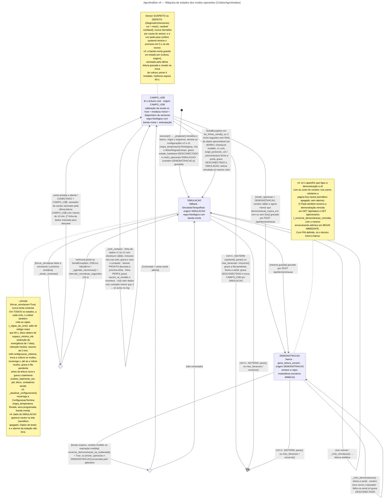
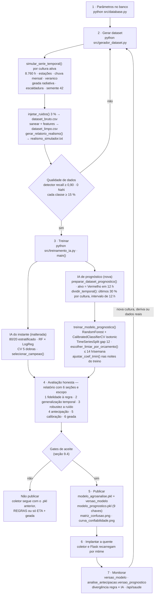
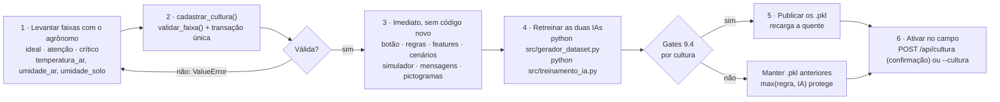
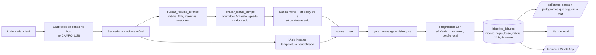

# Workflow e Governança — AgroAnálise v4

> **Parte 1 dos requisitos (Governança, Workflow e Diagramas), atualizada para a versão 4.** Escrito a partir do
> código final de `src/`, de `arduino/coleta_sensores.ino`, de `deploy/` e do banco `data/agroanalise.db` gerado do
> zero. Todos os números de exemplo foram calculados com as funções reais do projeto e com os dois `.pkl` publicados
> pela execução de referência (semente 42, 14/11/2026).
>
> Documentos irmãos: [Dicionário de Dados](DICIONARIO_DADOS.md) · [Mapeamento de Funções](MAPEAMENTO_FUNCOES.md) ·
> [CHANGELOG](../CHANGELOG.md) · [Pesquisa e referências](PESQUISA_REFERENCIAS.md) · Diagramas em
> [`diagramas/`](diagramas/) (`.mmd` + `.svg` renderizado).
>
> **O que a v2 acrescentou ao fluxo:** antecipação de estresse em 12 h (IA de prognóstico, quando a terra seca, geada
> ainda à tarde), avaliação honesta das IAs, mediana móvel e diagnóstico de sensores, protocolo serial v2 com
> checksum, gravação sem perda, retenção e backup, serviço 24/7 (systemd/waitress), pictogramas de ação, banca
> protegida por PIN, voz com bipes e página que funciona em rede fraca. A saída ao agricultor continua sendo **só o
> semáforo (0 Verde, 1 Amarelo, 2 Vermelho), a voz e, agora, até 3 pictogramas de ação** — sem gráficos.
>
> **O que a v3 acrescentou ao fluxo** (detalhes na [seção 11](#11-regra-térmica-da-v3-ia-em-dado-real-e-retorno-do-agricultor)
> e as fontes em [PESQUISA_REFERENCIAS.md](PESQUISA_REFERENCIAS.md)): regra térmica `fisiologica` (faixa do cliente
> sobre a média de 24 h, no máximo Amarelo; Vermelho só por geada no abrigo ou calor ≥ 34 °C na florada/2 dias
> seguidos), banda morta com off-delay no status gravado, janela de florada e seca programada, perfil do sensor de ar
> vindo do firmware, sonda de solo pulsada e calibrada no host, IA de prognóstico retreinada com o rótulo fisiológico
> e avaliada em dado real (ERA5-Land), aviso de geada com coeficientes por região e margem conformal, portão local de
> desempenho, certeza falada em dois níveis, causa visível, "Feito" de um toque, alarme na estação base, página do
> técnico e pedido de ajuda por WhatsApp.
>
> **O que a v4 acrescentou ao fluxo** (detalhes na [seção 12](#12-ux-de-campo-da-v4-página-que-diz-a-verdade-e-suíte-permanente),
> avaliação em [AVALIACAO_UX.md](AVALIACAO_UX.md)): nenhuma regra agronômica nem número do cliente mudou. Mudou a
> apresentação no fim do fluxo (E14–E15): `fala_curta` no `/api/status`, estado **neutro** para dado de teste e
> demonstração vista de fora, notícia antiga marcada pela forma, 503 ≠ sem ligação, "Feito" com desfazer e sem
> duplicata, avisos e diálogos falados, CSS estático imutável; o alarme da estação só toca leitura de campo; e uma
> **suíte permanente de validação UX** (`scripts/validar_ux.sh`, 70 metas) entra nos gates de publicação.

## Sumário

1. [Visão geral e arquitetura em camadas](#1-visão-geral-e-arquitetura-em-camadas)
2. [Workflow operacional: do solo à voz (passo a passo)](#2-workflow-operacional-do-solo-à-voz-passo-a-passo)
3. [Diagrama de sequência ponta a ponta](#3-diagrama-de-sequência-ponta-a-ponta)
4. [Máquina de estados dos modos operantes](#4-máquina-de-estados-dos-modos-operantes)
5. [Workflow de MLOps: gerar → treinar → avaliar → publicar (duas IAs)](#5-workflow-de-mlops-gerar--treinar--avaliar--publicar-duas-ias)
6. [Workflow de escalabilidade: cadastrar uma nova cultura](#6-workflow-de-escalabilidade-cadastrar-uma-nova-cultura)
7. [Modelo de dados (DER)](#7-modelo-de-dados-der)
8. [Operação 24/7 sem intervenção](#8-operação-247-sem-intervenção)
9. [Governança](#9-governança)
10. [Ordem de execução e verificação](#10-ordem-de-execução-e-verificação)
11. [Regra térmica da v3, IA em dado real e retorno do agricultor](#11-regra-térmica-da-v3-ia-em-dado-real-e-retorno-do-agricultor)
12. [UX de campo da v4: página que diz a verdade e suíte permanente](#12-ux-de-campo-da-v4-página-que-diz-a-verdade-e-suíte-permanente)

---

## 1. Visão geral e arquitetura em camadas

O AgroAnálise é um "Companheiro Virtual" para agricultores familiares com pouco ou nenhum letramento digital. Ele
mede o **microclima** (temperatura e umidade do ar) e a **umidade do solo onde o fruto se desenvolve**, cruza essas
variáveis com as faixas agronômicas da cultura e devolve a resposta **somente** como um semáforo (Verde, Amarelo,
Vermelho), com orientação falada em português e pictogramas do que fazer. Na v2 ele também **antecipa**: avisa em
Amarelo, com motivo e prazo falados, quando a lavoura deve entrar em risco nas próximas 12 horas. Na v3 a faixa de
temperatura do cliente passa a valer sobre a média de 24 h (o Vermelho térmico fica para a geada e o calor que aborta
flores), a IA é medida em dado climático real e o agricultor e o técnico passam a responder ao sistema.

| Camada | Arquivos | Responsabilidade |
|---|---|---|
| (1) Hardware IoT | `arduino/coleta_sensores.ino` | Ler DHT11 ou DHT22 (D2, em abrigo a 1,5 m) e higrômetro (A0, alimentação pulsada opcional), média móvel N=10, protocolo v2 com checksum, `nan` quando o DHT falha, watchdog de 8 s, linha de perfil `#AGROANALISE_PERFIL` (v3) |
| (2) Ingestão / Engenharia de Dados | `src/coletor_serial.py`, `src/qualidade_sensores.py`, `src/gerador_dataset.py`, `src/calibracao_sonda.py`, `src/referencia_climatica.py`, `referencia_climatica/` | Serial 24/7 com fallback, calibração da sonda no host (v3), saneamento, mediana móvel e diagnóstico de sensores, simulador climático realista e dataset, referência ERA5-Land offline (v3) |
| (3) IA / Persistência | `src/regras_agronomicas.py`, `src/treinamento_ia.py`, `src/prognostico.py`, `src/desempenho_local.py`, `src/database.py`, `models/`, `data/` | Regra térmica fisiológica e banda morta (v3), IA do instante + IA de prognóstico de 12 h, portão local (v3), decisão (regras + IA + antecipação), SQLite com gravação sem perda, retenção e backup |
| (4) Frontend Flask | `src/app.py`, `src/templates/index.html`, `src/templates/tecnico.html`, `src/acoes_orientacao.py`, `src/retorno_agricultor.py`, `src/seguranca_banca.py` | API JSON (`/api/status`, `/api/saude`), semáforo + causa + pictogramas que falam + voz, "Feito" e pedido de ajuda (v3), página do técnico (v3), banca protegida por PIN, gzip e estado embutido |
| Operação 24/7 | `src/servidor.py`, `src/registro.py`, `src/alarme_local.py`, `deploy/` | waitress, logs rotativos, serviços systemd com reinício (coletor, web, alarme) e timer do portão local (v3), instalador e inicializador do Windows |

Diagrama: [`diagramas/arquitetura_camadas.mmd`](diagramas/arquitetura_camadas.mmd) ([SVG](diagramas/arquitetura_camadas.svg)).

```mermaid
---
title: AgroAnálise v4 — Arquitetura em 4 camadas + operação 24/7 (nomes reais de arquivos e funções)
---
%%{init: {"flowchart": {"wrappingWidth": 440, "nodeSpacing": 40, "rankSpacing": 50}}}%%
flowchart TB
    agricultor(["Agricultor familiar<br/>celular ou computador no campo"])

    subgraph C1["(1) HARDWARE IoT"]
        direction TB
        solo_ar["Fenômeno físico<br/>solo onde o fruto se desenvolve + microclima do ar"]
        dht["DHT11 (padrão, ±2 °C) ou DHT22 (±0,5 °C) no pino D2<br/>AGRO_SENSOR_AR · em abrigo ventilado a 1,5 m do chão<br/>temperatura_ar °C · umidade_ar %"]
        hig["Higrômetro resistivo no pino A0<br/>ADC 0..1023 — escala invertida<br/>AGRO_PINO_ALIMENTACAO_SOLO: sonda ligada só 20 ms por medida (lerSoloComPulso)"]
        fw_media["amostrarHigrometro() a cada 100 ms com millis()<br/>média móvel N = 10 · buffer circular O(1)"]
        fw_envio["lerSensoresEEnviar() a cada 2000 ms<br/>enviarLinhaProtocolo(): $2,t,ur,solo*XX (XOR)<br/>DHT falhou → $2,nan,nan,solo*XX + #ERRO:DHT11_LEITURA_INVALIDA"]
        fw_diag["verificarHigrometro()<br/>#AVISO HIGROMETRO_CURTO_CIRCUITO · DESCONECTADO · FORA_DA_FAIXA"]
        wdt["Watchdog wdt_enable(WDTO_8S) · wdt_reset() no loop · LED heartbeat<br/>banner #AGROANALISE_PRONTO;PROTOCOLO=2<br/>+ #AGROANALISE_PERFIL;PROTOCOLO=2;AR=DHT11;SOLO=RESISTIVO;PULSO=0"]
        solo_ar --> dht
        solo_ar --> hig
        hig --> fw_media --> fw_envio
        dht --> fw_envio
        fw_media --> fw_diag
        fw_envio --> wdt
    end

    usb[/"USB serial 9600 bps · linhas CR LF<br/>v2: $2,21.0,65.0,72.4*XX · v1 legado: 21.0,65.0,72.4<br/>diagnóstico: linha iniciada por cerquilha"/]

    subgraph C2["(2) INGESTÃO / ENGENHARIA DE DADOS"]
        direction TB
        coletor["ColetorAgroAnalise.executar() — loop 24/7<br/>CAMPO_USB · SIMULACAO · DEMONSTRACAO · try/except por ciclo<br/>vigias: batimento, disco, relógio, retenção horária, resumo de 5 min"]
        porta["localizar_porta_arduino() · abrir_conexao_serial()<br/>ler_linhas_serial() · interpretar_linha_serial_detalhada()<br/>checksum calcular_checksum_nmea() · ContadoresProtocolo<br/>descarta a 1ª linha de dados após abrir a porta<br/>interpretar_perfil_firmware() → sensor_ar_modelo · incerteza_sensor_ar_c"]
        calibra["calibrar_umidade_solo() — só CAMPO_USB<br/>importlib calibracao_sonda.converter_umidade_solo()<br/>valor do Arduino → umidade_solo_firmware · identidade em qualquer falha"]
        simulador["SimuladorTempoReal.proxima_leitura()<br/>fallback automático: Modo Simulação"]
        cenario["gerar_leitura_cenario()<br/>CENARIOS_DEMONSTRACAO: Modo Demonstração"]
        saneador["SaneadorTempoReal.sanear()<br/>NaN · limites físicos do PERFIS_SENSOR_AR · LIMITES_SALTO · hold-last<br/>campo: semear() pela última leitura &lt; 10 min · plausibilidade física da queda do solo"]
        qualidade["qualidade_sensores.py<br/>FiltroMedianaMovel (12 leituras; crítico passa direto)<br/>DiagnosticoSensores → EstadoSensores OK · SUSPEITO · DEFEITO"]
        features["calcular_features()<br/>deficit_hidrico_solo · desvio_termico"]
        subgraph LOTE["Lote: gerar_dataset_completo"]
            direction LR
            simserie["simular_serie_temporal()<br/>8.760 h por cultura: estações, chuva mensal,<br/>veranico, geada radiativa, escaldadura"] --> ruido["injetar_ruidos()<br/>3 % nan · pico · negativo"]
            ruido --> detector["detectar_anomalias()"]
            detector --> sanear_lote["sanear_dataset()"]
            sanear_lote --> feat_df["calcular_features_dataframe()"]
            feat_df --> realismo["gerar_relatorio_realismo()"]
        end
        era5[("referencia_climatica/ — ERA5-Land 2018–2021<br/>Varginha MG · São Gabriel da Palha ES (CC BY 4.0, offline)<br/>referencia_climatica.carregar_referencia()")]
        coletor --> porta
        coletor --> simulador
        coletor --> cenario
        porta --> calibra --> saneador
        simulador --> saneador
        cenario --> saneador
        saneador --> qualidade --> features
    end

    subgraph C3["(3) IA / PERSISTÊNCIA"]
        direction TB
        processar["montar_registro_leitura() + gravar_registro_leitura()<br/>(processar_leitura = as duas)"]
        regras["MotorRegrasCampo.avaliar() → regras_agronomicas.avaliar_status_campo()<br/>regra_temperatura = fisiologica: faixa do cliente na média de 24 h (no máximo Amarelo)<br/>GEADA_AGORA ≤ 2 °C + incerteza · CALOR_FLORADA / CALOR_SEGUIDO ≥ 34 °C · SECA_PROGRAMADA<br/>banda morta 3 % + off-delay 60 s · instantanea (v2, banca, DATASET): calcular_status_regra()"]
        resumo["buscar_resumo_termico()<br/>média 24 h (≥ 18 h) · máxima de hoje e de ontem"]
        predicao["predizer_status() — IA do instante<br/>só culturas do treino; demais: REGRAS<br/>regra fisiológica: temperatura neutralizada no ponto médio do ideal"]
        pkl[("models/modelo_agroanalise.pkl<br/>RandomForestClassifier")]
        precaucao{{"status_alerta = max(status_regra, status_predito)<br/>sensor SUSPEITO/DEFEITO: max(1, variável confiável), nunca Vermelho"}}
        mensagem["gerar_mensagem_fisiologica() ou gerar_mensagem_orientacao()<br/>+ MENSAGEM_SENSOR_SOLO / MENSAGEM_SENSOR_AR"]
        antecipa["prognostico.aplicar_antecipacao() — via importlib<br/>só CAMPO_USB com sensores OK e ≥ 18 das últimas 24 h<br/>P(Vermelho em 12 h) ≥ limiar (Platt local; ignorado se prognostico_suspenso)<br/>ETA de secagem ≤ 12 h · geada: Tmin prevista − q90 ≤ 2 °C + incerteza<br/>certeza falada em 2 níveis · Verde → Amarelo, nunca cria Vermelho"]
        complemento[("models/complemento_prognostico.json<br/>climatologia mês × hora · coef_tmin e q90 por região")]
        portao["desempenho_local.avaliar_e_decidir() — timer de hora em hora<br/>Brier 28 d × climatologia · Page-Hinkley no log-loss<br/>prognostico_suspenso · platt_local · coef_tmin_local · quantis_tmin_local"]
        pkl_prog[("models/modelo_prognostico.pkl<br/>RandomForest + CalibratedClassifierCV isotonic")]
        inserir["inserir_leitura(registro, configuracoes_extras=batimento)<br/>fila deque(maxlen=720) se o banco travar"]
        banco[("data/agroanalise.db · SQLite WAL · auto_vacuum INCREMENTAL<br/>culturas · parametros_cultura · historico_leituras (+ motivo_regra, base_temperatura,<br/>temperatura_media_24h, umidade_solo_firmware) · configuracao_sistema<br/>analise_antecipacao · historico_agregado_hora<br/>v3: registro_acoes · eventos_interface · pedido_ajuda · calibracao_sonda")]
        csvs[("data/dataset_bruto.csv<br/>data/dataset_limpo.csv")]
        treino["treinamento_ia.main(--regra-temperatura)<br/>IA do instante: RF × LogisticRegression, 80/20 + CV 5<br/>IA de prognóstico: rótulo rotular_status_horario (fisiológico), dividir_temporal 70/30 + 12 h,<br/>limiar por orçamento · ajustar_coef_tmin_referencia + quantis_conformal_tmin por região<br/>avaliar_em_referencia() em ERA5-Land 2021 (SEÇÃO 7)"]
        relatorios[("reports/relatorio_treinamento.txt (seções com escopo + SEÇÃO 7 dado real)<br/>matriz_confusao.png · curva_confiabilidade.png<br/>realismo_simulador.txt")]
        retencao["aplicar_retencao() de hora em hora<br/>agrega por hora e apaga brutas &gt; 30 dias<br/>fazer_backup() · --compactar"]
        processar --> regras --> predicao
        resumo --> regras
        pkl --> predicao
        predicao --> precaucao --> mensagem --> antecipa --> inserir --> banco
        pkl_prog --> antecipa
        complemento --> antecipa
        portao -- "definir_configuracao()" --> banco
        treino -- "salvar_complemento_prognostico()" --> complemento
        antecipa -- "gravar_analise_antecipacao()" --> banco
        csvs --> treino
        treino -- "salvar_modelo()" --> pkl
        treino -- "salvar_modelo_prognostico()" --> pkl_prog
        treino --> relatorios
        retencao --> banco
    end

    subgraph C4["(4) FRONTEND FLASK"]
        direction TB
        flask["app.py · JSON pt-BR · gzip acima de 1 KB · MAX_CONTENT_LENGTH 4096<br/>GET /api/status → montar_status() (+ causa, causa_silenciada, v4: fala_curta, aparelho_da_banca) · GET /api/saude (componentes, prognostico, 503)<br/>v4: GET /static/agro.&lt;hash&gt;.css (immutable, 1 ano) · GET /api/culturas com ETag/304<br/>sem PIN, com limite por IP: POST /api/acao_feita (sem duplicata em 60 s) · /api/acao_feita/desfazer (até 120 s) · /api/pedido_ajuda · /api/evento<br/>PIN errado → 403 codigo pin_errado · bloqueio → 429 segundos_restantes<br/>com PIN X-PIN-Banca: /api/cultura · /api/demonstracao · /api/tecnico/* · /api/banca/florada · /api/banca/seca_programada · /api/calibracao/*"]
        acoes["acoes_orientacao.derivar_acoes() + derivar_causa()<br/>até 3 pictogramas = as ordens faladas (acoes_faladas, acoes_cobrem_mensagem) · causa TERRA_SECA · ENCHARCADO · FRIO_GEADA · CALOR · APARELHO<br/>v4: montar_fala_curta() — cor + ação na 2ª frase + causa, ≤ 15 palavras, sem números"]
        retorno["retorno_agricultor.py<br/>registrar_acao_sem_repetir · desfazer_acao · causa_silenciada 60 min · registrar_pedido_ajuda (link wa.me)<br/>montar_resumo_tecnico (7 dias, sem a demonstração)"]
        calib_mod["calibracao_sonda.py<br/>capturar_ponto · concluir_dois_pontos · aferir_um_ponto"]
        tecnico["tecnico.html — /tecnico (PIN)<br/>resumo de 7 dias · copiar para WhatsApp · calibrar a sonda (retorno junto do botão)<br/>v4: Calendário do café — seca programada e florada com confirmação"]
        pin["seguranca_banca.py<br/>PBKDF2-SHA256 · LimitadorTentativas 5 erros/60 s"]
        pagina["index.html + agricultor.css (sem CDN; GET / ≤ 15.000 B gzip, CSS crítico inline)<br/>semáforo deitado ≥ 72 px · data-estado neutro (teste, demonstração de fora) · data-confianca (antiga, sem-ligacao, erro-servidor…)<br/>título + desenho da causa · pictogramas que falam ao toque · ? contextual · Feito com Desfazer 15 s · Chamar o técnico<br/>&lt;dialog&gt; modal · #anunciador único · estado embutido · consulta adaptativa 5 s → 60 s"]
        voz["Web Speech API pt-BR<br/>1º toque fala_curta · 2º mensagem completa · 3º mais devagar (0,8; 0,85 lembrada)<br/>avisos e diálogos sempre falados · sem voz pt → bipes Web Audio 1/2/3<br/>repete o Vermelho a cada 600 s (nunca com teste ou demonstração)"]
        banca["Área da banca recolhida (?banca=1 ou toque longo de 2 s)<br/>só cenários de demonstração · Voltar ao normal · link para /tecnico<br/>troca de cultura com confirmação falada"]
        flask --> pagina --> voz
        acoes --> flask
        pin --> flask
        retorno --> flask
        calib_mod --> flask
        tecnico -- "GET /api/tecnico/resumo com X-PIN-Banca" --> flask
        pagina --> banca
        banca -- "POST com X-PIN-Banca" --> flask
    end

    subgraph OPS["OPERAÇÃO 24/7"]
        direction LR
        systemd["agroanalise-coletor · agroanalise-web · agroanalise-alarme (.service)<br/>agroanalise-desempenho.service + .timer (de hora em hora, Persistent=true)<br/>Restart=always · RestartSec=5 · SupplementaryGroups=dialout<br/>instalar.sh (glob deploy/agroanalise-*) · iniciar_windows.bat"]
        alarme["alarme_local.executar()<br/>bipes na estação base: transição para Vermelho · geada das 17–20 h<br/>v4: só leitura CAMPO_USB toca (nunca Simulação nem Demonstração)<br/>silêncio 21:30–05:00 (geada fura) · Feito silencia · no máximo 3 toques em 10 min"]
        servidor["servidor.py — waitress (8 threads)<br/>AGRO_HOST · AGRO_PORTA · AGRO_BANCO"]
        logs["registro.configurar_logs()<br/>logs/coletor.log · logs/web.log · 5 × 5 MB + journald"]
        systemd --> servidor
        systemd --> logs
        systemd --> alarme
    end

    subgraph UX["VALIDAÇÃO UX PERMANENTE (v4)"]
        direction LR
        suite["scripts/validar_ux.sh · 70 metas (tests/e2e/validacao/metas_v4.json)<br/>servidor_estados.py: 26 estados forçados num banco temporário<br/>axe-core · Lighthouse · contraste próprio · oclusão · pixels das lâmpadas · regiões vivas · bytes<br/>coerencia.py · legibilidade.py → reports/ux4/&lt;data&gt;/resultado.json"]
    end
    suite -. "Chromium (Playwright)" .-> pagina
    suite -. "importa app.app e montar_status" .-> flask

    fw_envio --> usb --> porta
    fw_diag --> usb
    features --> processar
    feat_df --> csvs
    banco -- "buscar_historico() ordem id_leitura · obter_analise_antecipacao()" --> flask
    flask -- "definir_configuracao() · injetar_leitura_cenario()" --> banco
    coletor -- "configurações a cada ciclo · batimento na mesma transação" --> banco
    servidor --> flask
    systemd --> coletor
    systemd --> portao
    alarme -- "ler_situacao(): buscar_historico() · causa_silenciada()" --> banco
    era5 --> treino
    banco -- "buscar_resumo_termico() · buscar_ultima_leitura_origem()" --> resumo
    calib_mod -- "calibracao_sonda (tabela)" --> banco
    banco -- "converter_umidade_solo() lê a calibração ativa" --> calibra
    tecnico_pessoa(["Técnico de ATER<br/>WhatsApp no celular"])
    tecnico_pessoa --> tecnico
    pagina -- "link wa.me aberto pelo celular" --> tecnico_pessoa
    voz --> agricultor
    pagina --> agricultor
    alarme --> agricultor
    agricultor -- "toca a voz, um pictograma ou ? · Feito · Chamar o técnico · confirma troca de cultura" --> pagina

    classDef hardware fill:#fff3e0,stroke:#e65100,color:#3e2723
    classDef dados fill:#e3f2fd,stroke:#1565c0,color:#0d47a1
    classDef ia fill:#ede7f6,stroke:#4527a0,color:#311b92
    classDef web fill:#e8f5e9,stroke:#2e7d32,color:#1b5e20
    classDef ops fill:#eceff1,stroke:#455a64,color:#263238
    class dht,hig,fw_media,fw_envio,fw_diag,wdt,solo_ar hardware
    class coletor,porta,calibra,simulador,cenario,saneador,qualidade,features,simserie,ruido,detector,sanear_lote,feat_df,realismo,era5 dados
    class processar,regras,resumo,predicao,precaucao,mensagem,antecipa,inserir,treino,retencao,portao ia
    class flask,acoes,pin,pagina,voz,banca,retorno,calib_mod,tecnico web
    class systemd,servidor,logs,alarme,suite ops
```



---

## 2. Workflow operacional: do solo à voz (passo a passo)

Visão resumida (cada caixa é uma etapa detalhada abaixo; as marcadas com ★ são novas ou mudaram na v2):

```mermaid
flowchart LR
    E1["E1 Fenômeno físico<br/>solo e ar"] --> E2["E2 Sensores<br/>DHT11 + higrômetro"]
    E2 --> E3["E3 Firmware ★<br/>média móvel · watchdog"]
    E3 --> E4["E4 Serial v2 ★<br/>checksum XOR"]
    E4 --> E5["E5 Coletor ★<br/>estados + vigias"]
    E5 --> E6["E6 Saneamento ★<br/>NaN · limites · picos · queda física"]
    E6 --> E6b["E6b Qualidade dos sensores ★<br/>mediana · diagnóstico"]
    E6b --> E7["E7 Features<br/>déficit · desvio"]
    E7 --> E8["E8 Motor de regras"]
    E7 --> E9["E9 IA do instante"]
    E8 --> E10{{"E10 Precaução ★<br/>max(regra, IA) · sensor"}}
    E9 --> E10
    E10 --> E11["E11 Mensagem falada ★"]
    E11 --> E12["E12 Antecipação 12 h ★<br/>Verde → Amarelo"]
    E12 --> E13[("E13 SQLite ★<br/>fila · batimento")]
    E13 --> E14["E14 Flask JSON ★<br/>/api/status · /api/saude"]
    E14 --> E15["E15 Semáforo, pictogramas e voz ★"]
```



### E1 — Fenômeno físico (solo e ar)

O que importa para o café é a água disponível na zona das raízes e a temperatura/umidade do ar em volta da planta. A
falta de água (estresse hídrico), o excesso (raiz sem oxigênio), o calor (escaldadura, abortamento de flores) e o frio
(geada) são os quatro riscos que o sistema traduz em semáforo. A v2 passou a olhar também a **tendência**: a terra
que seca 1 ponto por hora, a tarde seca e fria que prenuncia geada, o veranico de janeiro.

### E2 — Sensores

| Sensor | Pino | Grandeza | Faixa física aceita pelo software (`LIMITES_FISICOS_SENSORES`) |
|---|---|---|---|
| DHT11 (com pull-up 10 kΩ entre DATA e VCC) | D2 (`PINO_DHT 2`, `TIPO_DHT DHT11`) | `temperatura_ar` (°C) e `umidade_ar` (%) | 0–50 °C · 0–100 % |
| Higrômetro resistivo (saída analógica do módulo) | A0 (`PINO_HIGROMETRO`) | `umidade_solo` (%) a partir do ADC 0..1023 | 0–100 % |

O higrômetro tem escala **invertida**: solo seco = alta resistência = ADC perto de 1023; solo encharcado = ADC perto
de 300. O DHT11 não mede abaixo de 0 °C: numa geada forte o valor mínimo registrado é 0 °C (o aviso de geada da v2 sai
antes, ainda à tarde — E12).

### E3 — Firmware (`coleta_sensores.ino`, protocolo 2)

1. `setup()`: `Serial.begin(9600)`, `dht.begin()`, `preencherBufferSolo()`, watchdog `wdt_enable(WDTO_8S)` (só em placa
   AVR com `AGRO_USAR_WATCHDOG 1`) e o banner `#AGROANALISE_PRONTO;PROTOCOLO=2`.
2. `loop()` não bloqueante com `millis()`: `wdt_reset()` a cada volta; a cada **100 ms** `amostrarHigrometro()` (média
   móvel **N = 10** em O(1)); a cada **2000 ms** `lerSensoresEEnviar()`.
3. `lerSensoresEEnviar()`:
   - `verificarHigrometro(media)` emite `#AVISO:HIGROMETRO_CURTO_CIRCUITO` (média < 5), `#AVISO:HIGROMETRO_DESCONECTADO`
     (600 amostras = 60 s cravadas em 1023) e `#AVISO:HIGROMETRO_FORA_DA_FAIXA`;
   - se `isnan(t) || isnan(h)`: `tratarFalhaDht()` envia `#ERRO:DHT11_LEITURA_INVALIDA` (5 falhas seguidas → `dht.begin()`
     e `#AVISO:DHT11_REINICIADO`) **e, na v2, a linha de dados sai mesmo assim** com `nan` no ar — a umidade do solo
     continua sendo medida;
   - `enviarLinhaProtocolo(t, h, solo)` monta `$2,t,h,solo*XX` com 1 casa decimal e `XX` = `calcularChecksum()` (XOR
     dos bytes entre `$` e `*`, hexadecimal maiúsculo) e pisca o `LED_BUILTIN`.
4. Conversão (`converterAdcParaPercentual`): `umidade_solo = (1023 − média) × 100 / (1023 − 300)`, com `constrain`
   0..100. Exemplo: média 650 → **51,6 %**.
5. Se o programa travar (ruído elétrico, biblioteca presa), o watchdog reinicia a placa em 8 s; o coletor reconhece o
   banner e descarta a próxima linha de dados (pode vir cortada).

Verificação sem placa: `g++ -fsyntax-only -x c++ -I tests/stubs_arduino arduino/coleta_sensores.ino`, com e sem
`-D__AVR__` (stubs `Arduino.h`, `DHT.h`, `avr/wdt.h`). Não há toolchain AVR nem placa física no ambiente de testes.

### E4 — Protocolo serial (v2 com checksum, v1 aceito)

| Tipo de linha | Formato | Exemplo | Tratamento no coletor (`interpretar_linha_serial_detalhada`) |
|---|---|---|---|
| Dado v2 | `$2,t,ur,solo*XX` | `$2,21.0,65.0,72.4*XX` | checksum conferido por `calcular_checksum_nmea` → `(21.0, 65.0, 72.4)`, contador `serial_linhas_v2` |
| Dado v2 com DHT11 falho | `$2,nan,nan,solo*XX` | `$2,nan,nan,70.0*XX` | `(None, None, 70.0)`: ciclo com dados (não desconecta); o saneador segura o ar |
| Checksum inválido | — | um dígito trocado no cabo | descartada, `serial_checksum_invalido += 1` (em vez de virar alarme falso) |
| Dado v1 (legado) | `t,ur,solo` | `21.0,65.0,72.4` | aceito e contado em `serial_linhas_v1`; recusado se `exigir_protocolo_v2 = true` |
| Diagnóstico | começa com `#` | `#ERRO:DHT11_LEITURA_INVALIDA` | vai para `DiagnosticoSensores.registrar_diagnostico` |
| Malformada / lixo | ≠ 3 campos, não numérico, > 256 bytes | `21.0;65` | descartada |

Depois de cada abertura da porta, a **1ª linha de dados é descartada** (`serial_linhas_descartadas`): o reset da placa
ao abrir a porta pode cortar a linha (ex.: `1.0,65.0,70.2`, que seria lida como 1 °C e viraria "Perigo, geada").
`interpretar_linha_serial(linha)` mantém a assinatura e o retorno da v1.

### E5 — Coletor 24/7 e máquina de estados (`ColetorAgroAnalise.executar`)

Cada ciclo (padrão 5 s) é protegido por `try/except`. Ordem de um ciclo:

1. `_vigias_do_ciclo()`: compara Δ`time.time()` com Δ`time.monotonic()` (salto > 60 s → WARNING e
   `relogio_ultimo_salto_em`); mede o disco com `shutil.disk_usage` (abaixo de `espaco_minimo_mb` → ERROR e
   `aplicar_retencao(dias_brutos=7)`); roda `aplicar_retencao(retencao_dias_brutos)` uma vez por hora (a primeira 5 min
   depois de iniciar);
2. `_atualizar_configuracoes()`, `_verificar_troca_cultura()` e `_verificar_modelo()` (recarga a quente do `.pkl`);
3. demonstração ativa → `_ciclo_demonstracao()`;
4. desconectado e é hora → `_tentar_conectar()`; ao conectar, o saneador do campo é **semeado** pela última leitura
   `CAMPO_USB` com menos de 10 min (`buscar_ultima_leitura_origem` + `SaneadorTempoReal.semear`), o que impede um
   primeiro valor absurdo de virar o novo "último válido";
5. `_sincronizar_estado_gravado()`;
6. conectado → `_ciclo_campo()`: lê todas as linhas, conta o protocolo, avalia os sensores e processa a linha de dados
   mais recente; se o Arduino caiu **neste** ciclo, `_ciclo_simulacao()` grava uma leitura sintética no mesmo ciclo;
7. gravação: a fila pendente (se houver) é gravada em lote **antes** da leitura nova; a leitura vai com o batimento
   (`coletor_batimento_em`, `coletor_pid`, `disco_livre_mb`, `coletor_fila_pendente`, `serial_*`) na **mesma
   transação**; se o banco estiver travado (`sqlite3.OperationalError`), a leitura entra numa `deque(maxlen=720)`;
8. a cada 5 min, uma linha INFO de resumo (contagem por cor, modo, fila, sensores, protocolo e disco). A linha por
   leitura agora é DEBUG (`--verboso`).

Os gatilhos completos estão na [seção 4](#4-máquina-de-estados-dos-modos-operantes).

### E6 — Saneamento de anomalias

As **mesmas regras** são aplicadas em lote (dataset de treino, pandas) e em tempo real (coletor).

| Regra | Rótulo | Lote — `detectar_anomalias()` | Tempo real — `SaneadorTempoReal.sanear()` |
|---|---|---|---|
| Valor ausente (NaN, `None`, `nan` do firmware) | `nan` | `isna()` | → `None`, hold-last |
| Abaixo do mínimo físico | `negativo` | `valor < LIMITES_FISICOS_SENSORES[min]` | idem |
| Acima do máximo físico | `pico` | `valor > máximo` | idem |
| Salto implausível | `pico` | `|v − mediana móvel(5)| > LIMITES_SALTO` | `|v − último válido| > LIMITES_SALTO` |
| **Correção** | — | NaN + `interpolate(method="linear")` por cultura | *hold-last*: repete o último valor válido |
| Mudança real persistente | — | a mediana acompanha | após **3** leituras coerentes recusadas, aceita o novo patamar |
| **v2 — queda física do solo** (só no campo, `plausibilidade_fisica=True`) | `pico` | — | uma QUEDA maior que `LIMITES_SALTO` só vira patamar se couber em `15 p.p. + 8 p.p./h × horas decorridas`; a SUBIDA (chuva, rega) segue a regra das 3 leituras |
| **v2 — hold-last limitado** (campo, `limite_hold_last=30`) | — | — | depois de 30 leituras seguradas, a variável é marcada para o diagnóstico (DHT11 em `DEFEITO`) |

`LIMITES_SALTO`: temperatura 8 °C, umidade do ar 30 p.p., umidade do solo 15 p.p. O valor bruto é preservado em
`*_bruta`. O padrão de `SaneadorTempoReal(parametros)` continua idêntico ao da v1 (demonstração e testes antigos); só o
saneador do campo liga as proteções novas.

**Exemplo em tempo real** (Café Arábica, saída real do `SaneadorTempoReal` da v2 com o padrão):

| leitura bruta (T, UR, solo) | resultado | flag | descrição |
|---|---|---|---|
| 20.4, 68.0, 71.2 | aceita | 0 | |
| 20.6, 67.5, **−3.0** | solo = 71.2 (hold-last) | 1 | `umidade_solo:negativo` |
| **None**, 67.0, 71.0 | T = 20.6 (hold-last) | 1 | `temperatura_ar:nan` |
| 20.7, 66.9, **95.0** | solo = 71.0 (salto de 24 p.p. > 15) | 1 | `umidade_solo:pico` |
| 20.7, 66.9, 95.2 | solo = 71.0 (2º candidato) | 1 | `umidade_solo:pico` |
| 20.8, 66.5, 95.1 | **95.1 aceito** (3ª leitura coerente: novo patamar real, ex. irrigação) | 0 | |

No dataset gerado (17.520 linhas): 526 células corrompidas por sensor (3,00 %), 1.533 linhas com `flag_anomalia = 1`
(8,75 %), detector cego ao gabarito com recall 1,0000, precisão 0,9993 e F1 0,9997.

### E6b — Qualidade dos sensores (`qualidade_sensores.py`, novo)

Aplicado só às leituras de campo (`CAMPO_USB`), depois do saneamento e antes da regra:

1. **Mediana móvel** (`FiltroMedianaMovel`, janela `janela_mediana_leituras = 12`, idade máxima 90 s): tira o
   "tremido" do sensor perto de uma borda. O buffer é zerado quando muda a cultura/origem ou há lacuna > 90 s.
   **Exceção de segurança:** temperatura ou solo além de `critico_min`/`critico_max` sai na hora, sem mediana — um
   perigo real nunca espera 12 leituras. Medido na avaliação do treino (seção 3 do relatório): com ruído σ = 0,5 °C /
   1 p.p., a cor errada cai de 8,82 % para 3,25 %; com σ = 2 °C / 3 p.p., de 30,97 % para 11,07 %.
2. **Diagnóstico** (`DiagnosticoSensores.avaliar` → `EstadoSensores(estado_solo, estado_ar, descricao)`):

   | Regra | Estado |
   |---|---|
   | Solo bruto idêntico (1 casa) por ≥ `minutos_travamento_solo` (60 min) | solo `SUSPEITO` |
   | Temperatura **e** umidade do ar idênticas por ≥ `horas_travamento_ar` (3 h) | ar `SUSPEITO` |
   | Solo exatamente 0,0 ou 100,0 por ≥ 3 leituras | solo `DEFEITO` |
   | `#AVISO:HIGROMETRO_DESCONECTADO` do firmware | solo `DEFEITO` por 120 s |
   | Temperatura ausente por > 30 leituras seguidas | ar `DEFEITO` |

3. **Decisão com sensor não confiável** (`_decidir_com_sensor_suspeito`): `status_alerta = max(1, status da variável
   confiável)` — nunca Vermelho por causa do sensor suspeito — e a voz pede para conferir:
   `MENSAGEM_SENSOR_SOLO` = "O sensor da terra parece solto ou quebrado. Confira o espeto na terra. Não regue só por
   causa deste aviso: olhe a terra com a mão." ou `MENSAGEM_SENSOR_AR` = "O sensor do ar está com defeito. A água da
   terra continua sendo medida.", precedidas da orientação da variável confiável quando ela não for Verde. Com o solo
   em `DEFEITO` e calor crítico real (34 °C), o status é 2 pela temperatura: o perigo verdadeiro não fica escondido.

### E7 — Features derivadas (`calcular_features`)

Inalteradas na v2. Seja a faixa **ideal** da cultura em `parametros_cultura`:

```
deficit_hidrico_solo = ideal_min_solo − umidade_solo   se umidade_solo < ideal_min_solo   (> 0: FALTA de água, em p.p.)
                     = ideal_max_solo − umidade_solo   se umidade_solo > ideal_max_solo   (< 0: EXCESSO / encharcamento)
                     = 0                               dentro da faixa ideal

desvio_termico       = temperatura_ar − ideal_max_temp se temperatura_ar > ideal_max_temp (> 0: CALOR, em °C)
                     = temperatura_ar − ideal_min_temp se temperatura_ar < ideal_min_temp (< 0: FRIO)
                     = 0                               dentro da faixa ideal
```

Faixas ideais: **Arábica** temperatura 18–22 °C, solo 60–80 % · **Conilon** temperatura 22–26 °C, solo 55–75 %.

| Leitura (T °C, UR %, solo %) | Cultura | déficit | desvio | classe T | classe solo | status_regra |
|---|---|---|---|---|---|---|
| 24.5, 60, 52.0 | Arábica | **8.0** | **2.5** | 1 (15–25) | 1 (50–60) | **1** |
| 24.5, 60, 52.0 | Conilon | **3.0** | **0.0** | 0 | 1 (45–55) | **1** |
| 16.0, 80, 85.0 | Arábica | **−5.0** | **−2.0** | 1 (15–18) | 1 (80–88) | **1** |
| 16.0, 80, 85.0 | Conilon | **−10.0** | **−6.0** | 2 (< 19) | 2 (> 83) | **2** |
| 31.0, 45, 40.0 | Arábica | **20.0** | **9.0** | 2 (> 25) | 2 (< 50) | **2** |
| 20.0, 70, 70.0 | Arábica | **0.0** | **0.0** | 0 | 0 | **0** |
| 20.0, 70, 70.0 | Conilon | **0.0** | **−2.0** | 1 (19–22) | 0 | **1** |

A IA de prognóstico usa outro conjunto de 36 **features temporais** (variações de 1/3/6/12 h, médias e extremos de 6 e
24 h, VPD, horas em estresse, margens até as bordas normalizadas pela largura da faixa ideal, hora do dia em seno e
cosseno e `horas_ate_secar`), calculadas por `prognostico.calcular_features_temporais` — ver E12 e o
[Dicionário, seção 14](DICIONARIO_DADOS.md#14-pacote-modelsmodelo_prognosticopkl-ia-de-prognóstico-novo).

### E8 — Motor de regras agronômicas (`calcular_status_regra`)

> **v3:** com `regra_temperatura = 'fisiologica'` (semeada pelo coletor) o componente de temperatura passa a ser
> julgado por `regras_agronomicas.avaliar_status_campo` — faixa do cliente sobre a média de 24 h, no máximo Amarelo;
> Vermelho só por geada no abrigo (≤ 2 °C + incerteza do sensor) ou calor ≥ 34 °C na florada/2º dia — e o status
> gravado passa por banda morta com off-delay. O texto abaixo descreve a regra `instantanea`, que continua valendo
> para a banca (`DEMONSTRACAO`), o `DATASET` e bancos sem a chave. Ver [seção 11](#11-regra-térmica-da-v3-ia-em-dado-real-e-retorno-do-agricultor).

Regra `instantanea`: `status_regra = max(classificar_variavel(temperatura_ar), classificar_variavel(umidade_solo))`, com ideal → 0;
entre ideal e atenção → 1; fora da atenção → 2. É o **rótulo-verdade** do dataset e a rede de segurança das IAs. Os
limites **críticos** não mudam a cor (já é vermelho), mas tornam a mensagem "Urgente!" e furam a mediana móvel (E6b).

### E9 — IA do instante (`predizer_status` com `models/modelo_agroanalise.pkl`)

Mesmo fluxo da v1 (pacote validado, recarga por `mtime`, `DataFrame` com as 5 features na ordem do pacote, `REGRAS`
sem `.pkl` ou para cultura fora de `culturas`). O conjunto de chaves do pacote não mudou. Exemplos reais com o modelo
publicado (`RandomForestClassifier-20261114111842`): Arábica (24,5; 60; 52) → 1, p = 0,9867; Conilon (16; 80; 85) → 2,
p = 0,96; Conilon (20; 70; 70) → 1, p = 0,99; Arábica (20; 70; 70) → 0, p = 0,9967.

Leitura honesta (seção 1 do relatório de treino): esta IA **reproduz a regra do mesmo instante** — 100 % de acerto e
FP = FN = 0 no teste aleatório e na validação cruzada medem **fidelidade à regra, não desempenho de campo**. Por isso
a v2 acrescentou a IA de prognóstico (E12), que tenta prever o que a regra ainda não vê.

### E10 — Princípio da precaução (e o sensor suspeito)

```
sensores OK:                 status_alerta = max(status_regra, status_predito)
sensor SUSPEITO ou DEFEITO:  status_alerta = max(1, status da variável confiável)      (nunca 2 pelo sensor ruim)
antecipação (E12):           status_alerta = max(status_alerta, 1) quando há gatilho     (nunca cria 2, nunca rebaixa)
```

As três decisões continuam gravadas (`status_regra`, `status_predito`, `status_alerta`) e, na v2, também
`estado_sensor`/`diagnostico_sensor` e a análise de antecipação (`analise_antecipacao`).

### E11 — Mensagem falada (`gerar_mensagem_orientacao`)

Estrutura **ESTADO + CAUSA + AÇÃO**, frases curtas, números inteiros, "graus" e "por cento" no lugar de símbolos,
"Urgente!" além do limite **crítico**. Exemplos reais da v2:

| Cultura | Leitura (T, solo) | status | Mensagem |
|---|---|---|---|
| Arábica | 20,0 / 70,0 | 0 | "Tudo bem com a plantação de café arábica. A terra está molhada na medida e o tempo está bom. Não precisa fazer nada agora." |
| Arábica | 24,5 / 52,0 | 1 | "Atenção com a plantação de café arábica. A terra está secando, com só 52 por cento de água. Está quente, 25 graus. Regue hoje no fim da tarde, quando o sol baixar." |
| Conilon | 16,0 / 85,0 | 2 | "Perigo para a plantação de café conilon. A terra está encharcada, com 85 por cento de água. Está frio demais, 16 graus. Pare de regar e abra valetas para a água escorrer. Cubra as mudas novas e chegue terra no pé das plantas antes de escurecer." |
| Arábica | 6,0 / 70,0 | 2 | "Urgente! Perigo para a plantação de café arábica. Está frio demais, 6 graus. **Está gelando agora.** Cubra as mudas e chegue terra no pé das plantas assim que puder." |
| Arábica | 33,0 / 45,0 | 2 | "Urgente! Perigo para a plantação de café arábica. A terra está muito seca, com só 45 por cento de água. Está quente demais, 33 graus. Regue hoje, devagar, até a terra ficar úmida. Prefira o fim da tarde. Faça sombra nas mudas novas." |

**Mudança deliberada da v2:** abaixo de `critico_min` a frase antiga "Hoje à noite pode gear. Cubra as mudas…" virou
"Está gelando agora. Cubra as mudas e chegue terra no pé das plantas assim que puder." — a geada já está acontecendo;
o aviso "pode gear" passou a sair **antes**, ainda à tarde (E12). As palavras-chave de ação ("Regue agora", "fim da
tarde", "de manhã", "Não regue"/"Pare de regar", "valetas", "sombra", "Cubra as mudas"/"Proteja as mudas", "chegue
terra", "Não precisa fazer nada") continuam nas mesmas condições, porque os pictogramas (E15) dependem delas — há um
teste de propriedade em 5.000 linhas do simulador.

### E12 — Antecipação de estresse em 12 h (`prognostico.aplicar_antecipacao`, novo)

Chamada pelo coletor (via `importlib`, opcional) **só** para leituras `CAMPO_USB` com sensores `OK`, depois da
mensagem e antes da gravação. Nunca lança exceção: qualquer falha vira log e a leitura segue como veio.

1. **Histórico:** `buscar_serie_horaria` faz um `SELECT` read-only com `AVG` por hora nas últimas 24 h (só a origem
   `CAMPO_USB` e `flag_anomalia = 0`, com cache por banco/cultura/hora) e inclui a leitura atual. Com menos de **18 das
   24 h** com dados, devolve o registro intacto e nenhum resultado (`HORAS_MINIMAS_HISTORICO`).
2. **Três gatilhos**, avaliados só quando `status_regra < 2`:

   | Gatilho | Como é calculado | Constantes |
   |---|---|---|
   | IA de prognóstico | `predizer_risco_futuro` → P(entrar no Vermelho nas próximas 12 h) do RandomForest calibrado; dispara se `P ≥ pacote['limiar']` (0,3165 no pacote publicado) | `HORIZONTE_PROGNOSTICO_HORAS = 12` |
   | Quando a terra seca | `estimar_horas_ate_secar`: perda líquida das últimas 24 h até `atencao_min` do solo; `None` se houve subida > 1 pp/h (chuva/rega), perda ≤ 0,02 pp/h ou ETA > 72 h; dispara com ETA ≤ 12 h | `TETO_HORAS_ATE_SECAR = 72` |
   | Geada ainda à tarde | `prever_temperatura_minima_noite`: média de 17 h até agora (≥ 30 min de dados) entre 17 h e 23:59, ou a tarde anterior de 0 h a 6 h; `Tmin = a + b·T_tarde + c·Td_tarde` com `Td` = `ponto_orvalho_magnus`; dispara se `Tmin < critico_min + 2 °C`. Fora de 17 h–6 h devolve `None` (a frase "pode gear" nunca sai entre 6 h e 16 h) | `COEF_TMIN_PADRAO = (-1.0, 0.25, 0.75)`, ajustados no treino para `(0.116, -0.153, 1.147)`; `MARGEM_GEADA_C = 2.0` |

3. **Decisão:** com gatilho, `dataclasses.replace(registro, status_predito=max(·,1), status_alerta=max(·,1),
   mensagem_voz=nova)` — nenhum outro campo muda, nada vira 2. Sem gatilho, ainda pode acrescentar **uma** frase sem
   mudar a cor: frio leve ("Esta noite vai fazer frio. Proteja as mudas novas.") se `Tmin < atencao_min`, ou a frase
   condicional "Se não chover nem regar, a terra deve ficar muito seca <prazo>." se o ETA for ≤ 24 h.
4. **Explicação** (`explicar_alerta`): motivo em `MOTIVOS` (`SECA_CHEGANDO`, `SECA_AGORA`, `ENCHARCAMENTO`,
   `CALOR_TARDE`, `GEADA_NOITE`, `FRIO`, `NENHUM`). Quando o Amarelo vem do modelo, o motivo sai de um **contrafactual
   determinístico**: os grupos de features `solo` e `temperatura` são levados ao ponto neutro e vence o que mais reduz
   P. `horas_em_estresse` = horas seguidas fora da faixa ideal no fim da série.
5. **Frase** (`gerar_frase_antecipacao` + `falar_prazo`, no máximo 4 frases, começando com "Atenção com a plantação
   de …"): o prazo é dito sem números — "daqui a pouco", "hoje à tarde", "esta noite", "amanhã de manhã", "amanhã à
   tarde", "em uns 2 dias". Exemplos reais: "Ainda está tudo bem, mas a terra está secando e deve ficar seca amanhã de
   manhã. Regue hoje no fim da tarde."; "Esta noite pode gear. Antes de escurecer, cubra as mudas novas e chegue terra
   no pé das plantas."; com 24 h de secagem a 1 pp/h até 51 %: "A terra está seca há 9 horas e deve ficar muito seca
   daqui a pouco. Regue agora, devagar, até a terra ficar úmida."
6. **Persistência:** depois de `inserir_leitura`, `gravar_analise_antecipacao(id_leitura, resultado)` grava a tabela
   própria `analise_antecipacao` (FK com `ON DELETE CASCADE`), lida pelo Flask com `obter_analise_antecipacao`.

O coletor ainda se defende: copia só `status_predito`, `status_alerta` e `mensagem_voz` e só aceita se
`registro.status_alerta ≤ novo ≤ max(registro.status_alerta, 1)`; fora disso, WARNING e o registro original.

**Mudanças da v3 na antecipação** (só com `regra_temperatura = 'fisiologica'`; no modo `instantanea` tudo fica como
acima): o gatilho de geada passa a ser `Tmin_prevista − margem ≤ limiar_geada_abrigo_c + incerteza_sensor_ar_c`
(padrão 2,0 + 2,0 °C), com coeficientes da mínima por prioridade local (`coef_tmin_local`) > região
(`complemento_prognostico.json`) > pacote > `COEF_TMIN_PADRAO` e margem = quantil q90 conformal da estação (seca
mai.–set., águas out.–abr.); a mínima abaixo da atenção sem chegar à geada vira frase de **frio**, sem "Cubra as
mudas". Com `prognostico_suspenso = true` o gatilho do modelo é ignorado (geada e secagem continuam); com `platt_local`
a probabilidade é recalibrada antes do limiar; quando o gatilho é o modelo, a frase diz a certeza em dois níveis ("É
quase certo que…" para p ≥ 0,8, "Pode ser que…" abaixo), sem números. Fontes: [PESQUISA_REFERENCIAS.md](PESQUISA_REFERENCIAS.md).

### E13 — Persistência (`inserir_leitura`)

`montar_registro_leitura` monta o `RegistroLeitura` (agora com `estado_sensor`, `diagnostico_sensor` e `instante_utc =
datetime.now(timezone.utc)`), e `gravar_registro_leitura` chama `inserir_leitura(registro, configuracoes_extras=...)`,
que valida tudo e grava a leitura **e o batimento do coletor na mesma transação**. Banco travado → fila em memória
(720 leituras = 1 h a 5 s) gravada depois em uma transação por `inserir_leituras_em_lote`, com as `data_hora`
originais. O banco roda em **WAL**; com o coletor morto por `kill -9` durante a gravação, o `integrity_check` continuou
`ok` (verificação da integração). Dicionário completo: [DICIONARIO_DADOS.md](DICIONARIO_DADOS.md).

### E14 — Flask JSON (`GET /api/status` → `montar_status`; `GET /api/saude`)

1. Lê as configurações e encerra uma demonstração vencida (agora aceitando a expiração com ou sem fuso);
2. escolhe a leitura exibida em **ordem de gravação** (`id_leitura`): durante a banca só `DEMONSTRACAO`; fora dela
   aplica a histerese `aplicar_histerese` (piorar na hora; melhorar depois de 24 leituras seguidas melhores em 300 s);
3. calcula a idade pela `instante_utc` (aware, contra `datetime.now(timezone.utc)`), ou por `data_hora` em linhas sem
   ela, e aplica a precedência: **relógio errado** (leitura > 120 s no futuro) → **leitura velha** (com coletor parado:
   "O programa do computador parou. Desligue e ligue o computador. A última cor pode não valer mais.") → **simulação**
   → **sensor com defeito** ("Confira o aparelho") → orientação normal;
4. na orientação normal de uma leitura `CAMPO_USB`, busca a antecipação (`obter_analise_antecipacao`, via `importlib`)
   e deriva os pictogramas (`derivar_acoes(status, temperatura, solo, parametros, motivo, estado_sensor)`);
5. devolve 47 campos (20 do contrato + 14 complementares da v1 + 13 novos) com `Cache-Control: no-store`; respostas
   acima de 1 KB vão em gzip quando o navegador aceita;
6. `/api/saude` mantém as chaves da v1 e acrescenta `componentes` (banco, coletor, disco, relógio, prognóstico,
   serial); responde 503 com banco fora, coletor parado (batimento mais velho que `max(60 s, 3 × intervalo)`) ou disco
   abaixo de `espaco_minimo_mb`;
7. POSTs da banca e da troca de cultura passam por `_exigir_pin_banca()` quando há PIN (403/429), o corpo é limitado a
   4 KB (413) e cada troca/demonstração vai para o log com o IP de origem. A troca de cultura grava `cultura_anterior`
   e `cultura_alterada_em` (UTC).

Contratos completos: [Dicionário, seções 16 e 17](DICIONARIO_DADOS.md#16-contrato-json-de-get-apistatus).

### E15 — Semáforo, pictogramas e voz (`index.html`)

- **Primeira tela sem rolar** (testada a 360×740 e 360×640 nos 6 cenários): semáforo → título → faixa
  `<section class="acoes" aria-label="O que fazer">` com 1 a 3 pictogramas SVG embutidos de 72 px (regador, regador
  riscado, valeta, guarda-sol, manta, enxada, sol nascendo/poente, mão parada, aparelho), cada um com `aria-label` e
  legenda de uma palavra. Em telas com menos de 700 px de altura o semáforo fica horizontal. Botões ≥ 48×48 px.
- **Estado embutido e rede fraca:** a página chega com o status atual em `<script id="estado-inicial">` (pinta antes do
  primeiro fetch); consulta `/api/status` a cada 5 s com a página visível, pausa quando oculta e recua até 60 s sem
  rede. Cada status válido fica em `localStorage` (`agro_ultimo_status`); sem ligação, a tela mostra a cor salva
  esmaecida com "Última notícia de hoje às HH:MM — sem ligação agora" e a voz começa com "Sem ligação com o aparelho".
  Service Worker/manifest (PWA) foram **descartados de propósito**: exigiriam HTTPS na rede local do sítio.
- **Voz que não falha calada:** `escolherVoz` exige uma voz `pt*`; sem ela (ou se a fala não começar em 1,5 s), aviso
  grande "Este celular não tem voz em português" e **bipes** da Web Audio API (1 longo grave = verde, 2 médios =
  amarelo, 3 agudos = vermelho). A preferência de voz automática fica em `localStorage`. No Vermelho com a página
  visível, a fala ou os bipes se repetem a cada `intervalo_repeticao_alerta_segundos` (600 s), com vibração. O texto
  falado não duplica o estado ("perigo" no máximo uma vez).
- **Banca protegida:** o painel virou `<details id="area-banca">` fechado ("Área da banca"), aberto com `?banca=1` ou
  toque longo de 2 s; o selo técnico do modo só aparece com `?banca=1`. Com PIN, a página pede a senha uma vez
  (`sessionStorage`). A troca de cultura tem 2 passos (diálogo "O aparelho vai cuidar do Café Conilon. Confirmar?" com
  Sim/Não, lido em voz) e os outros aparelhos veem "A plantação foi trocada para … às HH:MM" por 10 min.
- Sem CDN: nenhum `<script src=`; `GET /` comprimido pesa ≈ 16 KB no pior caso medido (16.006 B de um limite de
  16.384 B no teste).
- **v4** (detalhes na [seção 12](#12-ux-de-campo-da-v4-página-que-diz-a-verdade-e-suíte-permanente)): semáforo sempre
  deitado no celular em pé (lâmpada ≥ 72 px), CSS não crítico em `/static/agro.<hash>.css` (`GET /` ≤ 15.000 B), 1º
  toque fala a `fala_curta`, "Feito" com Desfazer, `<dialog>` modal, banca só com cenários (seca programada e florada
  foram para `/tecnico`).

---

## 3. Diagrama de sequência ponta a ponta

Arquivo: [`diagramas/sequencia.mmd`](diagramas/sequencia.mmd) ([SVG](diagramas/sequencia.svg)).

```mermaid
---
title: AgroAnálise v4 — Sequência ponta a ponta (do solo à voz, com regra fisiológica, antecipação, fala curta e retorno do agricultor)
---
sequenceDiagram
    autonumber
    actor Agricultor
    actor Tecnico as Técnico de ATER
    participant Navegador as Navegador (index.html)
    participant Flask as Flask (app.py via servidor.py)
    participant SQLite as SQLite (agroanalise.db)
    participant Alarme as alarme_local.py (estação base)
    participant Coletor as Coletor (ColetorAgroAnalise)
    participant Regras as regras_agronomicas.py (MotorRegrasCampo)
    participant Qualidade as Saneador + qualidade_sensores
    participant IA as IA do instante (modelo_agroanalise.pkl)
    participant Prog as prognostico.py (modelo_prognostico.pkl)
    participant Arduino as Arduino (coleta_sensores.ino)

    Note over Coletor,SQLite: systemd → python src/coletor_serial.py → _preparar(): inicializar_banco() + migrar_esquema() + semear_configuracoes_v3() (regra_temperatura=fisiologica por INSERT OR IGNORE), carregar_modelo(), carregar_modulo_antecipacao('prognostico'), MotorRegrasCampo.do_banco()
    Arduino-->>Coletor: banner #AGROANALISE_PRONTO (PROTOCOLO=2) e linha de perfil #AGROANALISE_PERFIL (AR=DHT11, SOLO=RESISTIVO, PULSO=0)
    Coletor->>SQLite: interpretar_perfil_firmware() → sensor_ar_modelo e incerteza_sensor_ar_c (limiar de geada e limites físicos)

    loop a cada 2000 ms (millis, watchdog de 8 s)
        Arduino->>Arduino: média móvel do higrômetro (pulso de 20 ms na sonda, se configurado) e dht.read()
        alt DHT11 devolveu NaN
            Arduino-->>Coletor: #ERRO:DHT11_LEITURA_INVALIDA e $2,nan,nan,72.4*XX
        else leitura válida
            Arduino-->>Coletor: $2,21.0,65.0,72.4*XX (XOR) + pisca LED
        end
    end

    loop a cada intervalo_coleta_segundos (5 s) — ciclo protegido por try/except
        Coletor->>Coletor: _vigias_do_ciclo(): relógio, disco, retenção horária
        Coletor->>SQLite: obter_todas_configuracoes()
        alt modo DEMONSTRACAO válido
            Coletor->>Coletor: gerar_leitura_cenario(), origem DEMONSTRACAO
        else Arduino conectado (CAMPO_USB)
            Coletor->>Arduino: ler_linhas_serial() drena o buffer
            Arduino-->>Coletor: interpretar_linha_serial_detalhada(): checksum, v1/v2, diagnóstico
            Coletor->>Qualidade: DiagnosticoSensores.avaliar() → EstadoSensores
            alt 3 ciclos sem linha de dados aproveitável ou SerialException
                Coletor->>SQLite: DESCONECTADO + SIMULACAO
                Coletor->>Coletor: SimuladorTempoReal no mesmo ciclo
            end
        else SIMULACAO
            Coletor->>Coletor: SimuladorTempoReal.proxima_leitura() · reconexão a cada 15 s
        end

        opt origem CAMPO_USB
            Coletor->>SQLite: calibrar_umidade_solo() → calibracao_sonda.converter_umidade_solo() (calibração ativa, cache de 60 s)
            Note right of Coletor: valor do Arduino guardado em umidade_solo_firmware, sem calibração = identidade
        end
        Coletor->>Qualidade: sanear() (NaN, limites do perfil do sensor, salto, queda física do solo)
        Coletor->>Qualidade: FiltroMedianaMovel.filtrar() (crítico passa direto)
        Coletor->>Coletor: calcular_features()
        alt regra_temperatura = fisiologica e origem CAMPO_USB ou SIMULACAO
            Coletor->>Regras: MotorRegrasCampo.avaliar(temperatura, solo, parametros, origem)
            Regras->>SQLite: buscar_resumo_termico(): média 24 h (≥ 18 h), máxima de hoje e de ontem
            Regras->>Regras: avaliar_status_campo(): conforto na média 24 h (≤ Amarelo), GEADA_AGORA ≤ 2 + incerteza, CALOR ≥ 34 °C na florada ou 2º dia, SECA_PROGRAMADA
            Regras->>Regras: banda morta 3 % + off-delay 60 s só para melhorar (geada e calor nunca esperam)
            Regras-->>Coletor: AvaliacaoRegra(status, motivo_regra, base_temperatura, temperatura_referencia)
            Coletor->>IA: predizer_status() com a temperatura no ponto médio do ideal
        else instantanea (v2), DEMONSTRACAO ou DATASET
            Coletor->>Coletor: calcular_status_regra() (leitura instantânea)
            Coletor->>IA: predizer_status(..., codigo_cultura)
        end
        IA-->>Coletor: (status_predito, probabilidade, versao) ou REGRAS
        alt sensor OK
            Coletor->>Coletor: status_alerta = max(regra, IA) + gerar_mensagem_fisiologica() ou gerar_mensagem_orientacao()
        else sensor SUSPEITO/DEFEITO
            Coletor->>Coletor: max(1, variável confiável) + MENSAGEM_SENSOR_SOLO/AR
        end
        opt origem CAMPO_USB e sensores OK
            Coletor->>Prog: aplicar_antecipacao(registro, parametros, banco)
            Prog->>SQLite: buscar_serie_horaria() SELECT AVG por hora (24 h, só CAMPO_USB sem anomalia)
            alt menos de 18 das últimas 24 h com dados, ou qualquer erro
                Prog-->>Coletor: (registro, None) sem mudança
            else histórico suficiente
                Prog->>SQLite: prognostico_suspenso, platt_local, coef_tmin_local, quantis_tmin_local, limiar de geada
                Prog->>Prog: P(Vermelho em 12 h) (ignorada se suspenso), ETA de secagem, Tmin da madrugada − q90 ≤ 2 °C + incerteza
                Prog->>Prog: certeza falada: É quase certo que (p ≥ 0,8) ou Pode ser que
                Prog-->>Coletor: registro com status ≤ max(atual, 1) e frase de motivo e prazo
            end
        end
        Coletor->>SQLite: inserir_leitura(registro, configuracoes_extras=batimento) numa transação
        alt sqlite3.OperationalError (banco travado)
            Coletor->>Coletor: fila deque(maxlen=720), gravada em lote no ciclo seguinte
        else gravado
            Coletor->>SQLite: gravar_analise_antecipacao(id_leitura) se houve resultado
        end
    end

    loop alarme_local.executar() a cada 30 s
        Alarme->>SQLite: ler_situacao(): buscar_historico(limite=1), obter_analise_antecipacao(), causa_silenciada()
        alt transição para Vermelho (só CAMPO_USB na v4) ou GEADA_NOITE entre 17 h e 19:59, fora do silêncio 21:30–05:00 (Vermelho de GEADA_AGORA toca mesmo no silêncio)
            Alarme->>Agricultor: bipes pelo alto-falante da estação base (no máximo 3 em 10 min)
        end
    end

    Note over SQLite: timer agroanalise-desempenho (de hora em hora): desempenho_local.avaliar_e_decidir() compara o Brier de 28 dias com a climatologia, roda o Page-Hinkley e grava prognostico_suspenso, platt_local e coef_tmin_local

    Agricultor->>Navegador: abre a página no celular
    Navegador->>Flask: GET / (Accept-Encoding gzip)
    Flask->>SQLite: montar_status() para o estado embutido
    Flask-->>Navegador: HTML comprimido (≤ 15.000 B) com CSS crítico e script estado-inicial (semáforo pinta antes do 1º fetch)
    Navegador->>Flask: GET /static/agro.HASH.css (só na 1ª visita, depois vem do cache, immutable)
    loop consulta adaptativa: 5 s visível, pausa oculta, recuo até 60 s sem rede
        Navegador->>Flask: GET /api/status (cache no-store)
        Flask->>SQLite: buscar_historico() em ordem de id_leitura, configurações, obter_analise_antecipacao()
        Flask->>Flask: histerese · relógio · coletor parado · simulação · sensor · derivar_causa() · derivar_acoes() coerentes com a voz · causa_silenciada()
        Flask->>Flask: montar_fala_curta(): Sinal + cor + ação + causa, ≤ 15 palavras, sem números
        Flask-->>Navegador: JSON com cor, titulo, causa, mensagem_voz, fala_curta, acoes, aparelho_da_banca...
        alt dados_simulados ou demonstração vista de outro aparelho
            Navegador->>Navegador: data-estado neutro: semáforo apagado, aviso de teste, sem repetição nem vibração
        else leitura antiga, relógio errado ou sem ligação
            Navegador->>Navegador: última cor dessaturada + borda tracejada + relógio, aria-label com notícia antiga
        else viva
            Navegador->>Navegador: acende a lâmpada, desenha a causa e até 3 pictogramas tocáveis e guarda em agro_ultimo_status
        end
        Navegador->>Navegador: definirTexto() só escreve o que mudou, o anunciador só fala quando a chave do anúncio muda
    end
    Agricultor->>Navegador: toca o botão de voz
    alt existe voz pt-BR
        Navegador->>Agricultor: 1º toque fala_curta · 2º toque (até 120 s) mensagem completa · 3º fala_curta a 0,8
    else sem voz em português
        Navegador->>Agricultor: aviso grande + bipes Web Audio (1 verde, 2 amarelo, 3 vermelho)
    end
    Note over Navegador,Agricultor: Vermelho visível repete fala ou bipes a cada 600 s, com vibração, salvo se a causa foi silenciada por Feito
    opt Agricultor toca um pictograma, a causa ou ?
        Navegador->>Agricultor: fala a descrição da ação, a dica sensorial da causa ou a ajuda
    end
    opt Agricultor toca Feito
        Navegador->>Flask: POST /api/acao_feita {codigo_acao, causa, id_leitura} (sem PIN, 10 por minuto por IP)
        Flask->>SQLite: registrar_acao_sem_repetir() (mesmo toque em < 60 s → 200 repetido)
        Flask-->>Navegador: 201 com a fala Anotado: você regou às 17 horas. Se não fez, toque de novo para desfazer.
        Note over Navegador: o botão vira Desfazer por 15 s, depois Feito às HH:MM (aria-disabled). Sem rede, guarda em agro_feitos e reenvia
        opt toca Desfazer
            Navegador->>Flask: POST /api/acao_feita/desfazer {id_acao}
            Flask->>SQLite: desfazer_acao() apaga a linha (até 120 s, depois 409)
            Flask-->>Navegador: 200 e a fala Pronto, desfeito.
        end
    end
    opt Agricultor toca Chamar o técnico
        Navegador->>Flask: POST /api/pedido_ajuda
        Flask->>SQLite: registrar_pedido_ajuda() com cor, causa e leituras
        Flask-->>Navegador: link https://wa.me/numero?text=resumo (ou vazio sem número)
        Navegador->>Tecnico: WhatsApp do celular envia quando houver sinal
    end
    opt Técnico abre /tecnico
        Tecnico->>Flask: GET /api/tecnico/resumo?dias=7 com X-PIN-Banca
        Flask->>SQLite: montar_resumo_tecnico(): horas por cor e causa, avisos confirmados, Feito, sensor, prognóstico
        Flask-->>Tecnico: JSON + texto_whatsapp (≤ 700 caracteres)
        Tecnico->>Flask: POST /api/calibracao/aferir {valor_referencia_pct} com PIN
        Flask->>SQLite: aferir_um_ponto() grava calibracao_sonda (UM_PONTO_CAMPO)
    end
    opt rede caiu
        Navegador->>Agricultor: cor salva + borda tracejada + relógio + Última notícia de hoje às HH:MM — sem ligação agora
    end
    opt servidor respondeu 5xx
        Navegador->>Agricultor: Programa com problema (nunca Sem ligação nem ✓) + ação Aparelho
    end

    opt Área da banca (?banca=1 ou toque longo de 2 s)
        Agricultor->>Navegador: escolhe Seca Extrema
        Navegador->>Flask: POST /api/demonstracao com X-PIN-Banca
        alt PIN definido e ausente ou errado
            Flask-->>Navegador: 403 codigo pin_necessario ou pin_errado (diálogo continua aberto, erro em linha) · 5 erros do mesmo IP → 429 segundos_restantes
        else autorizado
            Flask->>SQLite: expiração UTC → cenário → modo DEMONSTRACAO
            Flask->>SQLite: injetar_leitura_cenario() grava na hora
            Flask-->>Navegador: JSON com status 2 (vermelho)
        end
    end
```



---

## 4. Máquina de estados dos modos operantes

| De | Para | Gatilho / guarda real (código) | Efeito |
|---|---|---|---|
| início | SIMULACAO | `executar()` → `_preparar()` | inicializa e migra o banco, semeia as configurações v2, grava `estado_hardware=DESCONECTADO`; `modo_operacao=SIMULACAO` (a menos que já seja `DEMONSTRACAO`); 1ª tentativa de conexão imediata |
| SIMULACAO | CAMPO_USB | `not forcar_simulacao` e `monotonic ≥ próxima tentativa`; `localizar_porta_arduino()` acha a porta e `abrir_conexao_serial()` abre | `CONECTADO` + `CAMPO_USB`; saneador do campo novo (plausibilidade física, hold-last ≤ 30) **semeado** pela última leitura `CAMPO_USB` com menos de 10 min; mediana e diagnóstico reiniciados; 1ª linha de dados marcada para descarte |
| SIMULACAO | SIMULACAO | sem porta, ou `SerialException`/`OSError`/`ValueError` ao abrir | nova tentativa em `intervalo_reconexao_segundos` (15 s) |
| CAMPO_USB | CAMPO_USB | linha de dados aproveitável (v1, ou v2 com checksum válido, inclusive `nan,nan,solo`) | grava a leitura; zera o contador de ciclos sem dados. O banner `#AGROANALISE_PRONTO` (placa reiniciada pelo watchdog) faz a próxima linha ser descartada |
| CAMPO_USB | SIMULACAO | `SerialException` em `ler_linhas_serial()` **ou** `LIMITE_CICLOS_SEM_DADOS = 3` ciclos sem linha aproveitável (só `#ERRO`, checksum inválido, v1 recusada) | `_desconectar()`: fecha a porta, `DESCONECTADO`, `SIMULACAO`, leitura simulada no mesmo ciclo |
| CAMPO_USB / SIMULACAO | DEMONSTRACAO | `modo_operacao == DEMONSTRACAO`, cenário válido e agora < `demonstracao_expira_em` (gravada em UTC pela v2; aceita com ou sem fuso) | leituras `origem=DEMONSTRACAO`; a serial continua aberta e drenada |
| DEMONSTRACAO | CAMPO_USB / SIMULACAO | expirou, cenário ou expiração inválidos → `encerrar_demonstracao_se_inalterada()`; ou o app encerrou | volta para CAMPO_USB se a porta estiver aberta, senão SIMULACAO |
| qualquer | fim | Ctrl+C, SIGTERM (systemd), `parar()` ou `max_iteracoes` | `encerrar()`: grava a fila pendente, fecha a serial, `DESCONECTADO`, troca `CAMPO_USB` por `SIMULACAO`. O systemd reinicia o processo em 5 s se ele cair |

Em todos os estados, a cada ciclo: vigias (relógio, disco, retenção), troca de cultura a quente, recarga do `.pkl` por
`mtime`, fila pendente antes da leitura nova e batimento. Arquivo:
[`diagramas/maquina_estados.mmd`](diagramas/maquina_estados.mmd) ([SVG](diagramas/maquina_estados.svg)).



---

## 5. Workflow de MLOps: gerar → treinar → avaliar → publicar (duas IAs)



| Passo | Comando / função | Saídas | Verificação (execução de referência) |
|---|---|---|---|
| 1. Parâmetros | `python src/database.py` | `data/agroanalise.db` | 2 culturas, 6 faixas, configurações v1–v3 (inclui as 24 de `semear_configuracoes_v3`), WAL |
| 2. Dataset | `python src/gerador_dataset.py` | `dataset_bruto.csv`, `dataset_limpo.csv` (17.520 linhas), `reports/realismo_simulador.txt` | 3,00 % de ruído por sensor; detector F1 0,9997; Verde 26,43 % / Amarelo 42,20 % / Vermelho 31,37 % |
| 3–5. Treino, avaliação, publicação | `python src/treinamento_ia.py` (≈ 25 s) | `modelo_agroanalise.pkl` (2,6 MB), `modelo_prognostico.pkl` (17,2 MB), `relatorio_treinamento.txt`, `matriz_confusao.png`, `curva_confiabilidade.png` | ver tabela abaixo |
| 6. Implantação | automática (`mtime`) | leituras com a nova `versao_modelo` e análises com a nova `versao_prognostico` | log "Modelo de IA recarregado" |

**Resultados da execução de referência** (todas as métricas das seções 2–6 vêm do **simulador climático**, não do campo):

| Seção do relatório | Escopo | Resultado |
|---|---|---|
| 1. Fidelidade à regra | IA do instante × regra, divisão aleatória 80/20 | RandomForest campeão: accuracy, precision, recall e F1 = 1,0000; FP = FN = 0 (teste, CV 5 dobras e por cultura). LogisticRegression: F1 macro 0,604, FP = 377, FN = 828. **Mede só que a IA copia a regra** |
| 2. Generalização temporal | prognóstico 12 h; teste = 14/07 a 31/10 (3.356 h), treino = 01/11 a 13/07 (8.581 h), intervalo de 12 h | IA calibrada: F1 macro **0,848**, AUC **0,919**, Brier **0,094**, recall 0,809, precisão 0,777. Persistência: F1 0,595, AUC 0,593, Brier 0,343. Regra pura ("Amarelo vira Vermelho"): F1 0,578, recall 0,811, precisão 0,414. TimeSeriesSplit (4 dobras, gap 12, RF sem calibração): F1 0,666 × 0,558 da persistência |
| 3. Robustez a ruído | regra sobre o dataset + ruído gaussiano | cor errada sem filtro / com mediana de 12: σ (0,5 °C; 1 p.p.) 8,82 % / 3,25 %; σ (1; 2) 17,25 % / 6,25 %; σ (2; 3) 30,97 % / 11,07 % |
| 4. Antecipação | 90 inícios de Vermelho no teste | IA: mediana de **10,5 h** de aviso prévio, **86,7 %** com ≥ 3 h, 7,8 h/semana de alarme falso. IA + secagem + geada: 11,5 h, 88,9 %, 9,1 h/semana. Persistência: 0 h, 22,2 %, 17,3 h/semana. Regra pura: 10,0 h, 93,3 %, **38,6 h/semana** de alarme falso |
| 5. Calibração | Brier e confiabilidade em 5 faixas | calibrado 0,0942 · não calibrado 0,0942 · persistência 0,3430; faixa 0,8–1,0: prevista 0,905 × observada 0,984 |
| 6. Geada | 218 noites do teste, aviso às 19 h | 18 noites com mínima < crítico, **100 %** avisadas até as 19 h, 0 % de avisos sem frio, erro médio da mínima **0,33 °C** (ajuste: erro-padrão 0,43 °C em 508 noites) |

Leitura honesta: (a) a IA de prognóstico aprende a física que o próprio simulador impõe — os números provam que o
método antecipa **sem olhar o futuro** (features só com o passado, intervalo de 12 h entre treino e teste) e que o
limiar respeita o orçamento de alarmes, mas o desempenho de campo só será conhecido com leituras reais; (b)
`FRACAO_DOBRA_CALIBRACAO` foi escolhida olhando o conjunto de teste temporal, então o Brier do teste pode estar um pouco
otimista; (c) a geada é prevista com a mesma fórmula de ponto de orvalho que o simulador usa para gerá-la, o que explica
o erro de 0,33 °C — no campo o erro esperado é maior.

---

## 6. Workflow de escalabilidade: cadastrar uma nova cultura

O banco foi modelado para que uma nova cultura seja **1 linha em `culturas` + N linhas em `parametros_cultura`**, sem
`ALTER TABLE` e sem mudar código. Regras, features, simulador realista, cenários, mensagens, pictogramas, botões e as
features do prognóstico são calculados a partir das faixas.



### Passo a passo

1. **Levantar as faixas** com referência técnica para as 3 variáveis obrigatórias, respeitando
   `critico_min <= atencao_min <= ideal_min < ideal_max <= atencao_max <= critico_max`, a faixa ideal dentro do que o
   sensor mede e, para temperatura e solo, as bordas de atenção estritamente dentro da faixa física (0–50 °C; 0–100 %).
2. **Cadastrar** com a função tipada (código real, testado num banco temporário na v2):

   ```python
   # executar a partir da raiz do projeto: python cadastrar_tomate.py
   import sys
   sys.path.insert(0, "src")

   from database import FaixaParametro, cadastrar_cultura

   id_cultura = cadastrar_cultura(
       codigo="tomate",
       nome_comum="Tomate",
       nome_cientifico="Solanum lycopersicum",
       categoria="hortalica",          # cafe, fruta, grao, hortalica, leguminosa ou outra
       descricao="Tomate de mesa em campo aberto.",
       faixas=[
           #             variável          unid. ideal_min ideal_max atenção_min atenção_max crítico_min crítico_max
           FaixaParametro("temperatura_ar", "°C", 20.0, 26.0, 16.0, 30.0, 10.0, 35.0),
           FaixaParametro("umidade_ar",     "%",  60.0, 80.0, 50.0, 90.0, 40.0, 95.0),
           FaixaParametro("umidade_solo",   "%",  60.0, 80.0, 50.0, 88.0, 35.0, 95.0),
           FaixaParametro("ph_solo",        "pH",  6.0,  6.8,  5.5,  7.2,  5.0,  7.8),   # variável extra opcional
       ],
   )
   print("Cultura cadastrada com id", id_cultura)
   ```

3. **Efeitos imediatos (zero código)**, verificados com o tomate na v2: os 6 cenários são recalculados pelas faixas
   (SECA_EXTREMA → solo 30,0 %; GEADA → 7,0 °C; ENCHARCAMENTO → solo 98,0 %; ONDA_DE_CALOR → 38,0 °C; CONDICAO_IDEAL →
   23,0 °C / 70,0 %) e os pictogramas saem coerentes (SECA_EXTREMA → `REGAR_AGORA`; GEADA → `COBRIR_MUDAS`,
   `CHEGAR_TERRA`; ENCHARCAMENTO → `NAO_REGAR`, `ABRIR_VALETAS`; ONDA_DE_CALOR → `FAZER_SOMBRA`, `REGAR_FIM_DA_TARDE`;
   CONDICAO_IDEAL → `NADA_A_FAZER`). O simulador realista gera 8.760 h do tomate em 0,1 s com 28,6 % / 40,1 % / 31,3 %
   de Verde/Amarelo/Vermelho e 126 h abaixo do crítico, todas no inverno.
4. **Retreinar**: `python src/gerador_dataset.py` (8.760 h × 3 culturas) e `python src/treinamento_ia.py`. Até o
   retreino, a **IA do instante** não é aplicada à cultura nova (`REGRAS`, porque três das cinco features são absolutas).
   A **IA de prognóstico** usa só features relativas às faixas e é aplicada a qualquer cultura de campo — o que é
   intencional, mas **não validado** para culturas fora do treino; o ETA de secagem e o aviso de geada valem para
   qualquer cultura.
5. **Aceitar e publicar** conforme a seção 9.4.
6. **Ativar** no campo: botão na tela (com confirmação Sim/Não e PIN, se houver) ou `python src/coletor_serial.py
   --cultura tomate`.

Desativar sem apagar o histórico: `UPDATE culturas SET ativo = 0 WHERE codigo = 'tomate'`.

**Limite da escalabilidade sem código:** uma variável nova (ex.: `ph_solo`) é armazenada, mas só influencia o semáforo
quando existir um sensor que a meça (firmware, protocolo, `COLUNAS_SENSORES` e motor de regras).

---

## 7. Modelo de dados (DER)

Dez tabelas da aplicação + `sqlite_sequence`: as seis da v2 (`culturas`, `parametros_cultura`, `historico_leituras`,
`configuracao_sistema`, `analise_antecipacao`, `historico_agregado_hora`) e quatro da v3, criadas pelos próprios
módulos (`registro_acoes`, `eventos_interface`, `pedido_ajuda`, `calibracao_sonda`). `historico_leituras` ganhou
`motivo_regra`, `base_temperatura`, `temperatura_media_24h` e `umidade_solo_firmware`. Esquema conferido por `PRAGMA`
num banco gerado do zero ([Dicionário, seção 20.8](DICIONARIO_DADOS.md#208-esquema-real-conferido-por-pragma-v3)).
Detalhes de cada coluna em [DICIONARIO_DADOS.md](DICIONARIO_DADOS.md). Arquivo:
[`diagramas/der.mmd`](diagramas/der.mmd) ([SVG](diagramas/der.svg)).

```mermaid
---
title: AgroAnálise v4 — DER do SQLite3 (data/agroanalise.db), esquema real (PRAGMA) de database.py, prognostico.py, retorno_agricultor.py e calibracao_sonda.py
---
erDiagram
    culturas ||--|{ parametros_cultura : "possui faixas, FK id_cultura ON DELETE CASCADE"
    culturas ||--o{ historico_leituras : "recebe leituras, FK id_cultura"
    culturas ||--o{ historico_agregado_hora : "medias por hora apos a retencao, FK id_cultura"
    historico_leituras ||--o| analise_antecipacao : "prognostico da leitura, FK id_leitura ON DELETE CASCADE"
    culturas ||..o| configuracao_sistema : "chaves cultura_ativa e cultura_anterior guardam culturas.codigo (vinculo logico)"
    historico_leituras |o--o{ registro_acoes : "v3 Feito do agricultor, FK id_leitura ON DELETE SET NULL"
    historico_leituras |o--o{ pedido_ajuda : "v3 pedido de ajuda, FK id_leitura ON DELETE SET NULL"

    culturas {
        INTEGER id_cultura PK "AUTOINCREMENT"
        TEXT codigo UK "NOT NULL UNIQUE, slug ex cafe_arabica"
        TEXT nome_comum "NOT NULL, ex Cafe Arabica"
        TEXT nome_cientifico "NULL, ex Coffea arabica"
        TEXT categoria "NOT NULL CHECK cafe fruta grao hortalica leguminosa outra"
        TEXT descricao "NULL"
        INTEGER ativo "NOT NULL DEFAULT 1 CHECK 0 ou 1"
        TEXT criado_em "NOT NULL DEFAULT datetime now localtime"
    }

    parametros_cultura {
        INTEGER id_parametro PK "AUTOINCREMENT"
        INTEGER id_cultura FK,UK "NOT NULL, UNIQUE id_cultura + variavel"
        TEXT variavel UK "NOT NULL, temperatura_ar umidade_ar umidade_solo ou nova variavel"
        TEXT unidade "NOT NULL, graus C ou porcento"
        REAL ideal_min "NOT NULL, inicio da faixa VERDE"
        REAL ideal_max "NOT NULL, fim da faixa VERDE"
        REAL atencao_min "NOT NULL, borda inferior da faixa AMARELA"
        REAL atencao_max "NOT NULL, borda superior da faixa AMARELA"
        REAL critico_min "NOT NULL, dano severo abaixo, mensagem Urgente"
        REAL critico_max "NOT NULL, dano severo acima, mensagem Urgente"
        TEXT fonte_referencia "NULL, ex Embrapa Cafe e Incaper"
        TEXT atualizado_em "NOT NULL DEFAULT datetime now localtime"
    }

    historico_leituras {
        INTEGER id_leitura PK "AUTOINCREMENT, ordem oficial de gravacao"
        TEXT data_hora "NOT NULL, YYYY-MM-DD HH:MM:SS local"
        INTEGER id_cultura FK "NOT NULL REFERENCES culturas"
        TEXT origem "NOT NULL CHECK CAMPO_USB SIMULACAO DEMONSTRACAO DATASET"
        REAL temperatura_ar_bruta "NULL quando NaN"
        REAL umidade_ar_bruta "NULL quando NaN"
        REAL umidade_solo_bruta "NULL quando NaN"
        REAL temperatura_ar "NOT NULL, saneada e filtrada"
        REAL umidade_ar "NOT NULL, saneada e filtrada"
        REAL umidade_solo "NOT NULL, saneada e filtrada"
        REAL deficit_hidrico_solo "NOT NULL, positivo falta agua"
        REAL desvio_termico "NOT NULL, positivo calor"
        INTEGER status_regra "NOT NULL CHECK 0 1 2"
        INTEGER status_predito "NOT NULL CHECK 0 1 2, IA do instante ou antecipacao"
        INTEGER status_alerta "NOT NULL CHECK 0 1 2, cor gravada"
        REAL probabilidade_predicao "NOT NULL CHECK entre 0 e 1"
        INTEGER flag_anomalia "NOT NULL DEFAULT 0 CHECK 0 ou 1"
        TEXT descricao_anomalia "NOT NULL DEFAULT vazio"
        TEXT mensagem_voz "NOT NULL, orientacao falada"
        TEXT versao_modelo "NOT NULL, versao do pkl ou REGRAS"
        TEXT motivo_regra "v3 NOT NULL DEFAULT vazio, GEADA_AGORA DIA_FRIO CALOR_FLORADA ..."
        TEXT base_temperatura "v3 NOT NULL DEFAULT vazio, instantanea ou media_24h"
        REAL temperatura_media_24h "v3 NULL, media de 24 h usada pela regra fisiologica"
        REAL umidade_solo_firmware "v3 NULL, umidade do firmware antes da calibracao"
        TEXT estado_sensor "v2 NOT NULL DEFAULT OK CHECK OK SUSPEITO DEFEITO"
        TEXT diagnostico_sensor "v2 NOT NULL DEFAULT vazio"
        TEXT instante_utc "v2 NULL, ISO 8601 com +00:00"
    }

    analise_antecipacao {
        INTEGER id_leitura PK,FK "REFERENCES historico_leituras ON DELETE CASCADE"
        REAL probabilidade_risco_futuro "NULL sem modelo, P de Vermelho em 12 h"
        REAL horas_ate_secar "NULL, ETA ate atencao_min do solo, teto 72 h"
        REAL temperatura_minima_prevista "NULL fora da janela 17 h a 6 h"
        TEXT motivo_principal "NOT NULL CHECK SECA_CHEGANDO SECA_AGORA ENCHARCAMENTO CALOR_TARDE GEADA_NOITE FRIO NENHUM"
        REAL prazo_horas "NULL"
        REAL horas_em_estresse "NULL"
        INTEGER status_antecipado "NOT NULL CHECK 0 ou 1"
        TEXT versao_prognostico "NOT NULL, versao do pkl ou SEM_PROGNOSTICO"
        TEXT criado_em "NOT NULL DEFAULT datetime now localtime"
    }

    historico_agregado_hora {
        INTEGER id_cultura PK,FK "REFERENCES culturas"
        TEXT hora PK "YYYY-MM-DD HH:00:00 local"
        TEXT origem PK "origem das leituras agregadas"
        INTEGER n "NOT NULL, leituras brutas agregadas"
        REAL temperatura_min "tambem temperatura_med e temperatura_max"
        REAL umidade_ar_min "tambem umidade_ar_med e umidade_ar_max"
        REAL umidade_solo_min "tambem umidade_solo_med e umidade_solo_max"
        INTEGER status_alerta_max "pior cor da hora"
        INTEGER n_verde "contagem por cor"
        INTEGER n_amarelo "contagem por cor"
        INTEGER n_vermelho "contagem por cor"
        INTEGER n_anomalias "leituras com flag_anomalia 1"
    }

    configuracao_sistema {
        TEXT chave PK "chave textual, v2 29 semeadas + 4 da interface, v3 + 24 semear_configuracoes_v3"
        TEXT valor "NOT NULL, texto serializado"
        TEXT tipo "NOT NULL CHECK str int float bool"
        TEXT descricao "NOT NULL"
        TEXT atualizado_em "NOT NULL DEFAULT datetime now localtime"
    }

    sqlite_sequence {
        TEXT name "tabela interna do SQLite criada pelo AUTOINCREMENT"
        INTEGER seq "ultimo id gerado por tabela"
    }
    registro_acoes {
        INTEGER id_acao PK "v3"
        INTEGER id_leitura FK "NULL, ON DELETE SET NULL"
        TEXT codigo_acao "NOT NULL, ACOES_VALIDAS"
        TEXT causa "NOT NULL, CAUSAS_VALIDAS"
        TEXT instante_utc "NOT NULL"
        TEXT origem_aparelho "NOT NULL DEFAULT vazio; v4: desfazer ate 120 s, sem duplicata em 60 s"
    }
    eventos_interface {
        INTEGER id_evento PK "v3, retencao de 90 dias"
        TEXT tipo "NOT NULL CHECK ouviu tocou_pictograma feito ajuda sem_voz rede_caida chamou_tecnico"
        TEXT instante_utc "NOT NULL, indice idx_eventos_interface_instante"
        TEXT detalhe "NOT NULL DEFAULT vazio"
        INTEGER demonstracao "v4, NOT NULL DEFAULT 0, 1 = gravado na demonstracao, fora do resumo"
    }
    pedido_ajuda {
        INTEGER id_pedido PK "v3"
        TEXT instante_utc "NOT NULL, indice idx_pedido_ajuda_instante"
        INTEGER status "NULL ou CHECK 0 1 2, cor no momento do pedido"
        TEXT causa "NOT NULL DEFAULT vazio"
        REAL temperatura_ar "NULL"
        REAL umidade_solo "NULL"
        INTEGER id_leitura FK "NULL, ON DELETE SET NULL"
        INTEGER demonstracao "v4, NOT NULL DEFAULT 0, 1 = pedido feito na demonstracao"
    }
    calibracao_sonda {
        INTEGER id_calibracao PK "v3, no maximo uma ativa por no"
        TEXT id_no "NOT NULL DEFAULT principal"
        REAL adc_seco "NOT NULL, ADC do ponto seco"
        REAL adc_umido "NOT NULL, ADC do ponto umido"
        REAL alvo_seco_pct "NOT NULL"
        REAL alvo_umido_pct "NOT NULL"
        TEXT metodo "CHECK FABRICA DOIS_PONTOS UM_PONTO_CAMPO"
        TEXT registrada_em "NOT NULL, ISO UTC"
        INTEGER ativa "NOT NULL DEFAULT 1 CHECK 0 ou 1, indice idx_calibracao_sonda_no_ativa"
        TEXT observacao "NOT NULL DEFAULT vazio"
    }
```



---

## 8. Operação 24/7 sem intervenção

| Peça | Arquivo | O que garante |
|---|---|---|
| Servidor web de produção | `src/servidor.py` (`waitress.serve(app, threads=8)`) | Multiusuário, estável por meses, sem compilador; `--host/--porta/--banco` ou `AGRO_HOST`/`AGRO_PORTA`/`AGRO_BANCO` (padrão `0.0.0.0:5000`). `python src/app.py` continua servindo para desenvolvimento |
| Logs | `src/registro.py` (`configurar_logs('coletor' \| 'web')`) | `logs/<nome>.log` com `RotatingFileHandler` de 5 MB × 5 arquivos (o disco nunca enche por log) + stderr para o journald; acesso HTTP em WARNING; idempotente |
| Serviços | `deploy/agroanalise-coletor.service`, `deploy/agroanalise-web.service` | `Restart=always`, `RestartSec=5`, `StartLimitIntervalSec=0` (nunca desiste), `User=agroanalise`, `SupplementaryGroups=dialout` (porta serial), SIGTERM com 30 s para gravar a fila |
| Instalador | `deploy/instalar.sh` (idempotente, `sudo`) | Copia para `/opt/agroanalise`, cria o venv e o usuário, `pip install -r requirements.txt`, roda o pipeline se faltar o modelo, instala as units, `systemctl enable --now` e `timedatectl set-ntp true` |
| Windows | `deploy/iniciar_windows.bat` | Duas janelas (coletor e web) em laço de reinício de 5 s; atalho em `shell:startup` para iniciar com o Windows |
| Batimento e saúde | `coletor_batimento_em` + `/api/saude` | Coletor parado vira 503 e a voz diz "O programa do computador parou..." |
| Relógio | vigia do coletor + `instante_utc` | Salto > 60 s vira WARNING; leitura "do futuro" vira "Relógio do aparelho errado"; histórico ordenado por `id_leitura` |
| Disco | vigia do coletor + `/api/saude` | Abaixo de 200 MB: ERROR, retenção de emergência (7 dias) e 503 |
| Retenção | `aplicar_retencao` (de hora em hora) | Brutas por 30 dias; depois, médias por hora em `historico_agregado_hora`; demonstração some em 1 dia |
| Backup | `python src/database.py --backup DESTINO` (`fazer_backup`, API de backup do SQLite) | Cópia consistente mesmo com WAL e o coletor gravando (`integrity_check = ok` nos testes) |
| Compactação | `python src/database.py --compactar` / `--reter DIAS` | `VACUUM` manual / retenção manual |
| Banca | `python src/seguranca_banca.py --definir-pin 1234` | Só o técnico muda cenário ou cultura de todos os aparelhos |

Validação feita na integração: `systemd-analyze verify deploy/*.service` e `bash -n deploy/instalar.sh` sem erros; o
sistema rodou ≈ 4 min com o coletor (emulador de Arduino em pty, com fragmento inicial, checksums errados, lixo, linhas
v1, `#ERRO` + `nan,nan` e desconexão física) e o waitress: 24 de 24 chamadas a `/api/saude` com 200, 76 leituras
`CAMPO_USB` (75 Amarelos antecipados por `SECA_CHEGANDO`, 74 análises gravadas), queda automática para Simulação depois
da desconexão e nenhum traceback nos logs. **Não testado:** Arduino físico, toolchain AVR e instalação real com systemd.

---

## 9. Governança

### 9.1 Princípios

1. **Precaução acima de tudo:** o status exibido é `max(regra, IA)`; a IA nunca deixa o semáforo mais brando que as regras.
2. **Antecipar sem assustar:** a antecipação só leva de Verde para **Amarelo**, nunca cria um Vermelho nem rebaixa uma
   cor; o Vermelho continua exclusivo do motor de regras e da IA do instante. O limiar respeita um orçamento de no
   máximo 14 h/semana de Amarelo antecipado falso.
3. **Hardware ruim não vira orientação errada:** sensor solto, travado ou impossível nunca gera Vermelho e a voz pede
   para conferir o aparelho ("Não regue só por causa deste aviso: olhe a terra com a mão").
4. **Continuidade (24/7):** fallback para Simulação, `REGRAS` sem `.pkl`, prognóstico opcional, `try/except` por ciclo,
   fila de gravação, watchdog na placa e `Restart=always` nos serviços.
5. **Transparência e honestidade:** a tela diz quando o dado é de teste, velho, do relógio errado ou de um programa
   parado; nenhum cache é mostrado como atual; toda métrica do relatório tem rótulo de escopo.
6. **Rastreabilidade:** brutos, saneados, anomalia, os três status, estado do sensor, instante UTC, versão dos dois
   modelos e a análise de antecipação ficam no banco.
7. **Mesmas regras no treino e na operação:** saneamento e features idênticos em lote e em tempo real; a robustez da
   mediana foi medida com ruído antes de ir ao campo.
8. **Escalabilidade por dados, não por código:** culturas e faixas no banco; features do prognóstico relativas às faixas.
9. **Linguagem simples e acessível:** só cor, voz e até 3 pictogramas; sem gráficos; bipes quando não há voz pt-BR;
   botões ≥ 48 px; primeira tela sem rolar.
10. **Privacidade e soberania:** dados na propriedade (SQLite local, sem CDN, sem nuvem); PIN guardado só como hash.

### 9.2 Papéis e responsabilidades

| Papel | Responsabilidades | Artefatos sob sua guarda |
|---|---|---|
| **Agrônomo responsável** | Define e revisa faixas; aprova nova cultura; valida mensagens e frases de antecipação | `parametros_cultura`, `culturas` |
| **Cientista de dados** | Gera dataset, treina as duas IAs, lê o relatório pelas seções de escopo, decide publicar; monitora divergência e antecipações | `dataset_*.csv`, os dois `.pkl`, `reports/` |
| **Engenheiro de software / dados** | Coletor, saneamento, API, banco, testes (176 unitários + e2e), retenção e backups | `src/`, `tests/`, `data/agroanalise.db` |
| **Técnico de campo / IoT** | Monta e calibra sensores, grava o firmware v2, roda `sudo bash deploy/instalar.sh`, define o PIN da banca, acompanha `/api/saude` e `journalctl` | `arduino/`, `deploy/`, `pin_banca_hash` |
| **Agricultor (usuário)** | Olha a cor, os pictogramas e ouve a voz; confere o sensor quando a tela pede | — |
| **Banca / demonstrador** | Usa a Área da banca (`?banca=1`) com o PIN; nunca em produção sem aviso | `cenario_demonstracao` (expira em 120 s) |

### 9.3 Critérios de qualidade de dados

| Dimensão | Critério | Onde é garantido / medido | Valor de referência |
|---|---|---|---|
| Completude | 0 valores ausentes nas colunas saneadas | `sanear_dataset`; `NOT NULL` | 0 NaN no `dataset_limpo.csv` |
| Validade física | temperatura 0–50 °C; umidades 0–100 % | `LIMITES_FISICOS_SENSORES` | 100 % das saneadas dentro da faixa |
| Plausibilidade temporal | saltos ≤ 8 °C / 30 p.p. / 15 p.p.; queda do solo ≤ 8 p.p./h no campo | `LIMITES_SALTO`, `taxa_maxima_queda_solo_pp_h` | — |
| Integridade da linha serial | checksum XOR do protocolo v2; 1ª linha descartada | `calcular_checksum_nmea`, contadores `serial_*` | 3.000 linhas com 1 byte corrompido: nenhuma aceita com valor errado (verificação da integração) |
| Saúde dos sensores | `estado_sensor` por leitura | `DiagnosticoSensores` | consulta do Dicionário, seção 19 |
| Taxa de anomalias em produção | % de `flag_anomalia = 1` por dia | consulta SQL | alerta operacional se > 10 % em 24 h |
| Eficácia do detector | recall ≥ 0,90 | `avaliar_detector` | recall 1,0000, F1 0,9997 |
| Balanceamento | cada classe ≥ 15 % | `PROPORCAO_MINIMA_CLASSE` | 26,43 % / 42,20 % / 31,37 % |
| Realismo do simulador | geadas só mai.–ago. e 0–8 h; inverno ≥ 3 °C mais frio; chuva da seca < 30 % da das águas; veranico ≥ 10 dias | `gerar_relatorio_realismo`, `tests/test_antecipacao_ia.py` | Arábica: 113 h abaixo do crítico, veranico 16,7 dias, razão de chuva 15,0 % |
| Atualidade | leitura recente; coletor vivo | `montar_status`, `/api/saude` | "Sem medições novas" acima de `max(60 s, 6 × intervalo)`; 503 com batimento > `max(60 s, 3 × intervalo)` |
| Ordem e tempo | ordem de gravação; instante absoluto | `id_leitura`, `instante_utc` | 0 linhas com `instante_utc` nulo após a migração |
| Rastreabilidade | origem, versões e bruto preservados | colunas `origem`, `versao_modelo`, `*_bruta`, `analise_antecipacao.versao_prognostico` | 100 % das linhas |

### 9.4 Critérios de aceite dos modelos (gates de publicação)

**IA do instante** (`modelo_agroanalise.pkl`, teste estratificado 20 % e CV 5 dobras) — inalterado:

| # | Critério | Resultado atual |
|---|---|---|
| 1 | FP = 0, FN = 0 e subestimações críticas = 0 (teste e fora da dobra) | 0 · 0 · 0 |
| 2 | F1 macro ≥ 0,95 e recall do Vermelho ≥ 0,99 | 1,0000 · 1,0000 |
| 3 | Desvio-padrão da accuracy na CV ≤ 0,02 | 0,0000 |
| 4 | Critério 1 por cultura | Arábica 1.754 e Conilon 1.750 amostras, todos 0 |
| 5 | Conjunto de chaves do pacote igual ao da v1 | OK |

**IA de prognóstico** (`modelo_prognostico.pkl`, teste temporal = últimos 30 % de cada cultura com intervalo de 12 h):

| # | Critério (plano da v2) | Resultado atual |
|---|---|---|
| 6 | AUC ≥ 0,80 | 0,919 |
| 7 | Brier ≤ 0,12 e menor que o da persistência | 0,094 < 0,343 |
| 8 | ≥ 50 % dos inícios de Vermelho com ≥ 3 h de alerta contínuo antes | 86,7 % |
| 9 | F1 macro ≥ persistência + 0,10 | 0,848 ≥ 0,595 + 0,10 (+0,253) |
| 10 | Calibrado com Brier ≤ não calibrado + 0,005 | 0,0942 ≤ 0,0942 + 0,005 |
| 11 | Geada: ≥ 80 % das noites com mínima < crítico avisadas até as 19 h; ≤ 25 % de avisos sem mínima < crítico + 2 °C; erro médio ≤ 2,0 °C | 100 % · 0 % · 0,33 °C |
| 12 | Pacote com as 9 chaves | OK |
| 13 | Suíte verde | 176 testes unitários OK; e2e 167/167 |

Reprovado: não copiar o `.pkl`. Sem `modelo_prognostico.pkl`, a antecipação continua com o ETA de secagem e a geada.

**Gates acrescentados na v3** (rótulo fisiológico; números da execução de 15/11/2026):

| # | Critério | Resultado atual |
|---|---|---|
| 14 | Falso Amarelo antecipado em dado real (ERA5-Land 2021, seção 7) ≤ 14 h/semana; se não, o relatório diz explicitamente | 0,0 h/semana (Arábica e Conilon) |
| 15 | Seção 7 compara com climatologia mês × hora e persistência fora da amostra | Feito; a IA **não** vence a climatologia (Brier 0,0031 × 0,0030 e 0,0082 × 0,0078) — dito no relatório |
| 16 | Mínima noturna por região em 2021: MAE ≤ 1,5 °C, \|viés\| ≤ 0,5 °C e melhor que os coeficientes do simulador | 1,02 °C · −0,01 °C · (simulador 3,30 °C) |
| 17 | Cobertura empírica da margem conformal q90 ≥ 0,85 nas duas estações | 90,8 % (seca) · 90,0 % (águas) |
| 18 | **Portão em campo:** com ≥ 168 previsões resolvidas, o Brier de 28 dias do sítio vence a climatologia e o Page-Hinkley não disparou; senão `prognostico_suspenso = true` (geada e secagem continuam) | Automático (`desempenho_local.py`, de hora em hora) |
| 19 | Suíte verde | 331 testes unitários OK; e2e 223/223 |

### 9.5 Riscos e mitigações

| # | Risco | Prob. | Impacto | Mitigação implementada | Ação recomendada |
|---|---|---|---|---|---|
| R1 | Arduino desconecta / cabo USB solto | Alta | Médio | Fallback para Simulação no mesmo ciclo; reconexão a cada 15 s; tela e voz "Sensor desligado: dados de teste"; pictograma "Aparelho" | — |
| R2 | Espeto do higrômetro solto lê 0 % → "Urgente, regue" | Alta | Alto | **v2:** diagnóstico `DEFEITO` (0,0/100,0 por 3 leituras ou aviso do firmware), nunca Vermelho pelo sensor, voz "Confira o espeto na terra" | Sensor capacitivo |
| R3 | DHT11 falha (NaN) | Média | Médio | **v2:** firmware manda `nan,nan,solo`, solo continua medido; hold-last ≤ 30 leituras; ar em `DEFEITO` depois disso | Abrigo ventilado, pull-up 10 kΩ |
| R4 | Ruído no cabo troca um dígito | Média | Alto | **v2:** checksum XOR; 1ª linha descartada | Cabo blindado curto |
| R5 | Semáforo piscando perto de uma borda | Alta | Médio | **v2:** mediana de 12 leituras antes da regra + histerese da tela | Ver limitação L2 (sementes diferentes) |
| R6 | Firmware trava | Baixa | Alto | **v2:** watchdog de 8 s; banner faz descartar a linha seguinte | Testar em bancada com AVR real |
| R7 | Banco travado / processo morto no meio da gravação | Baixa | Médio | **v2:** fila de 720 leituras, lote numa transação, WAL; `kill -9` sem corromper | Backup diário (`--backup`) |
| R8 | Disco cheio | Média | Alto | **v2:** retenção horária (30 dias brutos), emergência abaixo de 200 MB, logs rotativos, 503 em `/api/saude` | — |
| R9 | Relógio do computador errado (bateria do RTC, NTP) | Média | Médio | **v2:** `instante_utc`, ordem por `id_leitura`, vigia de salto, tela "Relógio do aparelho errado"; `timedatectl set-ntp true` | — |
| R10 | Coletor parado e tela mostrando cor velha | Média | Alto | **v2:** batimento, 503 e voz "O programa do computador parou..."; systemd reinicia em 5 s | — |
| R11 | Toque acidental muda cenário ou cultura de todos | Média | Alto | **v2:** banca recolhida, PIN PBKDF2 com 5 tentativas/60 s, troca de cultura com confirmação e aviso aos outros aparelhos | Definir PIN na instalação |
| R12 | Celular sem voz pt-BR fica calado | Média | Alto | **v2:** detecção de voz pt, bipes por cor, aviso visual | — |
| R13 | Rede 2G ou queda de Wi-Fi | Alta | Médio | **v2:** gzip, estado embutido, recuo exponencial, último estado com a idade e "sem ligação" | — |
| R14 | Prognóstico treinado só em simulador | Certa | Médio | Relatório rotula o escopo; só leva a Amarelo; limiar por orçamento | Coletar leituras reais e retreinar |
| R15 | Alarme antecipado falso cansar o agricultor | Média | Médio | Orçamento de 14 h/semana; medido 7,8 h/semana (IA) e 9,1 (IA + secagem + geada) no simulador | Acompanhar `analise_antecipacao` no campo |
| R16 | Modelo aplicado a cultura que ele não conhece | Média | Alto | IA do instante só nas culturas do treino (`REGRAS` fora delas). Prognóstico: features relativas, sem bloqueio por cultura | Retreinar após cadastrar cultura |
| R17 | Faixas agronômicas erradas | Baixa | Alto | CHECK de ordem + `validar_faixa`; fonte registrada | Revisão anual |
| R18 | Hardware real nunca testado com a v2 | Média | Médio | `g++ -fsyntax-only` com stubs, emulador pty, execução no host | Gravar o firmware e testar em bancada antes do campo |
| R19 | Vermelho térmico em toda madrugada de inverno (efeito lobo) | Certa na v2 | Alto | **v3:** regra `fisiologica` (Vermelho do Arábica em dado real 27,6 % → 0,1 % do ano) | Validar a regra com agrônomo e piloto de campo |
| R20 | Geada não avisada porque o sensor está fora do abrigo (sol, parede) | Média | Alto | **v3:** limiar de abrigo + incerteza do sensor; README pede abrigo ventilado a 1,5 m | Checklist de instalação na banca (próximo passo) |
| R21 | Prognóstico do simulador piorar no clima real | Alta | Médio | **v3:** seção 7 em ERA5-Land; portão local com Brier × climatologia e Page-Hinkley; Platt local | Reavaliar com 4 semanas de campo |
| R22 | Sonda corroída/descalibrada orientar rega errada | Alta | Alto | **v3:** sonda pulsada, calibração por dois pontos ou 1 ponto no campo, "calibrado há N dias" | Sensor capacitivo + calibração gravimétrica |
| R23 | Agricultor não está com o celular quando o Vermelho chega | Alta | Alto | **v3:** alarme sonoro na estação base, "Feito" pausa a repetição | Decidir se a geada instantânea deve furar o silêncio noturno |

### 9.6 Gestão de mudanças

| Mudança | Quem aprova | Procedimento |
|---|---|---|
| Ajuste de faixa / nova cultura | Agrônomo responsável | `cadastrar_cultura` → retreino → gates 9.4 |
| Regra térmica, limiar de geada, calor, florada, seca programada | Agrônomo responsável | `definir_configuracao` das chaves de [Dicionário 20.3](DICIONARIO_DADOS.md#203-chaves-novas-de-configuracao_sistema-semear_configuracoes_v3-insert-or-ignore) com a fonte registrada em [PESQUISA_REFERENCIAS.md](PESQUISA_REFERENCIAS.md); `python scripts/medir_impacto_regra.py` antes e depois |
| Novo modelo (instante ou prognóstico) | Cientista de dados | MLOps (seção 5); `.pkl` anterior guardado para rollback |
| Mudança de código | Engenharia | Suíte verde (unitários + `scripts/rodar_testes_ux.sh`); assinaturas conferidas no [Mapeamento](MAPEAMENTO_FUNCOES.md#conformidade); registro no [CHANGELOG](../CHANGELOG.md) |
| Configuração operacional | Técnico de campo | `definir_configuracao` (tipo validado); o coletor aplica no ciclo seguinte |
| Firmware | Técnico de campo + engenharia | `g++ -fsyntax-only` com stubs; gravação na placa; conferir `serial_linhas_v2` e `serial_checksum_invalido` em `/api/saude` |

---

## 10. Ordem de execução e verificação

```bash
pip install -r requirements.txt   # pandas, numpy, scikit-learn, matplotlib, joblib, flask, pyserial, waitress
python src/database.py            # data/agroanalise.db (2 culturas, 6 faixas, configurações v1–v3, WAL)
python src/gerador_dataset.py     # dataset_bruto.csv e dataset_limpo.csv (17.520 linhas) + reports/realismo_simulador.txt
python src/treinamento_ia.py      # modelo_agroanalise.pkl + modelo_prognostico.pkl + reports/ (≈ 25 s)
python src/coletor_serial.py      # 24/7 (--simular sem Arduino; --porta /dev/ttyUSB0; --verboso)
python src/servidor.py            # produção (waitress) em http://0.0.0.0:5000 — ou python src/app.py em desenvolvimento
python src/alarme_local.py        # v3: alarme sonoro na estação base (serviço agroanalise-alarme)
python src/desempenho_local.py     # v3: portão local do prognóstico (timer agroanalise-desempenho, de hora em hora)
python scripts/medir_impacto_regra.py  # v3: % de horas por cor por mês, regra v2 × v3 (simulador e ERA5-Land)
python -m unittest discover -s tests -v   # 331 testes (v3)
scripts/rodar_testes_ux.sh        # testes da interface + Playwright (node tests/e2e/ux_campo.spec.js)
sudo bash deploy/instalar.sh      # instalação 24/7 com systemd (Linux)
```

Diagramas: os quatro `.mmd` em [`diagramas/`](diagramas/) e os blocos `mermaid` deste documento foram renderizados sem
erro com **mermaid 11.4.1** dentro do Chromium (Playwright); os SVGs estão ao lado de cada `.mmd` e são XML válido
(`<br/>` fechado), abrindo direto no navegador.

---

## 11. Regra térmica da v3, IA em dado real e retorno do agricultor

### 11.1 Caminho da leitura na regra `fisiologica`



- `regra_temperatura` ausente = `instantanea` (v2). O coletor semeia `fisiologica` ao iniciar
  (`semear_configuracoes_v3`, `INSERT OR IGNORE`). A banca (`DEMONSTRACAO`) e o `DATASET` usam sempre a regra
  instantânea; nesses registros o `motivo_regra` também é gravado, e as figuras seguem a voz da v2.
- O sensor de ar deve ficar **em abrigo a 1,5 m** (como o abrigo meteorológico): o limiar de geada de 2 °C é de
  temperatura do abrigo.
- Portão local (`agroanalise-desempenho.timer`, de hora em hora): com ≥ 168 previsões resolvidas no próprio sítio,
  suspende a antecipação pelo modelo se o Brier de 28 dias não vencer a climatologia ou se o Page-Hinkley disparar;
  geada e secagem continuam.

### 11.2 Impacto medido (`python scripts/medir_impacto_regra.py`)

"antes" = regra instantânea da v2 (as entradas do simulador são idênticas às do commit `1e20971`); "depois" = regra
fisiológica padrão. V/A/Vm = % de horas Verde/Amarelo/Vermelho.

```text
SIMULADOR — Café Arábica (8760 h)
  jan  antes V/A/Vm   8.3/ 38.3/ 53.4   depois V/A/Vm   2.6/ 47.7/ 49.7
  fev  antes V/A/Vm  37.4/ 61.2/  1.5   depois V/A/Vm  48.2/ 51.8/  0.0
  mar  antes V/A/Vm  51.5/ 47.2/  1.3   depois V/A/Vm  64.1/ 34.5/  1.3
  abr  antes V/A/Vm  59.4/ 37.2/  3.3   depois V/A/Vm  69.3/ 29.0/  1.7
  mai  antes V/A/Vm  19.6/ 36.7/ 43.7   depois V/A/Vm  21.9/ 41.3/ 36.8
  jun  antes V/A/Vm   9.9/ 37.2/ 52.9   depois V/A/Vm   3.8/ 62.1/ 34.2
  jul  antes V/A/Vm  23.0/ 42.9/ 34.1   depois V/A/Vm  10.9/ 87.4/  1.7
  ago  antes V/A/Vm  16.3/ 41.0/ 42.7   depois V/A/Vm  10.5/ 71.1/ 18.4
  set  antes V/A/Vm  36.9/ 47.5/ 15.6   depois V/A/Vm  54.0/ 45.3/  0.7
  out  antes V/A/Vm  28.5/ 42.9/ 28.6   depois V/A/Vm  35.9/ 41.3/ 22.8
  nov  antes V/A/Vm  35.3/ 40.6/ 24.2   depois V/A/Vm  38.1/ 55.0/  6.9
  dez  antes V/A/Vm  15.3/ 47.0/ 37.6   depois V/A/Vm  12.2/ 66.5/ 21.2
  ANO  antes  28.3/ 43.2/ 28.5  depois  30.7/ 52.8/ 16.5 | Vermelho jun–ago: 43.2% → 17.9% | trocas de cor/ano: 790 → 267
SIMULADOR — Café Conilon (8760 h)
  jan  antes V/A/Vm  13.7/ 59.4/ 26.9   depois V/A/Vm   5.6/ 87.4/  7.0
  fev  antes V/A/Vm   7.4/ 22.3/ 70.2   depois V/A/Vm  10.0/ 23.4/ 66.7
  mar  antes V/A/Vm  53.2/ 43.8/  3.0   depois V/A/Vm  55.5/ 41.5/  3.0
  abr  antes V/A/Vm  58.5/ 36.4/  5.1   depois V/A/Vm  72.2/ 25.3/  2.5
  mai  antes V/A/Vm  17.3/ 35.5/ 47.2   depois V/A/Vm  26.5/ 30.9/ 42.6
  jun  antes V/A/Vm   8.6/ 32.2/ 59.2   depois V/A/Vm  10.6/ 47.5/ 41.9
  jul  antes V/A/Vm  14.7/ 30.2/ 55.1   depois V/A/Vm  12.4/ 44.4/ 43.3
  ago  antes V/A/Vm  11.7/ 28.6/ 59.7   depois V/A/Vm   4.6/ 43.4/ 52.0
  set  antes V/A/Vm  19.3/ 43.9/ 36.8   depois V/A/Vm  27.5/ 40.7/ 31.8
  out  antes V/A/Vm  42.2/ 35.8/ 22.0   depois V/A/Vm  51.2/ 28.9/ 19.9
  nov  antes V/A/Vm  26.8/ 55.1/ 18.1   depois V/A/Vm  32.9/ 57.2/  9.9
  dez  antes V/A/Vm  20.2/ 69.5/ 10.3   depois V/A/Vm  12.6/ 84.7/  2.7
  ANO  antes  24.6/ 41.2/ 34.2  depois  26.8/ 46.5/ 26.7 | Vermelho jun–ago: 58.0% → 45.8% | trocas de cor/ano: 653 → 266

DADO REAL ERA5-Land — varginha_mg / Café Arábica (35064 h; média 20.4 °C; solo fixo 70 %)
  jan  antes V/A/Vm  45.2/ 26.1/ 28.7   depois V/A/Vm  22.3/ 77.7/  0.0
  fev  antes V/A/Vm  53.4/ 26.3/ 20.3   depois V/A/Vm  45.9/ 54.1/  0.0
  mar  antes V/A/Vm  45.9/ 30.7/ 23.4   depois V/A/Vm  42.5/ 57.5/  0.0
  abr  antes V/A/Vm  36.8/ 46.3/ 16.8   depois V/A/Vm  87.5/ 12.5/  0.0
  mai  antes V/A/Vm  28.8/ 44.3/ 26.9   depois V/A/Vm  64.4/ 35.6/  0.0
  jun  antes V/A/Vm  27.6/ 41.1/ 31.2   depois V/A/Vm  42.0/ 58.0/  0.0
  jul  antes V/A/Vm  22.3/ 35.1/ 42.6   depois V/A/Vm  29.9/ 69.9/  0.1
  ago  antes V/A/Vm  24.1/ 36.8/ 39.1   depois V/A/Vm  50.1/ 49.9/  0.0
  set  antes V/A/Vm  29.9/ 34.3/ 35.8   depois V/A/Vm  39.6/ 60.4/  0.0
  out  antes V/A/Vm  41.8/ 34.1/ 24.1   depois V/A/Vm  49.5/ 49.5/  1.0
  nov  antes V/A/Vm  44.8/ 34.9/ 20.4   depois V/A/Vm  53.9/ 46.1/  0.0
  dez  antes V/A/Vm  49.4/ 29.4/ 21.1   depois V/A/Vm  53.9/ 46.1/  0.0
  ANO  antes  37.4/ 35.0/ 27.6  depois  48.4/ 51.5/  0.1 | Vermelho jun–ago: 37.7% → 0.0% | trocas de cor/ano: 1842 → 119
DADO REAL ERA5-Land — sao_gabriel_da_palha_es / Café Conilon (35064 h; média 23.8 °C; solo fixo 65 %)
  jan  antes V/A/Vm  55.7/ 24.3/ 20.1   depois V/A/Vm  56.2/ 43.7/  0.1
  fev  antes V/A/Vm  55.8/ 25.9/ 18.3   depois V/A/Vm  53.6/ 46.1/  0.4
  mar  antes V/A/Vm  53.3/ 31.5/ 15.3   depois V/A/Vm  63.2/ 36.4/  0.4
  abr  antes V/A/Vm  51.7/ 39.7/  8.6   depois V/A/Vm  84.3/ 15.7/  0.0
  mai  antes V/A/Vm  39.0/ 47.8/ 13.1   depois V/A/Vm  70.4/ 29.6/  0.0
  jun  antes V/A/Vm  32.2/ 51.9/ 15.9   depois V/A/Vm  48.9/ 51.1/  0.0
  jul  antes V/A/Vm  28.3/ 39.8/ 31.9   depois V/A/Vm  18.8/ 81.2/  0.0
  ago  antes V/A/Vm  27.4/ 49.1/ 23.5   depois V/A/Vm  37.6/ 62.4/  0.0
  set  antes V/A/Vm  30.9/ 51.4/ 17.7   depois V/A/Vm  76.9/ 22.9/  0.2
  out  antes V/A/Vm  42.9/ 44.0/ 13.1   depois V/A/Vm  69.3/ 29.2/  1.5
  nov  antes V/A/Vm  47.6/ 41.3/ 11.1   depois V/A/Vm  73.8/ 25.3/  1.0
  dez  antes V/A/Vm  52.4/ 36.2/ 11.4   depois V/A/Vm  71.8/ 28.2/  0.0
  ANO  antes  43.0/ 40.3/ 16.7  depois  60.3/ 39.4/  0.3 | Vermelho jun–ago: 23.8% → 0.0% | trocas de cor/ano: 1580 → 120
```

No simulador, o Vermelho que sobra é quase todo de solo (o simulador não modela rega): o térmico é 0,1 % (Arábica)
e 0,3 % (Conilon) do ano. Métricas do prognóstico antes × depois e a seção 7 (dado real) estão no
[CHANGELOG](../CHANGELOG.md#impacto-medido-antes--1e20971-depois--esta-versão).

### 11.3 Verificação da integração (sistema vivo)

Emulador de Arduino em pty (banner v2 + linha de perfil, protocolo v1 e v2, checksum errado, lixo, `#ERRO:`,
desconexão física) + coletor + servidor (waitress) + alarme local, com `HTTPS_PROXY` inválido (nada depende de rede):

- noite fria (12 °C) com média de 24 h ideal → Amarelo `DIA_FRIO` até vencer o off-delay, depois Verde; geada
  (3,5 °C) → Vermelho `GEADA_AGORA`, "Cubra as mudas…", causa Frio, alarme local tocou uma vez;
- aferição de 1 ponto pela API (+5 pp) aplicada pelo coletor em ≤ 60 s (`umidade_solo_firmware` 70, `umidade_solo` 75);
- "Feito" → 201 e `causa_silenciada`; pedido de ajuda sem/com número (link `wa.me`); `/api/tecnico/resumo` 403/200;
- banca: SECA_EXTREMA, ONDA_DE_CALOR, GEADA e ENCHARCAMENTO com pictogramas iguais à voz; troca de cultura; desconexão
  → Modo Simulação; logs sem traceback; telas a 360×740 sem rolagem lateral nem erro de console.

---

## 12. UX de campo da v4: página que diz a verdade e suíte permanente

A v4 não muda E1–E13: leitura, regras, IA e gravação são as da v3 (status de toda a grade idêntico ao de `5c66abe`,
`tests/test_conteudo_voz_v4.py`). Muda o fim do fluxo, onde o agricultor recebe a informação. Avaliação completa,
achados e números antes × depois em [AVALIACAO_UX.md](AVALIACAO_UX.md); fontes em
[PESQUISA_REFERENCIAS.md, seção 11](PESQUISA_REFERENCIAS.md#11-ux-de-campo-da-v4-referências-novas).

### 12.1 E14 na v4: o que `montar_status` acrescenta

1. `derivar_acoes(..., mensagem_voz=...)` devolve as **ordens faladas**, na ordem da voz (`acoes_faladas`): só frases com
   verbo no imperativo contam, e o verbo no subjuntivo depois de "que" ("É quase certo que faça muito calor amanhã de
   manhã") não é ordem — o "de manhã" ali é prazo, não "regue de manhã".
2. `montar_fala_curta(nivel, acoes, causa, situacao=...)` monta "Sinal &lt;cor&gt;. &lt;até 3 ações&gt;. &lt;causa&gt;." com ≤ 15
   palavras e sem números; nas situações especiais ("teste", "antiga", "sem_leitura") começa com "Atenção.". A
   `mensagem_voz` gravada pelo coletor não muda.
3. `aparelho_da_banca` diz se este aparelho ligou a demonstração (mesmo IP); nos outros a demonstração é neutra.

### 12.2 E15 na v4: o que a página faz com o status

| Situação | `body[data-estado]` / `[data-confianca]` | Semáforo | Voz e alarmes |
|---|---|---|---|
| Leitura viva | `verde`/`amarelo`/`vermelho` · `viva` | uma lâmpada acesa com anel branco | 1º toque `fala_curta`; Vermelho repete a cada 600 s com vibração (salvo "Feito") |
| Dado de teste (Simulação) | `neutro` · `teste` | apagado, aparelho cinza no meio | "Atenção. Dados de teste…"; sem repetição, sem vibração, alarme da estação não toca |
| Demonstração vista de outro aparelho | `neutro` · `demonstracao` | apagado | "Atenção. Demonstração da banca…"; sem anúncio automático |
| Leitura antiga / relógio errado | cor da última leitura · `antiga` | dessaturado + borda tracejada + relógio | "Atenção. Medição antiga. Confira o aparelho." |
| Rede caiu | cor salva · `sem-ligacao` | idem, ação antiga com `data-antiga` | "Atenção. Sem ligação: a cor é a última notícia." |
| Servidor respondeu 5xx | cor salva · `erro-servidor` | idem | "Atenção. Programa com problema: chame o técnico." |
| Sem leitura nenhuma | `amarelo` · `sem-leitura` | amarela acesa ("Esperando o sensor") | "Atenção. Sem medição. Confira o aparelho." |

"Feito" só aparece com notícia viva em Amarelo/Vermelho; vira "Desfazer" por 15 s (servidor aceita até 120 s) e depois
"Feito às HH:MM". Avisos e diálogos são sempre falados; a ajuda "?" é montada a partir do que está visível.

### 12.3 Entrega da página

`GET /` leva o CSS crítico inline, o JSON do estado e o JS (inline, minificado); o restante do CSS vem de
`GET /static/agro.<hash>.css` (`Cache-Control: public, max-age=31536000, immutable`), carregado sem bloquear a 1ª
pintura. Quando o CSS muda, o hash muda. `GET /api/culturas` usa ETag/304. Continua sem Service Worker (`http://` por
IP da rede local não é contexto seguro); `overscroll-behavior-y: contain` evita o "puxar para atualizar" acidental.

| Medida | Limite | v4 |
|---|---|---|
| `GET /` com gzip, pior caso | 15.000 B (testes antigos: 16.384 e 16.000 B, inalterados) | 14.983 B |
| CSS estático gzip | 6.144 B | 3.551 B |
| HTML + CSS | 21.000 B | 18.534 B |
| 2ª visita | 15.500 B | 15.240 B |

### 12.4 Gate de UX na publicação (complementa a seção 9.4)

Antes de publicar uma versão que toque `src/templates/`, `app.py` (`montar_status`), `acoes_orientacao.py`,
`gerador_dataset.py` (mensagens) ou `prognostico.py` (frases):

1. `python -m unittest discover -s tests` verde (inclui `test_conteudo_voz_v4`, `test_pagina_v4`, `test_retorno_v4`,
   `test_tecnico_v4`);
2. `scripts/rodar_testes_ux.sh` verde (e2e da v3 e da v4);
3. `AGRO_UX_ESTRITO=1 scripts/validar_ux.sh` com **70/70 metas** (`tests/e2e/validacao/metas_v4.json`); o relatório
   `reports/ux4/<data>/resultado.json` vai anexado à mudança;
4. mudança de texto falado: ação até a 2ª frase da `fala_curta`, ≤ 15 palavras, sem números; recomendação agronômica
   nova só com o extensionista;
5. pictograma novo ou redesenhado: linha no gabarito `tests/dados/pictogramas_iso9186.csv` e, antes de ir a campo,
   teste de compreensão pelo [protocolo](PROTOCOLO_TESTE_USUARIOS.md#5-compreensão-dos-pictogramas-iso-9186-1).

A suíte sobe `tests/e2e/validacao/servidor_estados.py` num banco temporário e numa porta própria (`AGRO_UX_PORTA`,
padrão 5210; a 5000 é recusada) e força 26 estados (`POST /__ux/estado/<nome>`, só nesse processo). Mede a v3 pelo
mesmo método com `--projeto <cópia> --linha-de-base` (19/70).

### 12.5 Validação com pessoas

A suíte não substitui gente. O próximo passo é o [protocolo de teste com agricultores](PROTOCOLO_TESTE_USUARIOS.md):
5–8 participantes por rodada, 3 rodadas, TCLE lido em voz alta, tarefas T1–T8, compreensão dos pictogramas pela
ISO 9186-1 (N ≥ 50 por símbolo) e escala de satisfação com rostos.

